# Database Design

<cite>
**Referenced Files in This Document**   
- [schema.prisma](file://apps/api/prisma/schema.prisma)
- [data-models.md](file://docs/data-models.md)
- [database.md](file://database.md)
- [order-bd-details.ts](file://apps/medusa/src/modules/bd-orders/models/order-bd-details.ts)
- [product-localization.ts](file://apps/medusa/src/modules/bd-catalog/models/product-localization.ts)
- [payment-transaction.ts](file://apps/medusa/src/modules/bd-payments/models/payment-transaction.ts)
- [courier-shipment-log.ts](file://apps/medusa/src/modules/bd-courier/models/courier-shipment-log.ts)
- [delivery-zone-config.ts](file://apps/medusa/src/modules/bd-settings/models/delivery-zone-config.ts)
- [audit-log.ts](file://apps/medusa/src/modules/bd-audit/models/audit-log.ts)
- [landing-page.ts](file://apps/medusa/src/modules/bd-campaigns/models/landing-page.ts)
- [initial-data-seed.ts](file://apps/medusa/src/migration-scripts/initial-data-seed.ts)
</cite>

## Table of Contents
1. [Introduction](#introduction)
2. [Project Structure](#project-structure)
3. [Core Components](#core-components)
4. [Architecture Overview](#architecture-overview)
5. [Detailed Component Analysis](#detailed-component-analysis)
6. [Dependency Analysis](#dependency-analysis)
7. [Performance Considerations](#performance-considerations)
8. [Troubleshooting Guide](#troubleshooting-guide)
9. [Conclusion](#conclusion)
10. [Appendices](#appendices)

## Introduction
This document describes the database design for the BD Commerce Platform. It covers two complementary layers:

- The **Prisma schema** under `apps/api/prisma/schema.prisma`, which defines a compact core commerce data model with PostgreSQL-backed tables for users, categories, products, orders, and order items.
- The **Medusa v2 custom module models** under `apps/medusa/src/modules/*/models/*.ts`, which extend the platform with Bangladesh-specific commerce logic such as delivery zones, COD verification, courier shipment logs, payment transaction logs, landing pages, and audit logging.

The canonical database specification is documented in `database.md`. That document establishes the authoritative rules for money representation (BDT paisa), Medusa-native vs custom tables, enum vs configuration decisions, security, retention, and migration strategy. The older draft `docs/data-models.md` is retained only for historical reference and is explicitly superseded by `database.md`.

## Project Structure
The repository separates concerns across three main areas relevant to the database layer:

| Area | Purpose | Key files |
|---|---|---|
| API Prisma layer | Core commerce entities used by the API service | `apps/api/prisma/schema.prisma` |
| Medusa custom modules | Bangladesh-specific domain models and links | `apps/medusa/src/modules/*/models/*.ts` |
| Canonical documentation | Authoritative database rules, entity definitions, and lifecycle policies | `database.md`, `docs/data-models.md` |
| Seed scripts | Initial platform data creation using Medusa workflows | `apps/medusa/src/migration-scripts/initial-data-seed.ts` |

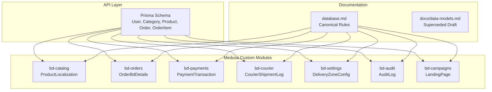

**Diagram sources**
- [schema.prisma:48-151](file://apps/api/prisma/schema.prisma#L48-L151)
- [product-localization.ts:3-17](file://apps/medusa/src/modules/bd-catalog/models/product-localization.ts#L3-L17)
- [order-bd-details.ts:3-39](file://apps/medusa/src/modules/bd-orders/models/order-bd-details.ts#L3-L39)
- [payment-transaction.ts:3-15](file://apps/medusa/src/modules/bd-payments/models/payment-transaction.ts#L3-L15)
- [courier-shipment-log.ts:3-12](file://apps/medusa/src/modules/bd-courier/models/courier-shipment-log.ts#L3-L12)
- [delivery-zone-config.ts:3-14](file://apps/medusa/src/modules/bd-settings/models/delivery-zone-config.ts#L3-L14)
- [audit-log.ts:3-40](file://apps/medusa/src/modules/bd-audit/models/audit-log.ts#L3-L40)
- [landing-page.ts:3-17](file://apps/medusa/src/modules/bd-campaigns/models/landing-page.ts#L3-L17)
- [database.md:172-301](file://database.md#L172-L301)

**Section sources**
- [schema.prisma:1-152](file://apps/api/prisma/schema.prisma#L1-L152)
- [database.md:1-170](file://database.md#L1-L170)

## Core Components
The database has two primary modeling surfaces:

### Prisma Core Commerce Model
The Prisma schema defines five core entities:

| Entity | Primary Key | Main Relationships | Important Constraints |
|---|---|---|---|
| `User` | `id` (`cuid`) | One-to-many `orders` | Unique `email`, unique `phone`, default role `CUSTOMER`, boolean `isActive` |
| `Category` | `id` (`cuid`) | Self-referencing parent-child hierarchy; one-to-many `products` | Unique `slug`; nullable `parentId` with `SetNull` delete behavior |
| `Product` | `id` (`cuid`) | Many-to-one `category`; one-to-many `orderItems` | Unique `slug`, unique `sku`; decimal price fields; boolean `isPublished` |
| `Order` | `id` (`cuid`) | Optional many-to-one `user`; one-to-many `orderItems` | Unique `orderNumber`; enums for status, payment status, payment method; JSON shipping address |
| `OrderItem` | `id` (`cuid`) | Many-to-one `order`; many-to-one `product` | Cascade delete on order; restrict delete on product; decimal unit and total price |

Indexes are defined at the table level for frequently queried columns such as email, phone, slug, category, price, order number, user ID, status, payment status, and timestamps.

### Medusa Custom Module Models
The Medusa custom models add Bangladesh-specific commerce capabilities:

| Module | Model | Purpose |
|---|---|---|
| `bd-catalog` | `ProductLocalization` | Bengali product content, SEO metadata, bilingual completeness flag |
| `bd-orders` | `OrderBdDetails` | Delivery zone, COD verification state, courier dispatch details, financial snapshots, UTM attribution |
| `bd-payments` | `PaymentTransaction` | Payment gateway attempts, provider IDs, transaction types, raw gateway responses |
| `bd-courier` | `CourierShipmentLog` | Courier API request/response audit trail |
| `bd-settings` | `DeliveryZoneConfig` | Flat-rate delivery charges, free-shipping thresholds, SLA ranges, district coverage |
| `bd-audit` | `AuditLog` | Staff/system action ledger with actor, entity, action, old/new values, IP, reason |
| `bd-campaigns` | `LandingPage` | Campaign page metadata, checkout mode, sections, theme tokens, SEO, Meta Pixel ID |

**Section sources**
- [schema.prisma:48-151](file://apps/api/prisma/schema.prisma#L48-L151)
- [product-localization.ts:3-17](file://apps/medusa/src/modules/bd-catalog/models/product-localization.ts#L3-L17)
- [order-bd-details.ts:3-39](file://apps/medusa/src/modules/bd-orders/models/order-bd-details.ts#L3-L39)
- [payment-transaction.ts:3-15](file://apps/medusa/src/modules/bd-payments/models/payment-transaction.ts#L3-L15)
- [courier-shipment-log.ts:3-12](file://apps/medusa/src/modules/bd-courier/models/courier-shipment-log.ts#L3-L12)
- [delivery-zone-config.ts:3-14](file://apps/medusa/src/modules/bd-settings/models/delivery-zone-config.ts#L3-L14)
- [audit-log.ts:3-40](file://apps/medusa/src/modules/bd-audit/models/audit-log.ts#L3-L40)
- [landing-page.ts:3-17](file://apps/medusa/src/modules/bd-campaigns/models/landing-page.ts#L3-L17)

## Architecture Overview
At runtime, the platform combines:

1. **PostgreSQL** as the durable relational store.
2. **Prisma Client** for the API’s core commerce entities.
3. **Medusa v2** for native commerce behavior and custom module extensions.
4. **Seed workflows** that create regions, stores, stock locations, fulfillment sets, shipping options, categories, products, and variants through Medusa APIs rather than direct SQL.

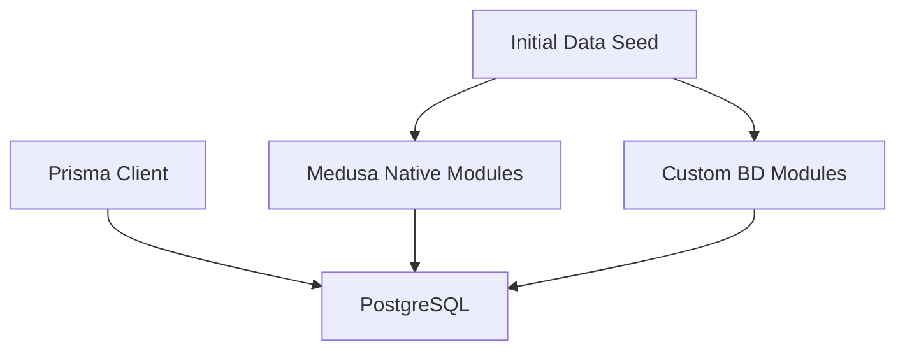

**Diagram sources**
- [schema.prisma:1-8](file://apps/api/prisma/schema.prisma#L1-L8)
- [initial-data-seed.ts:27-34](file://apps/medusa/src/migration-scripts/initial-data-seed.ts#L27-L34)
- [initial-data-seed.ts:42-113](file://apps/medusa/src/migration-scripts/initial-data-seed.ts#L42-L113)

The canonical database document clarifies that Medusa-native tables should not be duplicated by custom code. Custom extension tables use unique foreign keys plus module links instead of hard cross-module foreign keys to Medusa core tables.

**Section sources**
- [database.md:77-86](file://database.md#L77-L86)
- [database.md:172-301](file://database.md#L172-L301)

## Detailed Component Analysis

### Prisma Core Entities

#### User
- Stores identity, authentication hash, optional name and phone, role, activation state, and timestamps.
- Email and phone are unique to support login and contact lookup.
- Orders link back to a user when an authenticated customer places an order.

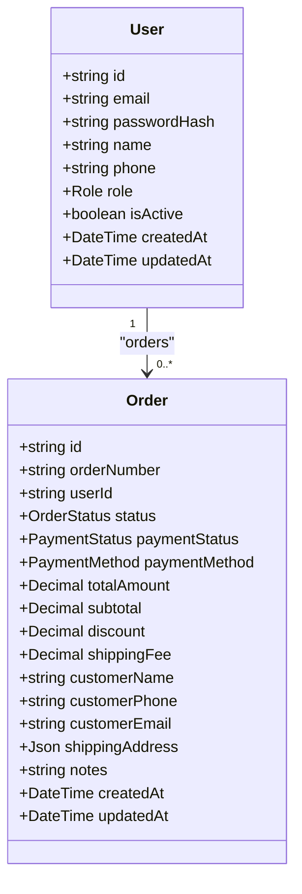

**Diagram sources**
- [schema.prisma:48-63](file://apps/api/prisma/schema.prisma#L48-L63)
- [schema.prisma:108-135](file://apps/api/prisma/schema.prisma#L108-L135)

#### Category
- Supports hierarchical categorization via a self-referencing `parentId`.
- Slug is unique and indexed for URL-friendly navigation.
- Deleting a parent category nulls child references rather than cascading deletes, preserving category structure.

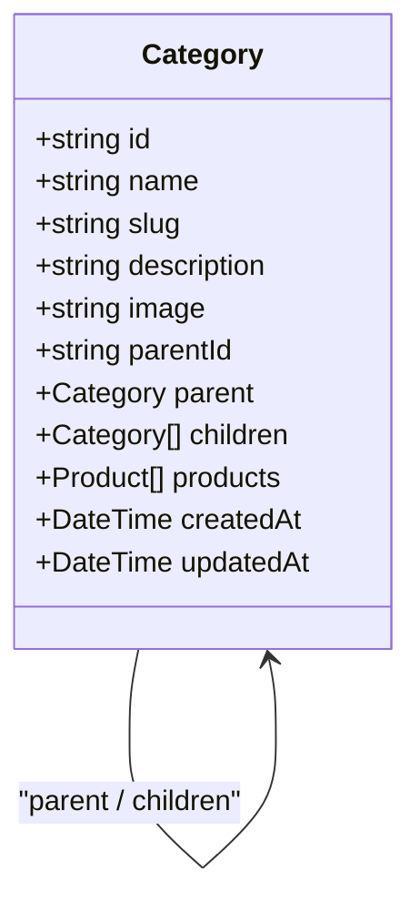

**Diagram sources**
- [schema.prisma:65-81](file://apps/api/prisma/schema.prisma#L65-L81)

#### Product
- Belongs to exactly one category.
- Prices are stored as decimals with two fractional digits.
- SKU and slug are unique identifiers.
- Published flag controls storefront visibility.

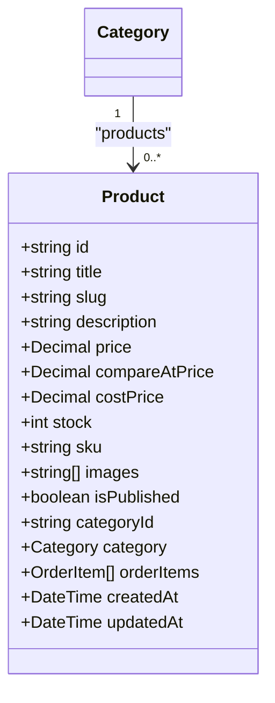

**Diagram sources**
- [schema.prisma:83-106](file://apps/api/prisma/schema.prisma#L83-L106)

#### Order and OrderItem
- An order contains multiple line items.
- Deleting an order cascades its line items.
- Deleting a product is restricted if referenced by existing order items, protecting historical sales data.

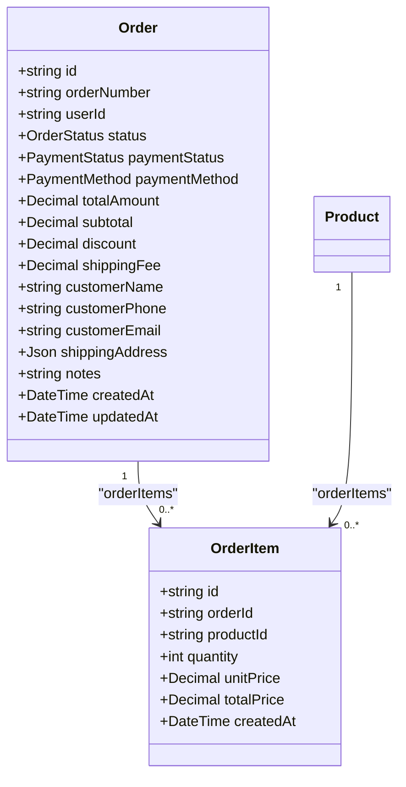

**Diagram sources**
- [schema.prisma:108-151](file://apps/api/prisma/schema.prisma#L108-L151)

**Section sources**
- [schema.prisma:48-151](file://apps/api/prisma/schema.prisma#L48-L151)

### Bangladesh-Specific Custom Models

#### Product Localization
Stores Bengali editorial fields and SEO metadata for products. It also tracks whether bilingual content is complete.

Key points:
- `title_bn`, `subtitle_bn`, `description_bn`, and related fields are nullable.
- Some fields are marked searchable, indicating integration with search indexing.
- `origin_country_bn` defaults to a Bangladesh value.

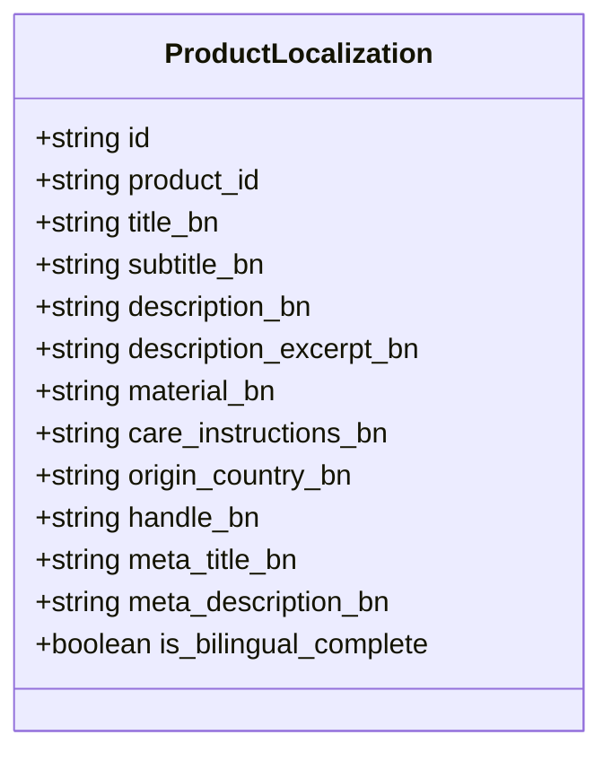

**Diagram sources**
- [product-localization.ts:3-17](file://apps/medusa/src/modules/bd-catalog/models/product-localization.ts#L3-L17)

**Section sources**
- [product-localization.ts:1-20](file://apps/medusa/src/modules/bd-catalog/models/product-localization.ts#L1-L20)

#### Order BD Details
Extends orders with Bangladesh-specific logistics, COD verification, courier information, financial snapshots, and marketing attribution.

Important fields include:
- Division, district, thana, area/street.
- Delivery zone enum.
- COD status, call attempt count, last call timestamp, staff confirmation.
- Shipment state progression.
- Courier provider, consignment ID, tracking code.
- Customer-paid delivery, courier cost, COD remittance, settlement status.
- COGS snapshot total.
- UTM source, medium, campaign, and landing page slug.

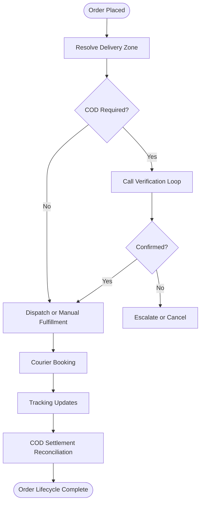

**Diagram sources**
- [order-bd-details.ts:3-39](file://apps/medusa/src/modules/bd-orders/models/order-bd-details.ts#L3-L39)

**Section sources**
- [order-bd-details.ts:1-42](file://apps/medusa/src/modules/bd-orders/models/order-bd-details.ts#L1-L42)

#### Payment Transaction
Captures payment attempts and gateway interactions.

Key aspects:
- Provider IDs include COD, bKash, and Nagad.
- Transaction types include authorization, capture, refund, and status query.
- Amount field uses `bigNumber`, but the canonical database document requires explicit paisa naming and integer validation for custom money columns.
- Raw gateway response is stored as JSON for auditability.

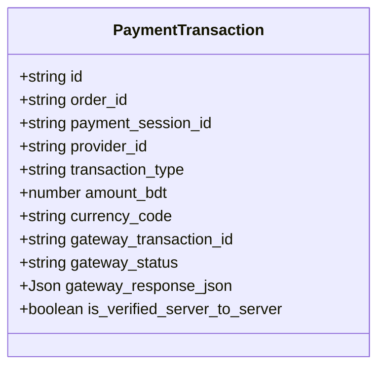

**Diagram sources**
- [payment-transaction.ts:3-15](file://apps/medusa/src/modules/bd-payments/models/payment-transaction.ts#L3-L15)

**Section sources**
- [payment-transaction.ts:1-18](file://apps/medusa/src/modules/bd-payments/models/payment-transaction.ts#L1-L18)

#### Courier Shipment Log
Records outbound and inbound courier API interactions.

Fields include:
- Order reference.
- Courier name.
- Action type.
- Request and response payloads.
- HTTP status code.
- Error message.

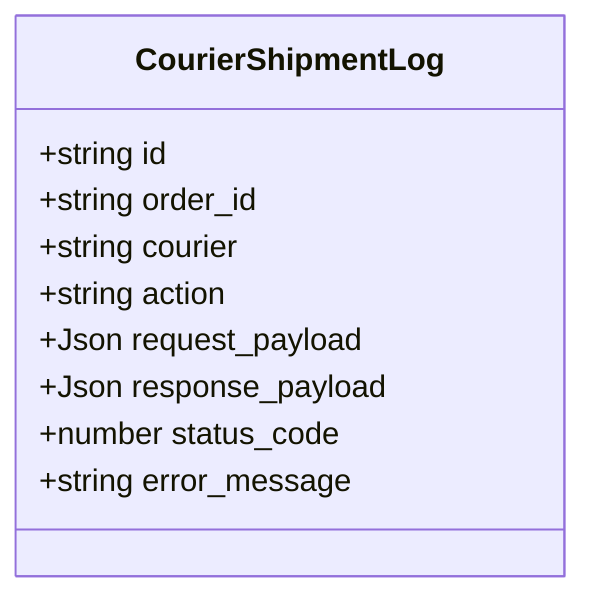

**Diagram sources**
- [courier-shipment-log.ts:3-12](file://apps/medusa/src/modules/bd-courier/models/courier-shipment-log.ts#L3-L12)

**Section sources**
- [courier-shipment-log.ts:1-15](file://apps/medusa/src/modules/bd-courier/models/courier-shipment-log.ts#L1-L15)

#### Delivery Zone Config
Defines flat-rate delivery pricing and SLAs for Bangladesh delivery zones.

Key aspects:
- Zone codes: inside Dhaka, Dhaka suburbs, outside Dhaka.
- Bilingual display names.
- Flat rate and free-shipping threshold stored as big numbers.
- Delivery day range and active flag.
- District coverage stored as JSON.

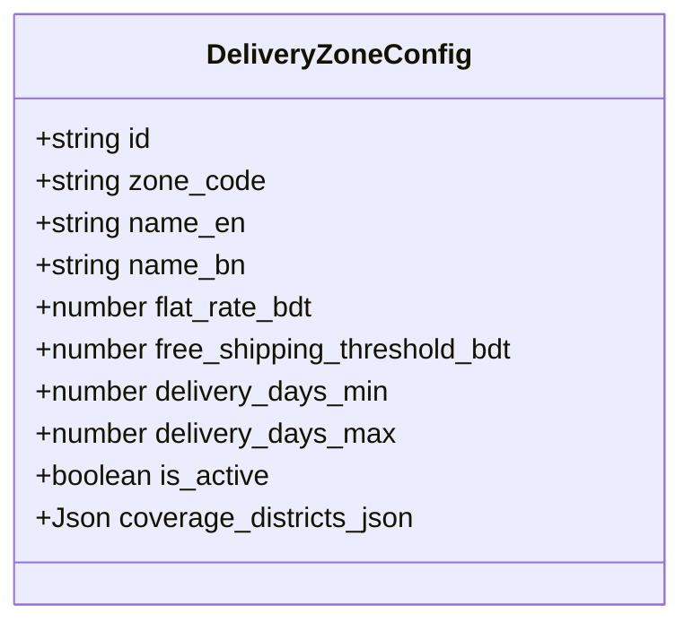

**Diagram sources**
- [delivery-zone-config.ts:3-14](file://apps/medusa/src/modules/bd-settings/models/delivery-zone-config.ts#L3-L14)

**Section sources**
- [delivery-zone-config.ts:1-17](file://apps/medusa/src/modules/bd-settings/models/delivery-zone-config.ts#L1-L17)

#### Audit Log
Provides an append-only-style operational audit record.

Key aspects:
- Actor identity and role.
- Entity type and ID affected.
- Action type.
- Old and new values as JSON.
- Client IP and stated reason.

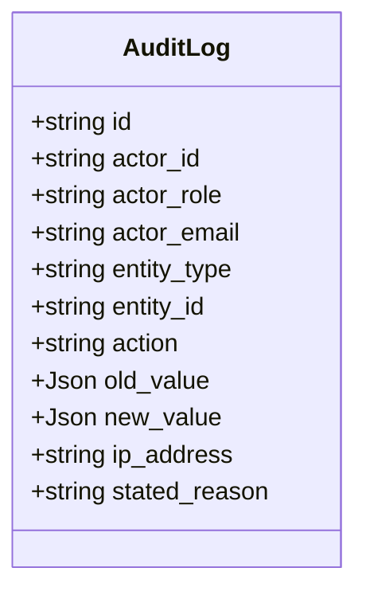

**Diagram sources**
- [audit-log.ts:3-40](file://apps/medusa/src/modules/bd-audit/models/audit-log.ts#L3-L40)

**Section sources**
- [audit-log.ts:1-43](file://apps/medusa/src/modules/bd-audit/models/audit-log.ts#L1-L43)

#### Landing Page
Models campaign landing pages with embedded checkout modes and CMS-like sections.

Key aspects:
- Unique slug.
- Bilingual titles.
- Active flag.
- Featured product reference.
- Checkout mode enum.
- Sections and theme tokens as JSON.
- SEO metadata and Meta Pixel ID.
- Publication timestamp.

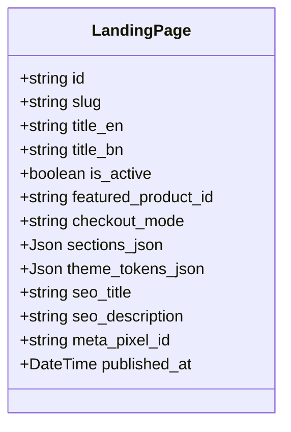

**Diagram sources**
- [landing-page.ts:3-17](file://apps/medusa/src/modules/bd-campaigns/models/landing-page.ts#L3-L17)

**Section sources**
- [landing-page.ts:1-20](file://apps/medusa/src/modules/bd-campaigns/models/landing-page.ts#L1-L20)

## Dependency Analysis
The relationship between core commerce entities and Bangladesh-specific extensions can be understood as follows:

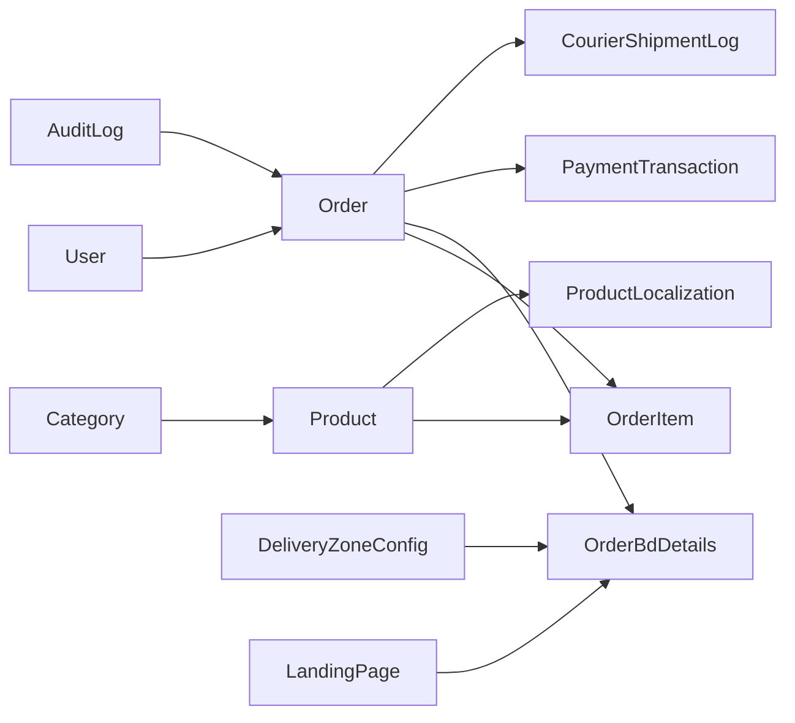

**Diagram sources**
- [schema.prisma:48-151](file://apps/api/prisma/schema.prisma#L48-L151)
- [product-localization.ts:3-17](file://apps/medusa/src/modules/bd-catalog/models/product-localization.ts#L3-L17)
- [order-bd-details.ts:3-39](file://apps/medusa/src/modules/bd-orders/models/order-bd-details.ts#L3-L39)
- [payment-transaction.ts:3-15](file://apps/medusa/src/modules/bd-payments/models/payment-transaction.ts#L3-L15)
- [courier-shipment-log.ts:3-12](file://apps/medusa/src/modules/bd-courier/models/courier-shipment-log.ts#L3-L12)
- [delivery-zone-config.ts:3-14](file://apps/medusa/src/modules/bd-settings/models/delivery-zone-config.ts#L3-L14)
- [audit-log.ts:3-40](file://apps/medusa/src/modules/bd-audit/models/audit-log.ts#L3-L40)
- [landing-page.ts:3-17](file://apps/medusa/src/modules/bd-campaigns/models/landing-page.ts#L3-L17)

Coupling observations:
- Core Prisma entities are tightly coupled within the API layer.
- Custom Medusa models extend core entities conceptually but are defined independently per module.
- The canonical database document recommends avoiding direct foreign-key coupling to Medusa core tables; relationships should use unique columns and module links where applicable.

**Section sources**
- [database.md:77-86](file://database.md#L77-L86)
- [database.md:172-301](file://database.md#L172-L301)

## Performance Considerations
Indexing and query performance are addressed at both layers:

### Prisma Indexes
- `User`: email, phone.
- `Category`: slug, parentId.
- `Product`: slug, categoryId, price, isPublished.
- `Order`: orderNumber, userId, status, paymentStatus, createdAt.
- `OrderItem`: orderId, productId.

These indexes support common lookups such as user login, category navigation, product filtering, order management, and order-line queries.

### Money Representation and Precision
The canonical database document specifies:
- Medusa core amounts use major units (BDT).
- Custom BD tables should use integer paisa with explicit `_paisa` suffixes.
- `model.bigNumber()` creates a numeric column plus a JSONB raw column, not a `bigint`.
- Integer checks should enforce non-negative paisa values.

The current Prisma schema uses `Decimal` for monetary fields, while some custom models use `bigNumber` without the canonical `_paisa` suffix convention. This is a design gap that should be reconciled against `database.md`.

### Query Optimization Recommendations
- Keep high-cardinality filters on indexed columns: email, phone, slug, orderNumber, status, paymentStatus.
- Avoid selecting large JSON fields unless required.
- Use pagination for order lists and product catalogs.
- Partition very large append-only tables such as audit logs and webhook/event logs if growth justifies it.
- Ensure search projections exclude sensitive financial fields like COGS.

**Section sources**
- [schema.prisma:48-151](file://apps/api/prisma/schema.prisma#L48-L151)
- [database.md:88-124](file://database.md#L88-L124)

## Troubleshooting Guide

### Common Schema Issues
| Symptom | Likely Cause | Resolution |
|---|---|---|
| Duplicate email or phone errors | Unique constraints on `User.email` and `User.phone` | Normalize input before insert or update |
| Cannot delete a product | `OrderItem.product` has `onDelete: Restrict` | Remove or archive order items first, or change business policy |
| Parent category deletion leaves orphan children | `Category.parent` uses `SetNull` | Review child categories and reassign parents if needed |
| Order totals mismatch | Financial snapshots not aligned with core totals | Reconcile through canonical money conversion helpers |
| Payment amount precision issues | Paisa vs major-unit confusion | Convert at module boundaries using canonical money helpers |
| Missing Bangladesh address codes | Address extension not created | Create `address_bd_detail` row linked to native address |
| COD escalation not triggered | Call attempt counter not incremented | Verify call log workflow updates order details |

### Security and Privacy Checks
- Ensure PII such as phone numbers and addresses are handled according to the canonical privacy rules.
- Confirm that audit logs capture sensitive changes without exposing secrets.
- Validate that webhook payloads are redacted appropriately.
- Check that Meta Pixel IDs and other integrations are managed centrally rather than duplicated per landing page if the canonical design requires a single pixel.

**Section sources**
- [schema.prisma:48-151](file://apps/api/prisma/schema.prisma#L48-L151)
- [database.md:77-86](file://database.md#L77-L86)
- [database.md:88-124](file://database.md#L88-L124)

## Conclusion
The BD Commerce Platform database design combines a straightforward Prisma core model with Medusa-based Bangladesh-specific extensions. The Prisma layer provides strong foundational entities for users, categories, products, orders, and order items. The Medusa custom models add delivery zones, COD verification, courier logs, payment transaction logs, landing pages, and audit logging.

For production readiness, the implementation should align closely with the canonical database specification in `database.md`, especially regarding:
- Money representation in paisa for custom tables.
- Enum vs configuration table decisions.
- Module links instead of direct foreign-key coupling to Medusa core tables.
- Append-only audit and webhook/event logs.
- Migration and seed strategies that use Medusa workflows rather than ad-hoc SQL.

## Appendices

### Migration Strategy and Version Management
The canonical document prescribes:
1. Scaffold custom modules with DML models, services, and module definitions.
2. Register modules in Medusa configuration.
3. Define module links for associations between Medusa core entities and custom tables.
4. Run migrations to create tables and sync links.
5. Seed initial Bangladesh-specific data such as delivery zones, VAT settings, and admin roles.
6. Verify schema integrity after build and migration.

The seed script demonstrates how Medusa workflows create regions, stores, stock locations, fulfillment sets, shipping options, categories, products, and variants.

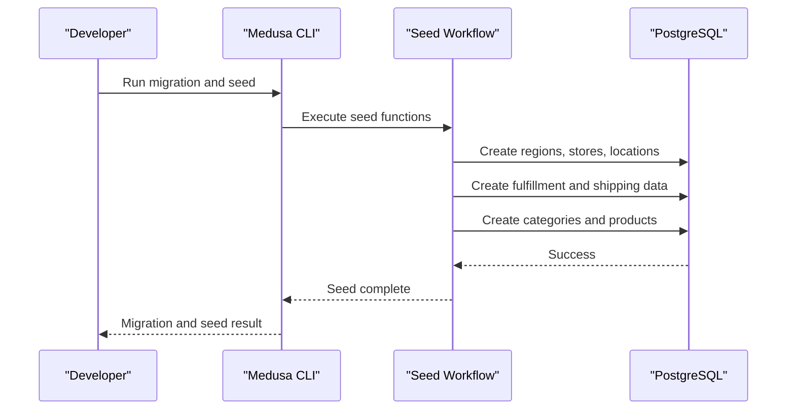

**Diagram sources**
- [initial-data-seed.ts:27-34](file://apps/medusa/src/migration-scripts/initial-data-seed.ts#L27-L34)
- [initial-data-seed.ts:42-113](file://apps/medusa/src/migration-scripts/initial-data-seed.ts#L42-L113)
- [initial-data-seed.ts:125-298](file://apps/medusa/src/migration-scripts/initial-data-seed.ts#L125-L298)
- [initial-data-seed.ts:300-529](file://apps/medusa/src/migration-scripts/initial-data-seed.ts#L300-L529)

**Section sources**
- [database.md:377-385](file://database.md#L377-L385)
- [initial-data-seed.ts:27-113](file://apps/medusa/src/migration-scripts/initial-data-seed.ts#L27-L113)
- [initial-data-seed.ts:125-298](file://apps/medusa/src/migration-scripts/initial-data-seed.ts#L125-L298)
- [initial-data-seed.ts:300-529](file://apps/medusa/src/migration-scripts/initial-data-seed.ts#L300-L529)