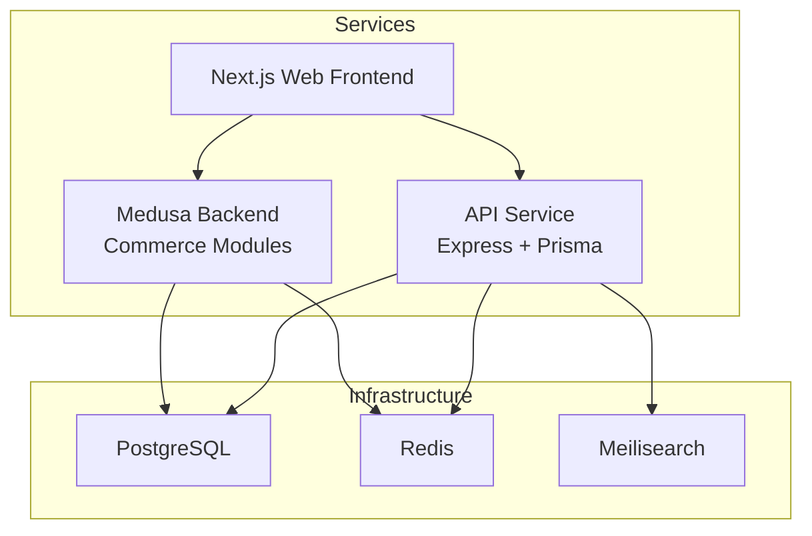
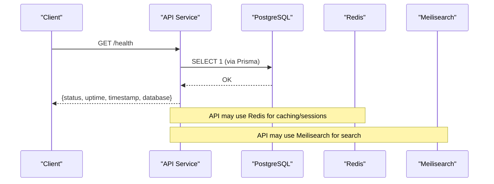
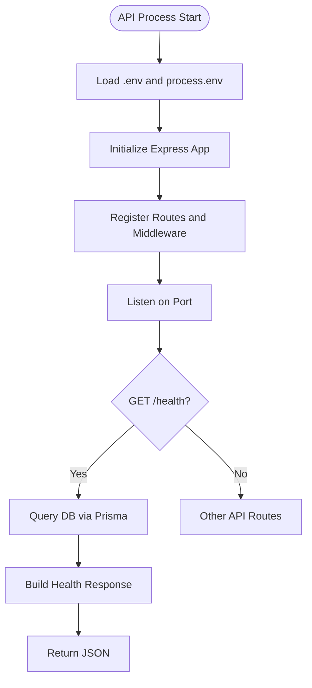
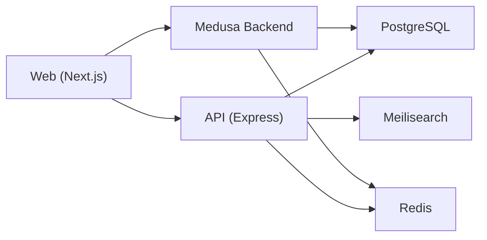

# Deployment & Operations

<cite>
**Referenced Files in This Document**
- [docker-compose.yml](file://docker-compose.yml)
- [main.ts](file://apps/api/src/main.ts)
- [prisma.ts](file://apps/api/src/lib/prisma.ts)
- [medusa-config.ts](file://apps/medusa/medusa-config.ts)
- [instrumentation.ts](file://apps/medusa/instrumentation.ts)
- [next.config.mjs](file://apps/web/next.config.mjs)
- [package.json (API)](file://apps/api/package.json)
- [package.json (Medusa)](file://apps/medusa/package.json)
- [package.json (Web)](file://apps/web/package.json)
</cite>

## Table of Contents
1. Introduction
2. Project Structure
3. Core Components
4. Architecture Overview
5. Detailed Component Analysis
6. Dependency Analysis
7. Performance Considerations
8. Troubleshooting Guide
9. Conclusion
10. Appendices

## Introduction
This document provides deployment and operations guidance for the BD Commerce Platform, focusing on Docker containerization, service orchestration with Docker Compose, environment configuration, inter-service communication, monitoring and health checks, logging, alerting, scaling, load balancing, disaster recovery, security hardening, and operational runbooks. It is intended for platform operators, SREs, and developers responsible for production readiness.

## Project Structure
The platform consists of:
- API service (Express + Prisma)
- Medusa commerce backend (modules enabled)
- Next.js web frontend
- Shared infrastructure services: PostgreSQL, Redis, Meilisearch

**Diagram sources**
- [docker-compose.yml:1-77](file://docker-compose.yml#L1-L77)
- [main.ts:1-55](file://apps/api/src/main.ts#L1-L55)
- [medusa-config.ts:1-46](file://apps/medusa/medusa-config.ts#L1-L46)
- [next.config.mjs:1-15](file://apps/web/next.config.mjs#L1-L15)

**Section sources**
- [docker-compose.yml:1-77](file://docker-compose.yml#L1-L77)
- [package.json (API):1-34](file://apps/api/package.json#L1-L34)
- [package.json (Medusa):1-61](file://apps/medusa/package.json#L1-L61)
- [package.json (Web):1-28](file://apps/web/package.json#L1-L28)

## Core Components
- Infrastructure services
  - PostgreSQL: relational data store with health check and persistent volume
  - Redis: caching/session store with optional password protection and health check
  - Meilisearch: search engine with master key and health endpoint
- Application services
  - API service: Express server with Prisma client, CORS, JSON parsing, and a /health endpoint
  - Medusa backend: commerce engine with modules, environment-driven config, and OpenTelemetry instrumentation stub
  - Web frontend: Next.js app with strict mode and remote image allowlist

Key runtime behaviors:
- API reads environment variables from root .env and process.env; exposes /health that probes the database via Prisma
- Medusa loads environment files and configures databaseUrl, redisUrl, CORS, and secrets
- Web app uses Next.js defaults and allows remote images over HTTPS

**Section sources**
- [docker-compose.yml:1-77](file://docker-compose.yml#L1-L77)
- [main.ts:1-55](file://apps/api/src/main.ts#L1-L55)
- [prisma.ts:1-14](file://apps/api/src/lib/prisma.ts#L1-L14)
- [medusa-config.ts:1-46](file://apps/medusa/medusa-config.ts#L1-L46)
- [instrumentation.ts:1-24](file://apps/medusa/instrumentation.ts#L1-L24)
- [next.config.mjs:1-15](file://apps/web/next.config.mjs#L1-L15)

## Architecture Overview
The system deploys three application services alongside shared infrastructure. Containers communicate over a dedicated bridge network. Health checks ensure service readiness. Environment variables drive configuration per service.

**Diagram sources**
- [main.ts:18-35](file://apps/api/src/main.ts#L18-L35)
- [docker-compose.yml:1-77](file://docker-compose.yml#L1-L77)

## Detailed Component Analysis

### Docker Compose Orchestration
- Services: postgres, redis, meilisearch
- Networking: single bridge network bd_commerce_network
- Volumes: persistent storage for postgres, redis, meilisearch
- Health checks: pg_isready, redis-cli ping, curl to /health
- Ports: configurable via environment variables with defaults

Operational notes:
- Use environment variable overrides for ports and credentials
- Ensure volumes are backed up for disaster recovery
- Restrict port exposure in production behind a reverse proxy

**Section sources**
- [docker-compose.yml:1-77](file://docker-compose.yml#L1-L77)

### API Service (Express + Prisma)
Responsibilities:
- HTTP server with CORS and JSON parsing
- Health endpoint that validates database connectivity
- Environment-driven port selection

Runtime behavior:
- Loads environment from root .env and process.env
- Exposes /health returning status, uptime, timestamp, and database state
- Uses Prisma client with log levels controlled by NODE_ENV

**Diagram sources**
- [main.ts:1-55](file://apps/api/src/main.ts#L1-L55)
- [prisma.ts:1-14](file://apps/api/src/lib/prisma.ts#L1-L14)

**Section sources**
- [main.ts:1-55](file://apps/api/src/main.ts#L1-L55)
- [prisma.ts:1-14](file://apps/api/src/lib/prisma.ts#L1-L14)
- [package.json (API):1-34](file://apps/api/package.json#L1-L34)

### Medusa Backend
Responsibilities:
- Commerce engine with multiple custom modules
- Environment-driven configuration for database, Redis, CORS, and secrets
- Optional OpenTelemetry instrumentation

Configuration highlights:
- Loads environment files for current and project directories
- Configures databaseUrl and redisUrl
- Sets CORS policies for store/admin/auth endpoints
- Enables admin UI and registers modules

Observability:
- Instrumentation file includes commented OpenTelemetry setup ready to enable

**Section sources**
- [medusa-config.ts:1-46](file://apps/medusa/medusa-config.ts#L1-L46)
- [instrumentation.ts:1-24](file://apps/medusa/instrumentation.ts#L1-L24)
- [package.json (Medusa):1-61](file://apps/medusa/package.json#L1-L61)

### Web Frontend (Next.js)
Responsibilities:
- Serve the storefront
- Strict React mode enabled
- Remote image loading restricted to HTTPS origins

Operational notes:
- Typically runs behind a reverse proxy or CDN in production
- Configure environment variables for API base URLs at build/runtime as needed

**Section sources**
- [next.config.mjs:1-15](file://apps/web/next.config.mjs#L1-L15)
- [package.json (Web):1-28](file://apps/web/package.json#L1-L28)

## Dependency Analysis
Service dependencies and integration points:
- API depends on PostgreSQL (Prisma), Redis (ioredis), and Meilisearch (meilisearch SDK)
- Medusa depends on PostgreSQL and Redis
- Web depends on API and Medusa through HTTP calls

**Diagram sources**
- [package.json (API):16-23](file://apps/api/package.json#L16-L23)
- [docker-compose.yml:1-77](file://docker-compose.yml#L1-L77)
- [medusa-config.ts:9-10](file://apps/medusa/medusa-config.ts#L9-L10)

**Section sources**
- [package.json (API):16-23](file://apps/api/package.json#L16-L23)
- [docker-compose.yml:1-77](file://docker-compose.yml#L1-L77)
- [medusa-config.ts:1-46](file://apps/medusa/medusa-config.ts#L1-L46)

## Performance Considerations
- Database connection pooling: tune Prisma pool size based on CPU cores and workload; monitor connection saturation
- Redis usage: leverage for caching and sessions; set appropriate memory limits and eviction policies
- Search indexing: keep Meilisearch indexes updated; consider incremental reindexing strategies
- API concurrency: adjust worker processes or threads if using a process manager; tune event loop backpressure
- Frontend optimization: enable static generation where possible; configure CDN for assets and images
- Observability: enable OpenTelemetry in Medusa for tracing and metrics; integrate with a collector and dashboard

[No sources needed since this section provides general guidance]

## Troubleshooting Guide
Common issues and resolutions:
- API /health reports database disconnected
  - Verify PostgreSQL container is healthy and reachable
  - Check DATABASE_URL and Prisma schema migrations
  - Review logs for connection timeouts or auth failures
- Redis connectivity errors
  - Confirm REDIS_URL and REDIS_PASSWORD are set correctly
  - Validate firewall rules and network access between containers
- Meilisearch health failing
  - Ensure MEILI_MASTER_KEY is configured and matches client settings
  - Check /health endpoint availability and network reachability
- CORS errors between Web and APIs
  - Align STORE_CORS/ADMIN_CORS/AUTH_CORS with actual frontend domains
  - Validate reverse proxy headers and origin handling
- High latency or timeouts
  - Inspect database query performance and indexes
  - Enable query logging in development; analyze slow queries
  - Monitor Redis and Meilisearch resource utilization

Operational checks:
- Use docker compose ps and logs to inspect service states
- Run health checks manually against exposed ports or internal service names
- Validate environment variables loaded by each service

**Section sources**
- [main.ts:18-35](file://apps/api/src/main.ts#L18-L35)
- [docker-compose.yml:14-64](file://docker-compose.yml#L14-L64)
- [medusa-config.ts:11-17](file://apps/medusa/medusa-config.ts#L11-L17)

## Conclusion
The BD Commerce Platform is containerized with clear separation of concerns across API, Medusa, and Web services, orchestrated via Docker Compose. Health checks, environment-driven configuration, and modular architecture support scalable and maintainable operations. Production deployments should add reverse proxies, TLS termination, centralized logging, metrics, and alerting, while enforcing least-privilege access and secure secret management.

[No sources needed since this section summarizes without analyzing specific files]

## Appendices

### Environment Variables Management
- API service
  - PORT/API_PORT: server listen port
  - NODE_ENV: controls Prisma logging verbosity
  - DATABASE_URL: PostgreSQL connection string
  - REDIS_URL: Redis connection string
  - MEILISEARCH_HOST: Meilisearch host
- Medusa backend
  - DATABASE_URL, REDIS_URL
  - STORE_CORS, ADMIN_CORS, AUTH_CORS
  - JWT_SECRET, COOKIE_SECRET
- Infrastructure
  - POSTGRES_USER, POSTGRES_PASSWORD, POSTGRES_DB, POSTGRES_PORT
  - REDIS_PASSWORD, REDIS_PORT
  - MEILI_MASTER_KEY, MEILI_ENV, MEILISEARCH_PORT

Best practices:
- Use a secrets manager or encrypted env files in production
- Never commit secrets to version control
- Rotate secrets regularly and validate them during CI

**Section sources**
- [main.ts:1-13](file://apps/api/src/main.ts#L1-L13)
- [prisma.ts:8-11](file://apps/api/src/lib/prisma.ts#L8-L11)
- [medusa-config.ts:4-17](file://apps/medusa/medusa-config.ts#L4-L17)
- [docker-compose.yml:6-55](file://docker-compose.yml#L6-L55)

### Service Discovery and Inter-Service Communication
- Service discovery: rely on Docker Compose DNS within bd_commerce_network
- Communication patterns:
  - Web to API/Medusa via HTTP(S)
  - API to PostgreSQL, Redis, Meilisearch via TCP/HTTP
- Recommendations:
  - Use service names instead of localhost in containerized environments
  - Enforce timeouts and retries at the client layer
  - Add circuit breakers for external integrations

**Section sources**
- [docker-compose.yml:19-64](file://docker-compose.yml#L19-L64)
- [package.json (API):16-23](file://apps/api/package.json#L16-L23)

### Monitoring and Health Checks
- Infrastructure health checks:
  - PostgreSQL: pg_isready
  - Redis: redis-cli ping
  - Meilisearch: curl /health
- Application health:
  - API /health endpoint returns status, uptime, timestamp, and database state
- Observability:
  - Enable OpenTelemetry in Medusa for traces and metrics
  - Integrate with a metrics stack (e.g., Prometheus/Grafana) and tracing backend

**Section sources**
- [docker-compose.yml:14-64](file://docker-compose.yml#L14-L64)
- [main.ts:18-35](file://apps/api/src/main.ts#L18-L35)
- [instrumentation.ts:1-24](file://apps/medusa/instrumentation.ts#L1-L24)

### Logging Strategy
- API:
  - Prisma logs: query/error/warn in development; error only in production
  - Application logs: structured JSON logs recommended
- Medusa:
  - Enable OpenTelemetry for request/workflow/query spans
- Centralization:
  - Ship logs to a centralized system (e.g., Loki, CloudWatch, Datadog)
  - Correlate logs with trace IDs

**Section sources**
- [prisma.ts:8-11](file://apps/api/src/lib/prisma.ts#L8-L11)
- [instrumentation.ts:1-24](file://apps/medusa/instrumentation.ts#L1-L24)

### Alerting Configuration
- Define alerts for:
  - Service down (health check failures)
  - Database connection errors
  - High error rates and latency spikes
  - Disk/memory exhaustion on infrastructure services
- Integrate with notification channels (Slack, PagerDuty, email)

[No sources needed since this section provides general guidance]

### Scaling Considerations
- Horizontal scaling:
  - Scale API and Medusa replicas behind a load balancer
  - Use sticky sessions if required by session strategy
- Stateful services:
  - Keep PostgreSQL, Redis, Meilisearch as single instances or managed clusters
  - Use read replicas for PostgreSQL if needed
- Auto-scaling:
  - Implement HPA based on CPU/memory or custom metrics
  - Pre-warm caches and connections on scale-up

[No sources needed since this section provides general guidance]

### Load Balancing Approaches
- Ingress controller or reverse proxy (NGINX/Traefik/HAProxy)
- Health-based routing and failover
- Rate limiting and request throttling at the edge

[No sources needed since this section provides general guidance]

### Disaster Recovery Procedures
- Backups:
  - Schedule regular backups of PostgreSQL, Redis, and Meilisearch volumes
  - Test restore procedures periodically
- Failover:
  - Define RTO/RPO targets
  - Automate failover for critical services where feasible
- Data integrity:
  - Validate checksums and consistency post-restore
  - Rebuild search indexes after recovery

[No sources needed since this section provides general guidance]

### Security Hardening
- Secrets management:
  - Use environment-specific secret stores; avoid plaintext .env in production
- Network security:
  - Restrict port exposure; route traffic through reverse proxy
  - Apply firewall rules to limit inbound/outbound traffic
- TLS/SSL:
  - Terminate TLS at the reverse proxy or ingress
  - Enforce HTTPS for all services
- Access control:
  - Least privilege for service accounts and database users
  - Secure Meilisearch with master key and restrict admin endpoints
- CORS:
  - Whitelist allowed origins per environment
  - Validate and sanitize inputs at API boundaries

**Section sources**
- [medusa-config.ts:11-17](file://apps/medusa/medusa-config.ts#L11-L17)
- [docker-compose.yml:6-55](file://docker-compose.yml#L6-L55)

### Operational Runbooks
- Deploy changes:
  - Build and tag images; update compose or orchestrator manifests
  - Run migrations before rolling restarts
- Restart services:
  - Graceful restarts with zero downtime using rolling updates
- Rollback:
  - Maintain previous image tags; revert manifests and redeploy
- Maintenance tasks:
  - Rotate secrets and certificates
  - Update dependencies and apply security patches
- Incident response:
  - Triage via health checks and logs
  - Escalate based on severity and SLAs

[No sources needed since this section provides general guidance]

### Performance Tuning Guidelines
- Database:
  - Tune connection pool sizes and query cache
  - Analyze slow queries and add indexes
- Redis:
  - Set maxmemory and eviction policies
  - Monitor hit ratio and latency
- Meilisearch:
  - Optimize index settings and batch updates
- API:
  - Enable compression and caching headers
  - Profile hot paths and optimize I/O

[No sources needed since this section provides general guidance]