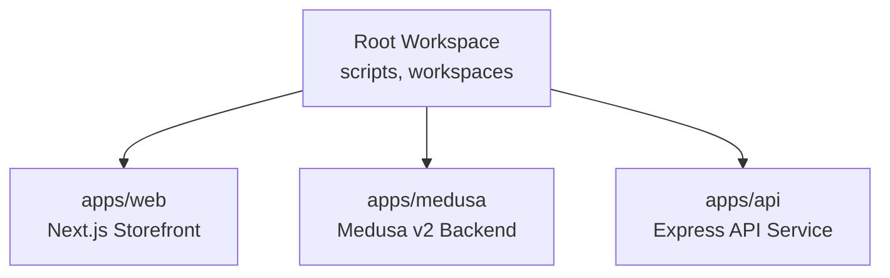
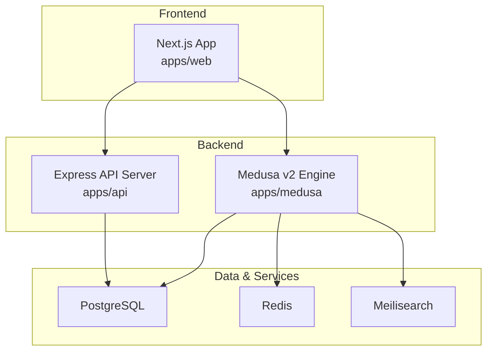
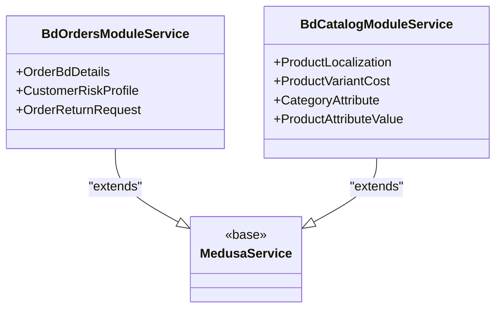
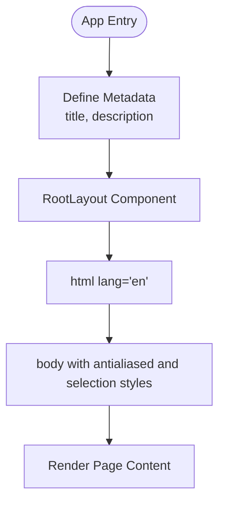
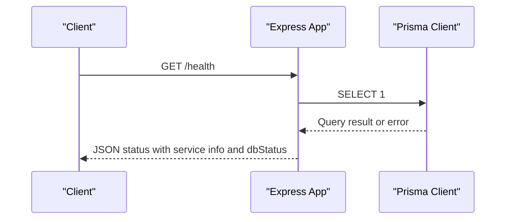
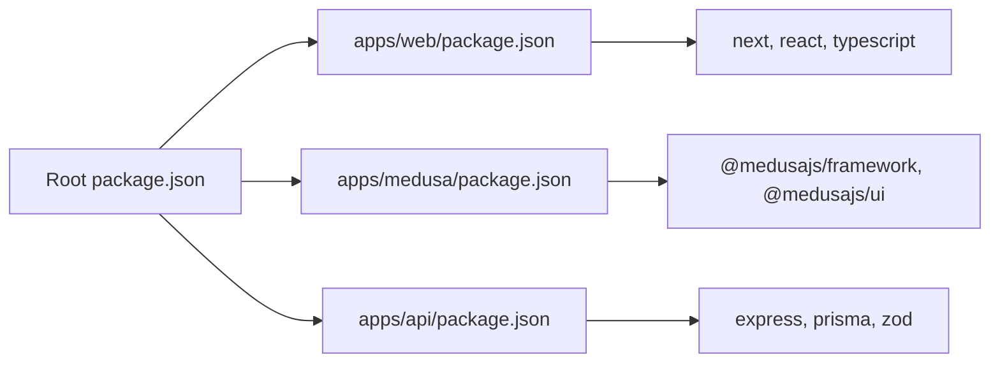

# Developer Guidelines

<cite>
**Referenced Files in This Document**
- [package.json](file://package.json)
- [apps/api/package.json](file://apps/api/package.json)
- [apps/medusa/package.json](file://apps/medusa/package.json)
- [apps/web/package.json](file://apps/web/package.json)
- [apps/medusa/eslint.config.ts](file://apps/medusa/eslint.config.ts)
- [apps/web/tsconfig.json](file://apps/web/tsconfig.json)
- [apps/api/tsconfig.json](file://apps/api/tsconfig.json)
- [apps/medusa/src/modules/README.md](file://apps/medusa/src/modules/README.md)
- [apps/medusa/src/modules/bd-orders/service.ts](file://apps/medusa/src/modules/bd-orders/service.ts)
- [apps/medusa/src/modules/bd-catalog/service.ts](file://apps/medusa/src/modules/bd-catalog/service.ts)
- [apps/web/src/app/layout.tsx](file://apps/web/src/app/layout.tsx)
- [apps/api/src/main.ts](file://apps/api/src/main.ts)
- [quality-checklist.md](file://quality-checklist.md)
</cite>

## Table of Contents
1. [Introduction](#introduction)
2. [Project Structure](#project-structure)
3. [Core Components](#core-components)
4. [Architecture Overview](#architecture-overview)
5. [Detailed Component Analysis](#detailed-component-analysis)
6. [Dependency Analysis](#dependency-analysis)
7. [Performance Considerations](#performance-considerations)
8. [Troubleshooting Guide](#troubleshooting-guide)
9. [Conclusion](#conclusion)
10. [Appendices](#appendices)

## Introduction
This document provides comprehensive developer guidelines for contributing to the BD Commerce Platform. It covers code style conventions, TypeScript best practices, ESLint configuration standards, Git workflow and branching strategies, commit message conventions, pull request processes, module development standards, naming conventions, architectural patterns, code review guidelines, documentation standards, quality checklist items, debugging techniques, profiling tools, performance optimization practices, contribution process, issue reporting guidelines, and community interaction standards.

The platform is a monorepo with three primary applications:
- Medusa commerce backend (apps/medusa)
- Next.js storefront (apps/web)
- Express API service (apps/api)

All contributors should read this guide before making changes and align their work with the established quality and security requirements defined in the repository’s quality checklist.

## Project Structure
The repository uses npm workspaces to manage multiple apps under apps/. The root package.json defines shared scripts for development, building, and Docker operations across all applications. Each app has its own package.json with application-specific dependencies and scripts.

**Diagram sources**
- [package.json:1-39](file://package.json#L1-L39)

Key responsibilities:
- apps/web: Next.js frontend with React 19, Tailwind CSS, and TypeScript.
- apps/medusa: Medusa v2 commerce engine with custom modules and admin integrations.
- apps/api: Express-based API service using Prisma and environment-driven configuration.

**Section sources**
- [package.json:1-39](file://package.json#L1-L39)
- [apps/web/package.json:1-28](file://apps/web/package.json#L1-L28)
- [apps/medusa/package.json:1-61](file://apps/medusa/package.json#L1-L61)
- [apps/api/package.json:1-34](file://apps/api/package.json#L1-L34)

## Core Components
This section outlines core components and how they fit into the platform’s architecture.

- Medusa Modules: Reusable business capabilities such as orders, catalog, payments, courier, settings, and audit. Each module follows Medusa’s module pattern with models, services, migrations, and index definitions.
- Next.js Storefront: Provides the customer-facing UI with metadata, layout, and styling via Tailwind.
- Express API: A lightweight API server exposing health checks and basic endpoints, configured with environment variables and Prisma client.

Module development standards:
- Define data models under each module’s models directory.
- Implement a service class extending MedusaService that exposes domain methods.
- Export a module definition from index.ts and register it in Medusa configuration.
- Generate and run migrations for schema changes.

Naming conventions:
- Module folders use kebab-case with bd- prefix (e.g., bd-orders, bd-catalog).
- Service classes are PascalCase and descriptive (e.g., BdOrdersModuleService).
- Model files are snake_case or kebab-case consistent with database table names.

Architectural patterns:
- Domain-driven modules encapsulate related entities and behaviors.
- Services act as the single source of truth for business logic.
- Migrations ensure schema evolution and reproducibility.

**Section sources**
- [apps/medusa/src/modules/README.md:1-118](file://apps/medusa/src/modules/README.md#L1-L118)
- [apps/medusa/src/modules/bd-orders/service.ts:1-13](file://apps/medusa/src/modules/bd-orders/service.ts#L1-L13)
- [apps/medusa/src/modules/bd-catalog/service.ts:1-15](file://apps/medusa/src/modules/bd-catalog/service.ts#L1-L15)
- [apps/web/src/app/layout.tsx:1-22](file://apps/web/src/app/layout.tsx#L1-L22)
- [apps/api/src/main.ts:1-55](file://apps/api/src/main.ts#L1-L55)

## Architecture Overview
The system comprises three main layers:
- Frontend (Next.js): Renders pages, manages state, and calls APIs.
- Commerce Backend (Medusa v2): Orchestrates commerce workflows, modules, and admin extensions.
- API Service (Express): Provides additional endpoints and integrates with external systems.

[No sources needed since this diagram shows conceptual workflow, not actual code structure]

## Detailed Component Analysis

### Medusa Module Pattern
Modules encapsulate domain functionality. Each module includes:
- Data model(s) defining tables and relationships.
- Service class extending MedusaService to expose domain methods.
- Index file exporting module definition and service registration.
- Migration files for schema evolution.

**Diagram sources**
- [apps/medusa/src/modules/bd-orders/service.ts:1-13](file://apps/medusa/src/modules/bd-orders/service.ts#L1-L13)
- [apps/medusa/src/modules/bd-catalog/service.ts:1-15](file://apps/medusa/src/modules/bd-catalog/service.ts#L1-L15)
- [apps/medusa/src/modules/README.md:26-42](file://apps/medusa/src/modules/README.md#L26-L42)

**Section sources**
- [apps/medusa/src/modules/README.md:1-118](file://apps/medusa/src/modules/README.md#L1-L118)
- [apps/medusa/src/modules/bd-orders/service.ts:1-13](file://apps/medusa/src/modules/bd-orders/service.ts#L1-L13)
- [apps/medusa/src/modules/bd-catalog/service.ts:1-15](file://apps/medusa/src/modules/bd-catalog/service.ts#L1-L15)

### Next.js Storefront Layout
The Next.js app sets global metadata and layout. It configures language attributes, base styles, and selection colors.

**Diagram sources**
- [apps/web/src/app/layout.tsx:1-22](file://apps/web/src/app/layout.tsx#L1-L22)

**Section sources**
- [apps/web/src/app/layout.tsx:1-22](file://apps/web/src/app/layout.tsx#L1-L22)

### Express API Health Check Flow
The Express API initializes middleware, loads environment variables, and exposes a health endpoint that verifies database connectivity.

**Diagram sources**
- [apps/api/src/main.ts:1-55](file://apps/api/src/main.ts#L1-L55)

**Section sources**
- [apps/api/src/main.ts:1-55](file://apps/api/src/main.ts#L1-L55)

## Dependency Analysis
The workspace defines shared scripts and isolates dependencies per app.

**Diagram sources**
- [package.json:1-39](file://package.json#L1-L39)
- [apps/web/package.json:1-28](file://apps/web/package.json#L1-L28)
- [apps/medusa/package.json:1-61](file://apps/medusa/package.json#L1-L61)
- [apps/api/package.json:1-34](file://apps/api/package.json#L1-L34)

**Section sources**
- [package.json:1-39](file://package.json#L1-L39)
- [apps/web/package.json:1-28](file://apps/web/package.json#L1-L28)
- [apps/medusa/package.json:1-61](file://apps/medusa/package.json#L1-L61)
- [apps/api/package.json:1-34](file://apps/api/package.json#L1-L34)

## Performance Considerations
- Frontend performance budgets and Core Web Vitals must be validated during testing.
- Images should be optimized (WebP/AVIF), served with explicit dimensions, and lazy-loaded where appropriate.
- Avoid unnecessary re-renders in React components; leverage memoization and proper state management.
- Use caching strategically at both CDN and application levels.
- Monitor LCP, CLS, and INP metrics in CI and pre-release environments.

[No sources needed since this section provides general guidance]

## Troubleshooting Guide
Common issues and resolutions:
- Environment variables: Ensure .env files are present and secrets are not committed. Verify required variables exist for Medusa and API services.
- Database connectivity: Confirm PostgreSQL is running and credentials are correct. Use the API health endpoint to verify DB status.
- Migration failures: Run Medusa migrations on a clean test database and validate schema integrity.
- Module registration: Ensure modules are registered in Medusa configuration and migrations are generated and applied.
- Linting errors: Fix ESLint violations in Medusa modules using the recommended plugin rules.

Quality checklist alignment:
- Follow the verification rules and priority tiers defined in the quality checklist.
- Evidence-based sign-off is required for all checks; include terminal output, logs, or screenshots.
- Security checks include input sanitization, rate limiting, secret masking, and RBAC enforcement.

**Section sources**
- [quality-checklist.md:1-657](file://quality-checklist.md#L1-L657)

## Conclusion
Contributors should adhere to the established code style, TypeScript configuration, ESLint standards, and module development patterns. Follow the Git workflow, commit conventions, and PR processes outlined below. Prioritize quality, security, and performance throughout development and testing phases.

[No sources needed since this section summarizes without analyzing specific files]

## Appendices

### Code Style Conventions
- Prefer TypeScript strict mode across all apps.
- Use functional components and hooks in React.
- Keep services focused and cohesive; avoid god objects.
- Validate inputs with Zod schemas where applicable.
- Use meaningful variable and function names; avoid abbreviations.

**Section sources**
- [apps/web/tsconfig.json:1-28](file://apps/web/tsconfig.json#L1-L28)
- [apps/api/tsconfig.json:1-18](file://apps/api/tsconfig.json#L1-L18)

### TypeScript Best Practices
- Enable strict compiler options and isolated modules.
- Use path aliases consistently (e.g., @/*).
- Prefer type-safe APIs and avoid any casts.
- Leverage incremental builds for faster compilation.

**Section sources**
- [apps/web/tsconfig.json:1-28](file://apps/web/tsconfig.json#L1-L28)
- [apps/api/tsconfig.json:1-18](file://apps/api/tsconfig.json#L1-L18)

### ESLint Configuration Standards
- Medusa modules use the recommended Medusa ESLint plugin configuration.
- Enforce consistent formatting and rule sets across modules.
- Address linting errors before opening pull requests.

**Section sources**
- [apps/medusa/eslint.config.ts:1-5](file://apps/medusa/eslint.config.ts#L1-L5)

### Git Workflow and Branching Strategies
- Use feature branches named after user stories or tasks (e.g., feature/bd-orders-module).
- Keep branches small and focused; open PRs early for feedback.
- Protect main branch; require reviews and passing CI checks.
- Squash commits for clean history when merging feature branches.

[No sources needed since this section provides general guidance]

### Commit Message Conventions
- Use conventional commits: feat:, fix:, docs:, style:, refactor:, test:, chore:.
- Include scope where relevant (e.g., feat(medusa): add bd-orders module).
- Provide clear descriptions and link to issues when applicable.

[No sources needed since this section provides general guidance]

### Pull Request Process
- Create PRs against the appropriate branch (feature, release, hotfix).
- Include a concise summary, motivation, and testing notes.
- Attach evidence for QA checks (screenshots, logs, terminal outputs).
- Ensure all CI checks pass and reviewers approve before merge.

[No sources needed since this section provides general guidance]

### Module Development Standards
- Follow the Medusa module template: models, service, index, migrations.
- Register modules in Medusa configuration.
- Generate and apply migrations for schema changes.
- Keep module boundaries clear and avoid cross-module coupling beyond interfaces.

**Section sources**
- [apps/medusa/src/modules/README.md:1-118](file://apps/medusa/src/modules/README.md#L1-L118)

### Naming Conventions
- Folders: kebab-case with bd- prefix for custom modules.
- Classes: PascalCase (e.g., BdOrdersModuleService).
- Files: snake_case or kebab-case aligned with domain terms.
- Constants: UPPER_SNAKE_CASE for module identifiers.

**Section sources**
- [apps/medusa/src/modules/bd-orders/service.ts:1-13](file://apps/medusa/src/modules/bd-orders/service.ts#L1-L13)
- [apps/medusa/src/modules/bd-catalog/service.ts:1-15](file://apps/medusa/src/modules/bd-catalog/service.ts#L1-L15)

### Architectural Patterns
- Domain-driven design via modules.
- Service layer encapsulating business logic.
- Clear separation between frontend, commerce backend, and API service.
- Use of Prisma for data access and Medusa for commerce orchestration.

**Section sources**
- [apps/medusa/src/modules/README.md:1-118](file://apps/medusa/src/modules/README.md#L1-L118)
- [apps/api/src/main.ts:1-55](file://apps/api/src/main.ts#L1-L55)

### Code Review Guidelines
- Verify adherence to TypeScript and ESLint standards.
- Check module structure and migration correctness.
- Ensure security considerations (input validation, secrets handling, RBAC).
- Validate performance implications and test coverage.

[No sources needed since this section provides general guidance]

### Documentation Standards
- Update README files for new modules or features.
- Maintain inline comments for complex logic.
- Keep quality checklist updated with new verification items.

**Section sources**
- [apps/medusa/src/modules/README.md:1-118](file://apps/medusa/src/modules/README.md#L1-L118)
- [quality-checklist.md:1-657](file://quality-checklist.md#L1-L657)

### Quality Checklist Items
- Priority tiers: P0 blockers, P1 high priority, P2 operational polish.
- Evidence-based sign-off for all checks.
- Idempotency and regression testing for critical flows.

**Section sources**
- [quality-checklist.md:1-657](file://quality-checklist.md#L1-L657)

### Debugging Techniques
- Use API health endpoint to verify service and DB status.
- Inspect logs for Medusa and Express services.
- Validate environment variables and secrets.
- Use browser devtools for frontend debugging and network inspection.

**Section sources**
- [apps/api/src/main.ts:1-55](file://apps/api/src/main.ts#L1-L55)

### Profiling Tools
- Frontend: Lighthouse, Chrome DevTools Performance panel.
- Backend: Node.js profiler, Medusa logs, database query analysis.
- Infrastructure: Docker logs, Redis monitoring, Meilisearch metrics.

[No sources needed since this section provides general guidance]

### Performance Optimization Practices
- Optimize images and assets.
- Minimize bundle size and tree-shake unused code.
- Implement caching strategies (CDN, application cache).
- Monitor Core Web Vitals and set budgets.

[No sources needed since this section provides general guidance]

### Contribution Process
- Fork the repository and create a feature branch.
- Implement changes following coding standards and module patterns.
- Add tests and update documentation as needed.
- Open a PR with detailed description and evidence.

[No sources needed since this section provides general guidance]

### Issue Reporting Guidelines
- Provide clear steps to reproduce.
- Include environment details (Node version, OS, database).
- Attach logs, screenshots, or terminal outputs.
- Label issues with priority and affected areas.

[No sources needed since this section provides general guidance]

### Community Interaction Standards
- Be respectful and constructive in discussions.
- Follow code of conduct and communication norms.
- Encourage collaboration and knowledge sharing.
- Acknowledge contributions and provide timely feedback.

[No sources needed since this section provides general guidance]