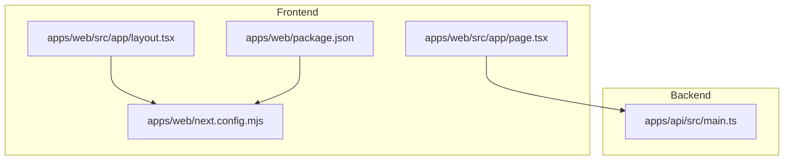
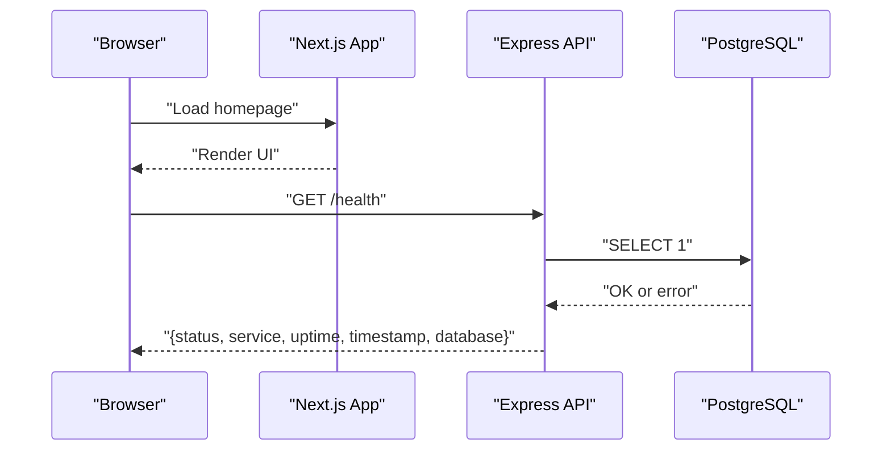
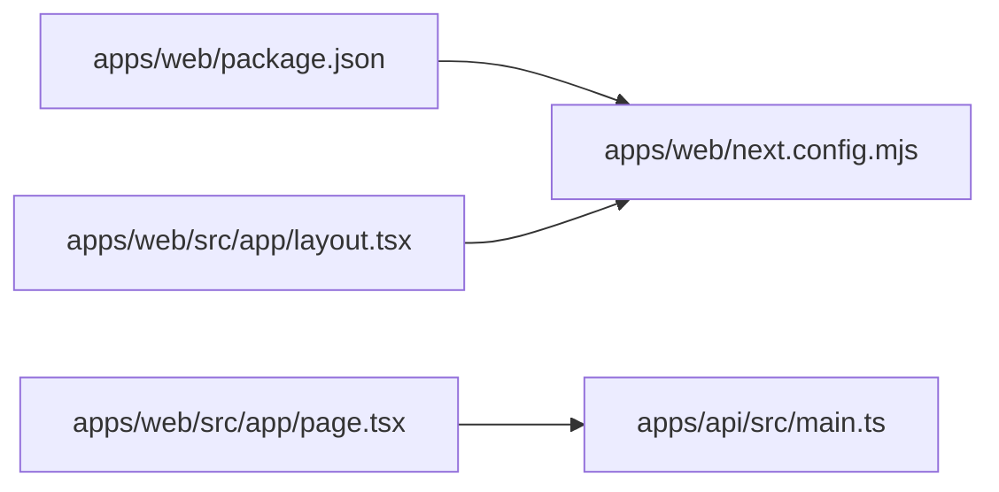

# API Integration & Client Setup

<cite>
**Referenced Files in This Document**
- [apps/web/package.json](file://apps/web/package.json)
- [apps/web/next.config.mjs](file://apps/web/next.config.mjs)
- [apps/web/src/app/layout.tsx](file://apps/web/src/app/layout.tsx)
- [apps/web/src/app/page.tsx](file://apps/web/src/app/page.tsx)
- [apps/api/src/main.ts](file://apps/api/src/main.ts)
- [PROJECT_CONTEXT_HANDOFF.md](file://PROJECT_CONTEXT_HANDOFF.md)
</cite>

## Table of Contents
1. [Introduction](#introduction)
2. [Project Structure](#project-structure)
3. [Core Components](#core-components)
4. [Architecture Overview](#architecture-overview)
5. [Detailed Component Analysis](#detailed-component-analysis)
6. [Dependency Analysis](#dependency-analysis)
7. [Performance Considerations](#performance-considerations)
8. [Troubleshooting Guide](#troubleshooting-guide)
9. [Conclusion](#conclusion)
10. [Appendices](#appendices)

## Introduction
This document explains how to integrate the Next.js frontend with the backend services in this monorepo, focusing on API client configuration, request and response handling, error management, authentication flow, token management, secure communication, data synchronization patterns (loading states, optimistic updates), caching strategies, offline support considerations, environment-specific configurations, and deployment considerations for API endpoints.

The current Next.js application is a minimal storefront that references the backend API service and its health endpoint. The backend Express server exposes a health check and a versioned API root, which will be the foundation for future integration points such as categories, products, and orders.

## Project Structure
At a high level:
- apps/web: Next.js App Router frontend using React 19 and Tailwind CSS.
- apps/api: Express-based REST API with Prisma and Dockerized infrastructure (PostgreSQL, Redis, Meilisearch).

**Diagram sources**
- [apps/web/package.json:1-28](file://apps/web/package.json#L1-L28)
- [apps/web/next.config.mjs:1-15](file://apps/web/next.config.mjs#L1-L15)
- [apps/web/src/app/layout.tsx:1-22](file://apps/web/src/app/layout.tsx#L1-L22)
- [apps/web/src/app/page.tsx:1-81](file://apps/web/src/app/page.tsx#L1-L81)
- [apps/api/src/main.ts:1-55](file://apps/api/src/main.ts#L1-L55)

**Section sources**
- [apps/web/package.json:1-28](file://apps/web/package.json#L1-L28)
- [apps/web/next.config.mjs:1-15](file://apps/web/next.config.mjs#L1-L15)
- [apps/web/src/app/layout.tsx:1-22](file://apps/web/src/app/layout.tsx#L1-L22)
- [apps/web/src/app/page.tsx:1-81](file://apps/web/src/app/page.tsx#L1-L81)
- [apps/api/src/main.ts:1-55](file://apps/api/src/main.ts#L1-L55)

## Core Components
- Next.js Web Application
  - Root layout sets global metadata and base HTML structure.
  - Home page lists core infrastructure services and highlights architectural pillars.
  - Configuration enables strict mode and remote image domains.
- Backend API Server
  - Express app with CORS enabled and JSON parsing.
  - Health endpoint checks database connectivity and returns status.
  - Versioned API root documents available endpoints.

Key responsibilities:
- Frontend: UI shell, static content, and future API client integration.
- Backend: Health monitoring, API discovery, and future business endpoints.

**Section sources**
- [apps/web/src/app/layout.tsx:1-22](file://apps/web/src/app/layout.tsx#L1-L22)
- [apps/web/src/app/page.tsx:1-81](file://apps/web/src/app/page.tsx#L1-L81)
- [apps/web/next.config.mjs:1-15](file://apps/web/next.config.mjs#L1-L15)
- [apps/api/src/main.ts:1-55](file://apps/api/src/main.ts#L1-L55)

## Architecture Overview
The frontend communicates with the backend via HTTP(S). The backend provides a health check and an API discovery route. Future integrations will extend these endpoints to serve catalog, orders, payments, and other domain features.

**Diagram sources**
- [apps/web/src/app/page.tsx:1-81](file://apps/web/src/app/page.tsx#L1-L81)
- [apps/api/src/main.ts:18-35](file://apps/api/src/main.ts#L18-L35)

## Detailed Component Analysis

### API Client Configuration
Recommended approach for Next.js App Router:
- Create a centralized API client module that configures:
  - Base URL from environment variables.
  - Default headers (Content-Type, Accept).
  - Interceptors for attaching tokens and handling errors.
- Use fetch or a typed HTTP client library. Since no HTTP client is currently installed, you can add one or use native fetch.

Environment variables:
- NEXT_PUBLIC_API_URL: Public-facing API base URL for browser usage.
- API_BASE_URL: Internal-only base URL for server-side calls (Node runtime).

Security notes:
- Never expose secrets to the browser; only use NEXT_PUBLIC_* variables where necessary.
- For server components or API routes, prefer internal URLs to avoid CORS issues.

CORS:
- Backend enables CORS globally. In production, restrict allowed origins to your frontend domain(s).

Image optimization:
- next.config.mjs allows remote images from any HTTPS host. Tighten this policy to known CDN domains in production.

**Section sources**
- [apps/web/next.config.mjs:1-15](file://apps/web/next.config.mjs#L1-L15)
- [apps/api/src/main.ts:15-16](file://apps/api/src/main.ts#L15-L16)
- [PROJECT_CONTEXT_HANDOFF.md:183-190](file://PROJECT_CONTEXT_HANDOFF.md#L183-L190)

### Request and Response Handling
Patterns:
- Centralized fetch wrapper:
  - Normalize success responses into a consistent shape.
  - Map network errors, timeouts, and server errors to user-friendly messages.
  - Retry transient failures with exponential backoff for idempotent GET requests.
- Error boundaries:
  - Use React error boundaries for UI-level error handling.
  - Show fallback UI when critical data fails to load.

Response types:
- Success: { data, meta }
- Error: { code, message, details }

Loading states:
- Use Suspense for server components and useState/useEffect for client components to manage loading, success, and error states.

**Section sources**
- [apps/web/src/app/layout.tsx:1-22](file://apps/web/src/app/layout.tsx#L1-L22)
- [apps/web/src/app/page.tsx:1-81](file://apps/web/src/app/page.tsx#L1-L81)

### Authentication Flow and Token Management
Recommended flow:
- Login:
  - Submit credentials to a secure login endpoint.
  - Receive access token and optional refresh token.
- Storage:
  - Store access token in memory for short-lived sessions.
  - Store refresh token in httpOnly cookie set by the backend to prevent XSS.
- Authorization:
  - Attach access token to Authorization header for protected routes.
- Refresh:
  - On 401, attempt silent refresh using refresh token.
  - If refresh fails, redirect to login.

Token lifecycle:
- Access token: short TTL (e.g., minutes).
- Refresh token: longer TTL (e.g., days) with rotation and revocation support.

Secure communication:
- Enforce HTTPS in production.
- Set secure flags on cookies (httpOnly, secure, sameSite=strict/lax).
- Validate JWT signatures server-side and enforce scopes/roles.

**Section sources**
- [PROJECT_CONTEXT_HANDOFF.md:183-190](file://PROJECT_CONTEXT_HANDOFF.md#L183-L190)

### Secure Communication with Backend Services
- TLS termination at reverse proxy or edge layer.
- Restrict CORS origins to trusted domains.
- Validate all inputs server-side using Zod or similar.
- Rate limit sensitive endpoints (login, payment).
- Sanitize outputs and avoid leaking stack traces.

**Section sources**
- [apps/api/src/main.ts:15-16](file://apps/api/src/main.ts#L15-L16)
- [PROJECT_CONTEXT_HANDOFF.md:183-190](file://PROJECT_CONTEXT_HANDOFF.md#L183-L190)

### Examples of Making API Calls
- Health check:
  - GET /health to verify backend availability and database connectivity.
- API discovery:
  - GET /api/v1 to list available endpoints.

Client-side example outline:
- Fetch health:
  - Call /health before rendering critical sections.
  - Display maintenance banner if unhealthy.
- Fetch catalog:
  - GET /api/v1/products with pagination and filters.
  - Handle loading, empty state, and error states.

**Section sources**
- [apps/api/src/main.ts:18-49](file://apps/api/src/main.ts#L18-L49)

### Handling Loading States
- Server components:
  - Use Suspense boundaries around data-heavy sections.
  - Provide skeleton loaders while fetching.
- Client components:
  - Manage local loading state with useState.
  - Debounce search inputs and cancel in-flight requests on unmount.

**Section sources**
- [apps/web/src/app/layout.tsx:1-22](file://apps/web/src/app/layout.tsx#L1-L22)
- [apps/web/src/app/page.tsx:1-81](file://apps/web/src/app/page.tsx#L1-L81)

### Managing Data Synchronization
- Single source of truth:
  - Keep a normalized store for entities (products, categories, orders).
- Optimistic updates:
  - Update UI immediately, then reconcile with server on success.
  - Rollback on failure with user feedback.
- Background sync:
  - Periodically refetch stale data based on cache timestamps.
  - Use SWR or React Query patterns for automatic background updates.

**Section sources**
- [apps/web/src/app/page.tsx:1-81](file://apps/web/src/app/page.tsx#L1-L81)

### Caching Strategies
- Browser cache:
  - Leverage Cache-Control headers for static assets.
  - Use ETag/Last-Modified for dynamic resources.
- Edge/CDN cache:
  - Cache public read endpoints behind CDN with appropriate TTLs.
- Application cache:
  - In-memory cache for hot data (Redis-backed if needed).
  - Stale-while-revalidate pattern for fast UI with fresh data.

**Section sources**
- [apps/web/next.config.mjs:1-15](file://apps/web/next.config.mjs#L1-L15)

### Offline Support Patterns
- Service Worker:
  - Cache essential shell and assets for offline access.
  - Implement background sync for queued mutations.
- Local storage:
  - Persist cart and draft data locally.
  - Sync with server when online.

[No sources needed since this section provides general guidance]

### Environment-Specific Configurations
- Development:
  - NEXT_PUBLIC_API_URL points to local API server.
  - CORS allows localhost origins.
- Production:
  - NEXT_PUBLIC_API_URL points to production API domain.
  - Restrict CORS to production domains.
  - Enable HTTPS and secure cookies.

Environment variables reference:
- Application: NODE_ENV, API_PORT, WEB_PORT, PORT, NEXT_PUBLIC_API_URL, NEXT_PUBLIC_APP_URL, CORS_ORIGIN.
- Database: POSTGRES_USER, POSTGRES_PASSWORD, POSTGRES_DB, POSTGRES_HOST, POSTGRES_PORT, DATABASE_URL, DIRECT_URL.
- Redis: REDIS_HOST, REDIS_PORT, REDIS_PASSWORD, REDIS_URL.
- Meilisearch: MEILISEARCH_HOST, MEILISEARCH_PORT, MEILI_MASTER_KEY, MEILI_ENV.
- Auth: JWT_SECRET, JWT_EXPIRES_IN, JWT_REFRESH_SECRET, JWT_REFRESH_EXPIRES_IN, SESSION_SECRET, ENCRYPTION_KEY, NEXTAUTH_SECRET, NEXTAUTH_URL.
- Payments: BKASH_*, NAGAD_*, SSLCOMMERZ_*.

**Section sources**
- [PROJECT_CONTEXT_HANDOFF.md:183-190](file://PROJECT_CONTEXT_HANDOFF.md#L183-L190)

### Deployment Considerations for API Endpoints
- Reverse proxy:
  - Terminate TLS at nginx/Traefik and forward to Node process.
- Process manager:
  - Use PM2 or container orchestration (Docker/Kubernetes).
- Secrets management:
  - Inject secrets via environment variables or secret managers.
- Health checks:
  - Expose /health for liveness/readiness probes.
- Scaling:
  - Horizontal scaling behind load balancer.
  - Stateless sessions with Redis-backed session store.

**Section sources**
- [apps/api/src/main.ts:18-35](file://apps/api/src/main.ts#L18-L35)

## Dependency Analysis
The frontend depends on:
- Next.js framework and React ecosystem.
- Tailwind CSS for styling.
- Lucide React for icons.

The backend depends on:
- Express for HTTP routing.
- CORS middleware.
- Prisma client for database access.
- External services: PostgreSQL, Redis, Meilisearch.

**Diagram sources**
- [apps/web/package.json:1-28](file://apps/web/package.json#L1-L28)
- [apps/web/next.config.mjs:1-15](file://apps/web/next.config.mjs#L1-L15)
- [apps/web/src/app/layout.tsx:1-22](file://apps/web/src/app/layout.tsx#L1-L22)
- [apps/web/src/app/page.tsx:1-81](file://apps/web/src/app/page.tsx#L1-L81)
- [apps/api/src/main.ts:1-55](file://apps/api/src/main.ts#L1-L55)

**Section sources**
- [apps/web/package.json:1-28](file://apps/web/package.json#L1-L28)
- [apps/api/src/main.ts:1-55](file://apps/api/src/main.ts#L1-L55)

## Performance Considerations
- Minimize bundle size:
  - Tree-shake unused dependencies.
  - Lazy-load heavy components.
- Optimize images:
  - Use next/image with proper sizing and formats.
- Reduce network requests:
  - Batch API calls where possible.
  - Use pagination and filtering.
- Server-side rendering:
  - Pre-render static pages and cache dynamic data.

[No sources needed since this section provides general guidance]

## Troubleshooting Guide
Common issues and resolutions:
- CORS errors:
  - Ensure backend CORS allows frontend origin.
  - Verify NEXT_PUBLIC_API_URL matches deployed domain.
- Health check failures:
  - Check database connectivity and credentials.
  - Inspect /health response for database status.
- Image loading issues:
  - Confirm remotePatterns allow image hosts.
  - Validate HTTPS and correct MIME types.

Operational tips:
- Log request IDs for tracing across frontend and backend.
- Monitor error rates and latency metrics.
- Use structured logging and centralized log aggregation.

**Section sources**
- [apps/api/src/main.ts:18-35](file://apps/api/src/main.ts#L18-L35)
- [apps/web/next.config.mjs:1-15](file://apps/web/next.config.mjs#L1-L15)

## Conclusion
This repository provides a solid foundation for integrating a Next.js frontend with a headless backend. The immediate next steps are to implement a robust API client, establish authentication flows, and standardize error handling and caching strategies. With clear environment configurations and health checks in place, you can confidently scale the platform and deploy it securely in production.

[No sources needed since this section summarizes without analyzing specific files]

## Appendices

### API Endpoints Reference
- GET /health: Returns service status, uptime, timestamp, and database connectivity.
- GET /api/v1: Returns API version and available endpoints.

**Section sources**
- [apps/api/src/main.ts:18-49](file://apps/api/src/main.ts#L18-L49)

### Environment Variables Quick Reference
- Application: NODE_ENV, API_PORT, WEB_PORT, PORT, NEXT_PUBLIC_API_URL, NEXT_PUBLIC_APP_URL, CORS_ORIGIN.
- Database: POSTGRES_USER, POSTGRES_PASSWORD, POSTGRES_DB, POSTGRES_HOST, POSTGRES_PORT, DATABASE_URL, DIRECT_URL.
- Redis: REDIS_HOST, REDIS_PORT, REDIS_PASSWORD, REDIS_URL.
- Meilisearch: MEILISEARCH_HOST, MEILISEARCH_PORT, MEILI_MASTER_KEY, MEILI_ENV.
- Authentication & Security: JWT_SECRET, JWT_EXPIRES_IN, JWT_REFRESH_SECRET, JWT_REFRESH_EXPIRES_IN, SESSION_SECRET, ENCRYPTION_KEY, NEXTAUTH_SECRET, NEXTAUTH_URL.
- Payment Gateways: BKASH_*, NAGAD_*, SSLCOMMERZ_*.

**Section sources**
- [PROJECT_CONTEXT_HANDOFF.md:183-190](file://PROJECT_CONTEXT_HANDOFF.md#L183-L190)