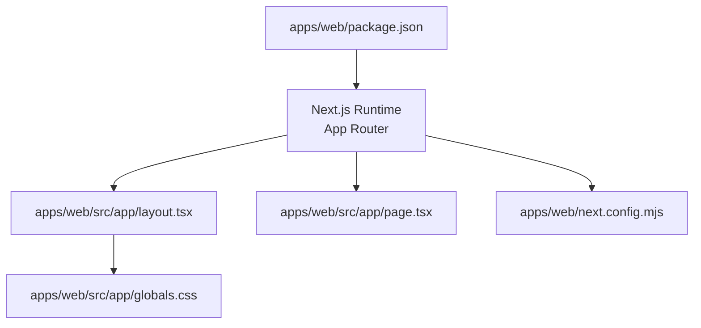
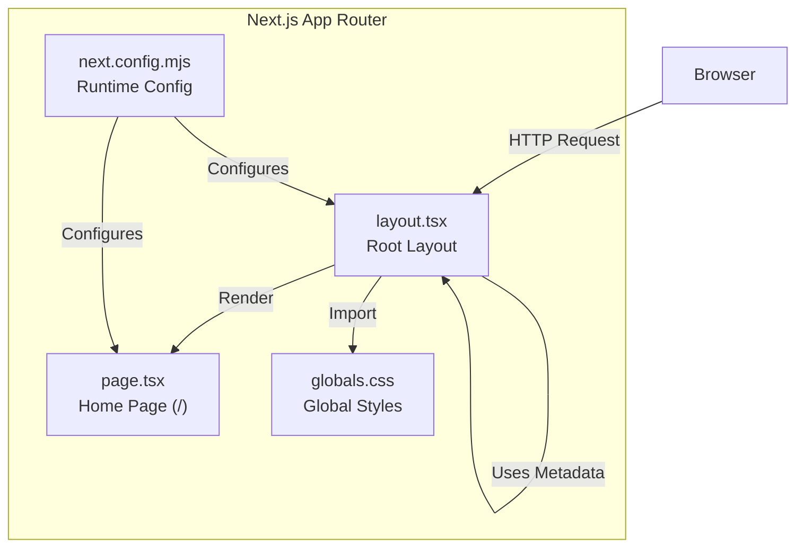
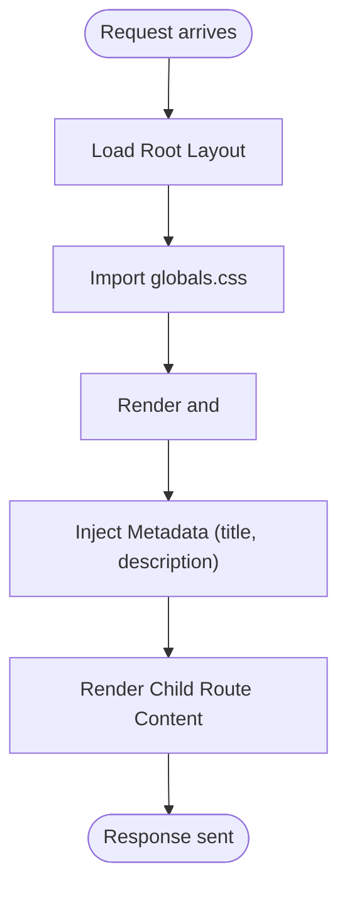
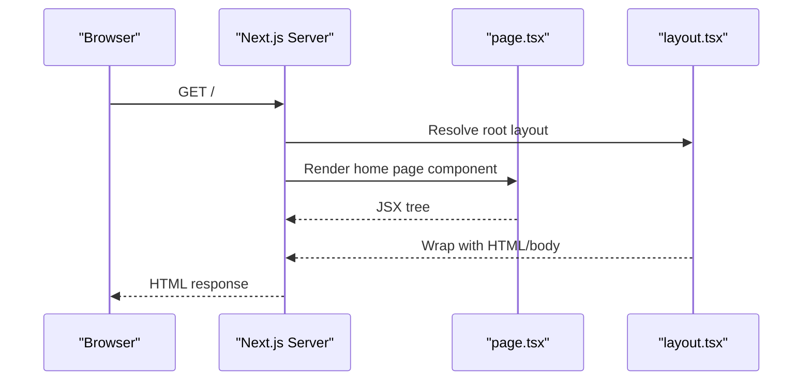
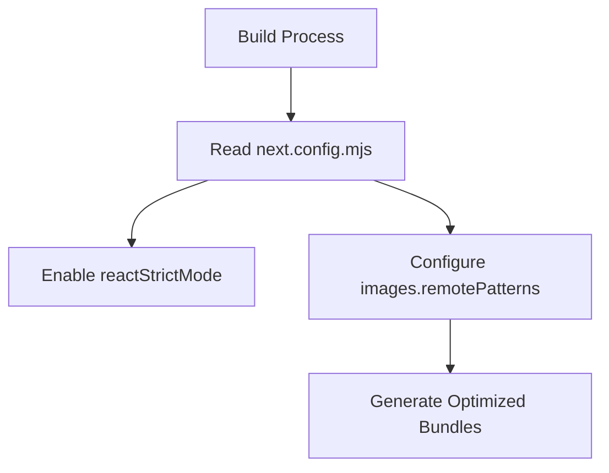
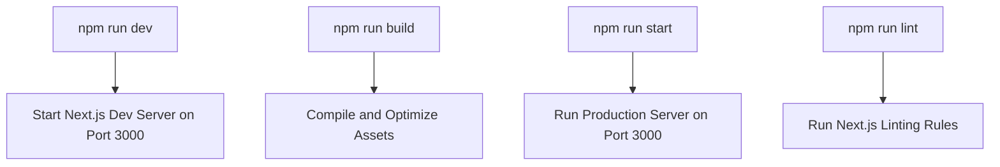
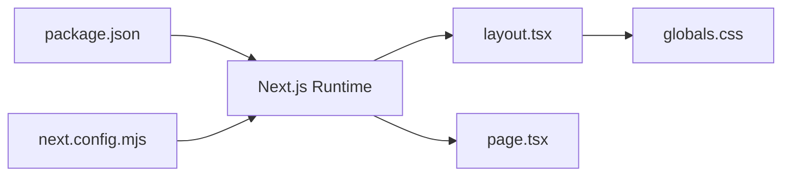

# Application Structure & Architecture

<cite>
**Referenced Files in This Document**
- [apps/web/src/app/layout.tsx](file://apps/web/src/app/layout.tsx)
- [apps/web/src/app/page.tsx](file://apps/web/src/app/page.tsx)
- [apps/web/next.config.mjs](file://apps/web/next.config.mjs)
- [apps/web/package.json](file://apps/web/package.json)
</cite>

## Table of Contents
1. [Introduction](#introduction)
2. [Project Structure](#project-structure)
3. [Core Components](#core-components)
4. [Architecture Overview](#architecture-overview)
5. [Detailed Component Analysis](#detailed-component-analysis)
6. [Dependency Analysis](#dependency-analysis)
7. [Performance Considerations](#performance-considerations)
8. [Troubleshooting Guide](#troubleshooting-guide)
9. [Conclusion](#conclusion)

## Introduction
This document explains the Next.js App Router structure and architecture for the BD Commerce Platform frontend located under apps/web. It covers the root layout, metadata configuration, file-based routing conventions, page organization within src/app, and how to extend the application with new pages, layouts, and nested routes. It also outlines performance considerations such as code splitting, lazy loading, and server-side rendering patterns used by the App Router.

## Project Structure
The Next.js web application is a standard App Router setup:
- The entry point for the app shell is the root layout at apps/web/src/app/layout.tsx.
- The default landing page is apps/web/src/app/page.tsx.
- Global styles are imported from apps/web/src/app/globals.css.
- Next.js runtime and build behavior are configured via apps/web/next.config.mjs.
- Dependencies and scripts are defined in apps/web/package.json.

**Diagram sources**
- [apps/web/package.json:1-28](file://apps/web/package.json#L1-L28)
- [apps/web/src/app/layout.tsx:1-22](file://apps/web/src/app/layout.tsx#L1-L22)
- [apps/web/src/app/page.tsx:1-81](file://apps/web/src/app/page.tsx#L1-L81)
- [apps/web/next.config.mjs:1-15](file://apps/web/next.config.mjs#L1-L15)

**Section sources**
- [apps/web/package.json:1-28](file://apps/web/package.json#L1-L28)
- [apps/web/src/app/layout.tsx:1-22](file://apps/web/src/app/layout.tsx#L1-L22)
- [apps/web/src/app/page.tsx:1-81](file://apps/web/src/app/page.tsx#L1-L81)
- [apps/web/next.config.mjs:1-15](file://apps/web/next.config.mjs#L1-L15)

## Core Components
- Root Layout (apps/web/src/app/layout.tsx): Defines the HTML shell, language attribute, global body classes, and imports global CSS. It also exports metadata for SEO and browser tabs.
- Default Page (apps/web/src/app/page.tsx): Renders the home page content using React Server Components by default.
- Configuration (apps/web/next.config.mjs): Enables React Strict Mode and configures image optimization for remote images.
- Package Scripts (apps/web/package.json): Provides dev, build, start, and lint commands; declares dependencies including Next.js 15, React 19, TailwindCSS, and TypeScript tooling.

Key responsibilities:
- Apps/web/src/app/layout.tsx sets up the document-level structure and metadata.
- Apps/web/src/app/page.tsx provides the initial user-facing content.
- Apps/web/next.config.mjs controls runtime behavior and optimizations.
- Apps/web/package.json defines the development and production workflow.

**Section sources**
- [apps/web/src/app/layout.tsx:1-22](file://apps/web/src/app/layout.tsx#L1-L22)
- [apps/web/src/app/page.tsx:1-81](file://apps/web/src/app/page.tsx#L1-L81)
- [apps/web/next.config.mjs:1-15](file://apps/web/next.config.mjs#L1-L15)
- [apps/web/package.json:1-28](file://apps/web/package.json#L1-L28)

## Architecture Overview
The Next.js App Router drives the application through file-based routing:
- The presence of apps/web/src/app/layout.tsx establishes the root layout for all routes.
- The presence of apps/web/src/app/page.tsx creates the root route /.
- Any additional folders or files under apps/web/src/app will be automatically mapped to URL paths.

**Diagram sources**
- [apps/web/src/app/layout.tsx:1-22](file://apps/web/src/app/layout.tsx#L1-L22)
- [apps/web/src/app/page.tsx:1-81](file://apps/web/src/app/page.tsx#L1-L81)
- [apps/web/next.config.mjs:1-15](file://apps/web/next.config.mjs#L1-L15)

## Detailed Component Analysis

### Root Layout (apps/web/src/app/layout.tsx)
Responsibilities:
- Exports a Metadata object that sets the document title and description.
- Renders the HTML and BODY elements with appropriate attributes and Tailwind utility classes.
- Imports global CSS to apply site-wide styles.
- Wraps child routes with {children}, enabling consistent UI across the app.

**Diagram sources**
- [apps/web/src/app/layout.tsx:1-22](file://apps/web/src/app/layout.tsx#L1-L22)

**Section sources**
- [apps/web/src/app/layout.tsx:1-22](file://apps/web/src/app/layout.tsx#L1-L22)

### Home Page (apps/web/src/app/page.tsx)
Responsibilities:
- Implements the default route / as a React Server Component by default.
- Renders static content describing platform services and architectural highlights.
- Uses Tailwind utility classes for responsive design.

**Diagram sources**
- [apps/web/src/app/page.tsx:1-81](file://apps/web/src/app/page.tsx#L1-L81)
- [apps/web/src/app/layout.tsx:1-22](file://apps/web/src/app/layout.tsx#L1-L22)

**Section sources**
- [apps/web/src/app/page.tsx:1-81](file://apps/web/src/app/page.tsx#L1-L81)

### Configuration (apps/web/next.config.mjs)
Responsibilities:
- Enables React Strict Mode for improved development experience.
- Configures image optimization to allow remote images from HTTPS origins.

**Diagram sources**
- [apps/web/next.config.mjs:1-15](file://apps/web/next.config.mjs#L1-L15)

**Section sources**
- [apps/web/next.config.mjs:1-15](file://apps/web/next.config.mjs#L1-L15)

### Package and Scripts (apps/web/package.json)
Responsibilities:
- Defines scripts for development, building, starting, and linting the app.
- Declares runtime dependencies (Next.js, React, React DOM) and UI/tooling libraries (TailwindCSS, PostCSS, Autoprefixer).
- Sets TypeScript types for Node and React.

**Diagram sources**
- [apps/web/package.json:1-28](file://apps/web/package.json#L1-L28)

**Section sources**
- [apps/web/package.json:1-28](file://apps/web/package.json#L1-L28)

## Dependency Analysis
High-level dependency relationships:
- apps/web/package.json depends on Next.js and React runtime packages.
- apps/web/src/app/layout.tsx depends on Next.js Metadata types and local CSS.
- apps/web/src/app/page.tsx renders UI components without direct external data dependencies in this snapshot.
- apps/web/next.config.mjs influences both layout and page builds.

**Diagram sources**
- [apps/web/package.json:1-28](file://apps/web/package.json#L1-L28)
- [apps/web/src/app/layout.tsx:1-22](file://apps/web/src/app/layout.tsx#L1-L22)
- [apps/web/src/app/page.tsx:1-81](file://apps/web/src/app/page.tsx#L1-L81)
- [apps/web/next.config.mjs:1-15](file://apps/web/next.config.mjs#L1-L15)

**Section sources**
- [apps/web/package.json:1-28](file://apps/web/package.json#L1-L28)
- [apps/web/src/app/layout.tsx:1-22](file://apps/web/src/app/layout.tsx#L1-L22)
- [apps/web/src/app/page.tsx:1-81](file://apps/web/src/app/page.tsx#L1-L81)
- [apps/web/next.config.mjs:1-15](file://apps/web/next.config.mjs#L1-L15)

## Performance Considerations
- Server Components by default: Pages under apps/web/src/app are server components unless explicitly marked as client components. This reduces client bundle size and improves Time to First Byte.
- Code splitting: Next.js automatically splits code per route. Keep heavy logic in separate components and import them where needed.
- Lazy loading: Use dynamic imports for non-critical components or third-party libraries to reduce initial payload.
- Image optimization: Configure remote image domains in apps/web/next.config.mjs to leverage Next.js image optimization pipeline.
- Data fetching: Prefer server-side data fetching patterns (e.g., fetch with caching) inside server components to minimize client work.
- CSS strategy: Keep global styles minimal in apps/web/src/app/globals.css and use component-scoped styles or Tailwind utilities to avoid large CSS payloads.

[No sources needed since this section provides general guidance]

## Troubleshooting Guide
Common issues and resolutions:
- Missing root layout: If apps/web/src/app/layout.tsx is removed, Next.js cannot render the HTML shell. Ensure it exists and returns a valid document structure.
- Metadata not applied: Verify that apps/web/src/app/layout.tsx exports a Metadata object and that the title/description fields are set correctly.
- Remote images blocked: If images fail to load, confirm that apps/web/next.config.mjs includes the required remotePatterns for the image hostnames.
- Development server port conflicts: The dev script runs on port 3000. If another process uses this port, adjust the script or stop the conflicting service.
- Build failures due to strict mode: React Strict Mode is enabled; ensure components do not rely on side effects during double-rendering in development.

**Section sources**
- [apps/web/src/app/layout.tsx:1-22](file://apps/web/src/app/layout.tsx#L1-L22)
- [apps/web/next.config.mjs:1-15](file://apps/web/next.config.mjs#L1-L15)
- [apps/web/package.json:1-28](file://apps/web/package.json#L1-L28)

## Conclusion
The BD Commerce Platform’s Next.js frontend follows a clean App Router structure with a single root layout and a default home page. The configuration enables strict mode and image optimization, while package scripts provide a straightforward development and build workflow. To scale the application, add new routes under apps/web/src/app, extract reusable components, and adopt server-side data fetching patterns to maintain performance.

[No sources needed since this section summarizes without analyzing specific files]