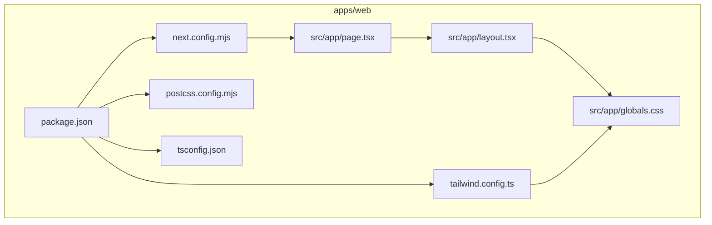
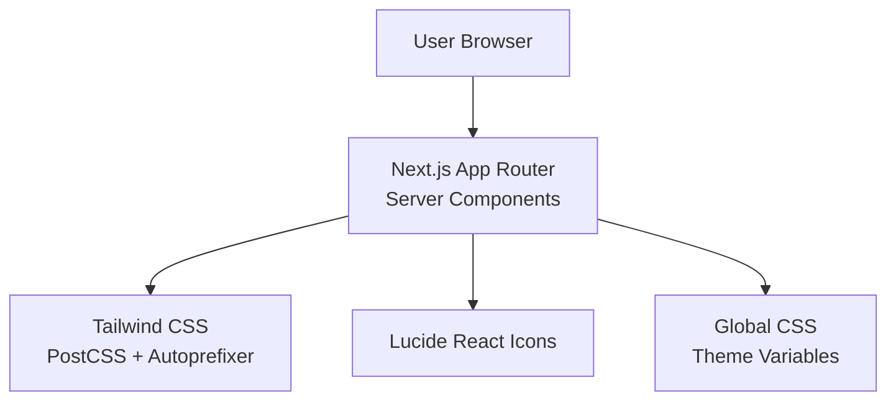
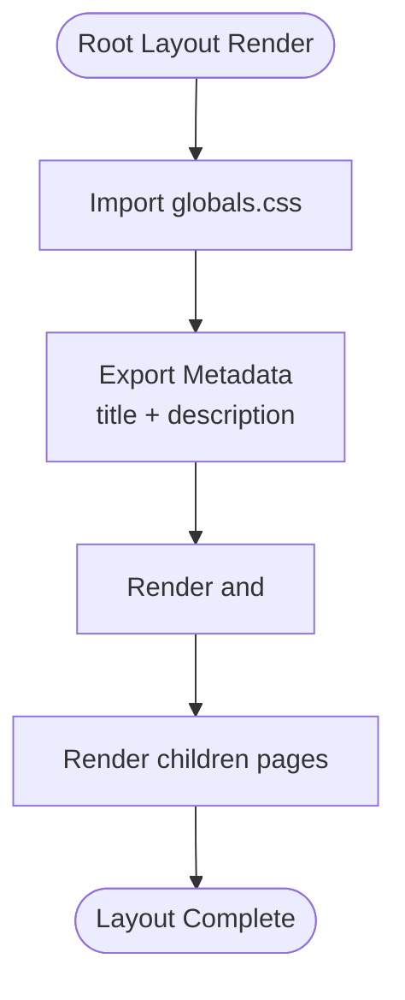
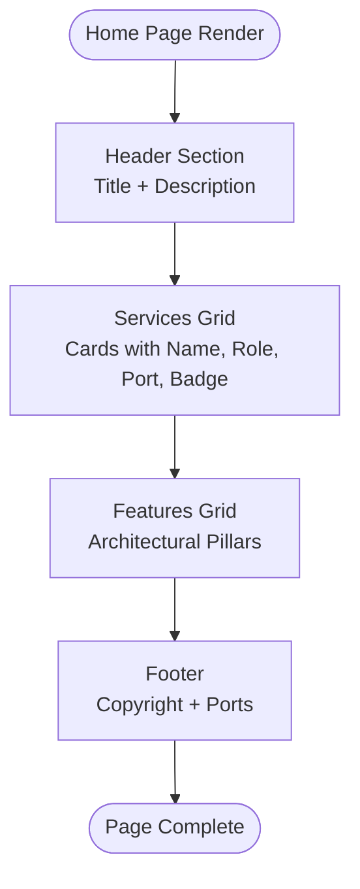
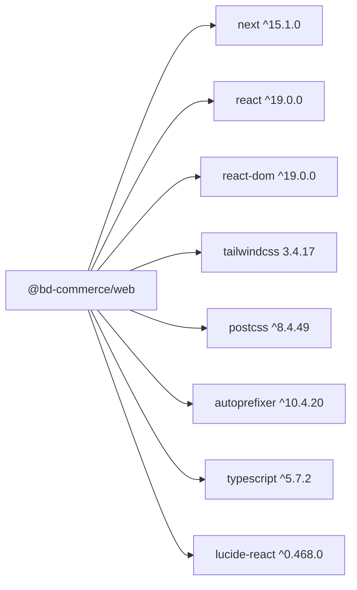

# Frontend Application (apps/web)

<cite>
**Referenced Files in This Document**   
- [package.json](file://apps/web/package.json)
- [next.config.mjs](file://apps/web/next.config.mjs)
- [tailwind.config.ts](file://apps/web/tailwind.config.ts)
- [postcss.config.mjs](file://apps/web/postcss.config.mjs)
- [tsconfig.json](file://apps/web/tsconfig.json)
- [layout.tsx](file://apps/web/src/app/layout.tsx)
- [page.tsx](file://apps/web/src/app/page.tsx)
- [globals.css](file://apps/web/src/app/globals.css)
</cite>

## Table of Contents
1. [Introduction](#introduction)
2. [Project Structure](#project-structure)
3. [Core Components](#core-components)
4. [Architecture Overview](#architecture-overview)
5. [Detailed Component Analysis](#detailed-component-analysis)
6. [Dependency Analysis](#dependency-analysis)
7. [Performance Considerations](#performance-considerations)
8. [Internationalization and Localization](#internationalization-and-localization)
9. [Styling with Tailwind CSS 3.4](#styling-with-tailwind-css-3-4)
10. [Routing and Page Components](#routing-and-page-components)
11. [API Client Integration](#api-client-integration)
12. [Build Process and Deployment Configuration](#build-process-and-deployment-configuration)
13. [SEO, Accessibility, and Responsive Design](#seo-accessibility-and-responsive-design)
14. [Troubleshooting Guide](#troubleshooting-guide)
15. [Conclusion](#conclusion)

## Introduction
This document describes the Next.js 15 frontend application located under `apps/web`. It explains the current project structure, component architecture, styling approach using Tailwind CSS 3.4, internationalization setup for Bangla and English, responsive design patterns, routing, API client integration strategy, performance optimizations, SEO considerations, accessibility compliance, build process, deployment configuration, and environment-specific settings.

The application is a minimal but production-ready foundation: it uses Next.js App Router, React Server Components by default, Tailwind CSS for utility-first styling, PostCSS and Autoprefixer, TypeScript, and Lucide icons. The root layout sets global metadata and base styles, while the home page demonstrates a responsive landing layout.

## Project Structure
The frontend app follows the standard Next.js App Router layout:

- `src/app/layout.tsx`: Root layout with global metadata and body classes.
- `src/app/page.tsx`: Home page component rendering a responsive landing section.
- `src/app/globals.css`: Global CSS with Tailwind directives and theme variables.
- `tailwind.config.ts`: Tailwind configuration extending brand colors.
- `next.config.mjs`: Next.js configuration enabling strict mode and remote image domains.
- `postcss.config.mjs`: PostCSS pipeline configuration.
- `tsconfig.json`: TypeScript configuration for the app.
- `package.json`: Scripts, dependencies, and devDependencies.

**Diagram sources**
- [package.json:1-28](file://apps/web/package.json#L1-L28)
- [next.config.mjs:1-15](file://apps/web/next.config.mjs#L1-L15)
- [tailwind.config.ts:1-31](file://apps/web/tailwind.config.ts#L1-L31)
- [postcss.config.mjs](file://apps/web/postcss.config.mjs)
- [tsconfig.json](file://apps/web/tsconfig.json)
- [layout.tsx:1-22](file://apps/web/src/app/layout.tsx#L1-L22)
- [page.tsx:1-81](file://apps/web/src/app/page.tsx#L1-L81)
- [globals.css:1-22](file://apps/web/src/app/globals.css#L1-L22)

**Section sources**
- [package.json:1-28](file://apps/web/package.json#L1-L28)
- [next.config.mjs:1-15](file://apps/web/next.config.mjs#L1-L15)
- [tailwind.config.ts:1-31](file://apps/web/tailwind.config.ts#L1-L31)
- [layout.tsx:1-22](file://apps/web/src/app/layout.tsx#L1-L22)
- [page.tsx:1-81](file://apps/web/src/app/page.tsx#L1-L81)
- [globals.css:1-22](file://apps/web/src/app/globals.css#L1-L22)

## Core Components
At this stage, the frontend has two primary components:

- Root Layout (`src/app/layout.tsx`): Defines global metadata, HTML language attribute, and base body classes including selection color and antialiasing.
- Home Page (`src/app/page.tsx`): Renders a responsive landing page with sections for infrastructure services and architectural highlights.

These components are server components by default in Next.js 15, which improves initial load performance and reduces client-side JavaScript.

Key responsibilities:
- Metadata injection for SEO via `Metadata` export.
- Global CSS import to enable Tailwind utilities and custom properties.
- Responsive layout using Tailwind grid and flex utilities.

**Section sources**
- [layout.tsx:1-22](file://apps/web/src/app/layout.tsx#L1-L22)
- [page.tsx:1-81](file://apps/web/src/app/page.tsx#L1-L81)

## Architecture Overview
The frontend architecture is intentionally simple and scalable:

- Next.js App Router provides file-based routing and server components.
- Tailwind CSS handles styling through utility classes and a small brand palette extension.
- PostCSS and Autoprefixer ensure cross-browser compatibility.
- TypeScript enforces type safety across components and configuration files.
- Lucide React provides lightweight iconography.

[No sources needed since this diagram shows conceptual workflow, not actual code structure]

## Detailed Component Analysis

### Root Layout Component
The root layout sets up the document-level structure and global metadata. It imports global CSS and applies consistent body classes for typography and selection behavior.

Responsibilities:
- Define site title and description for SEO.
- Set HTML language attribute for accessibility and i18n readiness.
- Apply global body styles and selection colors.

**Diagram sources**
- [layout.tsx:1-22](file://apps/web/src/app/layout.tsx#L1-L22)

**Section sources**
- [layout.tsx:1-22](file://apps/web/src/app/layout.tsx#L1-L22)

### Home Page Component
The home page renders a responsive landing interface showcasing core infrastructure services and architectural pillars. It uses Tailwind grid layouts and semantic HTML elements.

Responsibilities:
- Display service cards with name, role, port, and badge.
- Present feature highlights in a two-column grid on medium screens.
- Provide a footer with platform information.

**Diagram sources**
- [page.tsx:1-81](file://apps/web/src/app/page.tsx#L1-L81)

**Section sources**
- [page.tsx:1-81](file://apps/web/src/app/page.tsx#L1-L81)

## Dependency Analysis
The frontend depends on:

- Next.js 15 for framework features, routing, and server components.
- React 19 and React DOM for UI rendering.
- Tailwind CSS 3.4 for utility-first styling.
- PostCSS and Autoprefixer for CSS processing.
- TypeScript for type safety.
- Lucide React for icons.

**Diagram sources**
- [package.json:1-28](file://apps/web/package.json#L1-L28)

**Section sources**
- [package.json:1-28](file://apps/web/package.json#L1-L28)

## Performance Considerations
- Server Components: Default server components reduce client-side bundle size and improve Time to First Byte.
- Strict Mode: Enabled in Next.js config to catch potential issues during development.
- Image Optimization: Remote image domains are allowed via `remotePatterns`, enabling Next.js image optimization for external assets.
- Tailwind Purge: Content paths include `src/app/**/*.{js,ts,jsx,tsx,mdx}` to minimize CSS output.
- Minimal Dependencies: Only essential libraries are included to keep the bundle lean.

Recommendations:
- Use Next.js `Image` component for product images to leverage automatic optimization.
- Implement dynamic imports for heavy client-only features.
- Leverage caching headers and CDN for static assets.
- Monitor bundle size with Next.js built-in reports.

**Section sources**
- [next.config.mjs:1-15](file://apps/web/next.config.mjs#L1-L15)
- [tailwind.config.ts:1-31](file://apps/web/tailwind.config.ts#L1-L31)

## Internationalization and Localization
Current state:
- The root layout sets `lang="en"` for English.
- No i18n library or locale routing is configured yet.

Planned setup for Bangla/English support:
- Integrate `next-intl` or `react-i18next` for message management.
- Configure route-based localization under `src/app/[locale]/...`.
- Add locale detection via middleware or query parameters.
- Provide Bangla translations for key UI strings and metadata.
- Update `html lang` dynamically based on active locale.

Accessibility implications:
- Correct `lang` attributes improve screen reader behavior.
- Ensure all user-facing text is translatable and localized.

**Section sources**
- [layout.tsx:1-22](file://apps/web/src/app/layout.tsx#L1-L22)

## Styling with Tailwind CSS 3.4
Configuration highlights:
- Content scanning includes `src/app/**/*.{js,ts,jsx,tsx,mdx}`.
- Custom brand color palette extended under `colors.brand.*`.
- PostCSS and Autoprefixer are present for CSS processing.

Global styles:
- Tailwind directives imported in `globals.css`.
- CSS variables define background and foreground colors.
- Dark mode support via `prefers-color-scheme`.
- Base font stack defined for consistent typography.

Customization options:
- Extend Tailwind theme with additional colors, spacing, or typography.
- Create reusable component classes or use composition patterns.
- Maintain dark mode consistency across components.

**Section sources**
- [tailwind.config.ts:1-31](file://apps/web/tailwind.config.ts#L1-L31)
- [globals.css:1-22](file://apps/web/src/app/globals.css#L1-L22)

## Routing and Page Components
Routing model:
- File-based routing under `src/app`.
- `layout.tsx` acts as the root layout for all routes.
- `page.tsx` defines the home page at `/`.

Component composition:
- The home page composes header, services grid, features grid, and footer sections.
- Semantic HTML elements (`header`, `main`, `footer`) improve accessibility and SEO.

Future expansion:
- Add nested routes under `src/app/[category]/...`.
- Create shared layout components for common chrome (navbar, footer).
- Implement client components where interactivity is required.

**Section sources**
- [layout.tsx:1-22](file://apps/web/src/app/layout.tsx#L1-L22)
- [page.tsx:1-81](file://apps/web/src/app/page.tsx#L1-L81)

## API Client Integration
Current state:
- No API client library is installed in the frontend package.
- The backend services are documented elsewhere; the frontend can integrate via native `fetch` or a dedicated client.

Recommended approach:
- Use `fetch` within server components for data fetching to leverage Next.js caching and streaming.
- For client-side interactions, consider a typed client wrapper around `fetch` or a library like Axios if preferred.
- Centralize API endpoints in a configuration module for maintainability.
- Handle errors consistently with user-friendly messages and fallback states.

Integration points:
- Backend API at `apps/api` (port 4000).
- Headless commerce backend (Medusa) may be integrated later; configure environment variables for base URLs and secrets.

**Section sources**
- [package.json:1-28](file://apps/web/package.json#L1-L28)

## Build Process and Deployment Configuration
Scripts:
- Development: `npm run dev` starts the Next.js dev server on port 3000.
- Build: `npm run build` generates optimized production assets.
- Start: `npm run start` runs the production server on port 3000.
- Lint: `npm run lint` runs Next.js linter.

Next.js configuration:
- React strict mode enabled.
- Remote image domains allowed via `remotePatterns`.

Deployment considerations:
- Use Vercel for zero-config deployment or containerized environments for self-hosted setups.
- Set environment variables for API base URLs, feature flags, and analytics keys.
- Enable CDN caching for static assets and optimize image delivery.

**Section sources**
- [package.json:1-28](file://apps/web/package.json#L1-L28)
- [next.config.mjs:1-15](file://apps/web/next.config.mjs#L1-L15)

## SEO, Accessibility, and Responsive Design
SEO:
- Root layout exports metadata with title and description.
- Semantic HTML structure supports crawlers.
- Future pages should include Open Graph tags and structured data.

Accessibility:
- `html lang="en"` set for correct language declaration.
- Semantic elements used in the home page.
- Selection color and contrast are considered in global styles.

Responsive design:
- Tailwind grid and flex utilities provide mobile-first layouts.
- Breakpoints used for multi-column grids and spacing adjustments.
- Dark mode supported via CSS variables and media queries.

Best practices:
- Ensure sufficient color contrast for readability.
- Add ARIA attributes where necessary for interactive elements.
- Test with screen readers and keyboard navigation.

**Section sources**
- [layout.tsx:1-22](file://apps/web/src/app/layout.tsx#L1-L22)
- [page.tsx:1-81](file://apps/web/src/app/page.tsx#L1-L81)
- [globals.css:1-22](file://apps/web/src/app/globals.css#L1-L22)

## Troubleshooting Guide
Common issues and resolutions:
- Tailwind styles not applied: Verify content paths in `tailwind.config.ts` and ensure PostCSS pipeline is configured.
- Images failing to load from external domains: Confirm `remotePatterns` in `next.config.mjs` includes the target hostnames.
- TypeScript errors: Check `tsconfig.json` and ensure types are aligned with dependencies.
- Development server port conflicts: Adjust script or environment variable for port 3000.

Debugging tips:
- Use Next.js DevTools to inspect component tree and performance.
- Validate CSS with browser developer tools and Tailwind IntelliSense.
- Run `npm run lint` to catch code quality issues early.

**Section sources**
- [next.config.mjs:1-15](file://apps/web/next.config.mjs#L1-L15)
- [tailwind.config.ts:1-31](file://apps/web/tailwind.config.ts#L1-L31)
- [package.json:1-28](file://apps/web/package.json#L1-L28)

## Conclusion
The `apps/web` frontend is a clean, modern Next.js 15 application leveraging Tailwind CSS 3.4, PostCSS, TypeScript, and Lucide icons. It provides a solid foundation for building a high-performance e-commerce storefront with server components, responsive design, and extensible configuration. Future enhancements should focus on internationalization, API client integration, advanced SEO, and comprehensive accessibility testing.