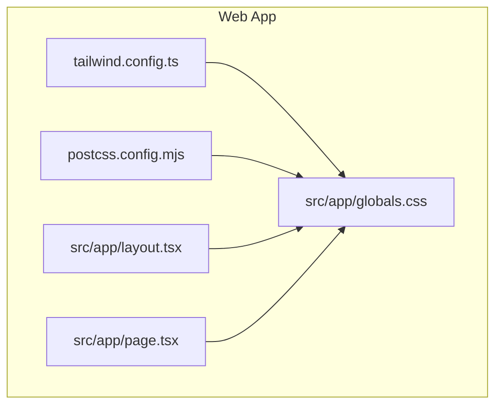
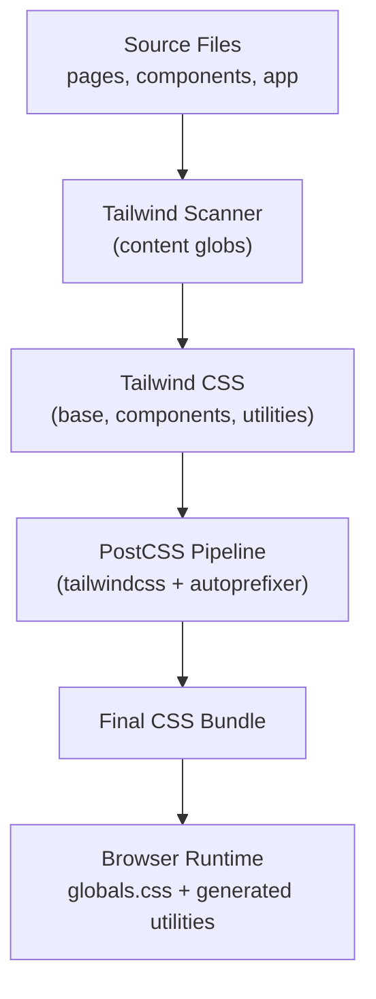
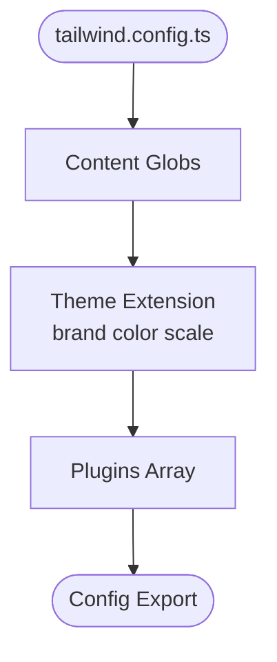
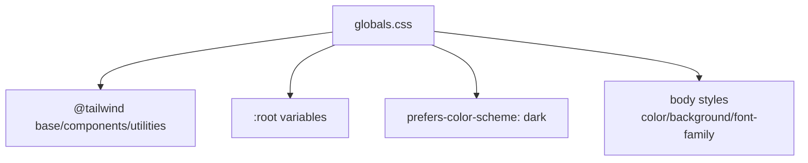
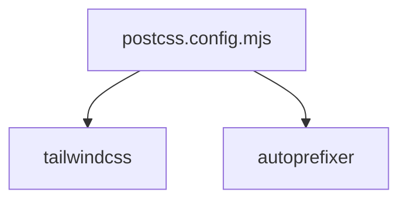
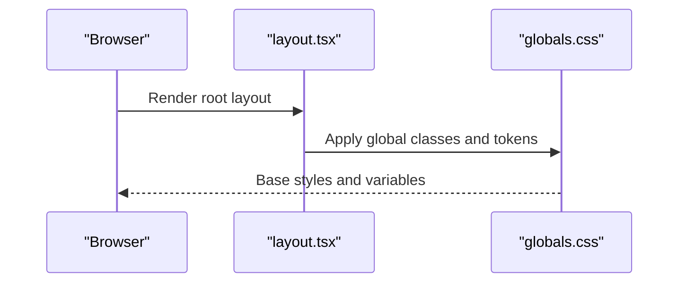
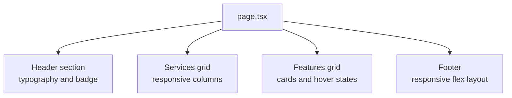
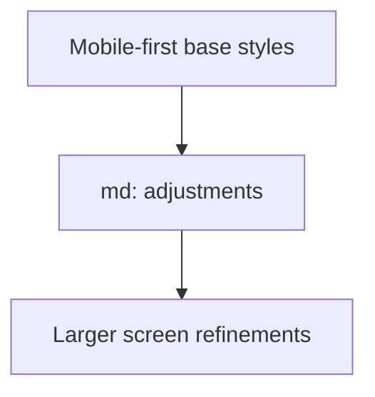
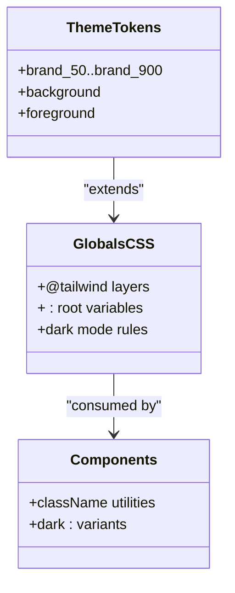
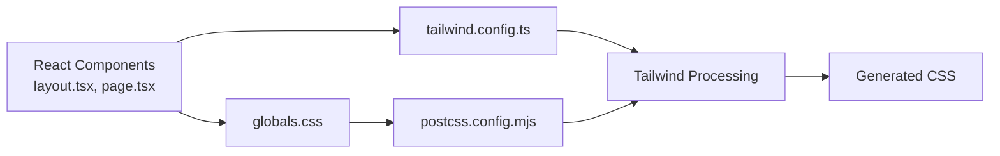

# Styling System & Tailwind CSS

<cite>
**Referenced Files in This Document**
- [tailwind.config.ts](file://apps/web/tailwind.config.ts)
- [globals.css](file://apps/web/src/app/globals.css)
- [postcss.config.mjs](file://apps/web/postcss.config.mjs)
- [layout.tsx](file://apps/web/src/app/layout.tsx)
- [page.tsx](file://apps/web/src/app/page.tsx)
</cite>

## Table of Contents
1. [Introduction](#introduction)
2. [Project Structure](#project-structure)
3. [Core Components](#core-components)
4. [Architecture Overview](#architecture-overview)
5. [Detailed Component Analysis](#detailed-component-analysis)
6. [Dependency Analysis](#dependency-analysis)
7. [Performance Considerations](#performance-considerations)
8. [Troubleshooting Guide](#troubleshooting-guide)
9. [Conclusion](#conclusion)
10. [Appendices](#appendices)

## Introduction
This document explains the styling system for the web application, which uses Tailwind CSS 3.4 with Next.js App Router. It covers configuration, custom theme extensions, global CSS setup, utility class usage patterns, responsive design approaches, and best practices for maintaining consistent styles across React components. It also includes guidance on performance optimization with PurgeCSS (via Tailwind’s content scanning) and integration with React components.

## Project Structure
The styling system is centered around:
- Tailwind configuration file that defines content paths, theme extensions, and plugins.
- Global CSS file that imports Tailwind layers and sets base variables and body styles.
- PostCSS configuration that wires Tailwind and Autoprefixer into the build pipeline.
- Next.js layout and page components that demonstrate responsive utility usage and brand token application.

**Diagram sources**
- [tailwind.config.ts:1-31](file://apps/web/tailwind.config.ts#L1-L31)
- [postcss.config.mjs:1-7](file://apps/web/postcss.config.mjs#L1-L7)
- [globals.css:1-22](file://apps/web/src/app/globals.css#L1-L22)
- [layout.tsx:1-22](file://apps/web/src/app/layout.tsx#L1-L22)
- [page.tsx:1-81](file://apps/web/src/app/page.tsx#L1-L81)

**Section sources**
- [tailwind.config.ts:1-31](file://apps/web/tailwind.config.ts#L1-L31)
- [postcss.config.mjs:1-7](file://apps/web/postcss.config.mjs#L1-L7)
- [globals.css:1-22](file://apps/web/src/app/globals.css#L1-L22)
- [layout.tsx:1-22](file://apps/web/src/app/layout.tsx#L1-L22)
- [page.tsx:1-81](file://apps/web/src/app/page.tsx#L1-L81)

## Core Components
- Tailwind Configuration
  - Content scanning targets pages, components, and app directories to enable PurgeCSS behavior via Tailwind’s built-in scanner.
  - Theme extension adds a brand color scale for consistent branding.
  - Plugins array is empty, indicating no additional Tailwind plugins are used at this time.

- Global CSS
  - Imports Tailwind base, components, and utilities layers.
  - Defines CSS custom properties for background and foreground colors.
  - Applies dark mode using prefers-color-scheme media query.
  - Sets default font stack and applies CSS variables to the body.

- PostCSS Configuration
  - Enables Tailwind CSS and Autoprefixer as PostCSS plugins.

- Layout and Page Components
  - Root layout applies global classes and uses the brand color token for selection highlight.
  - Home page demonstrates responsive grids, spacing, typography, and dark-mode-aware colors.

**Section sources**
- [tailwind.config.ts:3-28](file://apps/web/tailwind.config.ts#L3-L28)
- [globals.css:1-22](file://apps/web/src/app/globals.css#L1-L22)
- [postcss.config.mjs:1-7](file://apps/web/postcss.config.mjs#L1-L7)
- [layout.tsx:9-21](file://apps/web/src/app/layout.tsx#L9-L21)
- [page.tsx:17-78](file://apps/web/src/app/page.tsx#L17-L78)

## Architecture Overview
The styling architecture follows a layered approach:
- Build-time: PostCSS processes CSS through Tailwind and Autoprefixer.
- Tailwind scans configured content paths to generate only used utilities (PurgeCSS-like behavior).
- Global CSS establishes base styles, theme tokens, and layer imports.
- React components compose Tailwind utilities to build UI elements.

[No sources needed since this diagram shows conceptual workflow, not actual code structure]

## Detailed Component Analysis

### Tailwind Configuration
- Content Paths
  - Scans pages, components, and app directories for JS/TS/JSX/TSX/MDX files.
  - Ensures unused utilities are removed during production builds.

- Theme Extensions
  - Adds a brand color palette with semantic shades from 50 to 900.
  - Encourages consistent use of brand tokens across components.

- Plugins
  - Empty plugin list; can be extended later for features like forms or typography.

**Diagram sources**
- [tailwind.config.ts:3-28](file://apps/web/tailwind.config.ts#L3-L28)

**Section sources**
- [tailwind.config.ts:3-28](file://apps/web/tailwind.config.ts#L3-L28)

### Global CSS Setup
- Layer Imports
  - Imports Tailwind base, components, and utilities layers in order.

- Design Tokens
  - Defines CSS custom properties for background and foreground colors.
  - Uses prefers-color-scheme to switch tokens for dark mode.

- Body Styles
  - Applies font stack and assigns CSS variables to body text and background.

**Diagram sources**
- [globals.css:1-22](file://apps/web/src/app/globals.css#L1-L22)

**Section sources**
- [globals.css:1-22](file://apps/web/src/app/globals.css#L1-L22)

### PostCSS Integration
- Plugins
  - tailwindcss: enables Tailwind processing.
  - autoprefixer: ensures cross-browser compatibility.

**Diagram sources**
- [postcss.config.mjs:1-7](file://apps/web/postcss.config.mjs#L1-L7)

**Section sources**
- [postcss.config.mjs:1-7](file://apps/web/postcss.config.mjs#L1-L7)

### React Component Usage Patterns

#### Root Layout
- Applies global layout classes and uses the brand color token for selection highlight.
- Demonstrates how to apply theme tokens directly in component className attributes.

**Diagram sources**
- [layout.tsx:9-21](file://apps/web/src/app/layout.tsx#L9-L21)
- [globals.css:1-22](file://apps/web/src/app/globals.css#L1-L22)

**Section sources**
- [layout.tsx:9-21](file://apps/web/src/app/layout.tsx#L9-L21)

#### Home Page
- Responsive Grids
  - Uses single-column grid on small screens and multi-column grid on medium and larger screens.
- Spacing and Typography
  - Applies consistent spacing, heading sizes, and muted text colors.
- Dark Mode Awareness
  - Uses dark: variants for borders and backgrounds to adapt to user preferences.
- Branding
  - Leverages brand color tokens where appropriate for consistency.

**Diagram sources**
- [page.tsx:17-78](file://apps/web/src/app/page.tsx#L17-L78)

**Section sources**
- [page.tsx:17-78](file://apps/web/src/app/page.tsx#L17-L78)

### Responsive Design Approaches
- Breakpoints
  - Uses md: breakpoint to adjust layouts and spacing for medium screens and above.
- Flexbox and Grid
  - Employs flex and grid utilities for flexible, responsive layouts.
- Container Constraints
  - Uses max-width and margin utilities to center content and constrain width.

[No sources needed since this diagram shows conceptual workflow, not actual code structure]

### Custom Styles and Theming Strategies
- Brand Color Scale
  - Centralized in Tailwind config under brand.* shades.
- CSS Variables
  - Background and foreground tokens defined in globals.css for consistent theming.
- Dark Mode
  - Automatic dark mode via prefers-color-scheme; components should use dark: variants.

**Diagram sources**
- [tailwind.config.ts:9-25](file://apps/web/tailwind.config.ts#L9-L25)
- [globals.css:5-21](file://apps/web/src/app/globals.css#L5-L21)

**Section sources**
- [tailwind.config.ts:9-25](file://apps/web/tailwind.config.ts#L9-L25)
- [globals.css:5-21](file://apps/web/src/app/globals.css#L5-L21)

## Dependency Analysis
The styling dependencies flow from source files through Tailwind and PostCSS to the final CSS bundle consumed by the browser.

**Diagram sources**
- [layout.tsx:1-22](file://apps/web/src/app/layout.tsx#L1-L22)
- [page.tsx:1-81](file://apps/web/src/app/page.tsx#L1-L81)
- [tailwind.config.ts:1-31](file://apps/web/tailwind.config.ts#L1-L31)
- [globals.css:1-22](file://apps/web/src/app/globals.css#L1-L22)
- [postcss.config.mjs:1-7](file://apps/web/postcss.config.mjs#L1-L7)

**Section sources**
- [layout.tsx:1-22](file://apps/web/src/app/layout.tsx#L1-L22)
- [page.tsx:1-81](file://apps/web/src/app/page.tsx#L1-L81)
- [tailwind.config.ts:1-31](file://apps/web/tailwind.config.ts#L1-L31)
- [globals.css:1-22](file://apps/web/src/app/globals.css#L1-L22)
- [postcss.config.mjs:1-7](file://apps/web/postcss.config.mjs#L1-L7)

## Performance Considerations
- PurgeCSS via Tailwind Content Scanning
  - Ensure all component paths are included in the content array so utilities are generated and unused ones are purged.
- Minimal Global CSS
  - Keep globals.css focused on base styles, tokens, and layer imports to reduce complexity.
- Avoid Arbitrary Values
  - Prefer theme tokens and predefined utilities to keep the generated CSS small and maintainable.
- Autoprefixer
  - Use autoprefixer to handle vendor prefixes automatically without manual overrides.

[No sources needed since this section provides general guidance]

## Troubleshooting Guide
- Missing Utilities
  - Verify content paths in tailwind.config.ts include all directories where utilities are used.
- Dark Mode Not Applying
  - Confirm prefers-color-scheme rules exist in globals.css and components use dark: variants.
- Brand Colors Not Available
  - Check that brand color scale is defined in tailwind.config.ts and used via brand-* classes.
- CSS Variables Not Applied
  - Ensure globals.css defines :root variables and body styles reference them.

**Section sources**
- [tailwind.config.ts:3-28](file://apps/web/tailwind.config.ts#L3-L28)
- [globals.css:5-21](file://apps/web/src/app/globals.css#L5-L21)

## Conclusion
The styling system leverages Tailwind CSS 3.4 with a clear separation between configuration, global base styles, and component-level utility composition. The brand color scale and CSS variables provide a foundation for consistent theming, while responsive utilities and dark mode support ensure modern, accessible interfaces. Following the outlined best practices will help maintain performance, readability, and scalability across the application.

[No sources needed since this section summarizes without analyzing specific files]

## Appendices

### Common UI Component Patterns
- Cards
  - Use rounded containers with borders, subtle backgrounds, and hover transitions.
- Badges
  - Combine inline-flex, rounded-full, and color tokens for status indicators.
- Grids
  - Use responsive grid-cols-* utilities to create adaptive layouts.

[No sources needed since this section provides general guidance]

### Guidelines for Consistent Styling
- Use theme tokens (brand colors) instead of arbitrary hex values.
- Apply consistent spacing scales and typography utilities.
- Prefer dark: variants for dark mode awareness.
- Keep global CSS minimal; encapsulate reusable patterns in components when possible.

[No sources needed since this section provides general guidance]