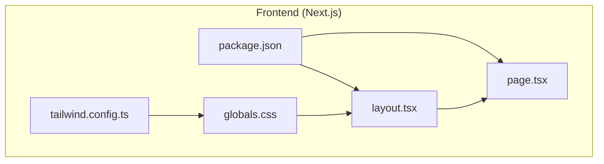
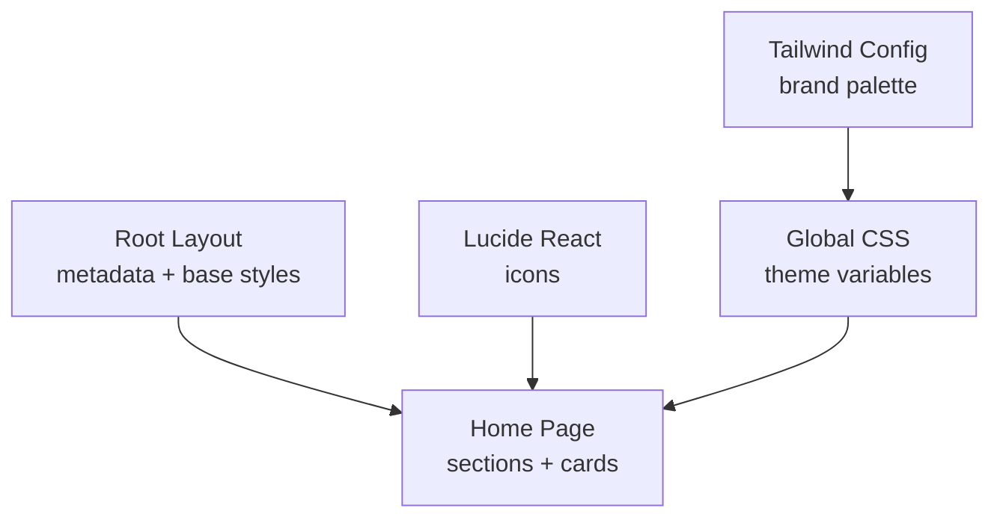
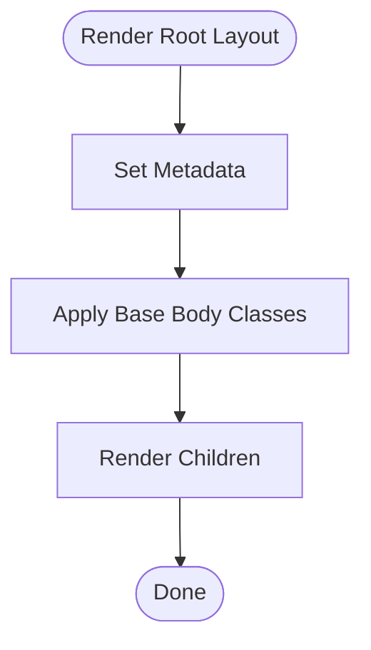
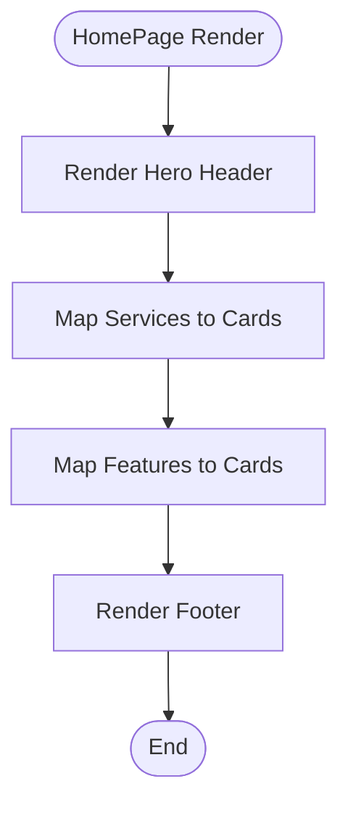
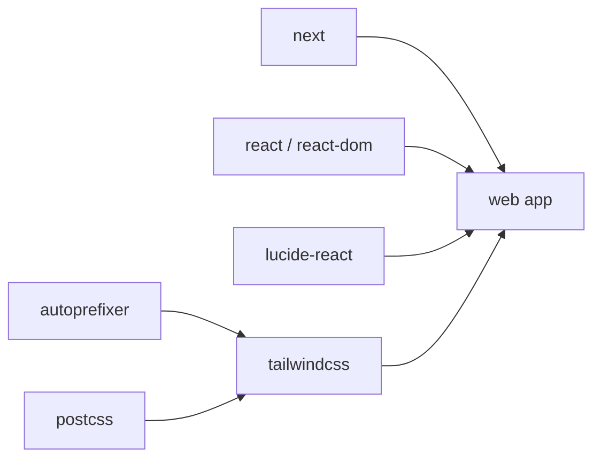

# UI Components & Patterns

<cite>
**Referenced Files in This Document**
- [package.json](file://apps/web/package.json)
- [tailwind.config.ts](file://apps/web/tailwind.config.ts)
- [layout.tsx](file://apps/web/src/app/layout.tsx)
- [page.tsx](file://apps/web/src/app/page.tsx)
- [globals.css](file://apps/web/src/app/globals.css)
</cite>

## Table of Contents
1. [Introduction](#introduction)
2. [Project Structure](#project-structure)
3. [Core Components](#core-components)
4. [Architecture Overview](#architecture-overview)
5. [Detailed Component Analysis](#detailed-component-analysis)
6. [Dependency Analysis](#dependency-analysis)
7. [Performance Considerations](#performance-considerations)
8. [Troubleshooting Guide](#troubleshooting-guide)
9. [Conclusion](#conclusion)
10. [Appendices](#appendices)

## Introduction
This document explains the frontend UI architecture, component patterns, and design system used in the Next.js application within this monorepo. The current codebase is a minimal Next.js App Router setup with Tailwind CSS for styling. It demonstrates foundational layout, global styles, and a landing page that composes simple data-driven sections. As the project grows, this guide provides patterns for building reusable components, managing state, handling events, ensuring accessibility, and maintaining responsive and cross-browser compatibility.

## Project Structure
The frontend lives under apps/web and uses:
- Next.js App Router for routing and layout
- Tailwind CSS for utility-first styling
- Lucide React for icons
- Global CSS variables for theme tokens

**Diagram sources**
- [package.json:1-28](file://apps/web/package.json#L1-L28)
- [tailwind.config.ts:1-31](file://apps/web/tailwind.config.ts#L1-L31)
- [layout.tsx:1-22](file://apps/web/src/app/layout.tsx#L1-L22)
- [page.tsx:1-81](file://apps/web/src/app/page.tsx#L1-L81)
- [globals.css:1-22](file://apps/web/src/app/globals.css#L1-L22)

**Section sources**
- [package.json:1-28](file://apps/web/package.json#L1-L28)
- [tailwind.config.ts:1-31](file://apps/web/tailwind.config.ts#L1-L31)
- [layout.tsx:1-22](file://apps/web/src/app/layout.tsx#L1-L22)
- [page.tsx:1-81](file://apps/web/src/app/page.tsx#L1-L81)
- [globals.css:1-22](file://apps/web/src/app/globals.css#L1-L22)

## Core Components
At present, the app has two primary files that define the UI surface:
- Root layout: sets metadata, language, base body classes, and selection colors using brand tokens.
- Home page: renders a header, service status grid, feature highlights, and a footer.

Key responsibilities:
- layout.tsx: global document structure, SEO metadata, and base typography/selection styles.
- page.tsx: composes static content and small inline components via JSX.

Design tokens and utilities:
- Tailwind configuration extends a brand color palette.
- Global CSS defines light/dark theme variables and a system font stack.

Accessibility basics present:
- Semantic HTML elements (main, header, section, footer).
- Language attribute on html.
- Dark mode support via prefers-color-scheme.

**Section sources**
- [layout.tsx:1-22](file://apps/web/src/app/layout.tsx#L1-L22)
- [page.tsx:1-81](file://apps/web/src/app/page.tsx#L1-L81)
- [tailwind.config.ts:1-31](file://apps/web/tailwind.config.ts#L1-L31)
- [globals.css:1-22](file://apps/web/src/app/globals.css#L1-L22)

## Architecture Overview
The frontend follows a minimal, layered approach:
- Layout layer: root layout provides shared document structure and global styles.
- Page layer: pages compose content and small presentational blocks.
- Styling layer: Tailwind utilities plus global CSS variables for theme tokens.
- Icons: Lucide React icons are available for consistent iconography.

**Diagram sources**
- [layout.tsx:1-22](file://apps/web/src/app/layout.tsx#L1-L22)
- [page.tsx:1-81](file://apps/web/src/app/page.tsx#L1-L81)
- [tailwind.config.ts:1-31](file://apps/web/tailwind.config.ts#L1-L31)
- [globals.css:1-22](file://apps/web/src/app/globals.css#L1-L22)
- [package.json:12-16](file://apps/web/package.json#L12-L16)

## Detailed Component Analysis

### Root Layout
Responsibilities:
- Declares document metadata (title, description).
- Sets lang="en" and applies base body classes including antialiased text and brand-based selection color.
- Renders children to compose pages.

Prop interface:
- children: React.ReactNode

Event handling:
- None at this level.

Accessibility:
- Semantic html/body structure.
- Language set for assistive technologies.

Responsive behavior:
- Uses Tailwind utilities for spacing and selection color; no breakpoints here.

**Diagram sources**
- [layout.tsx:1-22](file://apps/web/src/app/layout.tsx#L1-L22)

**Section sources**
- [layout.tsx:1-22](file://apps/web/src/app/layout.tsx#L1-L22)

### Home Page
Responsibilities:
- Renders a hero header with a status badge, title, and description.
- Displays a grid of infrastructure services as cards.
- Shows architectural highlights as a two-column grid.
- Includes a simple footer with copyright and port references.

Data model:
- Services array: name, role, port, badge.
- Features array: title, desc.

Rendering pattern:
- Maps over arrays to render lists of cards.
- Uses Tailwind grid and spacing utilities for responsive layouts.

Accessibility:
- Uses semantic headings and sections.
- No interactive controls yet; focus management not required.

State and events:
- No local state or event handlers currently.

**Diagram sources**
- [page.tsx:1-81](file://apps/web/src/app/page.tsx#L1-L81)

**Section sources**
- [page.tsx:1-81](file://apps/web/src/app/page.tsx#L1-L81)

### Design System and Tokens
- Brand palette: extended Tailwind colors under brand.* for consistent theming.
- Theme variables: CSS custom properties for background and foreground with dark mode support.
- Typography: system font stack defined in global CSS.

Usage guidance:
- Prefer brand.* tokens for primary actions and highlights.
- Use semantic HTML and Tailwind utilities for spacing and layout.
- Keep dark mode compatible by relying on CSS variables and Tailwind’s dark variants.

**Section sources**
- [tailwind.config.ts:1-31](file://apps/web/tailwind.config.ts#L1-L31)
- [globals.css:1-22](file://apps/web/src/app/globals.css#L1-L22)

## Dependency Analysis
Frontend dependencies:
- next: framework runtime and build tooling.
- react/react-dom: UI library.
- lucide-react: icon set.
- tailwindcss + autoprefixer/postcss: styling pipeline.

Dev dependencies:
- typescript and type definitions for Node and React.

**Diagram sources**
- [package.json:12-26](file://apps/web/package.json#L12-L26)

**Section sources**
- [package.json:1-28](file://apps/web/package.json#L1-L28)

## Performance Considerations
- Server Components: The current page is a default export function without client directives, which aligns with Next.js server-side rendering by default. This reduces client bundle size and improves initial load performance.
- Minimal JS: No client-side state or interactivity yet, keeping the JavaScript payload small.
- CSS strategy: Tailwind utilities and global CSS variables minimize custom CSS overhead.
- Images/media: Not present yet; when added, prefer optimized formats and lazy loading.

[No sources needed since this section provides general guidance]

## Troubleshooting Guide
Common issues and resolutions:
- Tailwind styles not applied:
  - Ensure content paths include src/app/**/*.{js,ts,jsx,tsx,mdx} and src/components/**/*.{...}.
  - Verify PostCSS and Autoprefixer are installed and configured.
- Dark mode not working:
  - Confirm prefers-color-scheme media query exists in globals.css.
  - Check that CSS variables are correctly scoped to :root.
- Font fallbacks:
  - The system font stack is defined globally; ensure no overriding font-family rules elsewhere.
- Selection color:
  - Brand selection color is applied via Tailwind class on body; verify it is present.

**Section sources**
- [tailwind.config.ts:3-8](file://apps/web/tailwind.config.ts#L3-L8)
- [globals.css:5-21](file://apps/web/src/app/globals.css#L5-L21)
- [layout.tsx:14-18](file://apps/web/src/app/layout.tsx#L14-L18)

## Conclusion
The frontend currently provides a solid foundation: a clean root layout, a content-focused home page, and a Tailwind-based design system with brand tokens and dark mode support. As features expand, adopt the patterns outlined below to maintain consistency, accessibility, and performance.

[No sources needed since this section summarizes without analyzing specific files]

## Appendices

### Guidelines for Creating New Components
- File organization:
  - Place reusable components under src/components with clear names (e.g., Button.tsx, Card.tsx).
  - Keep page-specific composition in src/app pages.
- Props and interfaces:
  - Define TypeScript interfaces for props.
  - Provide sensible defaults and validate required fields.
- Composition patterns:
  - Favor small, focused components composed into larger views.
  - Use children and slot-like props for flexible composition.
- Event handling:
  - Keep event handlers in parent components where possible; pass callbacks down as props.
  - Avoid inline logic in JSX; extract helpers when needed.
- Accessibility:
  - Use semantic elements (button, form, nav, main, section, article).
  - Add aria attributes only when necessary to enhance meaning.
  - Ensure keyboard navigation and focus states are visible.
- Responsive design:
  - Use Tailwind’s responsive prefixes (sm:, md:, lg:) to adapt layouts.
  - Test on mobile, tablet, and desktop viewports.
- Cross-browser compatibility:
  - Rely on Tailwind utilities and standard web APIs.
  - Validate CSS variables and dark mode behavior across browsers.
- Theming:
  - Extend Tailwind config for new tokens (colors, spacing, typography).
  - Centralize theme values in globals.css variables for consistency.

[No sources needed since this section provides general guidance]

### Example Patterns (Conceptual)
Note: These are conceptual examples to guide implementation. Replace placeholders with your actual component code.

- Button component
  - Props: variant ("primary", "secondary"), size ("sm", "md", "lg"), disabled, onClick, children.
  - Behavior: applies Tailwind classes based on variant/size; forwards click events.
  - Accessibility: role="button" if using non-button elements; ensure focus styles.

- Form component
  - Props: onSubmit, children, error messages.
  - Behavior: handles submit, validates inputs, displays errors.
  - Accessibility: associate labels with inputs; use aria-invalid and aria-describedby.

- Navigation component
  - Props: links array (label, href, active), onNavigate callback.
  - Behavior: renders list of links; highlights active link.
  - Accessibility: use nav landmark; add aria-current="page" for active link.

- Data display component
  - Props: items array, renderItem function, empty state message.
  - Behavior: maps items to rows/cards; shows empty state when no data.
  - Accessibility: provide meaningful headings and descriptions for datasets.

[No sources needed since this section provides general guidance]