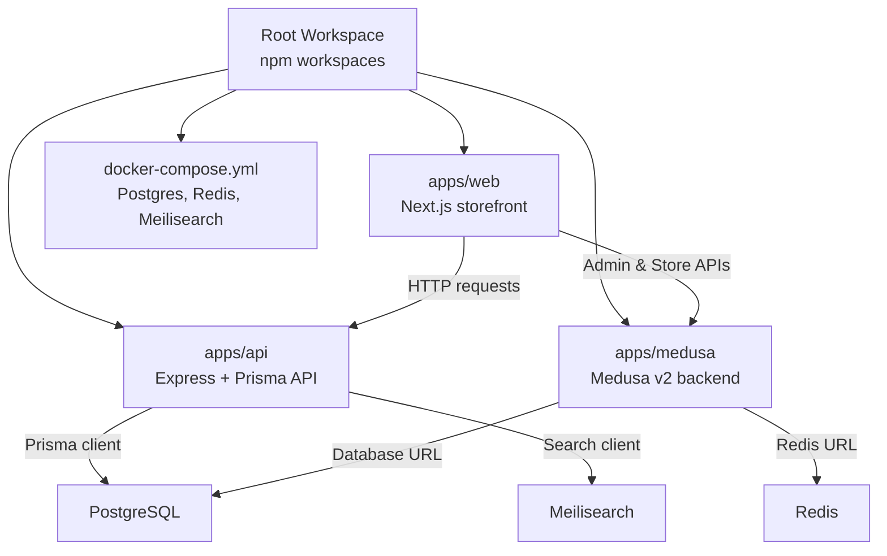
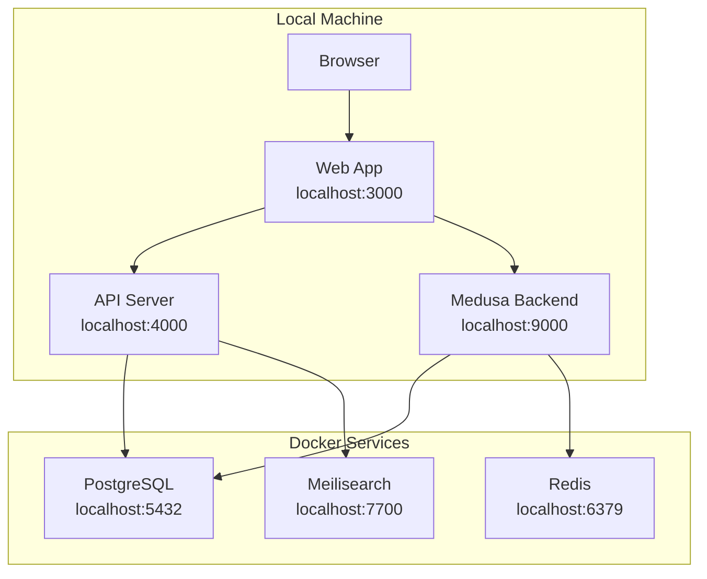
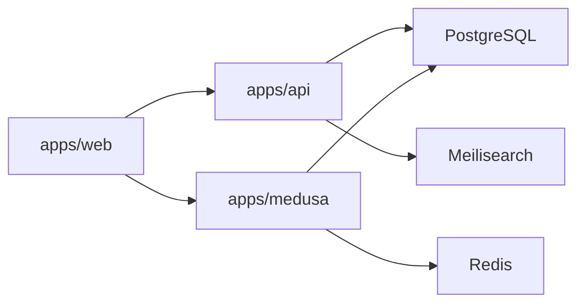

# Getting Started

<cite>
**Referenced Files in This Document**
- [docker-compose.yml](file://docker-compose.yml)
- [package.json](file://package.json)
- [apps/api/package.json](file://apps/api/package.json)
- [apps/web/package.json](file://apps/web/package.json)
- [apps/medusa/package.json](file://apps/medusa/package.json)
- [apps/api/src/main.ts](file://apps/api/src/main.ts)
- [apps/api/src/lib/prisma.ts](file://apps/api/src/lib/prisma.ts)
- [apps/medusa/medusa-config.ts](file://apps/medusa/medusa-config.ts)
- [apps/web/next.config.mjs](file://apps/web/next.config.mjs)
- [docs/architecture.md](file://docs/architecture.md)
- [PROJECT_CONTEXT_HANDOFF.md](file://PROJECT_CONTEXT_HANDOFF.md)
</cite>

## Table of Contents
1. [Introduction](#introduction)
2. [Project Structure](#project-structure)
3. [Core Components](#core-components)
4. [Architecture Overview](#architecture-overview)
5. [Detailed Component Analysis](#detailed-component-analysis)
6. [Dependency Analysis](#dependency-analysis)
7. [Performance Considerations](#performance-considerations)
8. [Troubleshooting Guide](#troubleshooting-guide)
9. [Conclusion](#conclusion)

## Introduction
This guide helps you set up and run the BD Commerce Platform locally. The platform is a monorepo with three main applications:
- Web storefront (Next.js) on port 3000
- API server (Express + Prisma) on port 4000
- Medusa backend (headless commerce engine) on port 9000

It also runs external services via Docker Compose:
- PostgreSQL for persistent data
- Redis for caching and queues
- Meilisearch for search indexing

You will install Node.js 22+, Docker, configure environment variables, start infrastructure with Docker Compose, initialize databases, and verify that all services are healthy.

## Project Structure
The repository uses npm workspaces to manage multiple apps under `apps/`. At the root, shared scripts orchestrate development, building, and Docker operations.

**Diagram sources**
- [package.json:6-25](file://package.json#L6-L25)
- [docker-compose.yml:1-77](file://docker-compose.yml#L1-L77)
- [apps/web/package.json:6-10](file://apps/web/package.json#L6-L10)
- [apps/api/package.json:7-14](file://apps/api/package.json#L7-L14)
- [apps/medusa/package.json:15-23](file://apps/medusa/package.json#L15-L23)

**Section sources**
- [package.json:1-39](file://package.json#L1-L39)
- [docker-compose.yml:1-77](file://docker-compose.yml#L1-L77)

## Core Components
- Web storefront: Next.js application serving the customer-facing store.
- API server: Express-based API using Prisma to interact with PostgreSQL.
- Medusa backend: Headless commerce engine providing admin and store APIs.
- Infrastructure: PostgreSQL, Redis, and Meilisearch containers orchestrated by Docker Compose.

Key ports:
- Web: 3000
- API: 4000
- Medusa: 9000
- PostgreSQL: 5432
- Redis: 6379
- Meilisearch: 7700

**Section sources**
- [apps/web/package.json:6-10](file://apps/web/package.json#L6-L10)
- [apps/api/src/main.ts:12-13](file://apps/api/src/main.ts#L12-L13)
- [apps/medusa/package.json:15-18](file://apps/medusa/package.json#L15-L18)
- [docker-compose.yml:10-11](file://docker-compose.yml#L10-L11)
- [docker-compose.yml:34-35](file://docker-compose.yml#L34-L35)
- [docker-compose.yml:54-55](file://docker-compose.yml#L54-L55)

## Architecture Overview
The runtime architecture connects the frontend, API, and Medusa backend to shared infrastructure.

**Diagram sources**
- [apps/web/package.json:6-10](file://apps/web/package.json#L6-L10)
- [apps/api/src/main.ts:12-13](file://apps/api/src/main.ts#L12-L13)
- [apps/medusa/package.json:15-18](file://apps/medusa/package.json#L15-L18)
- [docker-compose.yml:1-77](file://docker-compose.yml#L1-L77)

## Detailed Component Analysis

### Development Environment Setup
Requirements:
- Node.js 22+
- Docker and Docker Compose
- npm (bundled with Node.js)

Recommended steps:
1. Install Node.js 22+ from the official installer or your package manager.
2. Verify Node.js version:
   - node --version
3. Install Docker Desktop or your preferred Docker engine.
4. Verify Docker:
   - docker --version
   - docker compose version

Workspace installation:
- From the repository root, install dependencies:
  - npm install

This installs workspace packages for apps/web, apps/api, and apps/medusa.

**Section sources**
- [apps/medusa/package.json:57-60](file://apps/medusa/package.json#L57-L60)
- [package.json:6-9](file://package.json#L6-L9)
- [package.json:10-25](file://package.json#L10-L25)

### Docker Compose Infrastructure
The project provides a Docker Compose file that starts:
- PostgreSQL with default database bd_commerce
- Redis with optional password
- Meilisearch with master key

Default ports:
- PostgreSQL: 5432
- Redis: 6379
- Meilisearch: 7700

Start infrastructure:
- docker compose up -d

Stop infrastructure:
- docker compose down

View logs:
- docker compose logs -f

Check running services:
- docker compose ps

Environment variables for infrastructure can be overridden via an .env file at the repository root. If not present, defaults are applied inside docker-compose.yml.

**Section sources**
- [docker-compose.yml:1-77](file://docker-compose.yml#L1-L77)

### Initial Configuration
Environment variables:
- Create a root .env file if it does not exist.
- Define required variables for:
  - Database connection (DATABASE_URL)
  - Redis connection (REDIS_URL)
  - CORS origins for web, admin, and auth
  - JWT and cookie secrets
  - Meilisearch URL and master key
  - Optional payment gateway credentials

Reference configuration names and examples are documented in the architecture documentation.

Important notes:
- The API server loads environment variables from the root .env file.
- Medusa loads environment variables from both the parent directory and its own directory.
- Some setups may rely on symlinks for .env files; ensure they resolve correctly in your environment.

**Section sources**
- [apps/api/src/main.ts:2-6](file://apps/api/src/main.ts#L2-L6)
- [apps/medusa/medusa-config.ts:4-5](file://apps/medusa/medusa-config.ts#L4-L5)
- [docs/architecture.md:915-985](file://docs/architecture.md#L915-L985)
- [PROJECT_CONTEXT_HANDOFF.md:183-197](file://PROJECT_CONTEXT_HANDOFF.md#L183-L197)

### Database Setup and Migrations
PostgreSQL is managed by Docker Compose. The API uses Prisma to connect to the database.

Steps:
1. Ensure PostgreSQL container is running:
   - docker compose up -d postgres
2. Generate Prisma client:
   - npm run prisma:generate
3. Run migrations:
   - npm run prisma:migrate
4. Open Prisma Studio (optional):
   - npm run prisma:studio

Medusa also requires database migrations:
- npm run medusa:migrate

These commands apply schema changes defined in the API’s Prisma schema and Medusa modules.

**Section sources**
- [apps/api/package.json:11-14](file://apps/api/package.json#L11-L14)
- [apps/api/src/lib/prisma.ts:1-13](file://apps/api/src/lib/prisma.ts#L1-L13)
- [apps/medusa/package.json:15-23](file://apps/medusa/package.json#L15-L23)
- [package.json:18-21](file://package.json#L18-L21)

### Service Initialization and Starting Servers
Start each service in separate terminals or use background processes:

- Start the Web storefront:
  - npm run dev:web
  - Runs on http://localhost:3000

- Start the API server:
  - npm run dev:api
  - Runs on http://localhost:4000

- Start the Medusa backend:
  - npm run dev:medusa
  - Runs on http://localhost:9000

Verification endpoints:
- API health check:
  - curl http://localhost:4000/health
- Medusa admin interface:
  - Visit http://localhost:9000/admin
- Web storefront:
  - Visit http://localhost:3000

**Section sources**
- [package.json:10-17](file://package.json#L10-L17)
- [apps/web/package.json:6-10](file://apps/web/package.json#L6-L10)
- [apps/api/src/main.ts:18-35](file://apps/api/src/main.ts#L18-L35)
- [apps/medusa/package.json:15-18](file://apps/medusa/package.json#L15-L18)

### Seeding Demo Data
Demo seeding utilities exist within the Medusa app. Use the provided script path to seed demo products after migrations have been applied.

Typical flow:
1. Run Medusa migrations:
   - npm run medusa:migrate
2. Execute the demo product seed script located under apps/medusa/scripts.

If the seed script requires environment variables (for example, Medusa backend URL), ensure those are defined in your .env file.

**Section sources**
- [apps/medusa/package.json:15-23](file://apps/medusa/package.json#L15-L23)

## Dependency Analysis
The following diagram shows how the applications depend on infrastructure and each other.

**Diagram sources**
- [apps/web/package.json:6-10](file://apps/web/package.json#L6-L10)
- [apps/api/package.json:16-23](file://apps/api/package.json#L16-L23)
- [apps/medusa/package.json:25-39](file://apps/medusa/package.json#L25-L39)
- [docker-compose.yml:1-77](file://docker-compose.yml#L1-L77)

**Section sources**
- [apps/api/package.json:16-23](file://apps/api/package.json#L16-L23)
- [apps/medusa/package.json:25-39](file://apps/medusa/package.json#L25-L39)
- [docker-compose.yml:1-77](file://docker-compose.yml#L1-L77)

## Performance Considerations
- Use Docker volumes for PostgreSQL, Redis, and Meilisearch to persist data across restarts.
- Keep development logs verbose only when needed; production should reduce query logging.
- Avoid exposing sensitive keys like Meilisearch master keys to the browser; use read-only search keys where appropriate.
- Monitor container resource usage and adjust limits as needed during heavy indexing or migration tasks.

[No sources needed since this section provides general guidance]

## Troubleshooting Guide

Common issues and resolutions:

- Port conflicts:
  - If ports 3000, 4000, 9000, 5432, 6379, or 7700 are already in use, stop conflicting services or change ports in your environment variables and docker-compose.yml.

- Database connection errors:
  - Ensure PostgreSQL is running and DATABASE_URL points to the correct host, user, password, and database name.
  - Re-run migrations if schema mismatches occur.

- Redis connection errors:
  - Confirm REDIS_URL matches the Redis container settings and password if configured.

- Meilisearch connectivity:
  - Verify MEILISEARCH_URL and MEILI_MASTER_KEY are set correctly.
  - Check Meilisearch health endpoint at http://localhost:7700/health.

- CORS errors between Web, API, and Medusa:
  - Set STORE_CORS, ADMIN_CORS, and AUTH_CORS to include the relevant localhost URLs.

- Environment variable loading:
  - The API loads the root .env file explicitly.
  - Medusa loads environment variables from both the parent directory and its own directory.
  - If using symlinks for .env files, ensure they resolve correctly in your environment.

- Verifying services:
  - API health endpoint: http://localhost:4000/health
  - Medusa admin: http://localhost:9000/admin
  - Web storefront: http://localhost:3000

**Section sources**
- [apps/api/src/main.ts:18-35](file://apps/api/src/main.ts#L18-L35)
- [apps/medusa/medusa-config.ts:8-17](file://apps/medusa/medusa-config.ts#L8-L17)
- [PROJECT_CONTEXT_HANDOFF.md:183-197](file://PROJECT_CONTEXT_HANDOFF.md#L183-L197)

## Conclusion
You now have the BD Commerce Platform running locally with:
- Web storefront on port 3000
- API server on port 4000
- Medusa backend on port 9000
- PostgreSQL, Redis, and Meilisearch containers managed by Docker Compose

Use the provided npm scripts to develop, build, migrate, and seed data. Refer to the troubleshooting section if you encounter common setup issues. For advanced configuration, consult the environment variable reference in the architecture documentation.

[No sources needed since this section summarizes without analyzing specific files]