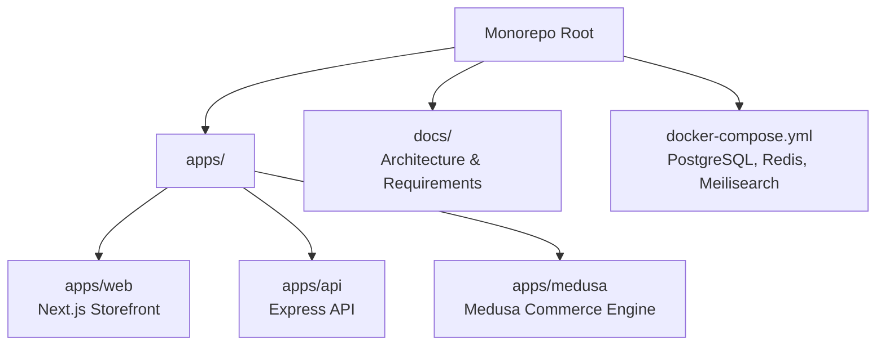
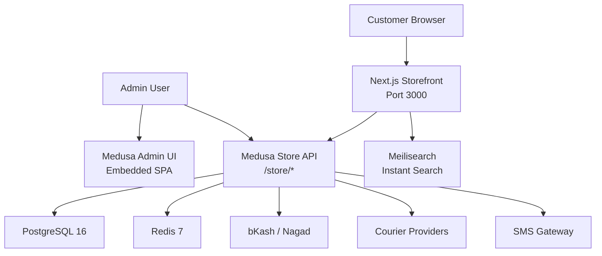
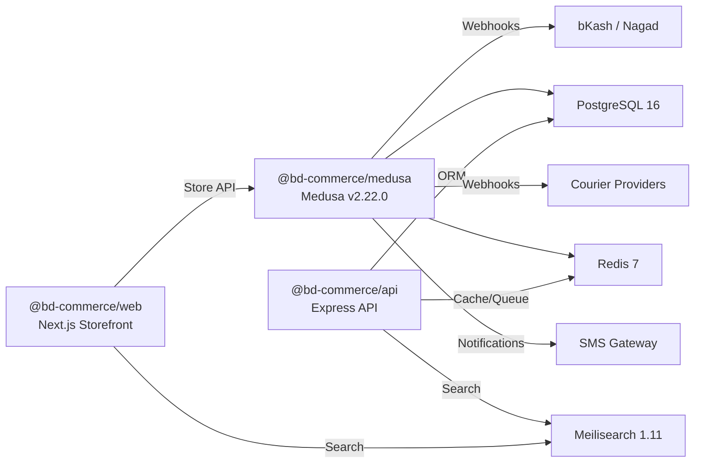

# Project Overview

<cite>
**Referenced Files in This Document**   
- [package.json](file://package.json)
- [apps/web/package.json](file://apps/web/package.json)
- [apps/api/package.json](file://apps/api/package.json)
- [apps/medusa/package.json](file://apps/medusa/package.json)
- [docker-compose.yml](file://docker-compose.yml)
- [prd.md](file://prd.md)
- [technical-plan.md](file://technical-plan.md)
- [ideaproposition.md](file://ideaproposition.md)
- [apps/web/src/app/layout.tsx](file://apps/web/src/app/layout.tsx)
- [apps/web/src/app/page.tsx](file://apps/web/src/app/page.tsx)
- [apps/api/src/main.ts](file://apps/api/src/main.ts)
- [apps/medusa/medusa-config.ts](file://apps/medusa/medusa-config.ts)
- [docs/architecture.md](file://docs/architecture.md)
- [database.md](file://database.md)
</cite>

## Table of Contents
1. [Introduction](#introduction)
2. [Project Structure](#project-structure)
3. [Core Components](#core-components)
4. [Architecture Overview](#architecture-overview)
5. [Detailed Component Analysis](#detailed-component-analysis)
6. [Dependency Analysis](#dependency-analysis)
7. [Performance Considerations](#performance-considerations)
8. [Troubleshooting Guide](#troubleshooting-guide)
9. [Conclusion](#conclusion)

## Introduction
BD Commerce Platform is a high-performance, single-vendor B2C e-commerce solution built specifically for the Bangladesh market. It combines a modern Next.js storefront with a headless Medusa commerce engine and an Express-based API layer, backed by PostgreSQL 16, Redis 7, and Meilisearch 1.11. The platform targets Bangladeshi consumers who expect fast mobile experiences, local payment methods (Cash on Delivery, bKash, Nagad), bilingual content (Bangla and English), and reliable nationwide delivery across all 64 districts.

The project purpose is to give a single merchant a trustworthy, scalable foundation that supports product browsing, variant selection, unified cart checkout, campaign landing pages, order tracking, returns and refunds, SMS notifications, contribution-profit reporting, and localized operations without forcing customers to create accounts or exposing unnecessary complexity.

Key business goals include launching COD, bKash, and Nagad payments; keeping catalog, pricing, stock, cart, and orders consistent everywhere; enabling non-technical staff to manage the store through a centralized Admin Panel; supporting Bangla and English without layout breakage; and presenting honest financial metrics rather than misleading profit figures.

**Section sources**
- [package.json:2-5](file://package.json#L2-L5)
- [prd.md:29-42](file://prd.md#L29-L42)
- [ideaproposition.md:16-38](file://ideaproposition.md#L16-L38)

## Project Structure
The repository follows a monorepo structure under `apps/`, separating three primary runtime concerns:

| Area | Responsibility | Primary Technology |
|---|---|---|
| Frontend Storefront | Customer-facing browsing, PDP, cart, checkout, campaign landing pages, localization | Next.js App Router |
| API Layer | Health checks, basic REST endpoints, Prisma-managed data access, Redis and Meilisearch integration | Express.js + TypeScript |
| Commerce Engine | Headless commerce core, custom BD modules, workflows, admin extensions | MedusaJS v2 |

**Diagram sources**
- [package.json:6-9](file://package.json#L6-L9)
- [apps/web/package.json:2-10](file://apps/web/package.json#L2-L10)
- [apps/api/package.json:2-14](file://apps/api/package.json#L2-L14)
- [apps/medusa/package.json:2-23](file://apps/medusa/package.json#L2-L23)
- [docker-compose.yml:1-77](file://docker-compose.yml#L1-L77)

The root workspace orchestrates development, build, and Docker commands for each app. The frontend package declares Next.js, React, Tailwind CSS, and TypeScript. The API package declares Express, Prisma, Redis, Meilisearch, and Zod validation. The Medusa package declares version 2.22.0 of the Medusa framework and related packages.

**Section sources**
- [package.json:10-25](file://package.json#L10-L25)
- [apps/web/package.json:12-26](file://apps/web/package.json#L12-L26)
- [apps/api/package.json:16-32](file://apps/api/package.json#L16-L32)
- [apps/medusa/package.json:25-55](file://apps/medusa/package.json#L25-L55)

## Core Components
The platform’s core components are intentionally separated so each layer can evolve independently while sharing a single source of truth for commerce data.

### Next.js Storefront
The storefront is a Next.js application using the App Router. Its root layout sets metadata describing the platform as a high-performance B2C e-commerce solution. The current homepage displays infrastructure services, architectural pillars, and port references for the web and API layers.

Key responsibilities:
- Mobile-first customer experience.
- Product detail pages with variants, pricing, stock state, and delivery charge preview.
- Unified cart behavior where Add to Cart and Buy Now preserve existing items.
- One-page checkout adapted for Bangladesh address structure and payment options.
- Campaign landing pages that reuse the same catalog, cart, and order system.
- Bangla and English language support.

**Section sources**
- [apps/web/package.json:2-16](file://apps/web/package.json#L2-L16)
- [apps/web/src/app/layout.tsx:4-7](file://apps/web/src/app/layout.tsx#L4-L7)
- [apps/web/src/app/page.tsx:10-15](file://apps/web/src/app/page.tsx#L10-L15)
- [technical-plan.md:45-50](file://technical-plan.md#L45-L50)
- [technical-plan.md:394-434](file://technical-plan.md#L394-L434)

### Express API Layer
The API layer is an Express server initialized from `src/main.ts`. It loads environment configuration, enables CORS, parses JSON, exposes a health endpoint connected to PostgreSQL via Prisma, and provides a basic API discovery route.

Key responsibilities:
- Lightweight backend API surface.
- Health check reporting service status, uptime, timestamp, and database connectivity.
- Integration points for Prisma-managed data, Redis, and Meilisearch.
- Clear separation from the Medusa commerce engine.

**Section sources**
- [apps/api/package.json:2-23](file://apps/api/package.json#L2-L23)
- [apps/api/src/main.ts:1-17](file://apps/api/src/main.ts#L1-L17)
- [apps/api/src/main.ts:18-35](file://apps/api/src/main.ts#L18-L35)
- [apps/api/src/main.ts:37-54](file://apps/api/src/main.ts#L37-L54)

### Medusa Commerce Engine
The Medusa backend is configured through `medusa-config.ts`. It loads environment variables, configures database and Redis URLs, sets CORS boundaries for store, admin, and auth routes, and registers Bangladesh-specific modules such as catalog, orders, courier, payments, campaigns, settings, and audit.

Key responsibilities:
- Headless commerce engine with native product, pricing, inventory, cart, order, payment, and fulfillment primitives.
- Custom BD modules extending commerce behavior for Bangladesh operations.
- Embedded Admin UI extension point for operational screens.
- Workflow-driven reliability for multi-step order, payment, courier, and return processes.

**Section sources**
- [apps/medusa/package.json:25-39](file://apps/medusa/package.json#L25-L39)
- [apps/medusa/medusa-config.ts:1-18](file://apps/medusa/medusa-config.ts#L1-L18)
- [apps/medusa/medusa-config.ts:19-44](file://apps/medusa/medusa-config.ts#L19-L44)
- [docs/architecture.md:98-110](file://docs/architecture.md#L98-L110)

### Infrastructure Services
Docker Compose defines the production-like runtime dependencies:

| Service | Image / Version | Purpose |
|---|---|---|
| PostgreSQL | `postgres:16-alpine` | Relational database for Medusa core tables, custom BD models, audit logs, and snapshots |
| Redis | `redis:7-alpine` | Cache, session broker, workflow queue, distributed locks, rate limiting |
| Meilisearch | `getmeili/meilisearch:v1.11` | Instant search index for products with typo tolerance and filtering |

**Section sources**
- [docker-compose.yml:1-20](file://docker-compose.yml#L1-L20)
- [docker-compose.yml:22-44](file://docker-compose.yml#L22-L44)
- [docker-compose.yml:46-64](file://docker-compose.yml#L46-L64)
- [technical-plan.md:52-55](file://technical-plan.md#L52-L55)

## Architecture Overview
At a high level, the platform separates presentation, API routing, commerce domain logic, data storage, and external integrations.

**Diagram sources**
- [docs/architecture.md:77-124](file://docs/architecture.md#L77-L124)
- [technical-plan.md:59-112](file://technical-plan.md#L59-L112)
- [docker-compose.yml:1-77](file://docker-compose.yml#L1-L77)

The architecture emphasizes:
- Single-source commerce data shared by storefront, campaign landing pages, and Admin tools.
- Zero-trust handling of external callbacks from payment providers and couriers.
- Workflows for transactional multi-step operations.
- Separation between Medusa core modules and Bangladesh-specific modules.
- Localized operations including BDT currency, COD confirmation, delivery zones, and Bangla/English content.

**Section sources**
- [docs/architecture.md:44-74](file://docs/architecture.md#L44-L74)
- [technical-plan.md:22-27](file://technical-plan.md#L22-L27)

## Detailed Component Analysis

### Target Audience and Use Cases
The platform serves two primary audiences:

| Audience | Typical Use Case |
|---|---|
| End Customers | Browse categories, select product variants, add items to cart, use Buy Now, complete checkout with COD or online payment, track orders, request returns |
| Business Staff | Manage catalog, variants, inventory, orders, delivery zones, payments, returns, campaign landing pages, invoices, reports, and store content |

Use cases include:
- A first-time guest customer placing a COD order without creating an account.
- A registered customer returning to checkout after abandoning their cart.
- A marketing team publishing a campaign landing page with direct checkout.
- A call-center agent confirming COD orders before dispatch.
- A warehouse operator booking a courier and updating shipment status.
- A finance user recording manual refunds and reviewing contribution profit.

**Section sources**
- [prd.md:43-51](file://prd.md#L43-L51)
- [prd.md:95-131](file://prd.md#L95-L131)
- [prd.md:294-313](file://prd.md#L294-L313)
- [technical-plan.md:301-391](file://technical-plan.md#L301-L391)

### Local Payment Methods
The platform requires Cash on Delivery, bKash, and Nagad at launch. COD is available immediately, while bKash and Nagad direct Merchant API integrations are built into the platform but require merchant approval and credential setup before actual transactions become operational.

Payment characteristics:
- BDT is the only supported currency.
- Online payments redirect to provider gateways without creating an orphan order.
- Order creation and stock deduction occur only after verified server-to-server payment capture.
- Disabling a payment method hides it from checkout without altering historical records.
- Duplicate webhooks or callbacks must not create duplicate payments or orders.

**Section sources**
- [prd.md:256-291](file://prd.md#L256-L291)
- [technical-plan.md:511-548](file://technical-plan.md#L511-L548)
- [docs/architecture.md:467-507](file://docs/architecture.md#L467-L507)

### Multi-Language Support
Bangla and English are core requirements for both storefront and Admin Panel. The platform supports:
- A visible language switch.
- Preserving page context and cart state when switching languages.
- Separate Bangla and English fields for Admin-managed content.
- Stable visual rendering for Bangla and Latin text.
- Fallback behavior when saved preferences cannot be read.

Default behavior for first-time storefront visitors is English, with Bangla immediately available.

**Section sources**
- [prd.md:357-389](file://prd.md#L357-L389)
- [technical-plan.md:45-50](file://technical-plan.md#L45-L50)
- [ideaproposition.md:189-225](file://ideaproposition.md#L189-L225)

### Nationwide Delivery Across All 64 Districts
Delivery is modeled around Bangladesh’s administrative hierarchy: Division, District, Upazila/Thana, and street address. The platform enforces at least Inside Dhaka and Outside Dhaka delivery zones with configurable charges, while preserving room for finer zone rules later.

Delivery characteristics:
- Address capture ensures unambiguous courier mapping.
- Delivery charges are stored as snapshots at order time.
- Manual courier fallback remains available if APIs are unavailable.
- Failed delivery and RTO flows are staff-managed, not automatic.

**Section sources**
- [prd.md:392-414](file://prd.md#L392-L414)
- [technical-plan.md:512-542](file://technical-plan.md#L512-L542)
- [database.md:512-529](file://database.md#L512-L529)

### Competitive Advantages
Compared with generic global platforms, BD Commerce Platform is optimized for Bangladesh-specific realities:
- Local payment methods with direct Merchant API direction.
- COD confirmation workflow suited to call-center operations.
- Bilingual storefront and Admin Panel with stable typography.
- Delivery zones aligned with courier requirements across 64 districts.
- Contribution-profit reporting that includes COGS, delivery fees, payment fees, RTO costs, and ad spend estimates.
- Manual-only return and refund processing with full audit logging.

**Section sources**
- [prd.md:29-42](file://prd.md#L29-L42)
- [technical-plan.md:22-27](file://technical-plan.md#L22-L27)
- [technical-plan.md:629-654](file://technical-plan.md#L629-L654)

## Dependency Analysis
The monorepo has clear internal and external dependencies.

**Diagram sources**
- [apps/web/package.json:12-16](file://apps/web/package.json#L12-L16)
- [apps/api/package.json:16-23](file://apps/api/package.json#L16-L23)
- [apps/medusa/package.json:25-39](file://apps/medusa/package.json#L25-L39)
- [docker-compose.yml:1-77](file://docker-compose.yml#L1-L77)
- [docs/architecture.md:120-124](file://docs/architecture.md#L120-L124)

Internal coupling:
- The storefront depends on the Medusa store API and optional Meilisearch search.
- The Express API depends on PostgreSQL, Redis, and Meilisearch.
- Medusa owns commerce domain logic and custom BD modules.

External coupling:
- Payment providers require merchant credentials and verification.
- Courier providers require API access and may fall back to manual operations.
- SMS gateway selection is a post-setup dependency even though notification infrastructure is required in Phase 1.

**Section sources**
- [prd.md:256-291](file://prd.md#L256-L291)
- [prd.md:400-408](file://prd.md#L400-L408)
- [technical-plan.md:511-594](file://technical-plan.md#L511-L594)

## Performance Considerations
The platform targets performance through layered caching, efficient search, and strict data modeling:

- **Database:** PostgreSQL 16 provides ACID transactions, relational integrity, and JSONB support for flexible attributes and snapshots.
- **Cache and Queue:** Redis 7 supports workflow queues, pub/sub events, distributed locks for concurrent checkout, rate limiting, and session storage.
- **Search:** Meilisearch 1.11 delivers instant search with typo tolerance, filterable facets, and Banglish keyword support.
- **Frontend Rendering:** Next.js App Router supports server-side rendering, static generation, and client-side interactivity for cart and checkout.
- **Data Integrity:** Monetary values and snapshots are designed to avoid floating-point errors and ensure historical consistency.

**Section sources**
- [technical-plan.md:52-55](file://technical-plan.md#L52-L55)
- [technical-plan.md:402-432](file://technical-plan.md#L402-L432)
- [technical-plan.md:435-464](file://technical-plan.md#L435-L464)
- [database.md:88-124](file://database.md#L88-L124)

## Troubleshooting Guide
Common operational issues and their expected handling:

| Issue | Expected Behavior |
|---|---|
| Database disconnected during health check | `/health` reports database status as disconnected or error/offline |
| Payment webhook arrives twice | Idempotent processing prevents duplicate payments or orders |
| Payment gateway callback is unverified | Server performs server-to-server verification before capturing payment |
| Courier API is unavailable | Manual fallback allows consignment ID entry and status updates |
| SMS gateway fails | Failure is logged with retry or manual resend; order status is not corrupted |
| Language preference cannot be read | System falls back to default language and keeps the switch functional |
| Missing translation for critical content | Publishing is blocked or warned until resolved |

Operational safeguards include:
- Zero-trust webhook validation.
- Audit logging for sensitive actions.
- Role-based access control for Admin operations.
- Backup and restore procedures verified before launch.
- Rate limiting on login, order placement, and tracking endpoints.

**Section sources**
- [apps/api/src/main.ts:18-35](file://apps/api/src/main.ts#L18-L35)
- [prd.md:418-442](file://prd.md#L418-L442)
- [technical-plan.md:657-686](file://technical-plan.md#L657-L686)
- [docs/architecture.md:336-361](file://docs/architecture.md#L336-L361)

## Conclusion
BD Commerce Platform is a Bangladesh-focused B2C e-commerce system that balances enterprise-grade commerce primitives with local market needs. Its monorepo architecture cleanly separates the Next.js storefront, Express API layer, and Medusa commerce engine, while PostgreSQL, Redis, and Meilisearch provide durable data, caching, and search capabilities.

The platform’s competitive advantage lies in its focus on COD, bKash, and Nagad; Bangla and English support; nationwide delivery across all 64 districts; manual return and refund controls; and contribution-profit reporting tailored to Bangladesh logistics and advertising realities. For merchants operating in Bangladesh, it offers a practical, auditable, and extensible foundation ready for launch and growth.