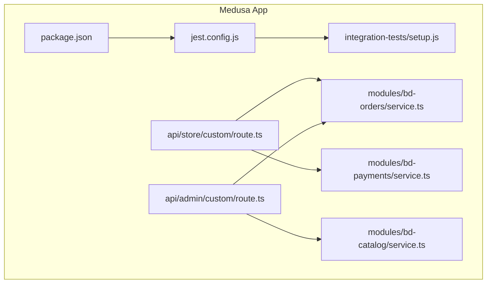
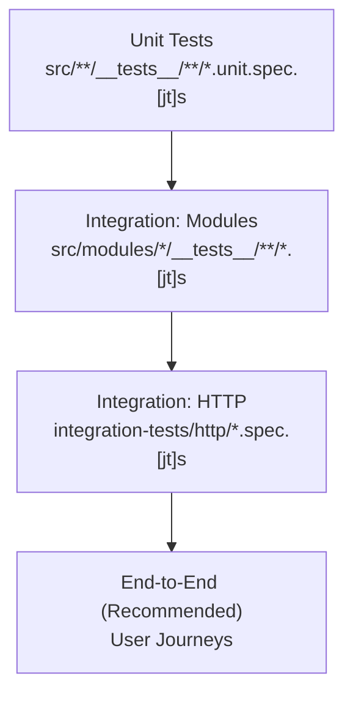
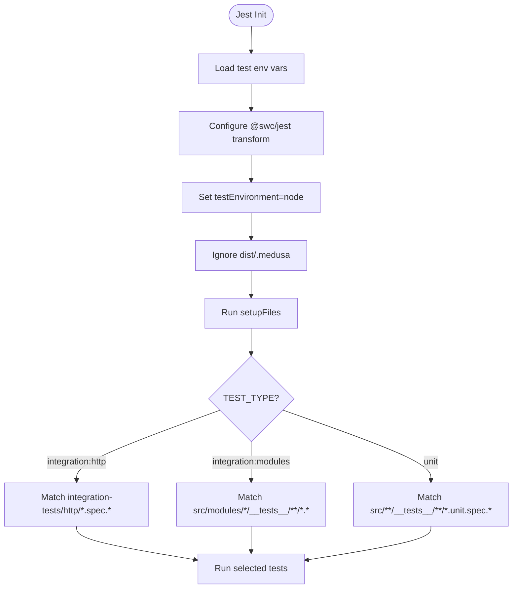
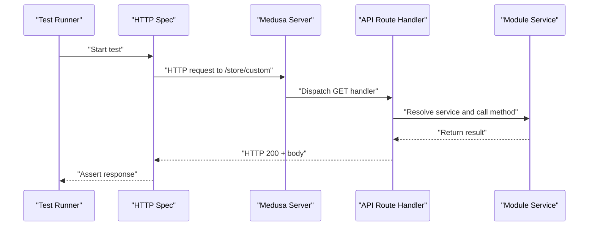
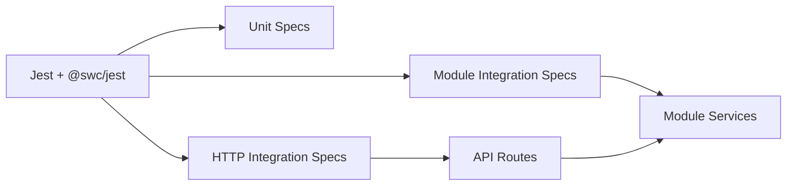

# Testing Strategy

<cite>
**Referenced Files in This Document**
- [jest.config.js](file://apps/medusa/jest.config.js)
- [package.json](file://apps/medusa/package.json)
- [setup.js](file://apps/medusa/integration-tests/setup.js)
- [service.ts (bd-orders)](file://apps/medusa/src/modules/bd-orders/service.ts)
- [service.ts (bd-payments)](file://apps/medusa/src/modules/bd-payments/service.ts)
- [service.ts (bd-catalog)](file://apps/medusa/src/modules/bd-catalog/service.ts)
- [route.ts (store/custom)](file://apps/medusa/src/api/store/custom/route.ts)
- [route.ts (admin/custom)](file://apps/medusa/src/api/admin/custom/route.ts)
</cite>

## Table of Contents
1. [Introduction](#introduction)
2. [Project Structure](#project-structure)
3. [Core Components](#core-components)
4. [Architecture Overview](#architecture-overview)
5. [Detailed Component Analysis](#detailed-component-analysis)
6. [Dependency Analysis](#dependency-analysis)
7. [Performance Considerations](#performance-considerations)
8. [Troubleshooting Guide](#troubleshooting-guide)
9. [Conclusion](#conclusion)

## Introduction
This document defines the testing strategy for the BD Commerce Platform, focusing on unit, integration, and end-to-end testing across Medusa modules and API routes. It explains how Jest is configured, how tests are organized, and how to test custom modules, API endpoints, and database-backed services. It also outlines quality gates, CI recommendations, and domain-specific best practices for e-commerce workflows such as orders, payments, catalog operations, and admin/store integrations.

## Project Structure
The testing setup lives under the Medusa application:
- Jest configuration and environment loading
- Test scripts for unit and integration suites
- A shared setup file used by all tests
- Custom modules with services that wrap data models
- API route handlers for store and admin surfaces

**Diagram sources**
- [jest.config.js:1-28](file://apps/medusa/jest.config.js#L1-L28)
- [package.json:15-24](file://apps/medusa/package.json#L15-L24)
- [setup.js:1-4](file://apps/medusa/integration-tests/setup.js#L1-L4)
- [service.ts (bd-orders):1-13](file://apps/medusa/src/modules/bd-orders/service.ts#L1-L13)
- [service.ts (bd-payments):1-11](file://apps/medusa/src/modules/bd-payments/service.ts#L1-L11)
- [service.ts (bd-catalog):1-15](file://apps/medusa/src/modules/bd-catalog/service.ts#L1-L15)
- [route.ts (store/custom):1-9](file://apps/medusa/src/api/store/custom/route.ts#L1-L9)
- [route.ts (admin/custom):1-9](file://apps/medusa/src/api/admin/custom/route.ts#L1-L9)

**Section sources**
- [jest.config.js:1-28](file://apps/medusa/jest.config.js#L1-L28)
- [package.json:15-24](file://apps/medusa/package.json#L15-L24)
- [setup.js:1-4](file://apps/medusa/integration-tests/setup.js#L1-L4)

## Core Components
- Jest configuration:
  - Uses @swc/jest for TypeScript transformation with decorators enabled
  - Node test environment
  - Ignores dist and .medusa directories
  - Loads test environment variables via Medusa utilities
  - Applies a shared setup file
  - Selects test patterns based on TEST_TYPE:
    - integration:http
    - integration:modules
    - unit
- Test scripts:
  - Unit tests: run with TEST_TYPE=unit
  - Module integration tests: run with TEST_TYPE=integration:modules
  - HTTP integration tests: run with TEST_TYPE=integration:http
- Shared setup:
  - Clears MikroORM metadata storage before each test run to avoid state leakage between tests

**Section sources**
- [jest.config.js:1-28](file://apps/medusa/jest.config.js#L1-L28)
- [package.json:15-24](file://apps/medusa/package.json#L15-L24)
- [setup.js:1-4](file://apps/medusa/integration-tests/setup.js#L1-L4)

## Architecture Overview
The testing architecture follows a test pyramid:
- Unit tests: validate module service logic in isolation
- Integration tests:
  - Modules: verify service interactions with the ORM and database
  - HTTP: verify API route behavior over real HTTP requests
- End-to-end tests: not present yet; recommended for critical user journeys (e.g., checkout)

[No sources needed since this diagram shows conceptual workflow, not actual code structure]

## Detailed Component Analysis

### Jest Configuration and Environment
Key behaviors:
- Transforms TypeScript using @swc/jest with decorator support
- Runs in Node environment
- Ignores build artifacts and Medusa runtime directories
- Loads test environment variables
- Applies a global setup to clear ORM metadata
- Dynamically selects test files based on TEST_TYPE

**Diagram sources**
- [jest.config.js:1-28](file://apps/medusa/jest.config.js#L1-L28)
- [setup.js:1-4](file://apps/medusa/integration-tests/setup.js#L1-L4)

**Section sources**
- [jest.config.js:1-28](file://apps/medusa/jest.config.js#L1-L28)
- [setup.js:1-4](file://apps/medusa/integration-tests/setup.js#L1-L4)

### Unit Testing Strategy for Custom Modules
Focus areas:
- Validate service methods exposed by MedusaService wrappers
- Assert correct model associations and query results
- Use pure functions or minimal mocks where possible

Recommended approach:
- Place unit tests under src/<module>/__tests__/*.unit.spec.ts
- Mock external dependencies (e.g., third-party SDKs) while keeping ORM calls real if you want lightweight integration
- For pure business logic, assert inputs/outputs without network or DB

Example targets:
- bd-orders service: order details, risk profiles, return requests
- bd-payments service: transaction records, webhook logs
- bd-catalog service: product localization, variant costs, attributes

**Section sources**
- [service.ts (bd-orders):1-13](file://apps/medusa/src/modules/bd-orders/service.ts#L1-L13)
- [service.ts (bd-payments):1-11](file://apps/medusa/src/modules/bd-payments/service.ts#L1-L11)
- [service.ts (bd-catalog):1-15](file://apps/medusa/src/modules/bd-catalog/service.ts#L1-L15)

### Integration Testing for Service Interactions
Goals:
- Verify service methods interact correctly with the database
- Ensure migrations and schema are applied in test DB
- Validate transactions and constraints

Approach:
- Use TEST_TYPE=integration:modules to run tests under src/modules/*/__tests__
- Leverage Medusa’s test utilities to spin up a test container or in-memory DB
- Seed deterministic data per test suite
- Assert side effects like audit logs, payment webhook entries, and catalog updates

**Section sources**
- [jest.config.js:21-27](file://apps/medusa/jest.config.js#L21-L27)

### Integration Testing for API Endpoints
Goals:
- Validate HTTP endpoints for store and admin APIs
- Assert status codes, response shapes, and authorization rules
- Exercise cross-module flows (e.g., placing an order triggers payment and audit events)

Approach:
- Use TEST_TYPE=integration:http to run tests under integration-tests/http
- Start the Medusa server within the test runner or use a test harness provided by Medusa
- Send HTTP requests to /store/custom and /admin/custom routes and assert responses

**Diagram sources**
- [route.ts (store/custom):1-9](file://apps/medusa/src/api/store/custom/route.ts#L1-L9)
- [route.ts (admin/custom):1-9](file://apps/medusa/src/api/admin/custom/route.ts#L1-L9)
- [jest.config.js:21-27](file://apps/medusa/jest.config.js#L21-L27)

**Section sources**
- [route.ts (store/custom):1-9](file://apps/medusa/src/api/store/custom/route.ts#L1-L9)
- [route.ts (admin/custom):1-9](file://apps/medusa/src/api/admin/custom/route.ts#L1-L9)
- [jest.config.js:21-27](file://apps/medusa/jest.config.js#L21-L27)

### Database Operations Testing
Guidelines:
- Use a dedicated test database or in-memory SQLite for speed
- Apply migrations before running tests
- Seed fixtures deterministically
- Roll back or reset state between tests
- Clear ORM metadata at startup to prevent cross-test contamination

Implementation notes:
- The shared setup clears MikroORM metadata to ensure clean state
- Prefer transactional tests where supported to speed up execution

**Section sources**
- [setup.js:1-4](file://apps/medusa/integration-tests/setup.js#L1-L4)

### Mocking Strategies
Recommendations:
- Mock external services (payment gateways, courier APIs) to isolate tests
- Use Jest spies and jest.fn() for function-level mocks
- For ORM interactions, prefer real DB in integration tests and mock only when necessary
- Keep mocks close to the boundary they replace (e.g., HTTP clients, email providers)

[No sources needed since this section provides general guidance]

### End-to-End Testing for User Workflows
Scope:
- Critical e-commerce flows: browse catalog, add to cart, checkout, payment confirmation, order fulfillment, returns
- Admin flows: manage products, view orders, configure settings

Approach:
- Not implemented yet; recommend adding a separate E2E suite (e.g., Playwright)
- Target stable URLs and use feature flags to control test data
- Record failures with screenshots and logs

[No sources needed since this section provides general guidance]

## Dependency Analysis
Tests depend on:
- Jest and @swc/jest for execution and transformation
- Medusa test utilities for bootstrapping
- Module services for business logic verification
- API routes for HTTP integration

**Diagram sources**
- [package.json:40-55](file://apps/medusa/package.json#L40-L55)
- [jest.config.js:1-28](file://apps/medusa/jest.config.js#L1-L28)

**Section sources**
- [package.json:40-55](file://apps/medusa/package.json#L40-L55)
- [jest.config.js:1-28](file://apps/medusa/jest.config.js#L1-L28)

## Performance Considerations
- Run unit tests in parallel by default; keep them fast and isolated
- Use --runInBand for integration tests to avoid resource contention
- Prefer in-memory databases for speed during development
- Limit seed data size and scope fixtures per test
- Avoid heavy external calls; mock network-bound services

[No sources needed since this section provides general guidance]

## Troubleshooting Guide
Common issues and resolutions:
- Metadata leakage between tests:
  - Ensure setupFiles runs and clears MikroORM metadata
- TypeScript compilation errors:
  - Confirm @swc/jest transform is active and decorators are enabled
- Wrong test pattern matched:
  - Verify TEST_TYPE matches the intended suite
- Missing environment variables:
  - Ensure loadEnv("test", ...) is executed before starting tests

Actionable checks:
- Confirm setup.js clears MetadataStorage
- Validate jest.config.js paths and transforms
- Run individual test types using package scripts

**Section sources**
- [setup.js:1-4](file://apps/medusa/integration-tests/setup.js#L1-L4)
- [jest.config.js:1-28](file://apps/medusa/jest.config.js#L1-L28)
- [package.json:15-24](file://apps/medusa/package.json#L15-L24)

## Conclusion
The BD Commerce Platform’s testing foundation centers on Jest with clear separation between unit, module integration, and HTTP integration tests. The configuration supports TypeScript with decorators, isolates test environments, and provides a shared setup to maintain clean state. To mature the QA process, adopt consistent test placement conventions, expand coverage across modules and API routes, introduce E2E scenarios for critical user journeys, and integrate automated quality checks into CI pipelines.