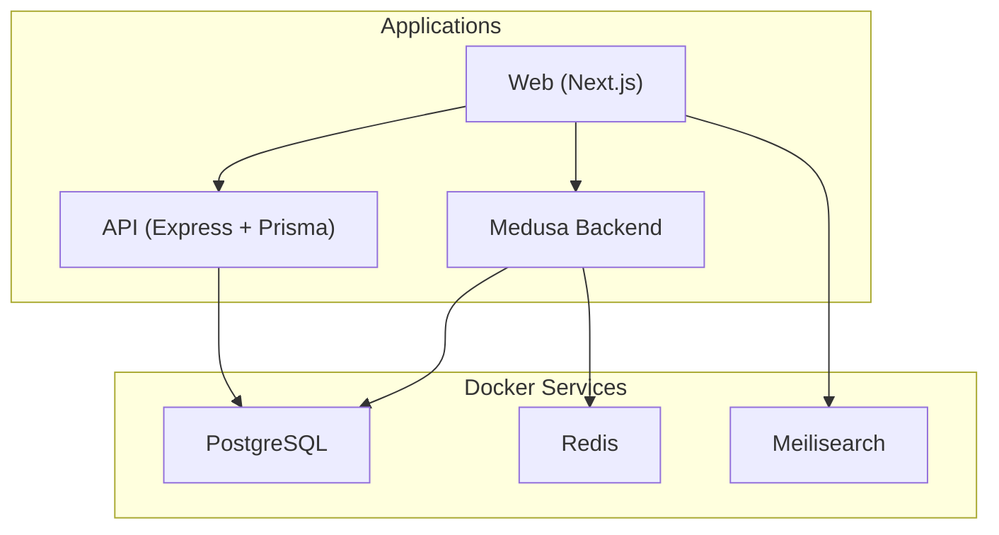
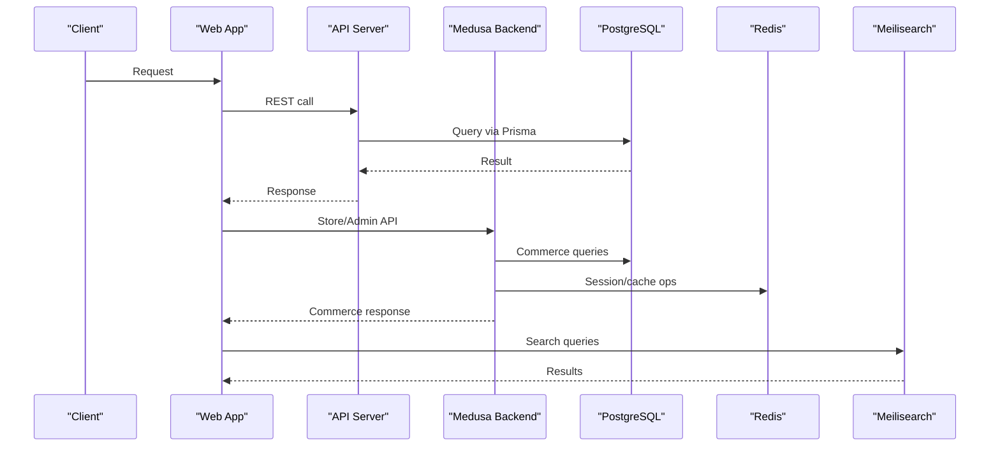
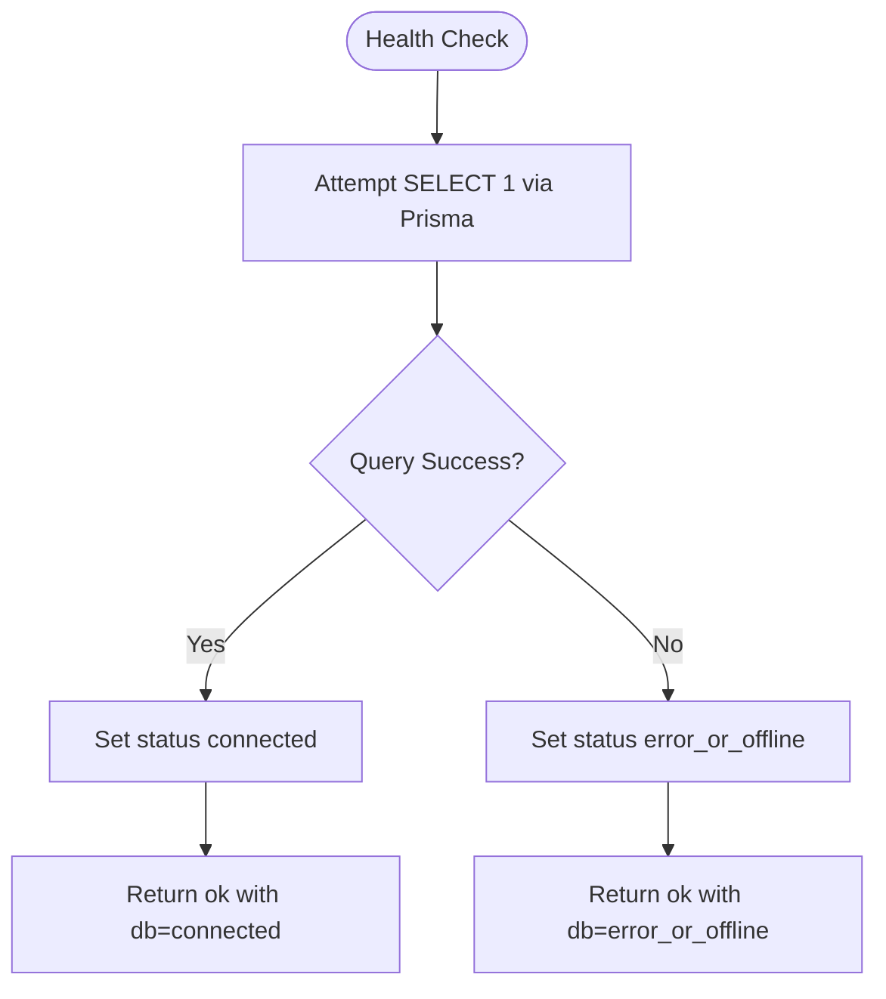
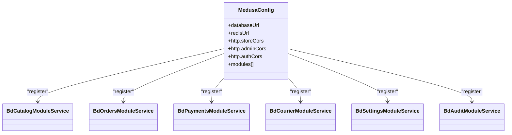
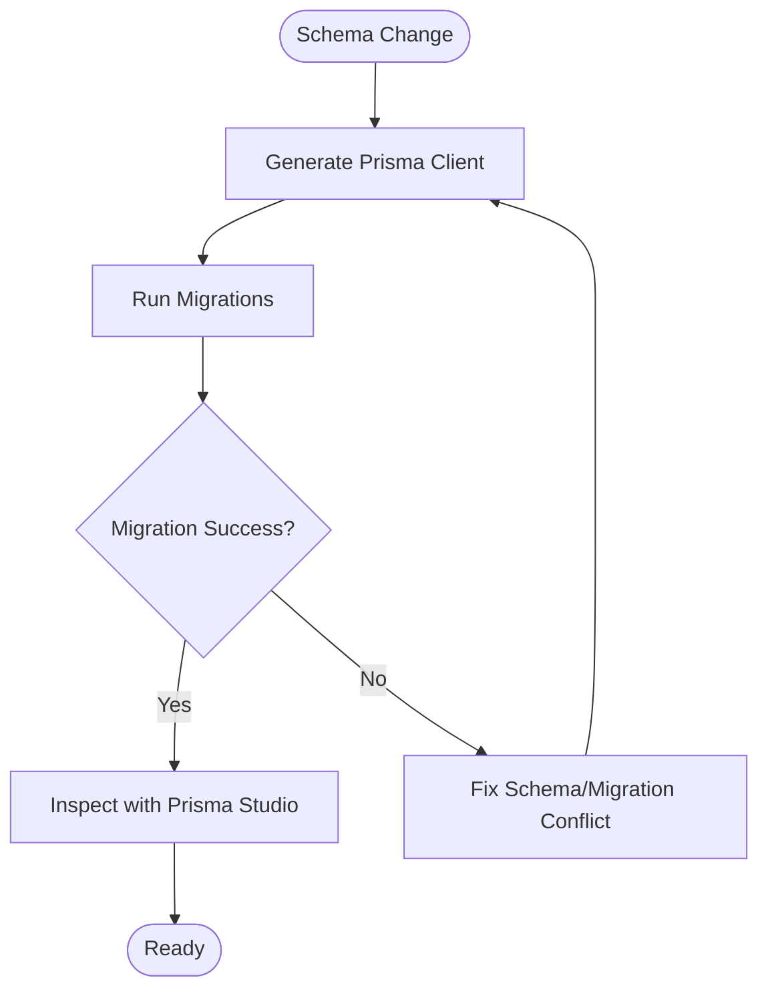
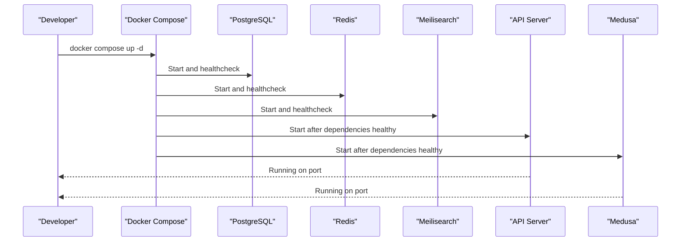
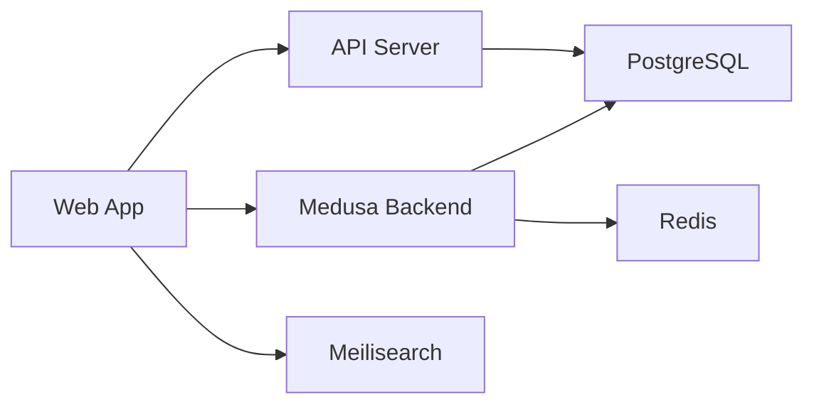

# Troubleshooting & FAQ

<cite>
**Referenced Files in This Document**
- [package.json](file://package.json)
- [docker-compose.yml](file://docker-compose.yml)
- [apps/api/src/main.ts](file://apps/api/src/main.ts)
- [apps/api/src/lib/prisma.ts](file://apps/api/src/lib/prisma.ts)
- [apps/api/package.json](file://apps/api/package.json)
- [apps/api/prisma/schema.prisma](file://apps/api/prisma/schema.prisma)
- [apps/medusa/medusa-config.ts](file://apps/medusa/medusa-config.ts)
- [apps/medusa/instrumentation.ts](file://apps/medusa/instrumentation.ts)
- [apps/medusa/package.json](file://apps/medusa/package.json)
- [apps/medusa/src/modules/bd-catalog/service.ts](file://apps/medusa/src/modules/bd-catalog/service.ts)
- [apps/medusa/src/modules/bd-orders/service.ts](file://apps/medusa/src/modules/bd-orders/service.ts)
- [apps/medusa/src/modules/bd-payments/service.ts](file://apps/medusa/src/modules/bd-payments/service.ts)
- [apps/medusa/src/modules/bd-courier/service.ts](file://apps/medusa/src/modules/bd-courier/service.ts)
- [apps/medusa/src/modules/bd-settings/service.ts](file://apps/medusa/src/modules/bd-settings/service.ts)
- [apps/medusa/src/modules/bd-audit/service.ts](file://apps/medusa/src/modules/bd-audit/service.ts)
- [technical-plan.md](file://technical-plan.md)
- [PROJECT_CONTEXT_HANDOFF.md](file://PROJECT_CONTEXT_HANDOFF.md)
</cite>

## Table of Contents
1. [Introduction](#introduction)
2. [Project Structure](#project-structure)
3. [Core Components](#core-components)
4. [Architecture Overview](#architecture-overview)
5. [Detailed Component Analysis](#detailed-component-analysis)
6. [Dependency Analysis](#dependency-analysis)
7. [Performance Considerations](#performance-considerations)
8. [Troubleshooting Guide](#troubleshooting-guide)
9. [Conclusion](#conclusion)
10. [Appendices](#appendices)

## Introduction
This document provides comprehensive troubleshooting and frequently asked questions for the BD Commerce Platform. It focuses on development issues, root causes, step-by-step resolutions, debugging techniques per service layer, log analysis strategies, performance profiling approaches, database connectivity and migration problems, service startup failures, known limitations, workarounds, optimization tips, configuration guidance, integration patterns, diagnostic tools usage, health check interpretation, and escalation procedures.

## Project Structure
The platform is a monorepo with three primary applications:
- Web frontend (Next.js)
- API server (Express + Prisma)
- Medusa commerce backend (v2 modules)

External services are orchestrated via Docker Compose: PostgreSQL, Redis, and Meilisearch.

**Diagram sources**
- [docker-compose.yml:1-77](file://docker-compose.yml#L1-L77)
- [apps/api/src/main.ts:1-55](file://apps/api/src/main.ts#L1-L55)
- [apps/medusa/medusa-config.ts:1-46](file://apps/medusa/medusa-config.ts#L1-L46)

**Section sources**
- [package.json:1-39](file://package.json#L1-L39)
- [docker-compose.yml:1-77](file://docker-compose.yml#L1-L77)

## Core Components
- API Server: Express application exposing health and basic endpoints; connects to PostgreSQL via Prisma.
- Medusa Backend: v2 framework configured with custom modules for catalog, orders, payments, courier, settings, and audit.
- Infrastructure: PostgreSQL, Redis, Meilisearch containers with health checks and persistent volumes.

Key responsibilities:
- API Server: lightweight REST surface and DB connectivity verification.
- Medusa: core commerce logic, module services, migrations, and integrations.
- Infrastructure: data persistence, caching, and search.

**Section sources**
- [apps/api/src/main.ts:1-55](file://apps/api/src/main.ts#L1-L55)
- [apps/api/src/lib/prisma.ts:1-14](file://apps/api/src/lib/prisma.ts#L1-L14)
- [apps/medusa/medusa-config.ts:1-46](file://apps/medusa/medusa-config.ts#L1-L46)
- [docker-compose.yml:1-77](file://docker-compose.yml#L1-L77)

## Architecture Overview
The system uses a layered architecture:
- Frontend communicates with both the API and Medusa Store/Admin APIs.
- API handles direct database operations through Prisma.
- Medusa manages commerce workflows and custom modules.
- External services provide persistence, caching, and search capabilities.

**Diagram sources**
- [apps/api/src/main.ts:18-35](file://apps/api/src/main.ts#L18-L35)
- [apps/api/src/lib/prisma.ts:1-14](file://apps/api/src/lib/prisma.ts#L1-L14)
- [apps/medusa/medusa-config.ts:7-18](file://apps/medusa/medusa-config.ts#L7-L18)
- [docker-compose.yml:1-77](file://docker-compose.yml#L1-L77)

## Detailed Component Analysis

### API Server Health and Connectivity
Symptoms:
- Health endpoint returns disconnected or error_or_offline.
- API starts but cannot reach the database.

Root causes:
- Incorrect DATABASE_URL or environment variables.
- PostgreSQL container not ready or misconfigured.
- Prisma client logging levels affecting diagnostics.

Resolution steps:
1. Verify environment variables for PostgreSQL and DATABASE_URL.
2. Confirm PostgreSQL container is healthy using Docker healthcheck.
3. Check API logs for connection errors.
4. Validate Prisma client initialization and logging configuration.

**Diagram sources**
- [apps/api/src/main.ts:18-35](file://apps/api/src/main.ts#L18-L35)
- [apps/api/src/lib/prisma.ts:1-14](file://apps/api/src/lib/prisma.ts#L1-L14)

**Section sources**
- [apps/api/src/main.ts:18-35](file://apps/api/src/main.ts#L18-L35)
- [apps/api/src/lib/prisma.ts:1-14](file://apps/api/src/lib/prisma.ts#L1-L14)

### Medusa Configuration and Module Loading
Symptoms:
- Medusa fails to start due to missing or invalid environment variables.
- CORS errors between Admin, Store, and Auth clients.
- Custom modules not loading.

Root causes:
- Missing DATABASE_URL or REDIS_URL.
- Incorrect CORS origins for store/admin/auth.
- Module registration paths incorrect.

Resolution steps:
1. Ensure DATABASE_URL and REDIS_URL are set at the project root.
2. Validate CORS settings for store, admin, and auth.
3. Confirm module resolve paths match actual directories.
4. Review Medusa logs for module load errors.

**Diagram sources**
- [apps/medusa/medusa-config.ts:7-44](file://apps/medusa/medusa-config.ts#L7-L44)
- [apps/medusa/src/modules/bd-catalog/service.ts:1-15](file://apps/medusa/src/modules/bd-catalog/service.ts#L1-L15)
- [apps/medusa/src/modules/bd-orders/service.ts:1-13](file://apps/medusa/src/modules/bd-orders/service.ts#L1-L13)
- [apps/medusa/src/modules/bd-payments/service.ts:1-11](file://apps/medusa/src/modules/bd-payments/service.ts#L1-L11)
- [apps/medusa/src/modules/bd-courier/service.ts:1-11](file://apps/medusa/src/modules/bd-courier/service.ts#L1-L11)
- [apps/medusa/src/modules/bd-settings/service.ts:1-11](file://apps/medusa/src/modules/bd-settings/service.ts#L1-L11)
- [apps/medusa/src/modules/bd-audit/service.ts:1-11](file://apps/medusa/src/modules/bd-audit/service.ts#L1-L11)

**Section sources**
- [apps/medusa/medusa-config.ts:1-46](file://apps/medusa/medusa-config.ts#L1-L46)
- [apps/medusa/src/modules/bd-catalog/service.ts:1-15](file://apps/medusa/src/modules/bd-catalog/service.ts#L1-L15)
- [apps/medusa/src/modules/bd-orders/service.ts:1-13](file://apps/medusa/src/modules/bd-orders/service.ts#L1-L13)
- [apps/medusa/src/modules/bd-payments/service.ts:1-11](file://apps/medusa/src/modules/bd-payments/service.ts#L1-L11)
- [apps/medusa/src/modules/bd-courier/service.ts:1-11](file://apps/medusa/src/modules/bd-courier/service.ts#L1-L11)
- [apps/medusa/src/modules/bd-settings/service.ts:1-11](file://apps/medusa/src/modules/bd-settings/service.ts#L1-L11)
- [apps/medusa/src/modules/bd-audit/service.ts:1-11](file://apps/medusa/src/modules/bd-audit/service.ts#L1-L11)

### Database Schema and Migrations
Symptoms:
- Prisma client generation fails.
- Migration errors during dev or production runs.
- Data type mismatches or missing tables.

Root causes:
- DATABASE_URL points to wrong database or credentials.
- Schema changes not reflected in migrations.
- Conflicts between Prisma schema and Medusa migrations.

Resolution steps:
1. Validate DATABASE_URL and ensure it matches the running PostgreSQL instance.
2. Regenerate Prisma client if schema changed.
3. Run migrations in correct order and verify snapshots.
4. Use Prisma Studio to inspect schema state.

**Diagram sources**
- [apps/api/prisma/schema.prisma:1-152](file://apps/api/prisma/schema.prisma#L1-L152)
- [apps/api/package.json:7-14](file://apps/api/package.json#L7-L14)

**Section sources**
- [apps/api/prisma/schema.prisma:1-152](file://apps/api/prisma/schema.prisma#L1-L152)
- [apps/api/package.json:7-14](file://apps/api/package.json#L7-L14)

### Service Startup Failures
Symptoms:
- API does not start or listens on unexpected port.
- Medusa fails to start due to environment or module issues.
- Containers exit immediately.

Root causes:
- Port conflicts or missing PORT/API_PORT.
- Missing environment variables for services.
- Container dependencies not healthy.

Resolution steps:
1. Check port availability and environment variables.
2. Validate container healthchecks for PostgreSQL, Redis, Meilisearch.
3. Review service logs for startup errors.
4. Restart services in dependency order.

**Diagram sources**
- [docker-compose.yml:1-77](file://docker-compose.yml#L1-L77)
- [apps/api/src/main.ts:51-54](file://apps/api/src/main.ts#L51-L54)
- [apps/medusa/package.json:15-23](file://apps/medusa/package.json#L15-L23)

**Section sources**
- [docker-compose.yml:1-77](file://docker-compose.yml#L1-L77)
- [apps/api/src/main.ts:51-54](file://apps/api/src/main.ts#L51-L54)
- [apps/medusa/package.json:15-23](file://apps/medusa/package.json#L15-L23)

## Dependency Analysis
The platform depends on external services and internal modules:
- API depends on PostgreSQL via Prisma.
- Medusa depends on PostgreSQL and Redis.
- Web depends on API, Medusa, and Meilisearch.

**Diagram sources**
- [apps/api/src/lib/prisma.ts:1-14](file://apps/api/src/lib/prisma.ts#L1-L14)
- [apps/medusa/medusa-config.ts:7-18](file://apps/medusa/medusa-config.ts#L7-L18)
- [docker-compose.yml:1-77](file://docker-compose.yml#L1-L77)

**Section sources**
- [apps/api/src/lib/prisma.ts:1-14](file://apps/api/src/lib/prisma.ts#L1-L14)
- [apps/medusa/medusa-config.ts:7-18](file://apps/medusa/medusa-config.ts#L7-L18)
- [docker-compose.yml:1-77](file://docker-compose.yml#L1-L77)

## Performance Considerations
- Enable structured logging and request correlation IDs for traceability.
- Use Redis for rate limiting and session storage to reduce database load.
- Profile Medusa HTTP, workflow, and query instrumentation when enabled.
- Optimize database indexes based on query patterns.
- Monitor Meilisearch performance for search-heavy features.

[No sources needed since this section provides general guidance]

## Troubleshooting Guide

### Common Development Issues

#### Database Connectivity Issues
Symptoms:
- Health endpoint reports disconnected or error_or_offline.
- API logs show connection refused or authentication failed.

Root causes:
- Incorrect DATABASE_URL or credentials.
- PostgreSQL container not ready or network unreachable.

Resolution steps:
1. Verify DATABASE_URL and PostgreSQL environment variables.
2. Check PostgreSQL healthcheck output.
3. Test connectivity from API container or host.
4. Reset credentials if necessary and restart services.

**Section sources**
- [apps/api/src/main.ts:18-35](file://apps/api/src/main.ts#L18-L35)
- [docker-compose.yml:1-20](file://docker-compose.yml#L1-L20)

#### Migration Problems
Symptoms:
- Migration errors or schema mismatch.
- Prisma client generation fails.

Root causes:
- Outdated migrations or conflicting schema changes.
- Wrong target database.

Resolution steps:
1. Align Prisma schema with intended state.
2. Regenerate Prisma client.
3. Apply migrations in order and verify snapshots.
4. Use Prisma Studio to validate schema.

**Section sources**
- [apps/api/prisma/schema.prisma:1-152](file://apps/api/prisma/schema.prisma#L1-L152)
- [apps/api/package.json:7-14](file://apps/api/package.json#L7-L14)

#### Service Startup Failures
Symptoms:
- API or Medusa fails to start.
- Containers exit immediately.

Root causes:
- Missing environment variables.
- Port conflicts.
- Dependencies unhealthy.

Resolution steps:
1. Validate environment variables for all services.
2. Check port bindings and availability.
3. Inspect container logs and healthchecks.
4. Restart services in dependency order.

**Section sources**
- [apps/api/src/main.ts:51-54](file://apps/api/src/main.ts#L51-L54)
- [apps/medusa/package.json:15-23](file://apps/medusa/package.json#L15-L23)
- [docker-compose.yml:1-77](file://docker-compose.yml#L1-L77)

### Debugging Techniques by Service Layer

#### API Layer
- Use health endpoint to verify DB connectivity.
- Enable Prisma query logging in development.
- Inspect Express middleware and route handlers for errors.

**Section sources**
- [apps/api/src/main.ts:18-35](file://apps/api/src/main.ts#L18-L35)
- [apps/api/src/lib/prisma.ts:1-14](file://apps/api/src/lib/prisma.ts#L1-L14)

#### Medusa Layer
- Validate module registration and configuration.
- Review Medusa logs for module load and runtime errors.
- Enable OpenTelemetry instrumentation for HTTP, workflows, and queries.

**Section sources**
- [apps/medusa/medusa-config.ts:7-44](file://apps/medusa/medusa-config.ts#L7-L44)
- [apps/medusa/instrumentation.ts:1-24](file://apps/medusa/instrumentation.ts#L1-L24)

#### Infrastructure Layer
- Check Docker healthchecks for PostgreSQL, Redis, Meilisearch.
- Validate environment variables and volume mounts.
- Inspect container logs for startup failures.

**Section sources**
- [docker-compose.yml:1-77](file://docker-compose.yml#L1-L77)

### Log Analysis Strategies
- Collect structured logs from API and Medusa.
- Correlate requests using correlation IDs.
- Scrub sensitive data before logging.
- Use Docker logs command to stream service outputs.

**Section sources**
- [technical-plan.md:678-686](file://technical-plan.md#L678-L686)
- [package.json:22-25](file://package.json#L22-L25)

### Performance Profiling Approaches
- Enable Medusa OpenTelemetry instrumentation for HTTP, workflows, and queries.
- Monitor database query performance and indexes.
- Profile search queries against Meilisearch.
- Use Redis metrics for cache hit rates and latency.

**Section sources**
- [apps/medusa/instrumentation.ts:1-24](file://apps/medusa/instrumentation.ts#L1-L24)
- [technical-plan.md:678-686](file://technical-plan.md#L678-L686)

### Known Limitations and Workarounds
- No production multi-stage Dockerfiles for apps/web or apps/api.
- Symlinked .env files may fail in containerized builds or Windows checkouts.

Workarounds:
- Build images locally or add Dockerfiles for each app.
- Resolve symlinks or copy .env into build context.

**Section sources**
- [PROJECT_CONTEXT_HANDOFF.md:192-195](file://PROJECT_CONTEXT_HANDOFF.md#L192-L195)

### Frequently Asked Questions

#### Platform Configuration
- Q: How do I configure database and Redis URLs?
  - A: Set DATABASE_URL and REDIS_URL at the project root so Medusa can load them.
- Q: What CORS settings should I use?
  - A: Configure storeCors, adminCors, and authCors in Medusa config to include your web and admin origins.

**Section sources**
- [apps/medusa/medusa-config.ts:7-18](file://apps/medusa/medusa-config.ts#L7-L18)
- [PROJECT_CONTEXT_HANDOFF.md:183-190](file://PROJECT_CONTEXT_HANDOFF.md#L183-L190)

#### Customization Options
- Q: How do I register custom modules?
  - A: Add module resolve paths in Medusa config under modules array.
- Q: Can I extend existing models?
  - A: Yes, define new models and update module services accordingly.

**Section sources**
- [apps/medusa/medusa-config.ts:22-44](file://apps/medusa/medusa-config.ts#L22-L44)
- [apps/medusa/src/modules/bd-catalog/service.ts:1-15](file://apps/medusa/src/modules/bd-catalog/service.ts#L1-L15)

#### Integration Patterns
- Q: How should I handle webhooks securely?
  - A: Validate signatures for payment and courier webhooks before processing payloads.
- Q: How do I protect admin endpoints?
  - A: Use JWT session authentication and restrict CORS to trusted domains.

**Section sources**
- [technical-plan.md:670-674](file://technical-plan.md#L670-L674)

### Diagnostic Tools Usage
- Health checks:
  - API: GET /health to verify service and database status.
  - Docker: Use healthcheck commands for PostgreSQL, Redis, Meilisearch.
- Logs:
  - Stream logs with docker compose logs -f.
  - Inspect individual container logs for errors.
- Database:
  - Use Prisma Studio to inspect schema and data.
  - Run migrations and generate client as needed.

**Section sources**
- [apps/api/src/main.ts:18-35](file://apps/api/src/main.ts#L18-L35)
- [docker-compose.yml:14-64](file://docker-compose.yml#L14-L64)
- [apps/api/package.json:11-14](file://apps/api/package.json#L11-L14)

### Escalation Procedures
- If health checks consistently report errors:
  1. Validate environment variables and secrets.
  2. Check container health and logs.
  3. Reproduce issue locally with minimal setup.
- If Medusa modules fail to load:
  1. Verify module paths and dependencies.
  2. Review Medusa logs for module-specific errors.
  3. Temporarily disable non-essential modules to isolate issues.
- For production incidents:
  1. Collect structured logs and traces.
  2. Assess impact and rollback recent changes if necessary.
  3. Engage infrastructure team for database and network diagnostics.

[No sources needed since this section summarizes procedural guidance]

## Conclusion
This troubleshooting guide consolidates common issues, root causes, and resolution steps across the API, Medusa, and infrastructure layers. By following the diagnostic procedures, leveraging health checks and logs, and applying performance profiling techniques, teams can efficiently identify and resolve problems. Configuration clarity, secure integration patterns, and proactive monitoring are essential for maintaining platform reliability.

## Appendices

### Environment Variables Reference
- Application: NODE_ENV, API_PORT, WEB_PORT, PORT, NEXT_PUBLIC_API_URL, NEXT_PUBLIC_APP_URL, CORS_ORIGIN.
- PostgreSQL: POSTGRES_USER, POSTGRES_PASSWORD, POSTGRES_DB, POSTGRES_HOST, POSTGRES_PORT, DATABASE_URL, DIRECT_URL.
- Redis: REDIS_HOST, REDIS_PORT, REDIS_PASSWORD, REDIS_URL.
- Meilisearch: MEILISEARCH_HOST, MEILISEARCH_PORT, MEILI_MASTER_KEY, MEILI_ENV.
- Authentication & Security: JWT_SECRET, JWT_EXPIRES_IN, JWT_REFRESH_SECRET, JWT_REFRESH_EXPIRES_IN, SESSION_SECRET, ENCRYPTION_KEY, NEXTAUTH_SECRET, NEXTAUTH_URL.
- Payment Gateways: bKash, Nagad, SSLCOMMERZ variables as documented.

**Section sources**
- [PROJECT_CONTEXT_HANDOFF.md:183-190](file://PROJECT_CONTEXT_HANDOFF.md#L183-L190)