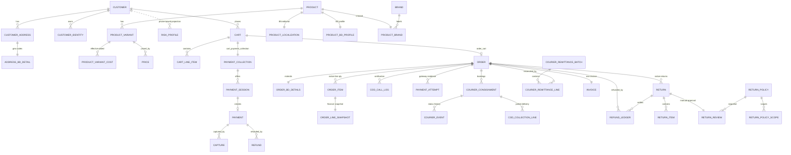
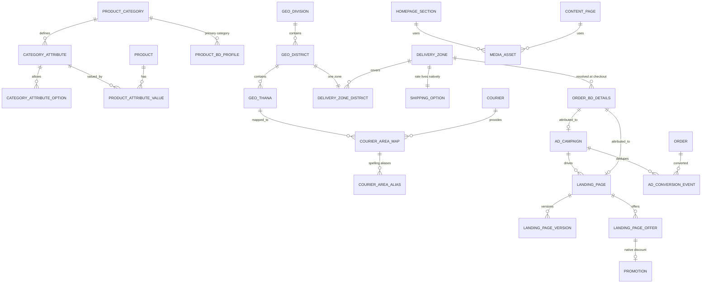
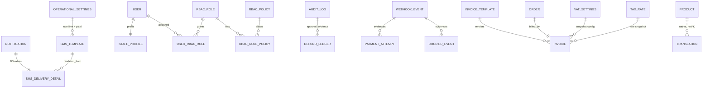

# Database Design — Canonical Specification
## Bangladesh Single-Vendor E-commerce Platform (MedusaJS v2)

**Document Version:** 2.0 — Canonical (single source of truth)
**Status:** Authoritative for all persistence decisions
**Date:** 2026-10-24
**Engine:** MedusaJS v2 framework `2.22.0` (`@medusajs/framework` verified from installed packages)
**Database:** PostgreSQL 16
**ORM / Schema Tool:** Medusa DML (`@medusajs/framework/utils`) + MikroORM migrations
**Supersedes:** [`docs/data-models.md`](docs/data-models.md) (v1.0 draft), `docs/architecture.md` §12, `docs/dfd.md` §1.2 data-store tables
**Does not supersede:** `prd.md` (business requirements), `docs/dfd.md` (flows), `docs/architecture.md` (system architecture) — those remain authoritative for *behaviour*; this document is authoritative for *data*

---

## 1. Scope and Source of Truth

### 1.1 Purpose

This document is the **only** authoritative definition of the persistent data model:

- which tables exist,
- which are Medusa-native and must never be re-implemented,
- which are Bangladesh-specific custom modules,
- every field, type, constraint, index and relationship,
- money representation,
- security, PII, encryption, masking and retention rules,
- transaction and idempotency rules,
- and the open decisions that still require the business owner.

Any schema change (migration, new table, new column, new enum value) must update this document first.

### 1.2 Authority order

When documents disagree, resolve in this order:

| Rank | Source | Authority |
|---:|---|---|
| 1 | Installed Medusa v2 code (`node_modules/@medusajs/*` at 2.22.0) | Native behaviour, enums, constraints |
| 2 | This document (`database.md`) | Table/field/constraint decisions |
| 3 | `prd.md` v2 | Business requirements and acceptance criteria |
| 4 | `docs/dfd.md` v2 | Data flows and process inputs/outputs |
| 5 | `docs/architecture.md` v2 | Module ownership and runtime topology |
| 6 | `docs/data-models.md` v1.0 | **Superseded** — historical only |

If this document contradicts an installed Medusa fact, the Medusa fact wins and this document must be corrected. If this document contradicts the PRD on *requirement*, the PRD wins and this document must be extended.

### 1.3 Why `database.md` did not exist (evidence)

| Check | Result | Evidence |
|---|---|---|
| File present at repo root | No | `find . -name "database*.md"` → no result |
| File present in `docs/` | No | `ls docs/` → no `database.md` |
| Git history for the path | None | `git log --all -- database.md docs/database.md` → empty |
| Any database doc tracked by git | None | `git ls-files \| grep -E "database\.md\|data-models\.md"` → empty |
| Database draft that does exist | `docs/data-models.md` (untracked, mtime 2026-10-24 11:59) | `stat docs/data-models.md` |

**Conclusion:** `database.md` was never created. `docs/data-models.md` is a v1.0 draft written after `architecture.md`/`dfd.md`, but it disagrees with both (it defines 13 tables while `architecture.md` §12.1 defines a different 13 with only 8 in common) and it declares itself "Authoritative" while omitting the `order_return_request` entity it links to. Marking it superseded is therefore evidence-based, not editorial preference. The file is retained (not deleted) with a supersession banner.

### 1.4 In scope / out of scope

**In scope (PostgreSQL):**

- All Medusa v2 native module tables that this platform uses.
- All custom BD module tables and module links.
- Database-level constraints, indexes, triggers, views, grants.
- Data classification, encryption, masking, retention.

**Out of scope (but referenced):**

| Store | Owns | This document says |
|---|---|---|
| Redis | BullMQ queues, `stock:lock:*`, `auth:lockout:*`, `ratelimit:*`, `sms:ratelimit:*`, cart cache | Ephemeral only. **No durable business fact may live only in Redis.** |
| Meilisearch | `products` index | Derived projection. Excludes COGS, margin, supplier, internal cost. |
| S3 / R2 | Product media, invoice PDFs, courier labels | Content-addressed keys; metadata rows live in `media_asset` / `invoice`. |
| Secrets manager / env | bKash, Nagad, SMS, Pathao, Steadfast, RedX, Meta CAPI secrets | **Never** stored in PostgreSQL. DB stores only `secret_ref` + `key_version`. |

### 1.5 Design principles

1. **Never fork Medusa core models.** Extend through module links and additive custom tables. No ALTER on core tables except performance indexes approved here (§5).
2. **One writer per fact.** Every mutable fact has exactly one authoritative table. Projections and snapshots are read-only derivatives with a documented recompute rule.
3. **Snapshots are write-once.** Financial, address, policy and VAT facts are copied at the moment they become legally/business relevant and never recomputed.
4. **Open sets are configuration tables; closed state machines are enums.** A value that the business may extend without a code release (couriers, payment providers, zones, refund methods, roles) is `text` + a config table. A value that is a fixed lifecycle is a DML `enum` (rendered by Medusa as `text` + `CHECK`). Adding an enum value is a migration; adding a config row is not.
5. **No duplicate money.** Amounts are never stored twice under two names. Where a value must be snapshotted from a native table, the field name says so (`*_snapshot` or the doc says "snapshot of …") and the writer is explicit.
6. **Extension tables are 1:1 with a unique key + module link.** The unique column is the write-once reporting key; the link table is authoritative for service-level joins; equality is validated by a nightly drift check (§7.7).
7. **PII is minimised at write time,** not at read time. If a column does not need the full value to do its job (webhook headers, payer MSISDN, refund account), only the masked/hashed/encrypted form is stored.
8. **Audit is append-only at the database level,** not by convention (§6.5).

### 1.6 Canonical money strategy (Medusa-compatible)

This is the single largest source of potential 100× errors. The rule is a hard boundary:

| Layer | Representation | Type | Example (৳2,500.00) |
|---|---|---|---|
| Medusa core tables (`price.amount`, `order_item.unit_price`, `payment.amount`, `order_summary.totals`, `shipping_method.amount`, `refund.amount`, `order_transaction.amount`) | **Major units, decimal BDT** | `numeric` via `model.bigNumber()` (plus `raw_*` JSONB) | `2500` / `2500.00` |
| Custom BD tables | **Integer paisa** | `model.bigNumber()` → `numeric` **with integer CHECK**, column named `*_paisa` | `250000` |
| API — Medusa `/store` and `/admin` | Major units (Medusa contract) | number | `2500` |
| API — custom BD admin endpoints | Integer paisa (explicit suffix) | integer | `250000` |
| UI display | Localized | `Intl.NumberFormat('bn-BD')` + `৳` | `৳২,৫০০.০০` |

**Hard rules**

1. Never write paisa into a Medusa core amount column. Never write major units into a `_paisa` column.
2. Conversion happens **only** in the module service boundary via one helper (`apps/medusa/src/lib/money.ts`):
   - `toPaisa(major: BigNumberInput): number` — `round(major × 100)`, `ROUND_HALF_UP`.
   - `toMajor(paisa: number): BigNumberInput` — `paisa / 100` with 2-dp representation.
   - Both are unit-tested against bKash/Nagad/Pathao/Steadfast sample payloads.
3. The suffix `_bdt` is **banned** on any column whose value is paisa. `_paisa` is mandatory. (`cogs_bdt`, `flat_rate_bdt`, `amount_bdt` in the superseded draft are renamed.)
4. `model.bigNumber()` creates a `numeric` column **plus** a `raw_<column>` JSONB column; it does **not** create `bigint`. The superseded draft's "bigint paisa" claim is factually wrong. Paisa columns therefore use:
   ```ts
   cogs_unit_paisa: model.bigNumber().default(0),
   ```
   with a model-level integer guard:
   ```ts
   .checks([{
     name: "CK_ols_paisa_integer",
     expression: `"cogs_unit_paisa" = trunc("cogs_unit_paisa") AND "cogs_unit_paisa" >= 0
                  AND "unit_price_paisa" = trunc("unit_price_paisa") AND "unit_price_paisa" >= 0`,
   }])
   ```
5. All `_paisa` columns are **non-negative**. Refunds/credits are positive magnitudes; direction is carried by row type (`refund_type`), never by a negative amount.
6. No floating point for money anywhere. `model.float()` is allowed only for percentages and ratios (`tax_rate_percent`, `delivery_success_rate`, `minimum_margin_percent`).
7. Rounding happens once, at the boundary that creates the value. Snapshots store the already-rounded integer. Never re-round a snapshot.
8. Bangladesh rounding convention: line-level VAT and discount allocation use `ROUND_HALF_UP` to the paisa; the last line absorbs the residue so `sum(line) == order total` (documented and tested in §7.1).

### 1.7 Verified Medusa v2.22.0 facts used by this document

All values below were read from the installed packages on 2026-10-24, not from memory or public docs.

| Fact | Verified value | Evidence path |
|---|---|---|
| `OrderStatus` | `pending`, `completed`, `draft`, `archived`, `canceled`, `requires_action` | `node_modules/@medusajs/utils/dist/order/status.d.ts` |
| `ReturnStatus` | `open`, `requested`, `received`, `partially_received`, `canceled` | same file |
| `PaymentStatus` | `not_paid`, `awaiting`, `authorized`, `partially_authorized`, `captured`, `partially_captured`, `partially_refunded`, `refunded`, `canceled`, `requires_action` | `node_modules/@medusajs/types/dist/order/common.d.ts:1710` |
| `FulfillmentStatus` | `not_fulfilled`, `partially_fulfilled`, `fulfilled`, `partially_shipped`, `shipped`, `partially_delivered`, `delivered`, `canceled` | same file:1714 |
| `PaymentSessionStatus` | `authorized`, `captured`, `pending`, `requires_more`, `error`, `canceled`, `pending_authorization` | `node_modules/@medusajs/types/dist/payment/common.d.ts:6` |
| `RefundStatus` | `pending`, `succeeded`, `failed` | `node_modules/@medusajs/utils/dist/payment/refund.d.ts` |
| `NotificationStatus` | `pending`, `success`, `failure` | `node_modules/@medusajs/utils/dist/notification/common.d.ts` |
| `PromotionStatus` | `draft`, `active`, `inactive` | `node_modules/@medusajs/utils/dist/promotion/index.d.ts` |
| `GeoZoneType` | `country`, `province`, `city`, `zip` | `node_modules/@medusajs/utils/dist/fulfillment/geo-zone.d.ts` |
| Native return models | `return`, `return_item`, `return_reason`, `order_transaction` | `node_modules/@medusajs/order/dist/models/` |
| Native return quantities | `return_item.quantity`, `received_quantity`, `damaged_quantity` | `.../models/return-item.js` |
| Native line quantities | `order_item.fulfilled_quantity`, `delivered_quantity`, `shipped_quantity`, `return_requested_quantity`, `return_received_quantity`, `return_dismissed_quantity`, `written_off_quantity` | `.../models/order-item.js` |
| Native fulfillment | `fulfillment`, `fulfillment_item`, `fulfillment_label`, `fulfillment_set`, `service_zone`, `geo_zone`, `shipping_option`, `shipping_option_rule`, `shipping_profile` | `node_modules/@medusajs/fulfillment/dist/models/` |
| Native payments | `payment_collection`, `payment_session`, `payment`, `capture`, `refund`, `refund_reason` | `node_modules/@medusajs/payment/dist/models/` |
| Native refund idempotency | unique `(payment_id, idempotency_key)` where key not null | `.../models/refund.js` |
| Native RBAC | `rbac_role`, `rbac_policy`, `rbac_role_policy`, `rbac_role_parent` | `node_modules/@medusajs/rbac/dist/models/` |
| Native user↔role link | `user_rbac_role` (`id`, `user_id`, `rbac_role_id`), many-to-many | `node_modules/@medusajs/link-modules/dist/definitions/user-rbac-role.js` |
| Native translation | `translation(reference_id, reference, locale_code, translations JSON, translated_field_count)`; unique `(reference_id, locale_code)` | `node_modules/@medusajs/translation/dist/models/translation.js` |
| Native tax | `tax_region`, `tax_rate`, `tax_rate_rule`, `tax_provider` | `node_modules/@medusajs/tax/dist/models/` |
| Native promotion campaign | table `promotion_campaign` with `starts_at`, `ends_at`, `campaign_identifier` unique | `node_modules/@medusajs/promotion/dist/models/campaign.js` |
| Native notification | `notification` with unique `idempotency_key`, `status`, `channel`, `template`, `provider_data`, `external_id`, `original_notification_id`, `resource_id`, `receiver_id` | `node_modules/@medusajs/notification/dist/models/notification.js` |
| Native inventory level | `inventory_level` unique `(inventory_item_id, location_id)`, `stocked_quantity`, `reserved_quantity`, `incoming_quantity`, computed `available_quantity` | `node_modules/@medusajs/inventory/dist/models/inventory-level.js` |
| Reservation item | **no `expires_at`**; `line_item_id` nullable | `node_modules/@medusajs/types/dist/inventory/common/reservation-item.d.ts` |
| Customer | `email` nullable; unique only `(email, has_account)`; `phone` nullable, **not unique, not indexed** | `node_modules/@medusajs/customer/dist/models/customer.js` |
| Customer address | has `is_default_shipping` / `is_default_billing` partial-unique per customer | `.../models/address.js` |
| Order totals | stored in `order_summary.totals` JSONB, not on `order` | `.../order/dist/models/order-summary.js` |
| Product translatable fields | `title`, `subtitle`, `description`, `material` | `.../product/dist/models/product.js` |
| Category translatable fields | `name`, `description` | `.../product/dist/models/product-category.js` |
| Variant physical fields | `weight`, `length`, `height`, `width` (float), `sku`/`barcode` unique | `.../product/dist/models/product-variant.js` |
| `model.bigNumber()` | `numeric` column + `raw_*` JSONB; not `bigint` | `node_modules/@medusajs/utils/dist/dal/mikro-orm/big-number-field.js`, `dml/entity-builder.js` |
| `model.number()` | `integer` column | e.g. `"version" integer` in `@medusajs/order/dist/migrations/*` |
| `model.enum()` | `text` + `CHECK (... IN (...))` | `node_modules/@medusajs/bd-*/migrations` pattern |
| DML `index()` / `.indexes()` | partial indexes `WHERE deleted_at IS NULL` by default | `@medusajs/utils/dist/dml/entity.d.ts`, module models |
| DML `.checks()` | supported; emits table CHECK constraints | `@medusajs/utils/dist/dml/entity.d.ts:165` |
| Link default | single-record unless `isList: true` | `@medusajs/utils/dist/modules-sdk/define-link.js` |
| DML base columns | every model gets `created_at`, `updated_at`, `deleted_at` | all native migrations |

**Unverifiable / not claimed:** nothing in this document asserts a Medusa API that was not found in the installed package tree. Where Medusa documentation is quoted from memory it is explicitly marked *(doc-implied, not code-verified)*.

---

## 2. Medusa-Native Entities vs Custom Modules

### 2.1 Native tables used as-is (no custom duplicate)

> Rule: if a table appears here, **no custom table may store the same fact**.

**Order & fulfillment**

| Native table | Owns | Custom code must not duplicate |
|---|---|---|
| `order` | order identity, `status`, `currency_code`, `customer_id`, `canceled_at`, `shipping_address_id` | order status, cancel flag |
| `order_item` | per-line prices, quantities, `fulfilled_quantity`, `delivered_quantity`, `shipped_quantity`, `return_requested_quantity`, `return_received_quantity`, `return_dismissed_quantity`, `written_off_quantity` | line quantities of any kind |
| `order_line_item` | line title/sku/variant snapshot, unit price, totals, `is_discountable`, `requires_shipping` | line title/SKU/price snapshot |
| `order_address` | shipping/billing address | canonical order address |
| `order_shipping_method` | shipping method + amount | shipping charge |
| `order_summary` | `totals` JSONB (item/shipping/tax/discount/gift card/credit totals) | order totals |
| `order_transaction` | order-level money movements (`amount`, `reference`, `return_id`) | refund ledger entries linked to a return |
| `order_change` | post-placement edits | order edit trail |
| `return`, `return_item`, `return_reason` | return lifecycle, per-line return qty, received/damaged qty, reason | return entity, return quantities |
| `fulfillment`, `fulfillment_item`, `fulfillment_label` | shipment execution, per-line shipped qty, labels | shipment quantities, label records |
| `cart`, `line_item`, `cart_address` | pre-order state | cart persistence |
| `fulfillment_set`, `service_zone`, `geo_zone`, `shipping_option`, `shipping_option_rule`, `shipping_profile` | shipping rate resolution and price | shipping rate amount, zone→rate mapping |

**Payment**

| Native table | Owns |
|---|---|
| `payment_collection` | `amount`, `authorized_amount`, `captured_amount`, `refunded_amount`, `status` |
| `payment_session` | provider session, `status`, `data`, `context` |
| `payment` | `amount`, `provider_id`, `captured_at`, `canceled_at` |
| `capture` | capture amount |
| `refund` | refund amount, `status`, `idempotency_key`, `payment_id` |
| `refund_reason` | refund reason catalogue |

**Catalog & pricing**

| Native table | Owns |
|---|---|
| `product`, `product_variant`, `product_image` | catalog identity, translatable title/subtitle/description/material, variant SKU/barcode/weight/dimensions |
| `product_category`, `product_collection`, `product_tag`, `product_type` | taxonomy (category `name`/`description` translatable) |
| `product_option`, `product_option_value`, `product_variant_option_value` | variant options (platform limit: ≤3 options/product, app-enforced) |
| `price_set`, `price`, `price_list`, `price_list_rule`, `price_preference` | all prices, BDT major units |

**Inventory & stock**

| Native table | Owns |
|---|---|
| `inventory_item` | SKU-level inventory identity |
| `inventory_level` | `stocked_quantity`, `reserved_quantity`, `incoming_quantity` per location |
| `reservation_item` | reservations (no TTL) |
| `stock_location`, `stock_location_address` | central warehouse, damaged quarantine, courier-return desk |

**Customer, auth & access**

| Native table | Owns |
|---|---|
| `customer`, `customer_address`, `customer_group` | customer identity, saved addresses, groups |
| `user`, `invite` | staff identity |
| `auth_identity`, `provider_identity`, `auth_mfa_factor`, `auth_mfa_recovery_code`, `auth_password_reset_token`, `auth_verification` | credentials, MFA, reset tokens, `app_metadata` |
| `rbac_role`, `rbac_policy`, `rbac_role_policy`, `rbac_role_parent` | authorization policy |
| `user_rbac_role` (link) | staff ↔ role assignment (many-to-many) |
| `invite_rbac_role` (link) | pending staff ↔ role |

**Tax, promotion, translation, notification, platform**

| Native table | Owns |
|---|---|
| `tax_region`, `tax_rate`, `tax_rate_rule`, `tax_provider` | VAT calculation (BD region + rate rows) |
| `promotion`, `promotion_campaign`, `campaign_budget`, `campaign_budget_usage`, `application_method`, `promotion_rule`, `promotion_rule_value` | discounts, promo windows, budgets, free-shipping rules |
| `translation`, `translation_settings` | bilingual catalog content |
| `notification`, `notification_provider` | SMS/email send log, retries, idempotency |
| `region`, `currency`, `store`, `sales_channel`, `api_key`, `publishable_api_key`, `file` | platform configuration |

### 2.2 Custom tables (canonical list — 51 tables, 10 modules)

| # | Table | Module | Purpose |
|---:|---|---|---|
| 1 | `product_localization` | bd_catalog | BN-only editorial fields native translation cannot hold + review state |
| 2 | `translation_review` | bd_catalog | Governance for native `translation` rows (auto vs manual, draft/reviewed/failed) |
| 3 | `product_bd_profile` | bd_catalog | Primary category, returnability, warranty/origin notes (1:1 product) |
| 4 | `brand` | bd_catalog | Brand master (bilingual) |
| 5 | `product_brand` | bd_catalog | Product → brand (1:1, DB-enforced) |
| 6 | `category_attribute` | bd_catalog | Category-scoped attribute definitions |
| 7 | `category_attribute_option` | bd_catalog | Allowed option values per attribute |
| 8 | `product_attribute_value` | bd_catalog | Product attribute values (typed) |
| 9 | `product_variant_cost` | bd_catalog | Effective-dated COGS / packaging / supplier cost |
| 10 | `customer_identity` | bd_orders | E.164 phone(s), locale, SMS consent (per customer) |
| 11 | `customer_risk_profile` | bd_orders | COD/RTO risk projection keyed by phone |
| 12 | `address_bd_detail` | bd_orders | BD geo codes for native `customer_address` (1:1) |
| 13 | `order_bd_details` | bd_orders | BD order extension: geo codes, COD, costs, attribution, exceptions |
| 14 | `order_line_snapshot` | bd_orders | Per-line financial snapshot (price, discount, tax, COGS) |
| 15 | `cod_call_log` | bd_orders | Per-attempt COD verification log |
| 16 | `cod_collection_line` | bd_orders | Courier-reported per-line delivery/collection (partial delivery) |
| 17 | `return_policy` | bd_returns | Versioned return/refund policy |
| 18 | `return_policy_scope` | bd_returns | Category/product applicability and overrides |
| 19 | `return_review` | bd_returns | Manual review extension for native `return` (1:1) |
| 20 | `courier` | bd_courier | Courier provider config (replaces enum) |
| 21 | `courier_area_map` | bd_courier | Thana → courier city/zone/area IDs |
| 22 | `courier_area_alias` | bd_courier | Raw spelling → thana resolution |
| 23 | `courier_consignment` | bd_courier | Per-booking consignment (1:N order) |
| 24 | `courier_event` | bd_courier | Normalized courier status history |
| 25 | `courier_remittance_batch` | bd_courier | COD payout batch header |
| 26 | `courier_remittance_line` | bd_courier | Per-order expected vs remitted + variance |
| 27 | `payment_provider_config` | bd_payments | Provider enablement/fees/secret references |
| 28 | `payment_attempt` | bd_payments | Gateway audit log (native payment stays authoritative) |
| 29 | `refund_ledger` | bd_payments | Manual/provider refund intent → paid lifecycle |
| 30 | `operational_settings` | bd_settings | Singleton operational config incl. **one** Meta Pixel |
| 31 | `geo_division` | bd_settings | Division master |
| 32 | `geo_district` | bd_settings | District master |
| 33 | `geo_thana` | bd_settings | Thana master + postal codes |
| 34 | `delivery_zone` | bd_settings | BD zone profile (coverage, COD policy) |
| 35 | `delivery_zone_district` | bd_settings | District → zone (enforced 1:1) |
| 36 | `vat_settings` | bd_settings | VAT registration/display snapshot config (rate lives in native tax) |
| 37 | `landing_page` | bd_campaigns | Campaign landing page |
| 38 | `landing_page_version` | bd_campaigns | Published version history |
| 39 | `landing_page_offer` | bd_campaigns | Offer display + variant + promotion link |
| 40 | `ad_campaign` | bd_campaigns | Paid-media campaign (spend, UTM, Meta campaign id) |
| 41 | `ad_conversion_event` | bd_campaigns | CAPI/browser event dedupe ledger |
| 42 | `homepage_section` | bd_campaigns | CMS homepage blocks |
| 43 | `content_page` | bd_campaigns | CMS pages (policy, about, FAQ…) |
| 44 | `media_asset` | bd_campaigns | Uploaded asset metadata + orphan cleanup |
| 45 | `sms_template` | bd_notifications | Bilingual SMS template registry |
| 46 | `sms_delivery_detail` | bd_notifications | BD-specific detail for native `notification` (1:1) |
| 47 | `invoice_template` | bd_invoices | Invoice template versions |
| 48 | `invoice` | bd_invoices | Immutable invoice record + snapshot |
| 49 | `audit_log` | bd_audit | Append-only, hash-chained audit ledger |
| 50 | `webhook_event` | bd_audit | Redacted inbound webhook log (payment + courier) |
| 51 | `staff_profile` | bd_audit | HR/ops profile (authorization stays in native RBAC) |

Auto-generated link tables (do **not** hand-create): `product_localization_product`, `product_bd_profile_product`, `order_bd_details_order`, `return_review_return`, `courier_consignment_order` (if linked), plus core links `user_rbac_role`, `order_cart`, `cart_payment_collection`, `order_payment_collection`, `order_fulfillment`, `product_variant_inventory_item`, `product_variant_price_set`, `shipping_option_price_set`, `fulfillment_set_location`, `sales_channel_location`.

### 2.3 Tables removed from the v1.0 draft (and why)

| Draft table / field | Verdict | Replacement |
|---|---|---|
| `order_return_request` (parallel return entity) | **Removed** | Native `return` + `return_item` + 1:1 `return_review` |
| `ProductLocalization.title_bn/subtitle_bn/description_bn/material_bn` | **Removed** | Native `translation` (fields are `.translatable()`) |
| `CategoryLocalization` (implied) | **Not created** | Native `translation` on `product_category.name/description` |
| `StaffRolePermission.role` + boolean flags | **Removed** | Native `rbac_role` / `rbac_policy` / `user_rbac_role`; `staff_profile` keeps HR data only |
| `StaffRolePermission.must_change_password` | **Removed** | `auth_identity.app_metadata.must_change_password` (single writer) |
| `order_bd_details.shipment_state` | **Removed** | Native `order.fulfillment_status` + `courier_consignment.status` + `courier_event`; read via `v_order_shipment_state` |
| `order_bd_details.delivery_zone` enum | **Removed** | `delivery_zone.code` (config table) + `order_bd_details.delivery_zone_code` |
| `order_bd_details.courier_provider` enum | **Removed** | `courier.code` + `order_bd_details.active_courier_code` (cached) |
| `order_bd_details.customer_paid_delivery` | Renamed | `customer_paid_delivery_paisa` (snapshot of `order_shipping_method.amount`) |
| `order_bd_details.courier_cost_to_business` | Renamed | `courier_cost_paisa` |
| `order_bd_details.cod_remittance_received` | **Removed** | `courier_remittance_line.remitted_paisa` (batch-level reconciliation) |
| `order_bd_details.cogs_total` | **Derived** | `sum(order_line_snapshot.cogs_total_paisa)`; exposed by view, never hand-edited |
| `PaymentTransaction` | **Renamed/re-scoped** | `payment_attempt` (gateway audit only; native `payment` is authoritative) |
| `payment_webhook_log` + `courier_webhook_log` | **Merged** | `webhook_event` (single redacted table with `source`) |
| `CourierShipmentLog` | **Renamed/re-scoped** | `courier_event` |
| `DeliveryZoneConfig` | **Renamed/re-scoped** | `delivery_zone` (rate lives in native `shipping_option` price) |
| `vat_config` | **Renamed/re-scoped** | `vat_settings` (rate lives in native `tax_rate`) |
| `landing_page.meta_pixel_id` | **Removed** | `operational_settings.meta_pixel_id` (one central pixel) |
| `sms_log` (never created, referenced by DFD) | **Renamed/re-scoped** | Native `notification` + `sms_delivery_detail` + `sms_template` |
| `bd_settings` (mega-table, never created) | **Split** | `operational_settings`, `vat_settings`, `delivery_zone`, `payment_provider_config`, `courier` |

### 2.4 Extension decision rules

Use this to decide where a new field goes **before** writing a migration:

| Need | Where it goes | Why |
|---|---|---|
| Fact Medusa already models | Native table | Duplicating creates two writers |
| Fact about a Medusa entity, 1:1, no lifecycle of its own | Custom extension table with unique `<entity>_id` + module link | Keeps core untouched, joinable |
| Fact with its own lifecycle/multiple rows | Custom table with indexed `<entity>_id` + link (`isList: true`) | History preserved |
| Financial/legal snapshot at a point in time | Custom snapshot table, write-once | Native values mutate |
| Business-configurable value set | Config table with `text` code | No migration to add a value |
| Fixed lifecycle state | DML `enum` | Compile-time safety, DB CHECK |
| Derived operational state | SQL view over native + custom | Prevents a second writer |
| Secret/credential | Secrets manager; DB stores `secret_ref` + `key_version` | PRD FR-12.3 |

### 2.5 Enum vs configuration table (canonical decision)

| Concept | Representation | Values (v2.0) |
|---|---|---|
| Order status | **Native** `order.status` | `pending`, `completed`, `draft`, `archived`, `canceled`, `requires_action` |
| Order exception | `text` code on `order_bd_details` | `stockout_after_payment`, `price_mismatch`, `address_invalid`, `duplicate_order`, `fraud_hold` |
| Payment status | **Native** `payment_collection.status` + `payment_session.status` | see §1.7 |
| Fulfillment status | **Native** `order.fulfillment_status` | see §1.7 |
| Return status | **Native** `return.status` | `open`, `requested`, `received`, `partially_received`, `canceled` |
| Return review status | Enum on `return_review.status` (closed lifecycle owned by us) | `pending_manual_review`, `approved`, `rejected`, `info_requested`, `awaiting_receipt`, `received_evaluating`, `completed`, `canceled` |
| Refund (provider) status | **Native** `refund.status` | `pending`, `succeeded`, `failed` |
| Refund (business) status | Enum on `refund_ledger.status` | `pending_approval`, `approved`, `processing`, `paid`, `failed`, `voided` |
| COD status | Enum on `order_bd_details.cod_status` | `not_applicable`, `pending_confirmation`, `confirmed`, `escalated`, `canceled`, `expired` |
| COD settlement | Enum on `order_bd_details.cod_settlement_status` | `pending`, `partially_remitted`, `settled`, `disputed`, `waived` |
| Consignment status | Enum on `courier_consignment.status` | `booked`, `picked_up`, `in_transit`, `out_for_delivery`, `delivered`, `delivery_failed`, `canceled`, `rto_initiated`, `rto_received`, `lost` |
| Courier provider | **Config table** `courier.code` | `pathao`, `steadfast`, `redx`, `manual`, + future |
| Payment provider | **Config table** `payment_provider_config.provider_code` | `cod`, `bkash`, `nagad`, + future |
| Delivery zone | **Config table** `delivery_zone.code` | `inside_dhaka`, `dhaka_suburbs`, `outside_dhaka`, + future |
| Refund method | `text` referencing `payment_provider_config.provider_code` or `bank`/`store_credit` | config-driven |
| Staff role | **Native** `rbac_role.name` | `owner`, `manager`, `finance`, `warehouse`, `call_center`, `content`, `staff` (seeded) |
| SMS event | `text` on `sms_template.event_type` | `order_placed`, `cod_confirm_request`, `cod_confirmed`, `dispatched`, `delivered`, `return_approved`, `return_rejected`, `refund_paid`, + future |
| Webhook source | `text` on `webhook_event.source` | `payment:bkash`, `payment:nagad`, `courier:pathao`, `courier:steadfast`, `courier:redx` |

---

## 3. Entity and Field Definitions

### 3.1 Conventions used by every custom table

| Convention | Rule |
|---|---|
| Primary key | `id: model.id({ prefix })`, text with module-specific prefix |
| Base columns | `created_at`, `updated_at`, `deleted_at` are added automatically by DML to every model. Where a table must be immutable (`audit_log`, `invoice`) the trigger/grant policy in §6 overrides the soft-delete behaviour. |
| Money | `*_paisa`, `model.bigNumber()`, integer CHECK, `>= 0` (§1.6) |
| Quantities | `model.number()` (`integer`), `>= 0` |
| Percentages/rates | `model.float()` or `model.bigNumber()` documented per field |
| Timestamps | `model.dateTime()` = `timestamptz`, always UTC |
| Codes | lowercase snake_case `text`, validated by config table or CHECK |
| Snapshots | suffix `_snapshot` or explicit doc note; write-once |
| Encrypted | suffix `_enc`; value format and handling in §6.3 |
| Masked | suffix `_masked`; display-safe forever |
| Booleans | `is_*` / `can_*` / `has_*`, `NOT NULL DEFAULT` |
| Foreign keys | **No cross-module FK to Medusa core tables.** Relation via unique column + module link. FKs are allowed *within* the same custom module when both tables are module-owned and lifecycle-coupled. |
| Nullability | Nullable only when "not yet known/configured" is a real business state. PRD FR-6.7.3 / FR-11.4 require explicit "not configured", so policy/VAT fields stay nullable rather than defaulted. |
| Deletion | Soft delete only, except append-only tables. Soft delete never removes a row referenced by a financial snapshot. |

### 3.2 Module ownership map

```text
bd_catalog        → product_localization, translation_review, product_bd_profile, brand, product_brand,
                    category_attribute, category_attribute_option, product_attribute_value, product_variant_cost
bd_orders         → customer_identity, customer_risk_profile, address_bd_detail, order_bd_details,
                    order_line_snapshot, cod_call_log, cod_collection_line
bd_returns        → return_policy, return_policy_scope, return_review
bd_courier        → courier, courier_area_map, courier_area_alias, courier_consignment, courier_event,
                    courier_remittance_batch, courier_remittance_line
bd_payments       → payment_provider_config, payment_attempt, refund_ledger
bd_settings       → operational_settings, geo_division, geo_district, geo_thana, delivery_zone,
                    delivery_zone_district, vat_settings
bd_campaigns      → landing_page, landing_page_version, landing_page_offer, ad_campaign,
                    ad_conversion_event, homepage_section, content_page, media_asset
bd_notifications  → sms_template, sms_delivery_detail
bd_invoices       → invoice_template, invoice
bd_audit          → audit_log, webhook_event, staff_profile
```

`bd_campaigns` keeps its existing module id for migration continuity but its scope is now "content & campaigns". `bd_returns`, `bd_notifications`, `bd_invoices` are new modules.

### 3.3 `bd_catalog`

#### 3.3.1 `product_localization` — 1:1 product, BN editorial fields only

> Native `product.title`, `subtitle`, `description`, `material` are `.translatable()` and **must** be translated through the native `translation` module. They must never be duplicated here.

| Field | Type | Constraints | Notes |
|---|---|---|---|
| `id` | text | PK, `bdploc_` | |
| `product_id` | text | `unique()` (partial), indexed | Write-once reporting key; link is authoritative |
| `description_excerpt_bn` | text | nullable | ≤200 chars, search snippet |
| `care_instructions_bn` | text | nullable | |
| `origin_country_bn` | text | nullable | default "বাংলাদেশ" applied in service |
| `handle_bn` | text | nullable, unique (partial) | Bengali storefront slug |
| `meta_title_bn` | text | nullable | SEO |
| `meta_description_bn` | text | nullable | SEO |
| `translation_source` | enum | `manual` \| `machine`, default `manual` | |
| `translation_status` | enum | `draft` \| `reviewed` \| `published` \| `failed`, default `draft` | PRD FR-10.3.4/10.3.5 |
| `source_hash` | text | nullable | Hash of source-language content used by machine translate |
| `reviewed_by` | text | nullable | Staff user id |
| `reviewed_at` | dateTime | nullable | |
| `failure_reason` | text | nullable | Machine translation failure flag |
| `is_bilingual_complete` | boolean | default `false` | Derived convenience, maintained by workflow |

Indexes: `uq_prodloc_product` unique `(product_id) WHERE deleted_at IS NULL`; `uq_prodloc_handle_bn` unique `(handle_bn) WHERE handle_bn IS NOT NULL AND deleted_at IS NULL`.

#### 3.3.2 `translation_review` — governance for native translation rows

| Field | Type | Constraints |
|---|---|---|
| `id` | text | PK `trrev_` |
| `reference` | text | e.g. `product`, `product_category`, `product_collection`, `shipping_option`, `tax_rate` |
| `reference_id` | text | native entity id |
| `locale_code` | text | `bn`, `en` |
| `translation_source` | enum | `manual` \| `machine` |
| `translation_status` | enum | `draft` \| `reviewed` \| `published` \| `failed` |
| `source_hash` | text | nullable |
| `reviewed_by` / `reviewed_at` | text / dateTime | nullable |
| `failure_reason` | text | nullable |
| `fields_json` | json | nullable — which fields were machine-drafted |

Unique: `(reference, reference_id, locale_code) WHERE deleted_at IS NULL`. Index: `(translation_status, updated_at DESC)` for the review queue.

#### 3.3.3 `product_bd_profile` — 1:1 product, BD commercial profile

| Field | Type | Constraints | Notes |
|---|---|---|---|
| `id` | text | PK `bdprod_` | |
| `product_id` | text | unique (partial) | |
| `primary_category_id` | text | nullable, indexed | Resolves multi-category attribute ambiguity (DB-R-04) |
| `is_returnable` | boolean | default `true` | Hard override; policy scope can also set it |
| `return_policy_id` | text | nullable | Product-level policy override |
| `warranty_note_en` / `_bn` | text | nullable | |
| `country_of_origin` | text | nullable, default `BD` | ISO-3166 alpha-2 |
| `hs_code` | text | nullable | Future export/customs; not used in Phase 1 |
| `is_cod_allowed` | boolean | default `true` | Per-product COD block (high-value goods) |
| `min_order_qty` / `max_order_qty` | integer | nullable | Storefront guard |
| `created_by` / `updated_by` | text | nullable | |

#### 3.3.4 `brand` + `product_brand`

| `brand` field | Type | Constraints |
|---|---|---|
| `id` | text | PK `brand_` |
| `slug` | text | unique (partial) |
| `name_en` / `name_bn` | text | required / nullable |
| `logo_key` | text | nullable (S3/R2 object key, registered in `media_asset`) |
| `description_en` / `_bn` | text | nullable |
| `is_active` | boolean | default `true` |
| `sort_order` | integer | default `0` |

`product_brand`: `id`, `product_id` (unique partial), `brand_id` (indexed). Deliberately a custom table rather than a module link so the 1-brand-per-product rule is a DB unique constraint, not an application convention.

#### 3.3.5 `category_attribute` + `category_attribute_option` + `product_attribute_value`

| `category_attribute` field | Type | Constraints |
|---|---|---|
| `id` | text | PK `catattr_` |
| `category_id` | text | indexed |
| `code` | text | normalised `[a-z0-9_]` |
| `name_en` / `name_bn` | text | required / required |
| `input_type` | enum | `select` \| `multiselect` \| `text` \| `number` \| `boolean`, default `select` |
| `unit` | text | nullable (`kg`, `inch`) |
| `help_text_en` / `_bn` | text | nullable |
| `is_required` | boolean | default `false` |
| `is_filterable` | boolean | default `true` (controls Meilisearch facet) |
| `sort_order` | integer | default `0` |
| `is_active` | boolean | default `true` |

Unique: `(category_id, code) WHERE deleted_at IS NULL`. (DB-R-03.)

| `category_attribute_option` field | Type | Constraints |
|---|---|---|
| `id` | text | PK `catopt_` |
| `category_attribute_id` | text | indexed (same-module FK) |
| `value_code` | text | normalised |
| `label_en` / `label_bn` | text | required |
| `sort_order` | integer | default `0` |
| `is_active` | boolean | default `true` |

Unique: `(category_attribute_id, value_code) WHERE deleted_at IS NULL`.

| `product_attribute_value` field | Type | Constraints |
|---|---|---|
| `id` | text | PK `pattrval_` |
| `product_id` | text | indexed |
| `category_attribute_id` | text | indexed (same-module FK) — **not** a bare code string |
| `value_text` | text | nullable |
| `value_number` | bigNumber | nullable (numeric, not paisa) |
| `value_boolean` | boolean | nullable |
| `value_code_ref` | text | nullable — must exist in `category_attribute_option.value_code` when `input_type` is select/multiselect (service-enforced + nightly validator) |

Unique: `(product_id, category_attribute_id) WHERE deleted_at IS NULL`. Index: `(category_attribute_id, value_text)` for facet queries. Exactly one of `value_text`/`value_number`/`value_boolean` is non-null (CHECK).

#### 3.3.6 `product_variant_cost` — effective-dated COGS

| Field | Type | Constraints | Notes |
|---|---|---|---|
| `id` | text | PK `varcost_` | |
| `variant_id` | text | indexed | |
| `currency_code` | text | default `bdt` | |
| `cogs_paisa` | bigNumber | ≥0, integer CHECK | Renamed from `cogs_bdt` |
| `packaging_cost_paisa` | bigNumber | ≥0 | |
| `estimated_shipping_cost_paisa` | bigNumber | ≥0 | Estimate only; actual is `order_bd_details.courier_cost_paisa` |
| `supplier_name` | text | nullable | Restricted field |
| `supplier_sku` | text | nullable | |
| `minimum_margin_percent` | float | default `20` | |
| `effective_from` | dateTime | required | |
| `effective_to` | dateTime | nullable | |
| `change_reason` | text | nullable | |
| `changed_by` | text | nullable | |

Unique: **one open row per variant** — `(variant_id) WHERE effective_to IS NULL AND deleted_at IS NULL`. Index `(variant_id, effective_from DESC)`. Historical rows are immutable; a cost change closes the row and inserts a new one. Orders snapshot the value, never join back (DB-F-07, DB-D-04).

### 3.4 `bd_orders`

#### 3.4.1 `customer_identity` — phone + consent per customer

| Field | Type | Constraints | Notes |
|---|---|---|---|
| `id` | text | PK `custid_` | |
| `customer_id` | text | indexed, required | Native customer |
| `phone_e164` | text | `CHECK (phone_e164 ~ '^\+8801[3-9][0-9]{8}$')` | PRD FR-6.6.1 / DB-B-11 |
| `phone_raw` | text | nullable | Audit only, never used for lookup |
| `is_primary` | boolean | default `false` | |
| `locale_preference` | text | `en` \| `bn`, default `bn` | |
| `sms_opt_out` | boolean | default `false` | DB-B-15 |
| `sms_opt_out_at` | dateTime | nullable | |
| `sms_opt_out_source` | text | nullable | `customer_portal`, `staff`, `sms_keyword` |
| `whatsapp_opt_in` | boolean | default `false` | |
| `whatsapp_opt_in_at` | dateTime | nullable | |
| `verified_at` | dateTime | nullable | |

Unique: `(customer_id, phone_e164) WHERE deleted_at IS NULL`. `phone_e164` is **indexed but not globally unique** — Bangladesh families routinely share one phone, so uniqueness would merge distinct people. Risk is profiled per phone (§3.4.2), not per customer. (Owner decision O-04.)

#### 3.4.2 `customer_risk_profile` — phone-keyed projection

| Field | Type | Constraints | Notes |
|---|---|---|---|
| `id` | text | PK `risk_` | |
| `phone_e164` | text | **unique** (partial), regex CHECK | Fraud is a phone-level signal |
| `customer_id` | text | nullable, indexed | Latest known customer, informational |
| `display_name` | text | nullable | Snapshot of last recipient name |
| `orders_placed` | integer | default `0` | Projection |
| `orders_delivered` | integer | default `0` | Projection |
| `orders_rto` | integer | default `0` | Projection |
| `orders_canceled` | integer | default `0` | Projection |
| `orders_expired` | integer | default `0` | COD expiry |
| `delivery_success_rate` | float | nullable | `delivered / (delivered + rto)`; explicit denominator |
| `risk_level` | enum | `low` \| `medium` \| `high` \| `blocked`, default `low` | |
| `is_flagged_fraud` | boolean | default `false` | |
| `flag_reason` | text | nullable | ≤500 chars |
| `notes` | text | nullable | ≤1000 chars, staff-only, masked on export |
| `last_order_at` / `last_delivered_at` / `last_rto_at` | dateTime | nullable | |
| `evaluated_at` | dateTime | nullable | Last scoring run |
| `reconciled_at` | dateTime | nullable | Last counter rebuild from orders |

Projection rule (§7.7): counters are rebuilt nightly from `order`, `return`, `courier_consignment`; `delivery_success_rate` is computed, never written by hand; `evaluated_at` records the scoring run. (DB-D-02.)

#### 3.4.3 `address_bd_detail` — 1:1 native `customer_address`

| Field | Type | Constraints | Notes |
|---|---|---|---|
| `id` | text | PK `addbd_` | |
| `address_id` | text | **unique** (partial) | Native `customer_address.id` |
| `division_code` | text | indexed, required | → `geo_division.code` |
| `district_code` | text | indexed, required | → `geo_district.code` |
| `thana_code` | text | indexed, required | → `geo_thana.code` |
| `landmark` | text | nullable | |
| `alt_phone_e164` | text | nullable, regex CHECK | Courier second number |
| `postal_code` | text | nullable | Denormalised from thana for courier payload |
| `delivery_zone_code` | text | nullable | Resolved zone at save time |
| `is_verified` | boolean | default `false` | |
| `verification_source` | enum | `customer_input` \| `staff` \| `courier_feedback`, default `customer_input` | |

Unique `(address_id)`. The native `customer_address` row stays canonical for the address text (`address_1`, `address_2`, `city`, `province`, `postal_code`, `phone`); this table adds codes only — no duplicated street text. (DB-M-13, DB-R-08.)

#### 3.4.4 `order_bd_details` — 1:1 order extension

| Field | Type | Constraints | Notes |
|---|---|---|---|
| `id` | text | PK `ordbd_` | |
| `order_id` | text | **unique** (partial) | Reporting key; link is authoritative |
| `order_source` | enum | `web` \| `manual_phone` \| `manual_facebook` \| `manual_whatsapp` \| `manual_other`, default `web` | DB-B-13 |
| `source_reference` | text | nullable | Conversation / messenger thread id |
| `created_by` | text | nullable | Staff id for manual orders |
| `division_code` / `district_code` / `thana_code` | text | indexed, required after placement | Codes, not free text |
| `postal_code` | text | nullable | |
| `address_snapshot` | json | required | **Write-once** at placement: recipient name, phones, address lines, landmark, codes. Source of truth for courier payload; refreshed only by an audited pre-dispatch correction workflow |
| `delivery_zone_code` | text | nullable, indexed | Resolved at placement from `delivery_zone_district` |
| `payment_method_code` | text | nullable | Snapshot of chosen provider (`cod`, `bkash`, `nagad`) for reporting |
| `checkout_idempotency_key` | text | unique (partial) | Prevents duplicate order on flaky BD networks |
| `cod_status` | enum | `not_applicable` \| `pending_confirmation` \| `confirmed` \| `escalated` \| `canceled` \| `expired`, default `pending_confirmation` | |
| `cod_expires_at` | dateTime | nullable, indexed | From `operational_settings.cod_expiry_hours`; enforced by cron because native `reservation_item` has no TTL (DB-N-07) |
| `cod_confirmed_at` / `cod_confirmed_by` | dateTime / text | nullable | Convenience current-state; history is `cod_call_log` |
| `cod_collectable_paisa` | bigNumber | ≥0, nullable until snapshot | **Write-once** at COD confirmation / dispatch. Formula §8.4 |
| `cod_collected_paisa` | bigNumber | ≥0, nullable | Courier-reported collection (order level) |
| `cod_settlement_status` | enum | `pending` \| `partially_remitted` \| `settled` \| `disputed` \| `waived`, default `pending` | Batch reconciliation drives this |
| `customer_paid_delivery_paisa` | bigNumber | ≥0, default 0 | Snapshot of native shipping total at placement (DB-D-05) |
| `courier_cost_paisa` | bigNumber | ≥0, nullable | Actual courier invoice |
| `cod_handling_fee_paisa` | bigNumber | ≥0, nullable | Courier COD fee |
| `payment_fee_paisa` | bigNumber | ≥0, nullable | bKash/Nagad MDR |
| `packaging_cost_paisa` | bigNumber | ≥0, nullable | Actual |
| `rto_shipping_cost_paisa` | bigNumber | ≥0, nullable | |
| `other_cost_paisa` | bigNumber | ≥0, nullable | |
| `cost_note` | text | nullable | |
| `order_exception_code` | text | nullable, indexed | `stockout_after_payment`, `duplicate_order`, `fraud_hold`, … (DB-N-01) |
| `shipment_exception_code` | text | nullable, indexed | `delivery_failed`, `rto_initiated`, `rto_received`, `lost_in_transit`, `damaged_in_transit` |
| `active_courier_code` | text | nullable | Cached from the active `courier_consignment` |
| `delivery_attempts_count` | integer | default 0 | Incremented by `courier_event` handler |
| `last_delivery_attempt_at` | dateTime | nullable | |
| `canceled_at` / `canceled_by` / `cancel_reason` | dateTime / text / text | nullable | Pre-shipment cancellation (PRD FR-6.7.15) |
| `staff_note` | text | nullable | ≤1000 chars, never customer-visible |
| `customer_note` | text | nullable | ≤500 chars, shown on tracking |
| `utm_source` / `utm_medium` / `utm_campaign` / `utm_content` / `utm_term` | text | nullable | **Single** attribution source (DB-D-06) |
| `landing_page_id` | text | nullable, indexed | Immutable id, not a slug (DB-R-07) |
| `ad_campaign_id` | text | nullable, indexed | |
| `risk_level_at_order` | enum | `low` \| `medium` \| `high` \| `blocked`, nullable | Snapshot for post-hoc analysis |

Explicitly **not** present: `shipment_state`, `courier_provider`, `courier_consignment_id`, `courier_tracking_code`, `cogs_total`, `cod_remittance_received`. Those are native fulfilment fields, `courier_consignment` rows, or derived values (§4.4 views).

#### 3.4.5 `order_line_snapshot` — 1:1 native line

| Field | Type | Constraints | Notes |
|---|---|---|---|
| `id` | text | PK `olinsnap_` | |
| `order_id` | text | indexed | |
| `line_item_id` | text | **unique** (partial) | Native `order_line_item.id` |
| `variant_id` | text | nullable, indexed | |
| `sku` / `title` / `variant_title` | text | required | Display snapshot |
| `quantity` | integer | >0 | |
| `currency_code` | text | default `bdt` | |
| `unit_price_paisa` | bigNumber | ≥0 | Converted from core major units at placement |
| `compare_at_price_paisa` | bigNumber | ≥0, nullable | |
| `discount_alloc_paisa` | bigNumber | ≥0, default 0 | Line share of order discount |
| `tax_rate_percent` | float | nullable | VAT rate applied |
| `tax_amount_paisa` | bigNumber | ≥0, default 0 | |
| `tax_included_in_price` | boolean | default `false` | Snapshot of VAT display mode |
| `cogs_unit_paisa` | bigNumber | ≥0, default 0 | From effective `product_variant_cost` |
| `cogs_total_paisa` | bigNumber | ≥0, default 0 | `cogs_unit_paisa × quantity` |
| `packaging_alloc_paisa` | bigNumber | ≥0, default 0 | |
| `supplier_name_snapshot` | text | nullable | Restricted |

Unique `(line_item_id)`. Index `(order_id)`, `(variant_id, created_at DESC)`. This is the only place historical line cost/margin can be recomputed from — never join `product_variant_cost` for history (DB-F-02, DB-D-04).

#### 3.4.6 `cod_call_log`

| Field | Type | Constraints |
|---|---|---|
| `id` | text | PK `codcall_` |
| `order_id` | text | indexed |
| `attempt_no` | integer | >0 |
| `outcome` | enum | `reached_confirmed`, `reached_cancel`, `no_answer`, `wrong_number`, `callback_requested`, `suspicious` |
| `agent_id` | text | required |
| `notes` | text | nullable, ≤1000 |
| `called_at` | dateTime | required |
| `next_followup_at` | dateTime | nullable |

Unique `(order_id, attempt_no)`. Index `(order_id, called_at DESC)`, `(outcome, called_at DESC)` for the escalation queue. Three failed attempts → `cod_status = escalated` (PRD FR-6.6.2, GAP-04).

#### 3.4.7 `cod_collection_line` — courier-reported partial delivery

| Field | Type | Constraints | Notes |
|---|---|---|---|
| `id` | text | PK `codline_` | |
| `order_id` | text | indexed | |
| `courier_consignment_id` | text | indexed, nullable | Booking that reported it |
| `line_item_id` | text | nullable, indexed | Native line |
| `reported_delivered_qty` | integer | default 0 | **Reported input**, not authoritative |
| `reported_rejected_qty` | integer | default 0 | |
| `reported_damaged_qty` | integer | default 0 | |
| `collected_paisa` | bigNumber | ≥0, default 0 | COD cash allocated to this line |
| `reason_code` | text | nullable | Courier reason or `customer_refused`, `not_as_described` |
| `source` | enum | `courier_webhook` \| `courier_manifest` \| `manual_entry` | |
| `recorded_by` | text | nullable | |
| `recorded_at` | dateTime | required | |

Unique `(courier_consignment_id, line_item_id) WHERE courier_consignment_id IS NOT NULL AND line_item_id IS NOT NULL`.

**Authoritative quantities:** delivered quantity lives in native `order_item.delivered_quantity`; returned/received/damaged quantities live in native `return_item.received_quantity` / `damaged_quantity`. The workflow that consumes a `cod_collection_line` writes those native values. This table exists for money allocation and courier variance evidence only (DB-B-04).

### 3.5 `bd_returns`

#### 3.5.1 `return_policy`

| Field | Type | Constraints | Notes |
|---|---|---|---|
| `id` | text | PK `retpol_` | |
| `version` | integer | unique (partial) | |
| `name` | text | required | |
| `window_days` | integer | nullable, >0 | `NULL` = not configured (PRD FR-6.7.3) |
| `eligibility_note_en` / `_bn` | text | nullable | |
| `return_shipping_paid_by` | enum | `customer` \| `merchant` \| `shared`, nullable | DB-B-08 |
| `refund_methods` | array(text) | nullable | e.g. `{bkash,nagad,bank}`; validated against `payment_provider_config` |
| `allow_partial_return` | boolean | default `true` | |
| `requires_unboxing_video` | boolean | default `false` | |
| `is_active` | boolean | default `false` | |
| `effective_from` / `effective_to` | dateTime | nullable | |
| `published_at` | dateTime | nullable | |
| `created_by` | text | nullable | |

Unique `(version) WHERE deleted_at IS NULL`; unique `(is_active) WHERE is_active = true AND deleted_at IS NULL` (exactly one active policy). Removing a referenced policy is blocked at the service layer (PRD FR-6.7.2); historical `return_review.policy_snapshot` is unaffected.

#### 3.5.2 `return_policy_scope`

| Field | Type | Constraints |
|---|---|---|
| `id` | text | PK `retpscope_` |
| `return_policy_id` | text | indexed |
| `category_id` | text | nullable |
| `product_id` | text | nullable |
| `is_returnable` | boolean | default `true` |
| `window_days_override` | integer | nullable |
| `note_en` / `note_bn` | text | nullable |

Exactly one of `category_id` / `product_id` is set (CHECK). Two partial unique indexes because PostgreSQL treats NULLs as distinct:
- `UNIQUE (return_policy_id, category_id) WHERE category_id IS NOT NULL AND deleted_at IS NULL`
- `UNIQUE (return_policy_id, product_id) WHERE product_id IS NOT NULL AND deleted_at IS NULL`

#### 3.5.3 `return_review` — 1:1 native `return`

| Field | Type | Constraints | Notes |
|---|---|---|---|
| `id` | text | PK `retrev_` | |
| `return_id` | text | **unique** (partial) | Native `return.id` |
| `order_id` | text | indexed | |
| `return_type` | enum | `customer_return` \| `rto` \| `partial_delivery` \| `damaged_delivery` \| `wrong_item` | |
| `status` | enum | `pending_manual_review` \| `approved` \| `rejected` \| `info_requested` \| `awaiting_receipt` \| `received_evaluating` \| `completed` \| `canceled` | Independent review dimension; native `return.status` tracks physical lifecycle |
| `policy_id` | text | nullable | |
| `policy_snapshot` | json | nullable | Write-once: window, payer, methods, notes at request time |
| `requested_at` | dateTime | required | |
| `reviewed_by` / `reviewed_at` | text / dateTime | nullable | |
| `approved_at` / `rejected_at` / `received_at` / `completed_at` | dateTime | nullable | |
| `rejection_reason_code` | text | nullable | |
| `rejection_note` | text | nullable | Customer-visible |
| `info_request_note` | text | nullable | Customer-visible |
| `staff_note` | text | nullable | Internal |
| `customer_visible_note` | text | nullable | |
| `return_shipping_cost_paisa` | bigNumber | ≥0, nullable | |
| `return_shipping_paid_by` | enum | `customer` \| `merchant` \| `shared`, nullable | Snapshot of policy |
| `refund_status` | enum | `not_applicable` \| `pending` \| `approved` \| `paid` \| `failed` \| `voided`, default `pending` | Business refund state, separate from review state |
| `restocked_at` / `restocked_by` | dateTime / text | nullable | |
| `quarantine_location_id` | text | nullable | Native stock location (`loc_damaged_quarantine`) |
| `condition` | enum | `uninspected` \| `sellable` \| `damaged` \| `not_restockable`, default `uninspected` | PRD FR-6.7.14 |
| `condition_recorded_by` / `condition_recorded_at` | text / dateTime | nullable | |

Unique `(return_id)`. Index `(status, created_at DESC)` for the review queue; `(order_id)`; `(refund_status, updated_at DESC)` for the finance queue.

**Return lifecycle reconciliation:** native `return.status` ∈ `open|requested|received|partially_received|canceled` remains the physical/quantity state; `return_review.status` is the PRD-mandated manual approval state. Neither may be written by the other's workflow. The public tracking endpoint composes both.

### 3.6 `bd_courier`

#### 3.6.1 `courier` — provider config

| Field | Type | Constraints |
|---|---|---|
| `id` | text | PK `cour_` |
| `code` | text | unique (partial): `pathao`, `steadfast`, `redx`, `manual` |
| `name_en` / `name_bn` | text | required |
| `adapter_key` | text | code-level adapter identifier |
| `supports_cod` | boolean | default `true` |
| `supports_partial_delivery` | boolean | default `false` |
| `supports_area_api` | boolean | default `false` |
| `supports_return_booking` | boolean | default `false` |
| `tracking_url_template` | text | nullable, `{tracking_code}` placeholder |
| `secret_ref` | text | nullable — vault/env key name, **never the secret** |
| `key_version` | text | nullable |
| `last_rotated_at` | dateTime | nullable |
| `is_active` | boolean | default `true` |
| `sort_order` | integer | default `0` |
| `metadata` | json | nullable |

Adding a courier = one row + one adapter, no enum migration (DB-N-12).

#### 3.6.2 `courier_area_map` + `courier_area_alias`

| `courier_area_map` field | Type | Constraints |
|---|---|---|
| `id` | text | PK `courarea_` |
| `courier_code` | text | indexed |
| `thana_code` | text | indexed |
| `courier_city_id` | text | nullable (Pathao `city_id`) |
| `courier_zone_id` | text | nullable (Pathao `zone_id`) |
| `courier_area_id` | text | nullable (RedX/Steadfast area id) |
| `area_name_raw` | text | nullable |
| `is_active` | boolean | default `true` |
| `verified_at` | dateTime | nullable |

Unique `(courier_code, thana_code) WHERE is_active = true AND deleted_at IS NULL`. Index `(courier_code, courier_zone_id)`.

| `courier_area_alias` field | Type | Constraints |
|---|---|---|
| `id` | text | PK `couralias_` |
| `courier_code` | text | indexed |
| `alias_text` | text | normalised lowercase, trimmed, punctuation-collapsed |
| `thana_code` | text | indexed |

Unique `(courier_code, alias_text)`. Resolves `Chittagong`/`Chattogram`, `Barisal`/`Barishal`, `Comilla`/`Cumilla`, `Jessore`/`Jashore` (DB-B-12).

#### 3.6.3 `courier_consignment` — 1:N order (re-booking preserves history)

| Field | Type | Constraints | Notes |
|---|---|---|---|
| `id` | text | PK `consign_` | |
| `order_id` | text | indexed | |
| `fulfillment_id` | text | nullable, indexed | Native fulfilment created with this booking |
| `courier_code` | text | indexed | |
| `consignment_external_id` | text | nullable | Courier parcel id |
| `tracking_code` | text | nullable | Public code |
| `status` | enum | `booked` \| `picked_up` \| `in_transit` \| `out_for_delivery` \| `delivered` \| `delivery_failed` \| `canceled` \| `rto_initiated` \| `rto_received` \| `lost` | |
| `is_active` | boolean | default `true` | Cached "current booking" flag |
| `booked_at` | dateTime | required | |
| `picked_up_at` / `delivered_at` / `canceled_at` | dateTime | nullable | |
| `cancel_reason` | text | nullable | |
| `rebooked_from_id` | text | nullable | Previous consignment |
| `cod_collectable_paisa` | bigNumber | ≥0 | Snapshot at booking; must equal `order_bd_details.cod_collectable_paisa` else booking fails |
| `delivery_charge_to_customer_paisa` | bigNumber | ≥0 | Snapshot |
| `courier_fee_paisa` | bigNumber | ≥0, nullable | Quoted fee |
| `weight_grams` | integer | nullable | From variant weights |
| `label_url` | text | nullable | S3/R2 key |
| `booking_request_id` | text | nullable | Retry-safe booking id sent to courier |
| `metadata` | json | nullable | Raw booking echo (redacted) |

Unique: `(courier_code, consignment_external_id) WHERE consignment_external_id IS NOT NULL AND deleted_at IS NULL`; `(courier_code, tracking_code) WHERE tracking_code IS NOT NULL AND deleted_at IS NULL`; `(order_id) WHERE is_active = true AND deleted_at IS NULL` (max one active booking; rebinding requires cancelling the previous row first). Index `(status, booked_at DESC)`.

#### 3.6.4 `courier_event` — normalized status history

| Field | Type | Constraints |
|---|---|---|
| `id` | text | PK `courev_` |
| `order_id` | text | indexed |
| `courier_consignment_id` | text | indexed |
| `event_type` | text | normalized (`picked_up`, `delivery_failed`, `delivered`, `rto_initiated`, …) |
| `courier_status_raw` | text | nullable |
| `reason_code` | text | nullable |
| `occurred_at` | dateTime | required |
| `received_at` | dateTime | required |
| `source` | enum | `webhook` \| `poll` \| `manual` \| `manifest` |
| `payload_redacted` | json | nullable |
| `payload_sha256` | text | required |
| `webhook_event_id` | text | nullable |

Unique `(courier_consignment_id, event_type, occurred_at, payload_sha256)` — dedupes retried webhooks. Index `(order_id, occurred_at DESC)`, `(courier_consignment_id, occurred_at DESC)`.

#### 3.6.5 `courier_remittance_batch` + `courier_remittance_line`

| `courier_remittance_batch` field | Type | Constraints |
|---|---|---|
| `id` | text | PK `rembatch_` |
| `courier_code` | text | indexed |
| `batch_ref` | text | required |
| `period_start` / `period_end` | date | required |
| `gross_collected_paisa` | bigNumber | ≥0 |
| `courier_fee_paisa` | bigNumber | ≥0 |
| `cod_fee_paisa` | bigNumber | ≥0 |
| `adjustment_paisa` | bigNumber | signed allowance documented in §8.6 |
| `net_remitted_paisa` | bigNumber | ≥0 |
| `received_at` | dateTime | nullable |
| `bank_ref` | text | nullable |
| `status` | enum | `pending` \| `matched` \| `partially_matched` \| `disputed` \| `closed` |
| `reconciled_by` / `reconciled_at` | text / dateTime | nullable |
| `notes` | text | nullable |

Unique `(courier_code, batch_ref)`.

| `courier_remittance_line` field | Type | Constraints |
|---|---|---|
| `id` | text | PK `remline_` |
| `batch_id` | text | indexed |
| `order_id` | text | indexed |
| `consignment_id` | text | nullable, indexed |
| `expected_paisa` | bigNumber | ≥0 |
| `courier_fee_paisa` / `cod_fee_paisa` | bigNumber | ≥0 |
| `remitted_paisa` | bigNumber | ≥0 |
| `variance_paisa` | bigNumber | signed (see §8.6) |
| `variance_reason_code` | text | nullable |
| `dispute_status` | enum | `none` \| `open` \| `accepted` \| `resolved`, default `none` |
| `resolved_by` / `resolved_at` | text / dateTime | nullable |

Unique `(batch_id, order_id)`. Index `(order_id)`, `(dispute_status)`.

### 3.7 `bd_payments`

#### 3.7.1 `payment_provider_config`

| Field | Type | Constraints | Notes |
|---|---|---|---|
| `id` | text | PK `paycfg_` | |
| `provider_code` | text | unique (partial) | `cod`, `bkash`, `nagad`, + future |
| `display_name_en` / `_bn` | text | required | |
| `kind` | enum | `cod` \| `mobile_wallet` \| `card` \| `bank` | |
| `is_enabled` | boolean | default `false` | |
| `is_sandbox` | boolean | default `true` | |
| `merchant_id` | text | nullable | Public identifier, not a secret |
| `secret_ref` | text | nullable | Vault key name |
| `key_version` | text | nullable | |
| `last_rotated_at` | dateTime | nullable | |
| `supports_refund_api` | boolean | default `false` | PRD FR-6.7.12 |
| `supports_partial_refund` | boolean | default `false` | |
| `fee_percent` | float | default `0` | MDR, informational |
| `fee_fixed_paisa` | bigNumber | default `0` | |
| `sort_order` | integer | default `0` | |
| `metadata` | json | nullable | |

**No credentials, API keys, private keys or PINs in this table** (DB-S-04). The Nagad private key stays in a mounted file/secrets manager, never in PostgreSQL.

#### 3.7.2 `payment_attempt` — gateway audit (native payment is authoritative)

| Field | Type | Constraints | Notes |
|---|---|---|---|
| `id` | text | PK `payatt_` | |
| `payment_collection_id` | text | nullable, indexed | Native |
| `payment_session_id` | text | nullable, indexed | Native |
| `payment_id` | text | nullable, indexed | Native |
| `order_id` | text | nullable, indexed | Null until order placement |
| `cart_id` | text | nullable, indexed | Dropped-callback recovery (DB-F-04) |
| `provider_code` | text | indexed | |
| `attempt_type` | enum | `initiate` \| `callback` \| `execute` \| `query` \| `capture` \| `refund` \| `replay` | |
| `amount_paisa` | bigNumber | ≥0 | Snapshot of native amount at attempt time |
| `currency_code` | text | default `bdt` | |
| `gateway_transaction_id` | text | nullable | bKash `trxID`, Nagad `payment_ref_id` |
| `gateway_status` | text | nullable | Normalized (`success`, `failed`, `pending`) |
| `gateway_status_raw` | text | nullable | As returned |
| `payer_msisdn_masked` | text | nullable | Never full |
| `provider_fee_paisa` | bigNumber | ≥0, nullable | |
| `is_signature_verified` | boolean | default `false` | |
| `is_server_verified` | boolean | default `false` | Server-to-server execute confirmed |
| `idempotency_key` | text | nullable | Caller-supplied dedupe |
| `failure_code` | text | nullable | |
| `failure_reason_redacted` | text | nullable | |
| `response_redacted` | json | nullable | Redacted provider response |
| `initiated_at` | dateTime | required | |
| `completed_at` | dateTime | nullable | |
| `request_id` | text | nullable | Correlation with `webhook_event`/logs |

Unique `(provider_code, gateway_transaction_id) WHERE gateway_transaction_id IS NOT NULL AND deleted_at IS NULL`; unique `(provider_code, idempotency_key) WHERE idempotency_key IS NOT NULL AND deleted_at IS NULL`. Index `(attempt_type, gateway_status, created_at)` for the recovery poller; `(order_id, created_at DESC)`.

**State authority:** `payment_collection.status`, `payment_session.status`, `payment.captured_at`, `refund.status` are authoritative. `payment_attempt` never decides financial state; it is evidence (DB-D-03, DB-N-06).

#### 3.7.3 `refund_ledger` — business refund lifecycle

| Field | Type | Constraints | Notes |
|---|---|---|---|
| `id` | text | PK `refund_` | |
| `order_id` | text | indexed | |
| `return_id` | text | nullable, indexed | Native return when return-linked |
| `native_refund_id` | text | nullable, unique (partial) | Native `refund.id` when provider refund used |
| `order_transaction_id` | text | nullable | Native `order_transaction.id` |
| `refund_type` | enum | `return_refund` \| `stockout_refund` \| `delivery_fee_refund` \| `goodwill` \| `rto_adjustment` \| `duplicate_payment` | |
| `amount_paisa` | bigNumber | >0 | |
| `currency_code` | text | default `bdt` | |
| `method_code` | text | required | `payment_provider_config.provider_code` or `bank` |
| `status` | enum | `pending_approval` \| `approved` \| `processing` \| `paid` \| `failed` \| `voided` | |
| `target_account_enc` | text | nullable | Encrypted (AES-256-GCM envelope, §6.3) |
| `target_account_last4` | text | nullable | Display |
| `target_account_key_version` | text | nullable | KMS key version |
| `target_account_holder_enc` | text | nullable | Encrypted |
| `trx_id` | text | nullable | External payout reference |
| `reason_code` | text | nullable | |
| `reason_note` | text | nullable | |
| `requested_by` | text | required | |
| `approved_by` / `approved_at` | text / dateTime | nullable | PRD FR-6.7.11 — never auto-approved |
| `paid_at` | dateTime | nullable | |
| `recorded_by` | text | nullable | |
| `failure_reason` | text | nullable | |
| `void_reason` | text | nullable | |
| `idempotency_key` | text | nullable | Prevents double payout |
| `audit_log_id` | text | nullable | Link to the approval audit row |

Unique `(method_code, trx_id) WHERE trx_id IS NOT NULL AND deleted_at IS NULL`; unique `(idempotency_key) WHERE idempotency_key IS NOT NULL AND deleted_at IS NULL`; unique `(native_refund_id) WHERE native_refund_id IS NOT NULL AND deleted_at IS NULL`. Index `(status, created_at DESC)` for the finance queue, `(order_id, created_at DESC)`.

**Refund layering rule** (§9 D-05): native `refund` = what the provider did; native `order_transaction` = order-level money movement; `refund_ledger` = business intent → approval → payout, including manual bKash/Nagad sends that never touch a provider API.

### 3.8 `bd_settings`

#### 3.8.1 `operational_settings` — singleton

| Field | Type | Constraints | Notes |
|---|---|---|---|
| `id` | text | PK `opset_`, `CHECK (id = 'global')` | Singleton |
| `cod_expiry_hours` | integer | default `48`, >0 | Drives `cod_expires_at` (owner decision O-03) |
| `cod_max_call_attempts` | integer | default `3`, >0 | Escalation threshold |
| `sms_sender_id` | text | nullable | |
| `sms_rate_limit_per_order_event` | integer | default `3` | Redis bucket size (architecture §7.1) |
| `meta_pixel_id` | text | nullable, unique (partial) | **The only Meta Pixel configuration in the schema** (PRD FR-5.3.1, DB-S-05) |
| `meta_capi_enabled` | boolean | default `false` | |
| `meta_capi_secret_ref` | text | nullable | Vault key; never the token |
| `meta_test_event_code` | text | nullable | Sandbox only |
| `ga4_measurement_id` | text | nullable | |
| `support_phone` / `support_email` | text | nullable | |
| `default_locale` | text | default `en` | `en` \| `bn` |
| `currency_display_locale` | text | default `bn-BD` | |
| `invoice_terms_en` / `_bn` | text | nullable | Default terms for new templates |
| `cod_advance_required_above_paisa` | bigNumber | nullable | Optional partial-advance policy |
| `retention_webhook_days` | integer | default `90` | §6.7 |
| `retention_sms_days` | integer | default `180` | |
| `retention_risk_months` | integer | default `24` | After last order |
| `retention_audit_years` | integer | default `6` | Pending legal confirmation (O-05) |
| `updated_by` | text | nullable | |

No free-shipping threshold column: free shipping is enforced by a native `promotion` (target `shipping_methods`, `application_method.type = fixed`) with a `promotion_campaign` window. Duplicating it here would create two writers.

#### 3.8.2 Geography master

`geo_division`

| Field | Type | Constraints |
|---|---|---|
| `code` | text | **PK** (stable internal code, e.g. `BD-DHK`) |
| `name_en` / `name_bn` | text | required |
| `bbs_code` | text | unique (partial), nullable |
| `sort_order` | integer | default `0` |
| `is_active` | boolean | default `true` |

`geo_district`

| Field | Type | Constraints |
|---|---|---|
| `code` | text | **PK** (`BD-DHK-GAZ`) |
| `division_code` | text | indexed, required (same-module FK) |
| `name_en` / `name_bn` | text | required |
| `bbs_code` | text | unique (partial), nullable |
| `is_active` | boolean | default `true` |

`geo_thana`

| Field | Type | Constraints |
|---|---|---|
| `code` | text | **PK** (`BD-DHK-GAZ-KAL`) |
| `district_code` | text | indexed, required (same-module FK) |
| `name_en` / `name_bn` | text | required |
| `bbs_code` | text | unique (partial), nullable |
| `postal_codes` | array(text) | nullable (a thana may map to several) |
| `is_city_corporation` | boolean | default `false` |
| `is_active` | boolean | default `true` |

Index `(district_code, name_en)`. Seed: 8 divisions, 64 districts, thanas from the BBS/Postcode dataset with bilingual names; codes are stable and never reused. Courier mapping and address validation both resolve to these codes, so spelling variants cannot break matching (DB-B-01, DB-B-12, DB-B-16).

#### 3.8.3 `delivery_zone` + `delivery_zone_district`

| `delivery_zone` field | Type | Constraints | Notes |
|---|---|---|---|
| `id` | text | PK `zone_` | |
| `code` | text | unique (partial) | `inside_dhaka`, `dhaka_suburbs`, `outside_dhaka`, + future |
| `name_en` / `name_bn` | text | required | |
| `shipping_option_id` | text | nullable, unique (partial) | Native shipping option that carries the **rate** |
| `service_zone_id` | text | nullable | Native service zone mirror |
| `cod_enabled` | boolean | default `true` | |
| `cod_handling_fee_paisa` | bigNumber | default `0` | |
| `min_order_paisa` | bigNumber | default `0` | Gating only |
| `max_weight_grams` | integer | nullable | Gating only |
| `delivery_days_min` / `delivery_days_max` | integer | nullable | SLA display |
| `priority` | integer | default `0` | Overlap resolution |
| `is_active` | boolean | default `true` | |
| `metadata` | json | nullable | |

The **money** for shipping lives in `shipping_option` + price set (native, major units). This table never stores a rate (DB-F-10, DB-N-12).

| `delivery_zone_district` field | Type | Constraints |
|---|---|---|
| `id` | text | PK `zonedist_` |
| `delivery_zone_code` | text | indexed |
| `district_code` | text | **unique** (partial) → one zone per district |

Unique `(district_code) WHERE deleted_at IS NULL`; unique `(delivery_zone_code, district_code)`.

#### 3.8.4 `vat_settings` — versioned display/registration config

| Field | Type | Constraints | Notes |
|---|---|---|---|
| `id` | text | PK `vat_` | |
| `is_current` | boolean | default `false` | unique partial `WHERE is_current = true` |
| `is_vat_enabled` | boolean | default `false` | PRD FR-11.4 — default off until confirmed |
| `registration_number` | text | nullable | Public identifier, not a secret |
| `registration_status` | enum | `unverified` \| `verified`, default `unverified` | PRD FR-11.7.4 |
| `prices_include_vat` | boolean | default `false` | Display snapshot |
| `tax_region_id` | text | nullable | Native `tax_region` (country `BD`) |
| `tax_rate_id` | text | nullable | Native `tax_rate` used for calculation |
| `legal_note_en` / `_bn` | text | nullable | |
| `effective_from` / `effective_to` | dateTime | nullable | |
| `created_by` | text | nullable | |

**Rate authority:** the numeric rate is native `tax_rate.rate`; this table never stores a second rate. Snapshots (`order_line_snapshot.tax_rate_percent`, `invoice.vat_snapshot_json`) freeze the values used at order time (DB-N-10, DB-B-09).

### 3.9 `bd_campaigns` (content & campaigns)

#### 3.9.1 `landing_page`

| Field | Type | Constraints | Notes |
|---|---|---|---|
| `id` | text | PK `lp_` | |
| `slug` | text | unique (partial) | |
| `title_en` / `title_bn` | text | required / nullable | |
| `status` | enum | `draft` \| `published` \| `unpublished`, default `draft` | |
| `ad_campaign_id` | text | nullable, indexed | |
| `checkout_mode` | enum | `embedded` \| `modal` \| `redirect`, default `embedded` | |
| `default_locale` | text | default `bn` | |
| `canonical_url` | text | nullable | |
| `seo_title_en` / `_bn` | text | nullable | |
| `seo_description_en` / `_bn` | text | nullable | |
| `sections_json` | json | required | Validated against the block schema (§6.6) |
| `theme_tokens_json` | json | nullable | Page-level override; precedence §8.11 |
| `published_version_id` | text | nullable | |
| `starts_at` / `ends_at` | dateTime | nullable | Page visibility window |
| `published_at` | dateTime | nullable | |
| `created_by` / `updated_by` | text | nullable | |

Index `(status, published_at DESC)`, `(starts_at, ends_at)`. **No `meta_pixel_id` column.**

#### 3.9.2 `landing_page_version`

| Field | Type | Constraints |
|---|---|---|
| `id` | text | PK `lpver_` |
| `landing_page_id` | text | indexed |
| `version` | integer | >0 |
| `sections_json` | json | required |
| `theme_tokens_json` | json | nullable |
| `seo_title_en` / `_bn`, `seo_description_en` / `_bn` | text | nullable |
| `published_at` | dateTime | nullable |
| `published_by` | text | nullable |
| `is_current` | boolean | default `false` |

Unique `(landing_page_id, version)`; unique `(landing_page_id) WHERE is_current = true` (rollback pointer).

#### 3.9.3 `landing_page_offer`

| Field | Type | Constraints | Notes |
|---|---|---|---|
| `id` | text | PK `lpoffer_` | |
| `landing_page_id` | text | indexed | |
| `variant_id` | text | indexed | |
| `promotion_id` | text | nullable, indexed | Native promotion that actually discounts |
| `offer_price_paisa` | bigNumber | ≥0, nullable | **Display only**; checkout must re-price from native pricing |
| `bundle_qty` | integer | default `1`, >0 | |
| `label_en` / `label_bn` | text | nullable | |
| `starts_at` / `ends_at` | dateTime | nullable | Offer window |
| `is_active` | boolean | default `true` | |
| `max_orders` | integer | nullable | |
| `sort_order` | integer | default `0` | |

Unique `(landing_page_id, variant_id)`. Server-side checkout validation: offer active, promotion active, computed price equals `offer_price_paisa` within 0 paisa tolerance (PRD FR-5.2.5, DB-B-10).

#### 3.9.4 `ad_campaign`

| Field | Type | Constraints |
|---|---|---|
| `id` | text | PK `adcamp_` |
| `name` | text | required |
| `platform` | enum | `meta` \| `google` \| `tiktok` \| `other` |
| `external_campaign_id` | text | nullable |
| `landing_page_id` | text | nullable, indexed |
| `promotion_campaign_id` | text | nullable (native promo window) |
| `utm_source` / `utm_medium` / `utm_campaign` / `utm_content` / `utm_term` | text | nullable |
| `starts_at` / `ends_at` | dateTime | nullable |
| `status` | enum | `draft` \| `active` \| `paused` \| `ended` |
| `daily_budget_paisa` | bigNumber | nullable |
| `total_spend_paisa` | bigNumber | default 0 (imported, not computed from orders) |
| `spend_updated_at` | dateTime | nullable |
| `created_by` | text | nullable |

Unique `(platform, external_campaign_id) WHERE external_campaign_id IS NOT NULL`. Promo validity itself is native `promotion_campaign.starts_at/ends_at` — this table adds ad spend and attribution only (DB-M-10).

#### 3.9.5 `ad_conversion_event`

| Field | Type | Constraints |
|---|---|---|
| `id` | text | PK `adevt_` |
| `order_id` | text | indexed |
| `ad_campaign_id` | text | nullable, indexed |
| `event_name` | text | `purchase`, `initiate_checkout`, `add_to_cart`, `lead` |
| `event_id` | text | **unique** — dedupe key shared with browser Pixel |
| `platform` | text | `meta` \| `google` \| `tiktok` |
| `payload_hash` | text | required |
| `sent_at` | dateTime | nullable |
| `status` | enum | `pending` \| `sent` \| `failed` \| `skipped` |
| `error_redacted` | text | nullable |

Unique `(event_id)`; index `(order_id, event_name)`, `(status, created_at)`. Server CAPI events reuse the browser `event_id`, which is how duplicate Meta reporting is prevented.

#### 3.9.6 `homepage_section`

| Field | Type | Constraints |
|---|---|---|
| `id` | text | PK `hsec_` |
| `section_type` | text | registered block type (`hero`, `category_grid`, `product_carousel`, `banner`, `offer_strip`, `testimonials`, `trust_badges`) |
| `title_en` / `title_bn` | text | nullable |
| `subtitle_en` / `subtitle_bn` | text | nullable |
| `config_json` | json | required |
| `sort_order` | integer | required |
| `is_active` | boolean | default `true` |
| `starts_at` / `ends_at` | dateTime | nullable |
| `published_at` | dateTime | nullable |
| `published_version_json` | json | nullable |
| `created_by` / `updated_by` | text | nullable |

Index `(is_active, sort_order)`, `(starts_at, ends_at)`.

#### 3.9.7 `content_page`

| Field | Type | Constraints |
|---|---|---|
| `id` | text | PK `page_` |
| `slug` | text | unique (partial) |
| `page_type` | enum | `policy` \| `about` \| `faq` \| `contact` \| `terms` \| `custom` |
| `title_en` / `title_bn` | text | required / nullable |
| `body_en` / `body_bn` | text | nullable (sanitised HTML) |
| `excerpt_en` / `_bn` | text | nullable |
| `status` | enum | `draft` \| `published` \| `unpublished` |
| `seo_title_en` / `_bn`, `seo_description_en` / `_bn` | text | nullable |
| `canonical_url` | text | nullable |
| `published_version_json` | json | nullable |
| `published_at` | dateTime | nullable |
| `created_by` / `updated_by` | text | nullable |

Index `(status, published_at DESC)`, `(page_type, status)`.

#### 3.9.8 `media_asset`

| Field | Type | Constraints |
|---|---|---|
| `id` | text | PK `media_` |
| `bucket` | text | required |
| `key` | text | required |
| `mime` | text | required |
| `size_bytes` | integer | >0 |
| `width` / `height` | integer | nullable |
| `checksum_sha256` | text | required |
| `alt_text_en` / `_bn` | text | nullable |
| `source` | enum | `product` \| `landing_page` \| `content_page` \| `invoice` \| `brand` |
| `ref_count` | integer | default 0 |
| `is_orphan` | boolean | default `false` |
| `uploaded_by` | text | nullable |

Unique `(bucket, key)`; unique `(checksum_sha256, size_bytes)` for dedupe; index `(is_orphan, created_at)` for cleanup.

### 3.10 `bd_notifications`

#### 3.10.1 `sms_template`

| Field | Type | Constraints |
|---|---|---|
| `id` | text | PK `smstpl_` |
| `template_key` | text | required (e.g. `order_placed`) |
| `event_type` | text | required, indexed |
| `locale` | enum | `bn` \| `en` |
| `body_template` | text | required (placeholders `{{order_no}}`) |
| `provider_template_id` | text | nullable |
| `version` | integer | >0 |
| `is_active` | boolean | default `false` |
| `updated_by` | text | nullable |

Unique `(template_key, locale, version)`; unique `(template_key, locale) WHERE is_active = true` (exactly one live template per key/locale).

#### 3.10.2 `sms_delivery_detail` — 1:1 native `notification`

| Field | Type | Constraints | Notes |
|---|---|---|---|
| `id` | text | PK `smsdet_` | |
| `notification_id` | text | **unique** (partial) | Native `notification.id` |
| `order_id` | text | nullable, indexed | |
| `event_type` | text | indexed | |
| `template_key` | text | nullable | |
| `recipient_masked` | text | required | `+88017****5678` |
| `recipient_hash` | text | required | SHA-256(phone + pepper) for dedupe/reporting without PII |
| `attempt_no` | integer | default `1` | |
| `provider_code` | text | nullable | |
| `error_code` | text | nullable | |
| `error_message_redacted` | text | nullable | |
| `sent_at` / `delivered_at` | dateTime | nullable | |
| `cost_paisa` | bigNumber | ≥0, nullable | |
| `rate_limit_bucket` | text | nullable | Redis bucket key used |

Unique `(notification_id)`. Index `(order_id, event_type, created_at DESC)`, `(recipient_hash, created_at DESC)`.

**Send log authority:** native `notification` (channel `sms`, unique `idempotency_key`, `status`, `external_id`, `original_notification_id` for retry) is the authoritative delivery log. Manual resend = a new native notification row with `original_notification_id`; this table records only BD extras (masked recipient, error text, cost, rate-limit bucket). `sms_log` from the DFD is an alias for this pair (DB-M-02).

### 3.11 `bd_invoices`

#### 3.11.1 `invoice_template`

| Field | Type | Constraints |
|---|---|---|
| `id` | text | PK `invtpl_` |
| `name` | text | required |
| `version` | integer | >0 |
| `is_active` | boolean | default `false` |
| `logo_asset_key` | text | nullable |
| `header_text_en` / `_bn` | text | nullable |
| `footer_text_en` / `_bn` | text | nullable |
| `terms_en` / `_bn` | text | nullable |
| `paper_size` | text | default `A4` |
| `show_vat` | boolean | default `false` |
| `published_at` | dateTime | nullable |
| `created_by` | text | nullable |

Unique `(name, version)`; unique `(is_active) WHERE is_active = true AND deleted_at IS NULL`.

#### 3.11.2 `invoice` — immutable record

| Field | Type | Constraints | Notes |
|---|---|---|---|
| `id` | text | PK `inv_` | |
| `order_id` | text | **unique** (partial) | One invoice per order |
| `invoice_number` | text | **unique** (partial) | `INV-{FY}-{000001}` from a Postgres sequence (§8.9) |
| `fiscal_year` | text | required | e.g. `2026-27` |
| `serial` | bigNumber | required, >0 | Sequence value, gap-tolerant |
| `template_id` | text | required | |
| `template_version` | integer | required | Snapshot |
| `s3_key` | text | required | Rendered PDF |
| `snapshot_sha256` | text | **unique** (partial) | Content hash; prevents silent regeneration |
| `vat_snapshot_json` | json | nullable | Rate, registration number, inclusive flag, legal status at issue |
| `totals_snapshot_json` | json | required | Subtotal, discount, shipping, tax, total |
| `total_paisa` | bigNumber | ≥0 | |
| `vat_amount_paisa` | bigNumber | ≥0, default 0 | |
| `issued_at` | dateTime | required | |
| `issued_by` | text | nullable | |
| `voided_at` / `voided_by` / `void_reason` | dateTime / text / text | nullable | Only mutable transition (trigger-enforced) |

Index `(issued_at DESC)`, `(fiscal_year, serial)`. Immutability: `UPDATE` allowed only for the null→void transition and only on `voided_at`, `voided_by`, `void_reason`; everything else raises an exception (§6.5).

### 3.12 `bd_audit`

#### 3.12.1 `audit_log` — append-only, hash-chained

| Field | Type | Constraints | Notes |
|---|---|---|---|
| `id` | text | PK `aud_` | |
| `seq` | autoincrement | **unique** | Chain ordering |
| `occurred_at` | dateTime | default now, indexed | Business time of the action |
| `actor_id` | text | indexed | Staff user id, `system`, or `customer:{id}` |
| `actor_type` | enum | `user` \| `system` \| `customer` \| `integration` | |
| `actor_role` | text | nullable | **Snapshot** at action time (not enum, not a join) |
| `actor_email` | text | nullable | Snapshot |
| `impersonated_by` | text | nullable | Support impersonation |
| `entity_type` | text | indexed | Open set: `order`, `payment`, `refund`, `return`, `customer`, `product`, `inventory`, `courier`, `sms`, `campaign`, `content_page`, `landing_page`, `vat`, `settings`, `staff_user`, `auth_security`, `export` |
| `entity_id` | text | indexed | |
| `entity_label` | text | nullable | Human-readable snapshot |
| `action` | text | indexed | Open set: `create`, `update`, `delete`, `status_transition`, `refund_recorded`, `refund_approved`, `refund_paid`, `restocked`, `quarantined`, `consignment_booked`, `consignment_canceled`, `login_success`, `failed_login`, `account_lockout`, `password_reset`, `export`, `view_sensitive`, `webhook_rejected` |
| `reason` | text | nullable | Staff-stated reason |
| `before_redacted` | json | nullable | Redacted by entity-aware redactor |
| `after_redacted` | json | nullable | Redacted |
| `changed_fields` | array(text) | nullable | |
| `correlation_id` | text | nullable, indexed | Cross-service trace |
| `request_id` | text | nullable | |
| `ip_address` | text | nullable | Restricted |
| `user_agent` | text | nullable, ≤256 chars | |
| `prev_hash` | text | nullable | Previous `record_hash` in chain |
| `record_hash` | text | required | SHA-256 over canonical payload + `prev_hash` |

Indexes: `(entity_type, entity_id, occurred_at DESC)`, `(actor_id, occurred_at DESC)`, `(correlation_id)`, BRIN `(occurred_at)`. Partition monthly when >10M rows.

DB guarantees (DB-S-01):
- trigger rejects `UPDATE` and `DELETE`;
- `CHECK (deleted_at IS NULL)`;
- app role has `INSERT`, `SELECT` only;
- chain verified by a nightly job that recomputes `record_hash` for the last N days and raises an alert on mismatch;
- `created_at`/`updated_at` exist only because DML adds them; they are never written after insert and the trigger blocks changes.

#### 3.12.2 `webhook_event` — secure inbound log (payment + courier)

| Field | Type | Constraints | Notes |
|---|---|---|---|
| `id` | text | PK `whk_` | |
| `source` | text | indexed | `payment:bkash`, `payment:nagad`, `courier:pathao`, `courier:steadfast`, `courier:redx` |
| `event_type` | text | nullable | Normalized provider event name |
| `external_event_id` | text | nullable | Provider event/id |
| `payment_provider_code` | text | nullable | |
| `courier_code` | text | nullable | |
| `order_id` | text | nullable, indexed | Filled after matching |
| `payment_attempt_id` | text | nullable, indexed | |
| `courier_consignment_id` | text | nullable, indexed | |
| `http_method` | text | required | |
| `endpoint` | text | required | |
| `ip_address` | text | nullable | Truncated (`/24` v4, `/64` v6) |
| `headers_redacted` | json | required | Allowlist only (§6.8) |
| `payload_redacted` | json | nullable | Field-level redaction, not raw |
| `payload_sha256` | text | required | Dedupe + integrity |
| `signature_valid` | boolean | default `false` | |
| `signature_algorithm` | text | nullable | |
| `verification_status` | enum | `pending` \| `verified` \| `failed` \| `skipped` | |
| `processing_status` | enum | `received` \| `processing` \| `processed` \| `ignored` \| `failed` | |
| `attempts` | integer | default `0` | |
| `processed_at` | dateTime | nullable | |
| `error_code` | text | nullable | |
| `error_message_redacted` | text | nullable | |

Unique `(source, external_event_id) WHERE external_event_id IS NOT NULL AND deleted_at IS NULL`; unique `(source, payload_sha256) WHERE external_event_id IS NULL AND deleted_at IS NULL` (dedupe when the provider sends no event id). Index `(processing_status, created_at)`, `(source, created_at DESC)`, `(order_id)`.

Replaces both `payment_webhook_log` and `courier_webhook_log`. Raw payloads and raw headers are **never** persisted (DB-S-02).

#### 3.12.3 `staff_profile` — HR/ops only

| Field | Type | Constraints | Notes |
|---|---|---|---|
| `id` | text | PK `staff_` | |
| `user_id` | text | unique (partial) | Native `user.id` |
| `employee_code` | text | unique (partial), nullable | |
| `display_name` | text | required | |
| `phone_e164` | text | nullable, regex CHECK | |
| `department` | text | nullable | |
| `designation` | text | nullable | |
| `joined_at` | date | nullable | |
| `is_active` | boolean | default `true` | |
| `notes` | text | nullable | |

**Authorization is not here.** Roles come from native `rbac_role` + `user_rbac_role`; policies from `rbac_policy`/`rbac_role_policy`. `must_change_password` lives in `auth_identity.app_metadata` (single writer). This removes the three-way RBAC duplication (DB-D-07, DB-D-08, DB-N-09).

### 3.13 Native configuration rows this platform must create

These are **data**, not new tables. Seed/migration checklist:

| Native table | Required rows |
|---|---|
| `store` | one store (BD), `default_currency_code = bdt`, `default_locale = en` (BN as alternate) |
| `currency` | `bdt` (`bdt`, symbol `৳`, no decimals) |
| `region` | one region: Bangladesh, `currency_code = bdt`, `countries = [bd]`, `payment_providers = [pp_system_default]` |
| `sales_channel` | `default` (storefront), `manual` (staff-entered orders) |
| `stock_location` | `loc_central_warehouse`, `loc_damaged_quarantine`, `loc_courier_return_desk` |
| `fulfillment_set` | `fs_bd_delivery` linked to `loc_central_warehouse` |
| `service_zone` | one per `delivery_zone`, `metadata.delivery_zone_code` set |
| `geo_zone` | `type = province`, `country_code = BD`, `province_code = district_code` (one per served district) |
| `shipping_option` | one per zone rate (`inside_dhaka` ৳60, `dhaka_suburbs` ৳100, `outside_dhaka` ৳130 — owner-configurable), price set in **major units** |
| `tax_region` | `country_code = BD`, provider `system` |
| `tax_rate` | `code = VAT`, `rate` per owner decision, `is_default = true` (only when VAT enabled) |
| `promotion` + `promotion_campaign` | free-shipping threshold promotion, campaign window |
| `rbac_role` | `owner`, `manager`, `finance`, `warehouse`, `call_center`, `content`, `staff` |
| `rbac_policy` | one policy per guarded action (`order.read`, `order.confirm_cod`, `order.cancel`, `courier.book`, `refund.approve`, `refund.pay`, `cogs.read`, `audit.read`, `content.publish`, `settings.update`, `export.run`) |
| `notification_provider` | `sms` provider record |
| `fulfillment_provider` | `manual` (+ courier adapters as they are built) |
| `payment_provider` | `pp_system_default` (COD), `pp_bkash`, `pp_nagad` |

Zone↔district rows and courier area rows are data migrations with the seed dataset, not schema.

---

## 4. Relationships and ERD

### 4.1 Relationship specification

Cardinality legend: `1—1`, `1—N`, `N—M`. Enforcement legend: **U** = DB unique constraint, **I** = index only, **L** = Medusa module link, **A** = application/service rule + nightly drift check.

| Parent | Child | Card. | Enforcement | Notes |
|---|---|---|---|---|
| `product` | `product_localization` | 1—1 | U + L | `product_id` unique |
| `product` | `product_bd_profile` | 1—1 | U + L | |
| `product` | `product_brand` | 1—1 | U | one brand per product |
| `brand` | `product_brand` | 1—N | I | |
| `product_category` | `category_attribute` | 1—N | I | `(category_id, code)` unique |
| `category_attribute` | `category_attribute_option` | 1—N | FK (same module) | cascade keep-on-delete by soft delete |
| `category_attribute` | `product_attribute_value` | 1—N | FK + U(product, attribute) | |
| `product_variant` | `product_variant_cost` | 1—N | U(open row) | effective-dated |
| `customer` | `customer_identity` | 1—N | U(customer, phone) | family-shared phones allowed |
| `customer` | `customer_address` | 1—N | native | |
| `customer_address` | `address_bd_detail` | 1—1 | U + L | |
| `customer` | `customer_risk_profile` | 1—N | I | informational; phone is the key |
| `order` | `order_bd_details` | 1—1 | U + L | |
| `order` | `order_line_snapshot` | 1—N | U(line) + I(order) | one per native line |
| `order` | `cod_call_log` | 1—N | U(order, attempt) | |
| `order` | `cod_collection_line` | 1—N | U(consignment, line) | |
| `order` | `courier_consignment` | 1—N | I + L, U(order) where active | history preserved |
| `courier_consignment` | `courier_event` | 1—N | I + dedupe U | |
| `courier_consignment` | `cod_collection_line` | 1—N | I | |
| `courier_remittance_batch` | `courier_remittance_line` | 1—N | FK (same module) + U(batch, order) | |
| `order` | `refund_ledger` | 1—N | I | |
| `return` | `return_review` | 1—1 | U + L | native return |
| `return` | `refund_ledger` | 1—N | I | `return_id` nullable |
| `payment` | `refund` | 1—N | native | |
| `payment` | `refund_ledger` | 1—1…N | U(native_refund_id) | |
| `payment_session` / `payment` | `payment_attempt` | 1—N | I | evidence only |
| `order` | `payment_attempt` | 1—N | I | nullable until placement |
| `cart` | `payment_attempt` | 1—N | I | recovery path |
| `return_policy` | `return_policy_scope` | 1—N | FK | |
| `return_policy` | `return_review` | 1—N | I | policy snapshot prevents retro-change |
| `geo_division` | `geo_district` | 1—N | FK | |
| `geo_district` | `geo_thana` | 1—N | FK | |
| `geo_district` | `delivery_zone_district` | 1—1 | U(district) | one zone per district |
| `delivery_zone` | `delivery_zone_district` | 1—N | I | |
| `delivery_zone` | `shipping_option` | 1—1 | U(shipping_option_id) + A | rate lives in native |
| `courier` | `courier_area_map` | 1—N | U(courier, thana) | |
| `courier` | `courier_consignment` | 1—N | I | |
| `landing_page` | `landing_page_version` | 1—N | U(page, version) | |
| `landing_page` | `landing_page_offer` | 1—N | U(page, variant) | |
| `ad_campaign` | `landing_page` | 1—N | I | |
| `ad_campaign` | `ad_conversion_event` | 1—N | I | |
| `order` | `ad_conversion_event` | 1—N | U(event_id) | dedupe key |
| `order` | `invoice` | 1—1 | U(order_id) | |
| `invoice_template` | `invoice` | 1—N | I | template version snapshotted |
| `notification` | `sms_delivery_detail` | 1—1 | U + L | |
| `sms_template` | `sms_delivery_detail` | 1—N | A (event_type/template_key) | |
| `user` | `staff_profile` | 1—1 | U + L | |
| `user` | `rbac_role` | N—M | native `user_rbac_role` | |
| `translation` | `translation_review` | 1—1 | U(reference, reference_id, locale) | no FK (native table) |

### 4.2 Module link definitions (authoritative config)

| Link file | From | To | `isList` | Purpose |
|---|---|---|---|---|
| `links/order-bd-details.ts` | `OrderModule.linkable.order` | `BdOrdersModule.linkable.orderBdDetails` | false | 1:1 order extension |
| `links/return-review.ts` | `OrderModule.linkable.return` | `BdReturnsModule.linkable.returnReview` | false | 1:1 return approval |
| `links/customer-identity.ts` | `CustomerModule.linkable.customer` | `BdOrdersModule.linkable.customerIdentity` | **true** | multiple phones |
| `links/product-localization.ts` | `ProductModule.linkable.product` | `BdCatalogModule.linkable.productLocalization` | false | 1:1 |
| `links/product-bd-profile.ts` | `ProductModule.linkable.product` | `BdCatalogModule.linkable.productBdProfile` | false | 1:1 |
| `links/product-variant-cost.ts` | `ProductModule.linkable.productVariant` | `BdCatalogModule.linkable.productVariantCost` | **true** | cost history |
| `links/address-bd-detail.ts` | `CustomerModule.linkable.customerAddress` | `BdOrdersModule.linkable.addressBdDetail` | false | 1:1 |
| `links/courier-consignment.ts` | `OrderModule.linkable.order` | `BdCourierModule.linkable.courierConsignment` | **true** | re-booking history |
| `links/refund-ledger.ts` | `OrderModule.linkable.order` | `BdPaymentsModule.linkable.refundLedger` | **true** | multiple refunds |
| `links/invoice.ts` | `OrderModule.linkable.order` | `BdInvoicesModule.linkable.invoice` | false | 1:1 |
| `links/sms-detail.ts` | `NotificationModule.linkable.notification` | `BdNotificationsModule.linkable.smsDeliveryDetail` | false | 1:1 |

**Denormalised-key rule (DB-R-02):** the unique `<entity>_id` column is written in the same transaction as the link row and never changes. The link table is authoritative for service joins; nightly job `drift.link-vs-column` compares both sides and alerts on mismatch. Direct writes that bypass the module service are forbidden by code review.

### 4.3 ERD — core commerce and BD order extension



### 4.4 ERD — catalog content, geography, delivery and campaigns



### 4.5 ERD — settings, security, notifications, invoices



### 4.6 Read-only views (derived state, no second writer)

| View | Definition | Purpose |
|---|---|---|
| `v_order_shipment_state` | `order.fulfillment_status` + active `courier_consignment.status` + latest `courier_event` + `order_bd_details.shipment_exception_code` | Replaces the removed `shipment_state` column; single read model for admin/storefront |
| `v_order_operations` | `order` + `order_bd_details` + `customer_risk_profile` + active consignment + `cod_status` | COD call-center queue (status + recency) |
| `v_cod_reconciliation` | delivered consignments ⋈ `courier_remittance_line` | Expected vs remitted vs variance per order |
| `v_contribution_profit` | `order_summary.totals` + `order_line_snapshot` + `order_bd_details` cost fields | Contribution profit with explicit missing-input flags |
| `v_inventory_available` | `inventory_level.stocked_quantity - reserved_quantity` per location | Sellable vs quarantine stock |

Views are created by a raw migration and are **read-only**; no workflow writes them.

---

## 5. Index and Uniqueness Strategy

### 5.1 Rules

1. Every DML `index()` is a **partial** index `WHERE deleted_at IS NULL`; composite/unique indexes are declared with `.indexes([...])`.
2. Index names: `IDX_<table>_<purpose>` / `UQ_<table>_<purpose>`; ≤63 characters.
3. Production index creation uses `CREATE INDEX CONCURRENTLY` (raw migration), never inside a transaction block.
4. Unique index = the business rule. If uniqueness is important enough to code in the service, it is important enough to be in the database.
5. Partial unique indexes must include `deleted_at IS NULL` so soft-deleted rows can be recreated (documented in §5.7).
6. No index on a column that is never filtered, sorted or joined. JSONB gets GIN only when queried (§5.6).
7. Every operational list screen must be served by an index whose first column is the status being filtered and whose second is the sort key.

### 5.2 Unique constraint catalogue (complete)

| Table | Unique key | Predicate |
|---|---|---|
| `product_localization` | `(product_id)` | `deleted_at IS NULL` |
| `product_localization` | `(handle_bn)` | `handle_bn IS NOT NULL AND deleted_at IS NULL` |
| `translation_review` | `(reference, reference_id, locale_code)` | `deleted_at IS NULL` |
| `product_bd_profile` | `(product_id)` | `deleted_at IS NULL` |
| `product_brand` | `(product_id)` | `deleted_at IS NULL` |
| `brand` | `(slug)` | `deleted_at IS NULL` |
| `category_attribute` | `(category_id, code)` | `deleted_at IS NULL` |
| `category_attribute_option` | `(category_attribute_id, value_code)` | `deleted_at IS NULL` |
| `product_attribute_value` | `(product_id, category_attribute_id)` | `deleted_at IS NULL` |
| `product_variant_cost` | `(variant_id)` | `effective_to IS NULL AND deleted_at IS NULL` |
| `customer_identity` | `(customer_id, phone_e164)` | `deleted_at IS NULL` |
| `customer_risk_profile` | `(phone_e164)` | `deleted_at IS NULL` |
| `address_bd_detail` | `(address_id)` | `deleted_at IS NULL` |
| `order_bd_details` | `(order_id)` | `deleted_at IS NULL` |
| `order_bd_details` | `(checkout_idempotency_key)` | `checkout_idempotency_key IS NOT NULL AND deleted_at IS NULL` |
| `order_line_snapshot` | `(line_item_id)` | `deleted_at IS NULL` |
| `cod_call_log` | `(order_id, attempt_no)` | `deleted_at IS NULL` |
| `cod_collection_line` | `(courier_consignment_id, line_item_id)` | both NOT NULL AND `deleted_at IS NULL` |
| `return_policy` | `(version)` | `deleted_at IS NULL` |
| `return_policy` | `(is_active)` | `is_active = true AND deleted_at IS NULL` |
| `return_policy_scope` | `(return_policy_id, category_id)` | `category_id IS NOT NULL AND deleted_at IS NULL` |
| `return_policy_scope` | `(return_policy_id, product_id)` | `product_id IS NOT NULL AND deleted_at IS NULL` |
| `return_review` | `(return_id)` | `deleted_at IS NULL` |
| `courier` | `(code)` | `deleted_at IS NULL` |
| `courier_area_map` | `(courier_code, thana_code)` | `is_active = true AND deleted_at IS NULL` |
| `courier_area_alias` | `(courier_code, alias_text)` | `deleted_at IS NULL` |
| `courier_consignment` | `(courier_code, consignment_external_id)` | id NOT NULL AND `deleted_at IS NULL` |
| `courier_consignment` | `(courier_code, tracking_code)` | code NOT NULL AND `deleted_at IS NULL` |
| `courier_consignment` | `(order_id)` | `is_active = true AND deleted_at IS NULL` |
| `courier_event` | `(courier_consignment_id, event_type, occurred_at, payload_sha256)` | `deleted_at IS NULL` |
| `courier_remittance_batch` | `(courier_code, batch_ref)` | `deleted_at IS NULL` |
| `courier_remittance_line` | `(batch_id, order_id)` | `deleted_at IS NULL` |
| `payment_provider_config` | `(provider_code)` | `deleted_at IS NULL` |
| `payment_attempt` | `(provider_code, gateway_transaction_id)` | id NOT NULL AND `deleted_at IS NULL` |
| `payment_attempt` | `(provider_code, idempotency_key)` | key NOT NULL AND `deleted_at IS NULL` |
| `refund_ledger` | `(method_code, trx_id)` | trx NOT NULL AND `deleted_at IS NULL` |
| `refund_ledger` | `(idempotency_key)` | key NOT NULL AND `deleted_at IS NULL` |
| `refund_ledger` | `(native_refund_id)` | id NOT NULL AND `deleted_at IS NULL` |
| `operational_settings` | `(id)` CHECK `id = 'global'` | — |
| `operational_settings` | `(meta_pixel_id)` | id NOT NULL AND `deleted_at IS NULL` |
| `geo_division` | `(code)` PK, `(bbs_code)` | `bbs_code IS NOT NULL` |
| `geo_district` | `(code)` PK, `(bbs_code)` | `bbs_code IS NOT NULL` |
| `geo_thana` | `(code)` PK, `(bbs_code)` | `bbs_code IS NOT NULL` |
| `delivery_zone` | `(code)` | `deleted_at IS NULL` |
| `delivery_zone` | `(shipping_option_id)` | id NOT NULL AND `deleted_at IS NULL` |
| `delivery_zone_district` | `(district_code)` | `deleted_at IS NULL` |
| `delivery_zone_district` | `(delivery_zone_code, district_code)` | `deleted_at IS NULL` |
| `vat_settings` | `(is_current)` | `is_current = true AND deleted_at IS NULL` |
| `landing_page` | `(slug)` | `deleted_at IS NULL` |
| `landing_page_version` | `(landing_page_id, version)` | `deleted_at IS NULL` |
| `landing_page_version` | `(landing_page_id)` | `is_current = true AND deleted_at IS NULL` |
| `landing_page_offer` | `(landing_page_id, variant_id)` | `deleted_at IS NULL` |
| `ad_campaign` | `(platform, external_campaign_id)` | external id NOT NULL AND `deleted_at IS NULL` |
| `ad_conversion_event` | `(event_id)` | `deleted_at IS NULL` |
| `content_page` | `(slug)` | `deleted_at IS NULL` |
| `media_asset` | `(bucket, key)` | `deleted_at IS NULL` |
| `media_asset` | `(checksum_sha256, size_bytes)` | `deleted_at IS NULL` |
| `sms_template` | `(template_key, locale, version)` | `deleted_at IS NULL` |
| `sms_template` | `(template_key, locale)` | `is_active = true AND deleted_at IS NULL` |
| `sms_delivery_detail` | `(notification_id)` | `deleted_at IS NULL` |
| `invoice_template` | `(name, version)` | `deleted_at IS NULL` |
| `invoice_template` | `(is_active)` | `is_active = true AND deleted_at IS NULL` |
| `invoice` | `(order_id)` | `deleted_at IS NULL` |
| `invoice` | `(invoice_number)` | `deleted_at IS NULL` |
| `invoice` | `(snapshot_sha256)` | `deleted_at IS NULL` |
| `staff_profile` | `(user_id)` | `deleted_at IS NULL` |
| `staff_profile` | `(employee_code)` | code NOT NULL AND `deleted_at IS NULL` |
| `webhook_event` | `(source, external_event_id)` | id NOT NULL AND `deleted_at IS NULL` |
| `webhook_event` | `(source, payload_sha256)` | external id IS NULL AND `deleted_at IS NULL` |
| `audit_log` | `(seq)` | — |

Native uniqueness this design relies on (do not re-implement): `(email, has_account)` on `customer`, `sku`/`barcode` on `product_variant`, `(inventory_item_id, location_id)` on `inventory_level`, `(email)` on `user`, `(name)` on `rbac_role`, `(key)` on `rbac_policy`, `(campaign_identifier)` on `promotion_campaign`, `(reference_id, locale_code)` on `translation`, `idempotency_key` on `notification`, `(payment_id, idempotency_key)` on `refund`, `(country_code, province_code)` on `tax_region`.

### 5.3 Composite index catalogue (operational queries)

| Purpose | Index |
|---|---|
| COD queue (status + recency) | `IDX_obd_cod_queue (cod_status, created_at DESC) WHERE deleted_at IS NULL` |
| COD expiry cron | `IDX_obd_cod_expiry (cod_expires_at) WHERE cod_status IN ('pending_confirmation','confirmed') AND deleted_at IS NULL` |
| Shipment exception queue | `IDX_obd_ship_exception (shipment_exception_code, created_at DESC) WHERE shipment_exception_code IS NOT NULL AND deleted_at IS NULL` |
| Courier manifest | `IDX_consign_manifest (courier_code, status, booked_at) WHERE deleted_at IS NULL` |
| Active consignment lookup | `UQ_consign_active (order_id) WHERE is_active = true AND deleted_at IS NULL` |
| Consignment tracking lookup | `IDX_consign_tracking (tracking_code) WHERE tracking_code IS NOT NULL AND deleted_at IS NULL` |
| Courier webhook resolve | `UQ_consign_external (courier_code, consignment_external_id) WHERE consignment_external_id IS NOT NULL AND deleted_at IS NULL` |
| Return review queue | `IDX_retrev_queue (status, created_at DESC) WHERE deleted_at IS NULL` |
| Refund finance queue | `IDX_refund_queue (status, created_at DESC) WHERE deleted_at IS NULL` |
| Refund by order | `IDX_refund_order (order_id, created_at DESC) WHERE deleted_at IS NULL` |
| Settlement queue | `IDX_obd_settlement (cod_settlement_status, created_at) WHERE deleted_at IS NULL` |
| Payment recovery poller | `IDX_payatt_poller (attempt_type, gateway_status, created_at) WHERE deleted_at IS NULL` |
| Webhook processing queue | `IDX_whk_queue (processing_status, created_at) WHERE deleted_at IS NULL` |
| Webhook by source/time | `IDX_whk_source (source, created_at DESC) WHERE deleted_at IS NULL` |
| Audit entity timeline | `IDX_audit_entity_time (entity_type, entity_id, occurred_at DESC)` |
| Audit actor timeline | `IDX_audit_actor_time (actor_id, occurred_at DESC)` |
| Audit time scan | `IDX_audit_brin USING BRIN (occurred_at)` |
| Risk evaluation queue | `IDX_risk_level (risk_level, evaluated_at) WHERE deleted_at IS NULL` |
| COD call escalation | `IDX_codcall_outcome (outcome, called_at DESC) WHERE deleted_at IS NULL` |
| SMS resend/list | `IDX_smsdet_order (order_id, event_type, created_at DESC) WHERE deleted_at IS NULL` |
| Order attribution report | `IDX_obd_attribution (ad_campaign_id, created_at DESC) WHERE ad_campaign_id IS NOT NULL AND deleted_at IS NULL` |
| Landing page publish list | `IDX_lp_publish (status, published_at DESC) WHERE deleted_at IS NULL` |
| Content publish list | `IDX_page_publish (status, published_at DESC) WHERE deleted_at IS NULL` |
| Homepage render | `IDX_hsec_render (is_active, sort_order) WHERE deleted_at IS NULL` |
| Zone resolution | `IDX_zone_district (district_code) WHERE deleted_at IS NULL` |
| Thana → courier (hot path) | `IDX_courier_area_lookup (courier_code, thana_code) WHERE is_active = true AND deleted_at IS NULL` |
| Variant cost history | `IDX_varcost_variant (variant_id, effective_from DESC) WHERE deleted_at IS NULL` |
| Line snapshot by variant | `IDX_olinsnap_variant (variant_id, created_at DESC) WHERE deleted_at IS NULL` |
| Invoice serialisation | `IDX_invoice_fy (fiscal_year, serial)` |

### 5.4 Deduplication keys (complete)

| Duplicate risk | Dedupe key | Enforcement |
|---|---|---|
| Double order submit (flaky network) | `order_bd_details.checkout_idempotency_key` | unique partial |
| Duplicate payment callback | `webhook_event (source, external_event_id)` | unique partial |
| Provider sends no event id | `webhook_event (source, payload_sha256)` | unique partial |
| Duplicate gateway capture row | `payment_attempt (provider_code, gateway_transaction_id)` | unique partial |
| Retried initiate | `payment_attempt (provider_code, idempotency_key)` | unique partial |
| Double refund payout | `refund_ledger (method_code, trx_id)` + `(idempotency_key)` | unique partial |
| Provider refund replay | native `refund (payment_id, idempotency_key)` | native unique |
| Duplicate return review | `return_review (return_id)` | unique partial |
| Duplicate consignment booking | `courier_consignment (courier_code, consignment_external_id)` | unique partial |
| Webhook + poll duplicate event | `courier_event (consignment, event_type, occurred_at, payload_sha256)` | unique |
| Duplicate SMS send | native `notification.idempotency_key` | native unique |
| Duplicate invoice | `invoice (order_id)` + `(snapshot_sha256)` | unique partial |
| Duplicate Meta conversion | `ad_conversion_event (event_id)` | unique |
| Duplicate remittance line | `courier_remittance_line (batch_id, order_id)` | unique |
| Duplicate policy activation | `return_policy (is_active) WHERE is_active` | unique partial |

### 5.5 Indexes to avoid

| Avoid | Reason |
|---|---|
| GIN on `audit_log.before_redacted/after_redacted` | Rarely queried, expensive write path |
| GIN on `landing_page.sections_json` | Rendered, never filtered |
| Index on `order_bd_details.staff_note` / `customer_note` | Free text, not searched |
| Index on low-cardinality single booleans (`is_active` alone) | Always composite with the filter used |
| Index on `deleted_at` alone for hot tables | Covered by partial indexes |
| Any index on encrypted columns | Values are non-deterministic ciphertext |
| Index on `sms_delivery_detail.recipient_masked` | Masked value has no query value; use `recipient_hash` |

### 5.6 JSONB policy

| Column | Index | Reason |
|---|---|---|
| `order_bd_details.address_snapshot` | none | Read whole row |
| `order_line_snapshot` (columns, not JSON) | none | Financial fields are real columns by design |
| `audit_log.*` | none | Append-heavy |
| `webhook_event.payload_redacted` | none | Ops reads by id/status |
| `return_review.policy_snapshot` | none | Read whole snapshot |
| `invoice.vat_snapshot_json` | none | Read whole snapshot |
| `landing_page.sections_json` | none | Render path |
| `order.metadata` / `line_item.metadata` | none | Compatibility only |

Rule: if a JSON field must be filtered, it becomes a column. No exceptions for financial data.

### 5.7 Soft-delete uniqueness policy

Because every unique index includes `deleted_at IS NULL`, a soft-deleted row can be "recreated" with the same natural key. Rules:

1. Financial facts (`order_line_snapshot`, `refund_ledger`, `invoice`, `audit_log`) are **never** soft-deleted; the delete path is disabled in the service.
2. `customer_risk_profile` merges by phone: if a new profile would collide with a soft-deleted row, the service **restores and merges counters** instead of inserting; the merge is audited.
3. `courier_area_map`, `delivery_zone_district`, `product_brand` restore the existing row rather than insert.
4. Module links pointing at a soft-deleted row are treated as broken by the drift job and surfaced, not silently ignored.
5. `webhook_event` and `courier_event` rows are never deleted before retention expiry; retention jobs hard-delete by age (§6.7), which is the one allowed `DELETE`.

---

## 6. Security, PII, Encryption, Masking and Retention

### 6.1 Data classification

| Class | Definition | Examples | Handling |
|---|---|---|---|
| **Public** | Safe to expose | product title, price, landing page content | Normal caching/CDN |
| **Internal** | Business operations | order status, stock, courier status, COGS **for finance roles only** | RBAC |
| **Sensitive** | Personal data | name, phone, address, email, IP, order history | Masked in lists/exports, RBAC, retention |
| **Restricted** | High-value secrets or financial PII | refund account number, gateway payloads, webhook signatures, credentials | Encrypted or never stored; Owner/Finance only; access audited |

Field classification:

| Table.column | Class |
|---|---|
| `customer_identity.phone_e164`, `phone_raw` | Sensitive |
| `customer_risk_profile.notes`, `flag_reason` | Sensitive (internal only) |
| `order_bd_details.address_snapshot`, `staff_note`, `customer_note` | Sensitive |
| `order_line_snapshot.supplier_name_snapshot`, `cogs_*` | Internal (finance-only) |
| `product_variant_cost.*` | Internal (finance-only) |
| `refund_ledger.target_account_enc` | Restricted |
| `payment_attempt.payer_msisdn_masked`, `response_redacted` | Sensitive |
| `webhook_event.headers_redacted`, `payload_redacted` | Restricted (never raw) |
| `audit_log.ip_address`, `before_redacted`, `after_redacted` | Sensitive/Restricted by entity type |
| `invoice.vat_snapshot_json` | Internal |
| `payment_provider_config.secret_ref`, `courier.secret_ref` | Internal reference only (no secret value) |
| `operational_settings.meta_pixel_id` | Public (it is embedded in the page), but single-writer |
| `operational_settings.meta_capi_secret_ref` | Internal reference only |

### 6.2 Access control matrix (database roles)

| Role | Read | Write | Notes |
|---|---|---|---|
| `medusa_app` | all except restricted columns via views | all business tables | Application role; **no** `UPDATE/DELETE` on `audit_log` |
| `medusa_app_audit` | `audit_log`, `webhook_event` | `INSERT` only | Used by the audit writer |
| `medusa_readonly_reporting` | curated views only | none | BI; no COGS unless granted |
| `medusa_finance` | COGS/refund/invoice columns | refund approval fields | Human role via admin, DB role for ad-hoc |
| `medusa_ops` | operations tables | operations tables | No COGS, no refund accounts |

Application-level role matrix (enforced by native RBAC policies + row filters):

| Capability | owner | manager | finance | warehouse | call_center | content | staff |
|---|:--:|:--:|:--:|:--:|:--:|:--:|:--:|
| View COGS / margin | ✅ | ❌ | ✅ | ❌ | ❌ | ❌ | ❌ |
| Approve/pay refund | ✅ | ❌ | ✅ | ❌ | ❌ | ❌ | ❌ |
| Confirm/cancel COD | ✅ | ✅ | ❌ | ❌ | ✅ | ❌ | ❌ |
| Book/cancel courier | ✅ | ✅ | ❌ | ✅ | ❌ | ❌ | ❌ |
| Record return condition | ✅ | ✅ | ❌ | ✅ | ❌ | ❌ | ❌ |
| Publish content/landing page | ✅ | ✅ | ❌ | ❌ | ❌ | ✅ | ❌ |
| Update settings/VAT/pixel | ✅ | ❌ | ❌ | ❌ | ❌ | ❌ | ❌ |
| Read audit log | ✅ | ❌ | ✅ (finance rows) | ❌ | ❌ | ❌ | ❌ |
| Export data | ✅ | ❌ | ✅ | ❌ | ❌ | ❌ | ❌ |

### 6.3 Encryption

**Scope:** only fields whose plaintext creates material harm if the DB is dumped.

| Field | Method |
|---|---|
| `refund_ledger.target_account_enc` | AES-256-GCM, envelope encryption |
| `refund_ledger.target_account_holder_enc` | AES-256-GCM |
| Provider credentials | **Not stored** — secrets manager only |

**Envelope format (text column):**

```
v1:<key_version>:<base64( nonce(12B) || ciphertext || tag(16B) )>
```

- Data key generated per record (or per day) and wrapped by the KMS master key (AWS KMS `GenerateDataKey`, or `MASTER_KEY` env for on-prem). `key_version` is stored alongside so rotation is possible without downtime.
- AAD (additional authenticated data) = `table.column|row_id` so ciphertext cannot be swapped between rows.
- Decryption only inside the refund service; never in list endpoints, exports, logs or the admin table view.
- `target_account_last4` is the only display value. Full value is revealed once, at approval, to the approver, and that reveal writes `audit_log.action = 'view_sensitive'`.
- Key rotation: decrypt-on-read with old version, re-encrypt-on-write with current version; a backfill job handles dormant rows. `last_rotated_at`/`key_version` on the config tables track provider secrets, not data keys.

**Not encrypted (deliberately):** phone numbers, addresses, emails. They are required for joins, dedupe and courier payloads; they are protected by RBAC, masking and retention instead. If the owner's legal review requires encryption at rest for these, that is a documented change (O-06), not an implicit one.

### 6.4 Secrets policy

| Secret | Storage |
|---|---|
| bKash app key/secret, username, password | Secrets manager / env, referenced by `payment_provider_config.secret_ref` |
| Nagad merchant private key | Mounted file or secrets manager (never DB), per architecture §9.4 |
| SMS provider API key | Secrets manager, `operational_settings` holds no key |
| Pathao/Steadfast/RedX API tokens | Secrets manager, `courier.secret_ref` |
| Meta CAPI access token | Secrets manager, `operational_settings.meta_capi_secret_ref` |
| JWT/cookie secrets | Env only |
| DB credentials | Env only |

Rules: secret values never appear in `audit_log`, `webhook_event`, `payment_attempt`, error messages, or exports. A CI check greps for token-shaped strings in migration seeds.

### 6.5 Immutable audit log (database-enforced)

```sql
-- append-only guard
CREATE OR REPLACE FUNCTION bd_reject_audit_mutation() RETURNS trigger AS $$
BEGIN
  RAISE EXCEPTION 'audit_log is append-only (attempted %)', TG_OP;
END;
$$ LANGUAGE plpgsql;

CREATE TRIGGER trg_audit_log_immutable
  BEFORE UPDATE OR DELETE ON audit_log
  FOR EACH ROW EXECUTE FUNCTION bd_reject_audit_mutation();

ALTER TABLE audit_log
  ADD CONSTRAINT ck_audit_log_not_deleted CHECK (deleted_at IS NULL);

REVOKE UPDATE, DELETE, TRUNCATE ON audit_log FROM medusa_app;
GRANT INSERT, SELECT ON audit_log TO medusa_app_audit;
```

`audit_log` hash chain:

```
record_hash = sha256( prev_hash || '|' || seq || '|' || occurred_at || '|' || actor_id
                      || '|' || entity_type || '|' || entity_id || '|' || action
                      || '|' || canonical_json(before_redacted) || '|' || canonical_json(after_redacted) )
```

- `canonical_json` = keys sorted, no whitespace, numbers as integers/paisa.
- Verification job recomputes the chain for the last 7 days hourly and the full chain weekly; mismatch raises a critical alert.
- `audit_log` rows are written **in the same transaction** as the business change where possible; where impossible (external API side effects), a second row is written with `correlation_id` linking them.
- `audit_log` is included in backups; restore drills must verify the chain.

**Invoice immutability** (separate, narrower trigger):

```sql
CREATE OR REPLACE FUNCTION bd_invoice_immutable() RETURNS trigger AS $$
BEGIN
  IF OLD.voided_at IS NULL AND NEW.voided_at IS NOT NULL
     AND NEW.order_id = OLD.order_id
     AND NEW.invoice_number = OLD.invoice_number
     AND NEW.snapshot_sha256 = OLD.snapshot_sha256
     AND NEW.total_paisa = OLD.total_paisa
     AND NEW.vat_amount_paisa = OLD.vat_amount_paisa
     AND NEW.totals_snapshot_json::text = OLD.totals_snapshot_json::text
     AND NEW.vat_snapshot_json::text IS NOT DISTINCT FROM OLD.vat_snapshot_json::text
  THEN
    RETURN NEW;  -- allowed: void transition only
  END IF;
  RAISE EXCEPTION 'invoice is immutable except for the void transition';
END;
$$ LANGUAGE plpgsql;

CREATE TRIGGER trg_invoice_immutable
  BEFORE UPDATE ON invoice
  FOR EACH ROW EXECUTE FUNCTION bd_invoice_immutable();
```

### 6.6 Content and JSON validation

| Field | Validation |
|---|---|
| `landing_page.sections_json`, `landing_page_version.sections_json` | JSON Schema per `section_type`; unknown type rejected; URLs `https:` or root-relative only; no `<script>`, `on*=` handlers, `javascript:`; iframe only from allowlisted hosts |
| `homepage_section.config_json` | same block schema |
| `content_page.body_en/body_bn` | sanitised HTML allowlist (`p`, `h2`, `h3`, `ul`, `ol`, `li`, `strong`, `em`, `a[href^=https]`, `img[src^=https]`) |
| `landing_page.theme_tokens_json` | token schema (colors, font family from allowlist, radius, spacing); contrast ratio ≥ 4.5:1 validated before publish |
| `webhook_event.payload_redacted` | produced by a redactor, never user input |
| `return_review.policy_snapshot`, `invoice.vat_snapshot_json`, `order_bd_details.address_snapshot` | server-generated snapshots; no user-writable JSON |

Validation runs in the service layer **and** in a CI schema test that feeds hostile payloads. The database stores only validated JSON; a `CHECK (jsonb_typeof(sections_json) = 'object')` is added where applicable.

Theme precedence (DB-R-12): per-page `theme_tokens_json` overrides global tokens stored in `operational_settings.metadata.theme` (if used) — the override is validated for contrast independently.

### 6.7 Retention matrix

| Table / data | Default retention | Basis | Owner decision |
|---|---|---|---|
| `order`, `order_item`, `order_line_item`, `order_summary` | indefinite (legal hold) | financial record | O-05 |
| `order_line_snapshot`, `order_bd_details` | indefinite | financial snapshot | O-05 |
| `return`, `return_item`, `return_review` | 6 years after closure | dispute/legal | O-05 |
| `refund_ledger` | 6 years | financial | O-05 |
| `invoice`, `invoice_template` | 6 years minimum | tax/legal | O-05 |
| `payment_attempt` | 6 years (financial) / 2 years for `query` attempts | reconcile | O-05 |
| `webhook_event` | **90 days** (`retention_webhook_days`), financial events 2 years | security + reconcile | O-05 |
| `courier_event` | 24 months | dispute | O-05 |
| `courier_remittance_*` | 6 years | financial | O-05 |
| `audit_log` | **6 years** (`retention_audit_years`) | audit/legal | O-05 |
| `sms_delivery_detail` | **180 days** (`retention_sms_days`) | operations | O-05 |
| native `notification` | 180 days (application-level purge of `success` rows only) | operations | O-05 |
| `customer_risk_profile` | **24 months after last order**, then anonymise (`phone_e164` → hash, notes cleared) | privacy | O-05 |
| `customer_identity` | life of customer + 24 months | account | O-05 |
| `payment_provider_config` / `courier` secret refs | life of integration | ops | — |
| `ad_conversion_event` | 24 months | attribution | O-05 |
| Redis keys | TTL per architecture §7.1 | ephemeral | — |
| `order_tracking_attempt` | **not persisted** (Redis only) | privacy; see DB-M-18 | O-07 |

Purge implementation: scheduled job, batched `DELETE ... WHERE created_at < now() - interval`, rate-limited, writes one `audit_log` row per run with counts. Anonymisation replaces PII, keeps aggregates. **No purge may delete a row referenced by an invoice, refund, or audit snapshot.**

### 6.8 Webhook redaction rules

Persisted header allowlist (everything else dropped):

| Header | Stored as |
|---|---|
| `content-type` | value |
| `user-agent` | truncated to 120 chars |
| `x-bkash-signature`, `x-signature`, `authorization`, `cookie` | **presence only** → `{"<name>":"[present]"}` |
| `x-forwarded-for` | first hop, truncated |
| `x-request-id` | value (correlation) |

Payload handling per provider:

| Provider | Rule |
|---|---|
| bKash callback (`paymentID`, `status`, `trxID`) | store as-is (no PII) |
| Nagad callback | store as-is, mask any `msisdn`/`customerPhone` |
| Pathao/Steadfast/RedX webhook | store event fields only; `recipient_phone`, `recipient_address`, `recipient_name` → masked/omitted |
| Any unrecognised field | dropped by allowlist |

Every webhook stores `payload_sha256` before redaction is discarded, so replay and integrity checks remain possible.

### 6.9 Masking rules

| Data | In list/table API | In detail (authorised) | In logs/exports |
|---|---|---|---|
| Phone (`+8801712345678`) | `+88017****5678` | full (owner/manager/call-center/finance only) | masked or hashed |
| Email | `a***@example.com` | full | masked |
| Address | `Dhaka, Mirpur …` (thana + district only) | full street | masked |
| Refund account | `**** 5678` | full only at approval (audited) | never |
| Payer MSISDN | `+8801******78` | never full | never |
| IP | truncated `/24` or `/64` | truncated | truncated |
| COGS/margin | hidden | finance/owner | never |
| Supplier name | hidden | finance/owner | never |

Implementation: response serialisers per module; explicit `toPublicDTO()` / `toFinanceDTO()` functions; tests assert that a call-center token cannot read COGS or a refund account. Free-text fields (`staff_note`, `customer_risk_profile.notes`) are length-limited and pass through the export masker.

### 6.10 One central Meta Pixel

- `operational_settings.meta_pixel_id` is the **only** pixel configuration in the database (unique partial index enforces at most one non-null value).
- `landing_page`, `homepage_section`, `content_page` and `ad_campaign` have **no** pixel column and no pixel field in their JSON schemas; the validator rejects `meta_pixel_id` keys inside `sections_json`/`config_json`.
- Changing the pixel requires the `settings.update` policy, is audited with `before/after`, and triggers a storefront cache purge.
- Server-side CAPI uses `ad_conversion_event.event_id` (same id as the browser event) so Meta deduplicates.
- Consent gating: browser Pixel only initialises when the visitor has analytics consent; server CAPI is sent only for orders with a recorded consent flag on `customer_identity`/session. (Consent-capture UI is a PRD open item O-08.)

### 6.11 Logging and export rules

1. Application logs never contain: full phone, full address, refund accounts, tokens, full gateway payloads. The logger has a redaction filter with a unit test.
2. Every export (`action = 'export'`) writes an `audit_log` row with entity type, row count, filter hash and requester, before the file is produced.
3. Sensitive-field reads (`view_sensitive`) are audited.
4. Error messages persisted in `webhook_event`, `payment_attempt`, `courier_event`, `sms_delivery_detail` are redacted with the same filter.
5. Nightly job scans new rows for patterns matching BD phone numbers / token shapes outside allowed columns and alerts.

---

## 7. Transaction and Idempotency Rules

### 7.1 Unit-of-work boundaries

Every listed operation is one database transaction unless marked otherwise. Cross-service calls happen **after** commit via the workflow engine, never inside the transaction.

| # | Operation | Tables written (in order) | Invariants |
|---|---|---|---|
| 1 | **Order placement** | native `order`, `order_item`, `order_line_item`, `order_summary`, `order_address`, then `order_bd_details`, `order_line_snapshot` | `sum(order_line_snapshot.unit_price×qty - discount + tax) == order_summary.totals.total` (paisa-equal after conversion); `checkout_idempotency_key` unique; shipping snapshot equals native shipping total |
| 2 | **COD confirmation** | `order_bd_details` (`cod_status`, `cod_confirmed_at/by`, `cod_collectable_paisa`), `cod_call_log` | `cod_collectable_paisa` written exactly once; equals order total − prepaid amount; `cod_expires_at` cleared |
| 3 | **COD expiry cron** | `order_bd_details` (`cod_status = expired`), native reservation release, native `order.status = canceled` | Only when `cod_expires_at < now()` and status ∈ {pending_confirmation, confirmed}; releases reservation (native has no TTL) |
| 4 | **Courier booking** | native `fulfillment` + `fulfillment_item`, `courier_consignment`, `order_bd_details.active_courier_code` | One active consignment per order; `consignment.cod_collectable_paisa == order_bd_details.cod_collectable_paisa`; API call outside transaction with `booking_request_id` |
| 5 | **Courier webhook/poll** | `webhook_event`, `courier_event`, `courier_consignment`, `order_bd_details` (`delivery_attempts_count`, exception), `cod_collection_line` | Event dedupe by `(consignment, event_type, occurred_at, payload_sha256)`; out-of-order events never regress a terminal status |
| 6 | **Partial delivery** | `cod_collection_line`, native `order_item.delivered_quantity`, native `return`+`return_item` for rejected qty, `return_review` | `sum(delivered + rejected + damaged) <= quantity`; COD collected equals sum of lines |
| 7 | **Return request** | native `return` + `return_item`, `return_review`, `refund_ledger` (status `pending_approval` only if policy requires) | Policy snapshot written at request; per-line requested ≤ `return_requested_quantity` |
| 8 | **Return approval/rejection** | `return_review`, native `return.status` | Approver ≠ requester (four-eyes for amounts > threshold); rejection reason required |
| 9 | **Return receipt + inspection** | native `return_item.received_quantity/damaged_quantity`, native inventory level (sellable or quarantine), `return_review` | Never restock before `condition` recorded; damaged → quarantine location only |
| 10 | **Refund recording** | `refund_ledger`, native `refund` (if provider refund), native `order_transaction`, `audit_log` | Amount ≤ captured − already refunded; `idempotency_key` unique; cannot reach `paid` without `approved_by` |
| 11 | **Courier remittance import** | `courier_remittance_batch`, `courier_remittance_line`, `order_bd_details.cod_settlement_status` | `sum(line.expected) == batch.gross_collected`; variance computed, never forced to zero |
| 12 | **Invoice generation** | `invoice` (sequence + snapshot), `audit_log` | Unique per order; hash stable; only after order is `completed`/delivered |
| 13 | **Content publish** | `landing_page`, `landing_page_version`, `content_page`, `homepage_section`, `audit_log` | Published snapshot equals the version row that becomes `is_current` |
| 14 | **SMS send** | native `notification` (idempotency key), `sms_delivery_detail` | One notification per `(order, event_type, attempt)`; rate limit checked in Redis before insert |

### 7.2 Idempotency registry

| Operation | Idempotency key | Scope | Behaviour on conflict |
|---|---|---|---|
| Place order | `checkout_idempotency_key` (client UUID) | global | Return existing order, HTTP 200 |
| Initiate payment | `(provider_code, idempotency_key)` | provider | Return existing attempt |
| Record payment callback | `(source, external_event_id)` → `webhook_event` | source | Skip processing, mark duplicate, return 200 |
| Provider capture | `(provider_code, gateway_transaction_id)` | provider | Return existing attempt |
| Provider refund | native `(payment_id, idempotency_key)` | payment | Native returns existing refund |
| Manual refund payout | `refund_ledger.idempotency_key` | global | Return existing ledger row |
| Refund external reference | `(method_code, trx_id)` | method | Reject duplicate payout |
| Courier booking | `booking_request_id` sent to courier + one active consignment per order | order | Reuse existing consignment |
| Courier event | `(consignment, event_type, occurred_at, payload_sha256)` | consignment | Ignore duplicate |
| Return request per line | native `return_item` quantity guard | order line | Reject over-request |
| Return approval | `return_review.return_id` unique + status transition guard | return | Second approval rejected |
| SMS | native `notification.idempotency_key = "order:{id}:{event}:{attempt}"` | order | Native rejects duplicate |
| Meta CAPI | `ad_conversion_event.event_id` | global | Skip send |
| Invoice | `invoice.order_id` + `snapshot_sha256` | order | Return existing invoice |
| Remittance import | `(courier_code, batch_ref)` + `(batch_id, order_id)` | batch | Merge/replace lines idempotently |

Pattern: **reserve by unique insert, then act.** Never "check then insert" in two transactions.

### 7.3 Concurrency and locking

| Risk | Control |
|---|---|
| Concurrent checkout on the last unit | Medusa inventory reservation inside the order workflow + Redis mutex `stock:lock:{variant_id}` (30s) for low-stock variants |
| Double order from double click | `checkout_idempotency_key` unique + workflow-level dedupe |
| Two staff approving the same refund | `SELECT ... FOR UPDATE` on the `refund_ledger` row; status transition guard |
| Two courier bookings | unique `(order_id) WHERE is_active` + advisory lock per order |
| Invoice number gaps/duplicates | Postgres sequence (`invoice_number_seq`) + unique `invoice_number`; gaps accepted after rollback (documented) |
| Counter drift | Projection counters updated by workflow, rebuilt nightly (§7.7) |
| Remittance batch re-import | unique batch ref + line upsert in one transaction |
| COD expiry race with courier booking | expiry job and booking both lock `order_bd_details`; booking wins if it committed first |

Isolation: `READ COMMITTED` default. Use `SERIALIZABLE` only for the remittance reconciliation transaction. No long-running transaction holds a lock across an external HTTP call.

### 7.4 Cross-module consistency and compensation

Because Medusa modules are separate, multi-module writes are **not** one physical transaction. Rules:

1. The workflow engine performs steps in order; each step is idempotent.
2. Every cross-module step records its own evidence row (`payment_attempt`, `courier_event`, `webhook_event`, `audit_log`) so a partial failure is diagnosable.
3. Compensation is explicit per workflow: cancel fulfilment on booking failure; void `refund_ledger` on provider failure; release reservation on COD expiry; re-open `return_review` if native return creation fails.
4. No distributed lock across modules; Medusa's locking module (`locking-postgres`/`locking-redis`) is used for workflow-level exclusion.
5. Status writes to native tables always go through Medusa module services, never raw SQL, so module events fire.
6. Outbound integrations (courier, SMS, CAPI) are at-least-once with idempotency keys; consumers must tolerate duplicates.

### 7.5 Allocation and rounding rules (order snapshot)

1. Convert native major-unit amounts to paisa once at capture.
2. Discount allocation: proportional to line subtotal, `ROUND_HALF_UP`; the residue is applied to the largest line so the sum matches the order discount exactly.
3. Tax allocation: computed per line from `tax_rate_percent`; residue to the largest line so `sum(line tax) == order tax total`.
4. Shipping and COD fees are order-level, never allocated to lines unless a report explicitly needs it (then proportional, same residue rule).
5. `order_line_snapshot.cogs_total_paisa = cogs_unit_paisa × quantity` exactly (no rounding).
6. Any mismatch between snapshot sums and native totals is a **blocking** error in the placement workflow, logged with `correlation_id`, never auto-corrected silently.

### 7.6 Failure and reconciliation behaviour

| Failure | Behaviour |
|---|---|
| Payment captured but stock exhausted | `order.status = requires_action`, `order_exception_code = stockout_after_payment`, payment stays `captured`, `refund_ledger` row auto-created in `pending_approval` (DB-N-01) |
| Browser callback dropped | Poller finds `payment_attempt.cart_id` / native `cart_payment_collection`, verifies server-to-server, places order once (idempotent) |
| Courier API timeout after accept | Retry with same `booking_request_id`; reconcile by `consignment_external_id` before creating a second booking |
| Webhook processing fails | `webhook_event.processing_status = failed`, retried from queue; never delete the row |
| Refund provider fails | `refund_ledger.status = failed`, native `refund.status = failed`, amount released for retry with a new idempotency key |
| Remittance shortfall | `variance_paisa < 0`, `dispute_status = open`, order `cod_settlement_status = disputed`; no auto-writeoff |
| Return received but no inspection | Stock remains reserved/quarantine; `return_review.status = received_evaluating` |

### 7.7 Drift checks (nightly)

| Check | Query intent | On failure |
|---|---|---|
| Link vs column | `order_bd_details.order_id` vs `order_bd_details_order` link, and the same for all 1:1 extensions | Alert + repair job |
| Snapshot vs totals | `sum(order_line_snapshot)` vs `order_summary.totals` for last 7 days | Alert (financial) |
| COGS snapshot vs cost table | order line COGS vs the cost row effective at order time | Alert (audit) |
| Risk counters | rebuild from `order`/`return`/`courier_consignment` | Rewrite counters, log |
| Settlement | delivered consignments without remittance line after N days | Ops alert |
| Invoice | order delivered but no invoice after N days | Ops alert |
| Audit chain | recompute hashes | Critical alert, freeze exports |
| Orphan media | `media_asset.ref_count = 0` older than 30 days | Mark `is_orphan`, purge after review |
| Duplicate active consignment | count active per order > 1 | Alert + repair |

---

## 8. Bangladesh Commerce Rules (Data-Level Specification)

### 8.1 Administrative geography

- Hierarchy: **Division (8) → District (64) → Thana/Upazila** (plus city-corporation thanas).
- Canonical identifiers are internal stable codes (`BD-DHK`, `BD-DHK-GAZ`, `BD-DHK-GAZ-KAL`), with `bbs_code` stored separately for reconciliation with government datasets. Internal codes never change; `bbs_code` may be corrected.
- Both `name_en` and `name_bn` are stored. Storefront/admin render by locale; courier payloads send the English name plus the code.
- `postal_codes` on `geo_thana` is a list because several thanas share a postcode and some thanas span several.
- Address validation is **code-based**: an order cannot be placed with a district/thana pair that does not exist in the master; the pair is validated by resolving `geo_thana.district_code`.
- Free-text names are snapshotted into `order_bd_details.address_snapshot` for display and courier fallback, but never used for matching.
- Seeding: data migration, versioned in `apps/medusa/src/scripts/seed/geo/` with a checksum recorded in `operational_settings.metadata.geo_dataset_version`.

### 8.2 Courier area mapping (Pathao / Steadfast / RedX)

| Courier | Required identifiers | Table columns |
|---|---|---|
| Pathao | `city_id`, `zone_id` | `courier_area_map.courier_city_id`, `courier_zone_id` |
| Steadfast | district/thana names (or area id if available) | `courier_area_map.courier_area_id`, `area_name_raw` |
| RedX | area id + postcode | `courier_area_map.courier_area_id` |
| Manual | none | row exists with `code = 'manual'` |

Resolution order at booking:

1. `courier_area_map (courier_code, thana_code)` active row.
2. `courier_area_alias (courier_code, alias_text)` → `thana_code` → map row.
3. District-level fallback (if the courier only supports district granularity) — recorded as `area_name_raw` with `courier_zone_id = null`.
4. No mapping → booking blocked for that courier with reason `courier_area_unmapped`; UI offers **Manual** courier (PRD FR-7.4.4). Never guess a zone.

Cache: mapping is cached in Redis for 1 hour keyed `courier:area:{courier}:{thana}` and invalidated on write. Thana→courier resolution is a hot checkout path; the composite index `(courier_code, thana_code)` covers it.

### 8.3 Delivery zones and shipping rates

- Zone coverage is `delivery_zone_district` (one zone per district, unique). Thana-level exceptions are **not** supported in Phase 1; if needed later, add `delivery_zone_thana` with the same unique-per-thana rule.
- The **rate** is native: `shipping_option` + price set in BDT major units. `delivery_zone.shipping_option_id` points to it; the checkout uses Medusa's shipping-option resolution (`service_zone` + `geo_zone` with `province_code = district_code`).
- `delivery_zone` adds only BD policy: COD availability, COD handling fee, minimum order, weight cap, SLA, priority.
- Free shipping is a native promotion (fixed amount on `shipping_methods`), optionally time-boxed by `promotion_campaign`. No threshold column is stored anywhere else.
- Rate changes create a new `price` row/price-list update; historical orders keep `customer_paid_delivery_paisa`.

### 8.4 COD lifecycle

```
pending_confirmation ──call confirmed──▶ confirmed ──book──▶ shipped
        │                                   │
        ├──3 attempts failed──▶ escalated   └──cancel──▶ canceled
        ├──staff cancel──────▶ canceled
        └──cod_expires_at────▶ expired (reservation released, order canceled)
```

Data rules:

1. On placement: `cod_status = pending_confirmation`, `cod_expires_at = placed_at + operational_settings.cod_expiry_hours`.
2. Each call writes `cod_call_log`; `attempt_no` increments monotonically.
3. After `cod_max_call_attempts` (default 3) without confirmation → `escalated`; the queue view sorts escalated first.
4. `cod_collectable_paisa` is written **once**, at confirmation (or at dispatch if confirmation is waived for trusted customers):

```
cod_collectable_paisa = order_total_paisa            -- native order_summary.totals.total converted
                      − prepaid_amount_paisa         -- captured/authorized non-COD payment
                      − store_credit_applied_paisa   -- if any (native credit line)
```

5. If the value is recomputed and differs from the stored snapshot, booking fails with `cod_amount_mismatch`. Couriers are never told a different amount than the customer was told.
6. `cod_expired` orders release the native reservation and cancel the order in one workflow; the audit row records the expiry timestamp used.
7. Native `reservation_item` has no TTL — expiry is **only** driven by `cod_expires_at` + cron (DB-N-07). A missed cron is a P1 incident.
8. `cod_status = not_applicable` for fully prepaid orders; `cod_collectable_paisa` stays null.

### 8.5 Partial delivery and RTO

- Courier reports per-line outcome → `cod_collection_line` (`reported_delivered_qty`, `reported_rejected_qty`, `reported_damaged_qty`, `collected_paisa`).
- The workflow then writes **native** quantities: `order_item.delivered_quantity` += delivered; rejected/damaged items become a native `return` + `return_item` with `return_review.return_type = partial_delivery`.
- Invariant: `reported_delivered + reported_rejected + reported_damaged ≤ order_item.quantity`.
- COD collected is capped at `cod_collectable_paisa`; any excess is recorded as `variance` in remittance, never as revenue.
- RTO: consignment `status = rto_initiated` → `rto_received`; the returned parcel creates a native return (`return_type = rto`) and the inspection flow decides restock vs quarantine. RTO shipping cost is recorded on `order_bd_details.rto_shipping_cost_paisa` by the workflow that receives the parcel.
- `delivery_attempts_count` increments on every `delivery_failed` event; `last_delivery_attempt_at` follows.
- Customer-facing tracking composes `v_order_shipment_state` + `return_review.status` — the customer never sees internal enums.

### 8.6 Courier remittance reconciliation

Per order line in a batch:

```
expected_paisa   = order_bd_details.cod_collectable_paisa
courier_fee_paisa= agreed delivery fee for the parcel
cod_fee_paisa    = courier COD handling fee
remitted_paisa   = cash actually received for this order
variance_paisa   = remitted_paisa − (expected_paisa − courier_fee_paisa − cod_fee_paisa)
```

Batch level:

```
gross_collected_paisa = Σ expected_paisa
net_remitted_paisa    = Σ remitted_paisa
batch.variance        = net_remitted_paisa − (gross_collected_paisa − Σ courier_fee − Σ cod_fee + adjustment_paisa)
```

Rules:

- `adjustment_paisa` is the only signed field; it must carry a note and an approver when non-zero.
- `variance_paisa ≠ 0` → line `dispute_status = open`; order `cod_settlement_status = disputed`. A variance is never silently absorbed into revenue.
- Short remittance resolved by courier credit note → `dispute_status = accepted` + `variance_reason_code`, still visible in reports.
- COD is recognised as revenue only when the remittance line exists (or the batch is closed with a documented write-off). This is what makes PRD FR-14.9 auditable.
- Duplicate order in two batches is prevented by `unique (batch_id, order_id)` plus a service check against prior batches.

### 8.7 Returns and refunds

| Rule | Storage |
|---|---|
| Return window starts at delivery | `order.fulfillment_status = delivered` / `fulfillment.delivered_at`; window computed from `return_policy.window_days` |
| Policy must be explicitly configured | `window_days IS NULL` → "not yet configured" in admin; return creation blocked with that message |
| Product/category exceptions | `return_policy_scope`, `product_bd_profile.is_returnable` (hard false wins) |
| Partial return | native `return_item` per line, `quantity` ≤ `order_item.return_requested_quantity` |
| Condition before restock | `return_review.condition` required; `sellable` → central warehouse; `damaged`/`not_restockable` → `loc_damaged_quarantine` |
| Who pays return shipping | `return_policy.return_shipping_paid_by` snapshotted to `return_review` |
| Refund only after approval and verification | `refund_ledger.status` cannot jump to `paid` without `approved_by` + `approved_at` |
| COD RTO has no customer refund | `return_review.refund_status = not_applicable` unless a prepaid amount exists |
| Rejected request keeps decision | `rejection_reason_code`, `rejection_note`, `reviewed_by`, `reviewed_at` |
| Policy removal protection | Service blocks deleting/editing a policy referenced by a non-terminal return; snapshots make history immutable |
| Prepaid refund methods | `return_policy.refund_methods` ∩ `payment_provider_config`; manual payout allowed with `method_code = 'bank'` |

Refund amount calculation (documented for finance UI):

```
refundable = Σ(line.unit_price×returned_qty − line.discount_alloc×returned_qty/quantity)
           + Σ(line.tax_amount×returned_qty/quantity)
           + return_shipping_paid_by_merchant_amount
           − restocking_fee (only if configured and disclosed)
```

Rounding follows §7.5. `refund_ledger.amount_paisa` is the approved result; it is never recomputed after approval.

### 8.8 VAT

- Calculation: native `tax_region` (country `BD`) + `tax_rate` (code `VAT`, `is_default = true`). VAT lines are produced by Medusa's tax engine and appear in `order_summary.totals` and line tax lines.
- Display/legal config: `vat_settings` (registration number, status `unverified|verified`, `prices_include_vat`, legal notes). **No rate duplication.**
- Default state: `is_vat_enabled = false`, `registration_status = unverified`. Admin shows "not yet configured" rather than inventing a rate (PRD FR-11.4, FR-11.7.4).
- Snapshot at order time: `order_line_snapshot.tax_rate_percent`, `tax_amount_paisa`, `tax_included_in_price`.
- Snapshot at invoice time: `invoice.vat_snapshot_json = {rate_percent, registration_number, registration_status, prices_include_vat, legal_note_en, legal_note_bn}`.
- Changing VAT settings never touches historical order snapshots; it only affects new orders and new invoices.
- If the owner later disables VAT, existing orders keep their snapshot and invoices remain valid.

### 8.9 Invoicing

- One invoice per order: unique `invoice.order_id`.
- Numbering: `INV-{fiscal_year}-{serial}`, `serial` from `invoice_serial_seq` (Postgres sequence), monotonic, gaps allowed on rollback, never reused.
- Fiscal year: July–June (Bangladesh convention) unless the owner specifies otherwise (O-09).
- Content snapshot: template id + version, VAT snapshot, totals snapshot, S3 key, `snapshot_sha256`.
- Regeneration is forbidden; a corrected invoice is issued as a **new** invoice number and the old one is voided with a reason (trigger allows only the void transition).
- Printed invoice must carry: order number, invoice number, issue date, customer name/phone/address (masked where legally acceptable), line items with unit price/discount/VAT, delivery charge, total, VAT registration number when verified, and the legal note when unverified.
- Invoice PDFs live in S3/R2 under a non-guessable key; access is via signed URL; the key is stored, not the file.

### 8.10 SMS notifications

- Native `notification` with `channel = 'sms'`, `template`, `data`, `provider_data`, `idempotency_key`, `status`, `external_id`, `original_notification_id` (retry).
- BD extras in `sms_delivery_detail`: masked recipient, event type, attempt number, error text (redacted), cost, rate-limit bucket.
- Templates in `sms_template`, one active row per `(template_key, locale)`, Bangla default. Placeholders limited to `order_no`, `amount`, `tracking_code`, `return_reason`, `support_phone`.
- Rate limit: max `sms_rate_limit_per_order_event` (default 3) per order per event per hour, enforced in Redis `sms:ratelimit:{order_id}:{event}` before insert. Exceeding the limit is audited, not silently dropped.
- Consent: `customer_identity.sms_opt_out`. Transactional messages (order, delivery, return) still respect opt-out except legally required notices; promotional SMS requires explicit opt-in. Opt-out via SMS keyword sets `sms_opt_out_source = 'sms_keyword'`.
- Phone masking in templates is forbidden (the customer must see their own number correctly); masking applies to logs/exports, not the message body.
- Manual resend: new native notification referencing `original_notification_id`; `attempt_no` increments.

### 8.11 Campaigns, attribution and the single Meta Pixel

- Ad campaign: `ad_campaign` (platform, external id, UTM, budget, spend import, window).
- Promo validity: native `promotion` + `promotion_campaign` (`starts_at`/`ends_at`). An expired promotion cannot discount; an expired landing page cannot render a buy box.
- Landing page: `landing_page` + versioned snapshots; offer display in `landing_page_offer` with `starts_at`/`ends_at` and optional `max_orders`.
- Server-side price authority: at checkout the workflow re-prices from native pricing/promotions; `offer_price_paisa` is display-only and mismatches block the order with `price_mismatch` (never silently charge a different price without telling the customer).
- Attribution snapshot: `order_bd_details.utm_*`, `landing_page_id`, `ad_campaign_id` captured at placement from the cart metadata; never overwritten by later campaign edits.
- One pixel: `operational_settings.meta_pixel_id`. Landing pages cannot override it. `ad_conversion_event` stores the dedupe `event_id`.
- Reporting: store-recorded sales (from `order`/`order_line_snapshot`) are always shown separately from ad-platform reported conversions; the two are never merged into one number (PRD FR-14.8).
- Theme precedence: global tokens (settings/metadata) → page `theme_tokens_json` override; campaign page never inherits another campaign's override.

### 8.12 Bilingual content

| Content | Mechanism |
|---|---|
| Product `title`, `subtitle`, `description`, `material` | **Native `translation`** (locale `bn`) + `translation_review` governance |
| Category `name`, `description` | Native `translation` |
| Collection title, option names, shipping option name, tax rate name | Native `translation` |
| Product BN-only editorial (care instructions, origin, excerpt, SEO meta, BN handle) | `product_localization` |
| Brand names | `brand.name_en` / `name_bn` columns |
| CMS pages, homepage sections, landing pages, offers, SMS templates, invoice text | Bilingual columns (`_en` / `_bn`) |
| Geo names | `name_en` / `name_bn` |
| Attribute labels/options | `name_en`/`name_bn`, `category_attribute_option.label_en/label_bn` |

Machine translation is allowed only with `translation_status = draft` and mandatory human review before `published`; a failure sets `failed` + `failure_reason`. Publishing a `failed` translation is blocked (PRD FR-10.3.4/10.3.5).

### 8.13 Phone numbers

- Canonical form: E.164 `+8801[3-9]XXXXXXXX` (13 chars total), enforced by CHECK on every phone column.
- Normalisation at the API boundary: strip spaces/dashes, convert `01…` → `+8801…`, reject anything else.
- One normaliser used by storefront, admin, courier payloads, tracking lookup and risk profiling. Divergent normalisers are a defect.
- Lookup by phone for order tracking returns only orders whose phone **and** order reference match (no enumeration by phone alone). Rate limited in Redis `ratelimit:track:{ip}`.
- Multiple customers may share a phone (family), so unique constraints are scoped as described in §3.4.1/§3.4.2.

### 8.14 Contribution profit (definition used by reports)

```
revenue_paisa            = Σ(order_line_snapshot.unit_price×qty − discount_alloc)
delivery_collected_paisa = order_bd_details.customer_paid_delivery_paisa
cogs_paisa               = Σ(order_line_snapshot.cogs_total_paisa)
packaging_paisa          = Σ(order_line_snapshot.packaging_alloc_paisa) or order_bd_details.packaging_cost_paisa
courier_cost_paisa       = order_bd_details.courier_cost_paisa
payment_fee_paisa        = order_bd_details.payment_fee_paisa
cod_fee_paisa            = order_bd_details.cod_handling_fee_paisa
rto_cost_paisa           = order_bd_details.rto_shipping_cost_paisa
returns_cost_paisa       = approved refund amounts + return shipping paid by merchant + non-restockable COGS

contribution_profit = revenue + delivery_collected − cogs − packaging − courier_cost
                      − payment_fee − cod_fee − rto_cost − returns_cost
```

- Missing inputs are **null, not zero**, and the report must label the result "Estimated Contribution Profit" with the missing fields listed (PRD AC-14.1).
- A cancelled/undelivered order never contributes revenue, but its courier cost still appears in cost totals (PRD AC-14.2).
- `v_contribution_profit` exposes each component and a `missing_inputs` array so the UI cannot accidentally present a misleading "net profit".

### 8.15 Money and rounding in the BD context

- 1 BDT = 100 paisa; BDT has no subunit in practice, but paisa precision is kept internally to avoid rounding drift across discounts/tax.
- Display: ৳ with Bengali digits on the BN storefront (`Intl.NumberFormat('bn-BD')`), Latin digits in admin.
- No cash rounding rule is applied (unlike some markets); COD cash is collected to the taka and any paisa difference is absorbed in `variance` only if the courier rounds — recorded, not assumed.
- Refunds are always positive amounts in paisa; `refund_type` carries direction.

---

## 9. Migration and Design Decisions

### 9.1 Decision log

| ID | Decision | Rationale | Evidence | Consequence |
|---|---|---|---|---|
| **D-01** | `database.md` is canonical; `docs/data-models.md` is superseded | No canonical DB doc ever existed; draft contradicts architecture/DFD | §1.3; file/git checks | Draft retained with banner; future edits go here |
| **D-02** | Never fork Medusa core models; extend via links + custom tables | Upgrade safety, workflow integrity | §1.5, §2.1 | Custom tables are additive only |
| **D-03** | Money: native major units, custom paisa, conversion at service boundary | Medusa stores major units; paisa avoids float drift | §1.6; verified `numeric` storage | One helper + tests; `_bdt` suffix banned |
| **D-04** | Returns use native `return`/`return_item` + 1:1 `return_review` | Native owns quantities/lifecycle; PRD needs manual approval | `@medusajs/order` models; PRD FR-6.7 | Parallel `order_return_request` dropped |
| **D-05** | Refund layering: native `refund` (provider) + `order_transaction` (order money) + `refund_ledger` (business payout) | Manual bKash/Nagad payouts have no provider API | PRD FR-6.7.11/6.7.12/6.7.16 | No auto-claim of refund completion |
| **D-06** | Shipment state = native `fulfillment_status` + consignment/event detail; no custom `shipment_state` | Two writable states caused drift | DFD GAP-09; verified enum | `v_order_shipment_state` read model |
| **D-07** | Native payment state authoritative; `payment_attempt` is evidence | Duplicate ledgers break reconciliation | verified `payment`/`refund` models | Payment status read only from native |
| **D-08** | Native RBAC authoritative; `staff_profile` is HR-only | Three-way RBAC duplication | verified rbac + `user_rbac_role` | `must_change_password` in `auth_identity.app_metadata` |
| **D-09** | Native `translation` for catalog fields; custom table only for BN-only editorial | Verified `.translatable()` fields | `@medusajs/translation`; product/category models | No duplicated title/description |
| **D-10** | Native tax for VAT rate; `vat_settings` for registration/display only | Prevents two rate sources | verified tax models; PRD FR-11.4 | Rate always from `tax_rate` |
| **D-11** | Delivery rate native (`shipping_option`), zone coverage/COD policy custom | Medusa checkout already resolves shipping options | verified fulfillment models | No rate column in `delivery_zone` |
| **D-12** | Native `promotion_campaign` for promo windows; `ad_campaign` for ad spend/attribution | Different concepts that were conflated | verified promotion campaign fields | Campaign scheduling uses native window |
| **D-13** | SMS log = native `notification` + `sms_delivery_detail` | Native already has idempotency/status/retry | verified notification model | `sms_log` dropped as an alias |
| **D-14** | One `webhook_event` table for payment + courier | Two tables duplicated redaction/retention logic | review DB-R-11/DB-S-02 | Single retention policy |
| **D-15** | `audit_log` append-only via trigger + grants + hash chain | DML soft-delete made "immutable" false | review DB-S-01 | Negative tests in CI |
| **D-16** | BD geo master is custom; native `geo_zone` mirrors district codes for rate resolution | Medusa has no BD admin hierarchy | verified `GeoZoneType` | Stable codes, alias table for spellings |
| **D-17** | Native address canonical; `order_bd_details.address_snapshot` write-once for courier | Both writable caused disagreement | review DB-D-01 | Snapshot refresh only via audited workflow |
| **D-18** | Invoice is immutable with snapshot hash and sequence numbering | Historical invoices cannot change | PRD FR-11.7.3 | Void = new invoice |
| **D-19** | Open value sets use config tables; closed lifecycles use enums | "Configurable" must not require migrations | review DB-N-12 | Courier/provider/zone additions are data |
| **D-20** | Partial delivery quantities stay native; `cod_collection_line` records courier-reported money | Avoids duplicate quantity truth | `order_item.delivered_quantity` verified | Per-line COD allocation possible |
| **D-21** | One Meta Pixel in `operational_settings`, enforced by unique index + JSON validator | PRD FR-5.3.1; prevents exfiltration | review DB-S-05 | Per-page pixel removed |
| **D-22** | Extension tables keep a unique `<entity>_id` column **and** a module link | Reporting simplicity + Medusa idioms | review DB-R-02 | Nightly drift check |

### 9.2 Migration order

> Every step is a separate migration with a verification query. Do not combine steps.

**Phase 0 — foundations (no business flow yet)**

1. Enable native modules used: `translation`, `tax`, `rbac`, `notification` (framework defaults; confirm in `medusa-config.ts` module list).
2. Create `bd_settings` module tables: `operational_settings`, `geo_division`, `geo_district`, `geo_thana`, `delivery_zone`, `delivery_zone_district`, `vat_settings`.
3. Seed geography + zones; seed native `region`, `currency`, `store`, `sales_channel`, stock locations, fulfilment set, service zones, geo zones, shipping options with prices.
4. Create `bd_audit` tables: `audit_log` (+ trigger/grants), `webhook_event`, `staff_profile`; install the immutability triggers and the hash-chain job.
5. Seed native `rbac_role`/`rbac_policy`; assign the owner account via `user_rbac_role`.

**Phase 1 — catalog**

6. `bd_catalog`: `brand`, `product_brand`, `product_bd_profile`, `product_localization`, `translation_review`, `category_attribute`, `category_attribute_option`, `product_attribute_value`, `product_variant_cost`.
7. Register links: `product-localization`, `product-bd-profile`, `product-variant-cost`.
8. Data migration for existing localization rows (if any) into the new shape.

**Phase 2 — orders, COD, courier**

9. `bd_orders`: `customer_identity`, `customer_risk_profile`, `address_bd_detail`, `order_bd_details`, `order_line_snapshot`, `cod_call_log`, `cod_collection_line`.
10. `bd_courier`: `courier`, `courier_area_map`, `courier_area_alias`, `courier_consignment`, `courier_event`, `courier_remittance_batch`, `courier_remittance_line`.
11. Register links: `order-bd-details`, `customer-identity`, `address-bd-detail`, `courier-consignment`.
12. Seed courier rows + area mapping dataset; verification query: every served district has a mapping for the primary courier.

**Phase 3 — payments and refunds**

13. `bd_payments`: `payment_provider_config`, `payment_attempt`, `refund_ledger`.
14. Register link: `refund-ledger`.
15. Backfill any existing `payment_transaction` rows into `payment_attempt` (mapping in §9.3), then drop the legacy table in a later release.

**Phase 4 — returns**

16. `bd_returns`: `return_policy`, `return_policy_scope`, `return_review`.
17. Register link: `return-review`.
18. Migrate legacy `order_return_request` rows into native `return`/`return_item` + `return_review` using the mapping in §9.3 (only if data exists; otherwise drop).

**Phase 5 — content, notifications, invoices**

19. `bd_campaigns`: `landing_page`, `landing_page_version`, `landing_page_offer`, `ad_campaign`, `ad_conversion_event`, `homepage_section`, `content_page`, `media_asset`.
20. `bd_notifications`: `sms_template`, `sms_delivery_detail`; register `sms-detail` link.
21. `bd_invoices`: `invoice_template` (+ trigger), `invoice`, `invoice_serial_seq`; register `invoice` link.
22. Remove `meta_pixel_id` from any existing landing-page data and set the single value in `operational_settings`.

**Phase 6 — cleanup and verification**

23. Drop superseded tables/columns in a separate release after data verification: `staff_role_permission`, `payment_transaction`, `payment_webhook_log`, `courier_webhook_log`, `order_return_request`, `delivery_zone_config`, `vat_config`, `courier_shipment_log`, `product_localization` old columns.
24. Run the drift checks (§7.7) and the integrity test suite (§9.5).

### 9.3 Rename / reshape map (current scaffold → canonical)

| Current table (scaffold) | Canonical | Migration shape |
|---|---|---|
| `delivery_zone_config` | `delivery_zone` + native `shipping_option` | Copy zone metadata; move rate to shipping option price; drop `flat_rate_bdt` |
| `vat_config` | `vat_settings` + native `tax_rate` | Copy registration/display; move rate to `tax_rate` |
| `order_return_request` | native `return`/`return_item` + `return_review` | Create native return per order; copy review fields; line items from payload/JSON |
| `payment_transaction` | `payment_attempt` | Copy with `attempt_type` derived from `transaction_type`; add `payment_session_id`, `cart_id`, idempotency |
| `payment_webhook_log` | `webhook_event` (`source = payment:*`) | Redact headers/payload; compute `payload_sha256`; keep `processed` → `processing_status` |
| `courier_webhook_log` | `webhook_event` (`source = courier:*`) | Same |
| `courier_shipment_log` | `courier_event` | Map `action` → `event_type`; attach `courier_consignment_id` |
| `staff_role_permission` | native `rbac_*` + `user_rbac_role` + `staff_profile` | Create roles from `role`; map booleans to policies; move `must_change_password` to `auth_identity.app_metadata` |
| `product_localization` (old) | `product_localization` (new) + native `translation` | Move title/description/material into `translation`; keep BN-only fields; add governance |
| `landing_page.meta_pixel_id` | `operational_settings.meta_pixel_id` | Copy the single configured value; delete the column |
| `order_bd_details.shipment_state` | `v_order_shipment_state` | Keep as backfill only; do not migrate the column |
| `order_bd_details.courier_consignment_id/tracking_code` | `courier_consignment` | Create one consignment row per historical order with `is_active` per current state |
| `order_bd_details.cods_total`/`cogs_total` | `order_line_snapshot` | Backfill from historical order lines + cost rows effective at order time |

### 9.4 Seed data requirements

| Dataset | Content | Verification |
|---|---|---|
| Geo | 8 divisions, 64 districts, all thanas with EN/BN names + postal codes | count + spot-check against BBS list; no duplicate codes |
| Delivery zones | 3 zones; every district mapped exactly once | `SELECT district_code, count(*) … HAVING count(*) > 1` returns 0; unmapped count = 0 |
| Shipping options | one per zone, BDT major-unit prices | price present, service zone linked |
| Courier area map | primary courier coverage for all served thanas | unmapped thana count reported and accepted |
| RBAC | 7 roles, policy matrix from §6.2 | every policy referenced by at least one role |
| Payment providers | `cod` enabled, `bkash`/`nagad` disabled until credentials | `is_enabled = false` for unconfigured |
| VAT | disabled, unverified | `is_vat_enabled = false`, `registration_status = unverified` |
| Return policy | **no active policy** | Admin shows "not yet configured" (PRD FR-6.7.3) |
| SMS templates | BN + EN for the 8 Phase-1 events | one active per key/locale |
| Operational settings | `cod_expiry_hours = 48`, rate limit 3, pixel null until provided | singleton exists |
| Invoice template | one default template, `show_vat = false`, `is_active = true` | unique active |

### 9.5 Verification checklist (run after each phase)

1. `medusa db:migrate` succeeds on a clean database and on a copy of staging.
2. All custom models appear in the DML-generated schema; no hand-written table drifts from `database.md`.
3. Unique/partial indexes exist with the exact predicates in §5.2 (`pg_indexes` diff).
4. Composite indexes in §5.3 exist and are used (`EXPLAIN` on the queue queries shows index scans, no seq scan on >10k rows).
5. `audit_log` UPDATE/DELETE fails; INSERT succeeds; hash chain verifies.
6. `invoice` UPDATE outside the void transition fails.
7. `webhook_event` contains no `authorization`/`cookie`/signature values (grep the JSON).
8. `refund_ledger.target_account_enc` is not readable without the service (ciphertext only).
9. Snapshot sums equal native totals for 100 sampled orders.
10. COD expiry cron cancels an expired order and releases its reservation.
11. Partial delivery produces native `order_item.delivered_quantity` + a return for rejected lines.
12. Remittance import with a deliberate ৳1 shortfall produces `dispute_status = open` and does not zero the variance.
13. Meta Pixel appears exactly once in the DB (`SELECT count(*) FROM operational_settings WHERE meta_pixel_id IS NOT NULL` = 1 or 0).
14. Negative tests: call-center role cannot read COGS; content role cannot update VAT; warehouse cannot approve refunds.
15. `EXPLAIN` shows the COD queue, return queue, refund queue and audit viewer use their composite indexes.

### 9.6 Documentation sync obligations (follow-ups, not blockers)

This document is canonical, but three documents still describe the old shape. They must be updated in a separate docs task:

| Document | Section | Change needed |
|---|---|---|
| `docs/data-models.md` | whole file | Superseded banner (done); no further edits |
| `docs/architecture.md` | §12.1 table list, §12.2 DML outline, §12.3 "bigint paisa" | Replace with `database.md` §2.2, §1.6, §3 |
| `docs/dfd.md` | §1.2 D2 store list, flows referencing `order_return_request`, `sms_log`, `bd_settings`, `shipment_state` | Map to native return + `return_review`, native notification + `sms_delivery_detail`, settings split, `v_order_shipment_state` |
| `prd.md` | none | No change; requirements unchanged |

Until those edits land, this document's §2.3/§9.3 mapping is the authoritative bridge for names used in the older docs.

---

## 10. Unresolved Owner Decisions

These are **business** decisions, not engineering gaps. The schema supports every option below without structural change (nullable fields, config rows). Defaults are what the system does until the owner answers, chosen to be the safest / least-committal behaviour.

| ID | Decision needed | Options | Default until answered | Blocks | Owner |
|---|---|---|---|---|---|
| **O-01** | Return policy values: window, conditions, non-returnable categories, who pays return shipping, allowed refund methods | Any values | No active policy; returns blocked with "not yet configured" | Return launch | Owner |
| **O-02** | VAT: registration status, rate, prices inclusive or exclusive, legal invoice fields | Enable 5/7.5/15% or stay disabled | Disabled, unverified, no VAT line on invoice | Invoice/VAT launch | Owner + accountant |
| **O-03** | COD expiry hours and whether trusted customers skip confirmation | 24h / 48h / 72h / no expiry | 48h, confirmation always required | COD launch | Owner |
| **O-04** | Shared phone numbers: allow multiple customers per phone (risk profiled per phone) or force one phone per customer | Allow (implemented) / force unique | Allow; risk keyed by phone | Customer accounts | Owner |
| **O-05** | Retention & legal hold: webhook 90d, SMS 180d, risk 24m, audit/financial 6y | Adjust any | Values in `operational_settings` defaults | Compliance sign-off | Owner + legal |
| **O-06** | Encryption scope: refund accounts only, or also phone/address; KMS provider and key ownership | App-level KMS / pgcrypto / broader scope | Refund accounts encrypted; phone/address RBAC+masking only | Security sign-off | Owner + tech lead |
| **O-07** | Persist order-tracking lookup attempts for audit, or keep Redis-only | Persist table / Redis only | Redis only; lockouts still audited | Security review | Owner |
| **O-08** | Meta Pixel ID, analytics consent mode, CAPI token custody, which events are sent | Provided values + consent policy | Pixel null (not sent), CAPI disabled | Marketing launch | Owner + marketing |
| **O-09** | Invoice fiscal year (July–June vs calendar), number format, mandatory legal fields | July–June `INV-2026-27-000001` (default) or calendar | July–June, `INV-{FY}-{serial}` | Invoice launch | Owner + accountant |
| **O-10** | Refund methods in Phase 1, restocking fee, store credit | bKash/Nagad/bank only vs +store credit | bKash/Nagad/bank; **no store-credit ledger** (deferred) | Refund launch | Owner |
| **O-11** | Primary courier, contracted rates, COD fee, remittance cadence | Pathao / Steadfast / RedX / manual | `manual` only; no automated booking | Courier launch | Owner |
| **O-12** | Role→policy matrix confirmation (esp. manager COGS/refund rights) and four-eyes threshold for refunds | As proposed or adjusted | Matrix in §6.2; four-eyes above ৳5,000 | Admin launch | Owner |
| **O-13** | Store-credit ledger (gift card/credit) in Phase 1? | Yes / defer | Deferred; `refund_ledger.method_code` cannot be `store_credit` until implemented | Refund methods | Owner |
| **O-14** | Warehouse topology: separate stock locations for damaged quarantine and courier-return desk | Separate (implemented) / single | 3 locations as seeded | Inventory launch | Owner |
| **O-15** | Data residency, backup retention and restore-drill ownership | Local BD / cloud region | Current hosting region; owner signs off | Compliance | Owner |

Any decision that changes a §9.1 entry requires a new decision row (D-23+) and a migration note here.

---

## Appendix A — Legacy name → canonical name

Names used in `docs/dfd.md`, `docs/architecture.md` §12, or the v1.0 draft, mapped to the canonical object:

| Legacy name | Canonical |
|---|---|
| `order_return_request` | native `return` + `return_item` + `return_review` |
| `ReturnRequestStatus` | native `ReturnStatus` + `return_review.status` |
| `sms_log` / `bd-sms` module | native `notification` + `sms_delivery_detail` + `sms_template` |
| `bd_settings` | `operational_settings` + `vat_settings` + `delivery_zone` + `payment_provider_config` + `courier` |
| `delivery_zone_config` | `delivery_zone` (+ native `shipping_option` for the rate) |
| `vat_config` | `vat_settings` (+ native `tax_rate` for the rate) |
| `payment_transaction` | `payment_attempt` |
| `payment_webhook_log` / `courier_webhook_log` | `webhook_event` |
| `courier_shipment_log` | `courier_event` |
| `staff_role_permission` | native `rbac_*` + `user_rbac_role` + `staff_profile` |
| `homepage_section`, `content_page`, `invoice_template` | same names, module `bd_campaigns` / `bd_invoices` |
| `shipment_state` | `v_order_shipment_state` (native fulfilment + consignment) |
| `cod_remittance_received` | `courier_remittance_line.remitted_paisa` |
| `cogs_total` | `sum(order_line_snapshot.cogs_total_paisa)` (view) |
| `customer_paid_delivery` | `order_bd_details.customer_paid_delivery_paisa` |
| `courier_cost_to_business` | `order_bd_details.courier_cost_paisa` |
| `ProductLocalization.title_bn` / `description_bn` / `material_bn` | native `translation` |
| `landing_page.meta_pixel_id` | `operational_settings.meta_pixel_id` |
| `order.delivery_zone` enum | `delivery_zone.code` |
| `order.courier_provider` enum | `courier.code` |
| `payment.provider_id` enum (`pp_cod`…) | `payment_provider_config.provider_code` |

## Appendix B — PRD traceability (requirement → data)

| PRD area | Tables |
|---|---|
| FR-3.x catalog, variants, attributes, brand | `product*` (native), `category_attribute`, `category_attribute_option`, `product_attribute_value`, `brand`, `product_brand` |
| FR-4.x cart/checkout/address | native `cart`, `line_item`, `customer_address`, `address_bd_detail`, `geo_*` |
| FR-5.x campaigns, landing pages, offers, Meta | `landing_page*`, `landing_page_offer`, `ad_campaign`, `ad_conversion_event`, `operational_settings`, native `promotion*` |
| FR-6.1 manual orders / order source | `order_bd_details.order_source`, `source_reference`, `created_by` |
| FR-6.2/6.4 order snapshot & consistency | `order_line_snapshot`, `order_bd_details.customer_paid_delivery_paisa` |
| FR-6.6 COD verification & risk | `cod_call_log`, `customer_risk_profile`, `order_bd_details.cod_*` |
| FR-6.7 returns & refunds | native `return*`, `return_policy*`, `return_review`, `refund_ledger` |
| FR-7.x payment, courier, delivery | native `payment*`, `refund`, `courier*`, `courier_consignment`, `delivery_zone*` |
| FR-8.x staff, roles, security | native `user`, `rbac_*`, `user_rbac_role`, `auth_*`, `staff_profile`, `audit_log` |
| FR-9.x CMS | `homepage_section`, `content_page`, `media_asset` |
| FR-10.3 translation | native `translation`, `translation_review`, `product_localization` |
| FR-11.2–11.3 geo & delivery | `geo_*`, `delivery_zone*`, native `shipping_option` |
| FR-11.4–11.7 VAT & invoices | native `tax_*`, `vat_settings`, `invoice_template`, `invoice` |
| FR-11.6 SMS | native `notification`, `sms_template`, `sms_delivery_detail` |
| FR-12 privacy/audit/retention | `audit_log`, `webhook_event`, retention jobs, masking rules (§6) |
| FR-13 admin operational views | `v_order_operations`, `v_order_shipment_state`, `v_cod_reconciliation` |
| FR-14 reporting & profit | `order_line_snapshot`, `order_bd_details` cost fields, `courier_remittance_*`, `v_contribution_profit` |

## Appendix C — Relationship to `docs/database-review.md`

The 107 review findings (36 critical / 51 high / 20 medium) are dispositioned in [`docs/database-fix-report.md`](docs/database-fix-report.md), one row per finding ID, with the section of this document that resolves it. Two findings are intentionally deferred to implementation phases (store-credit ledger, persisted tracking-attempt log) and are recorded as owner decisions O-13 and O-07.

## Appendix D — Document control

| Version | Date | Change |
|---|---|---|
| 1.0 | 2026-10-24 | `docs/data-models.md` draft (superseded) |
| 2.0 | 2026-10-24 | Canonical reconciliation: 51 custom tables, native-first model, money boundary, security/retention/idempotency, BD rules, decision log |

**Sign-off required before Phase 0 migration:** owner decisions O-01…O-15 (at minimum O-01, O-02, O-03, O-05, O-11, O-12).

*End of canonical database specification.*


