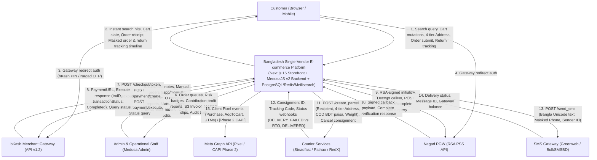
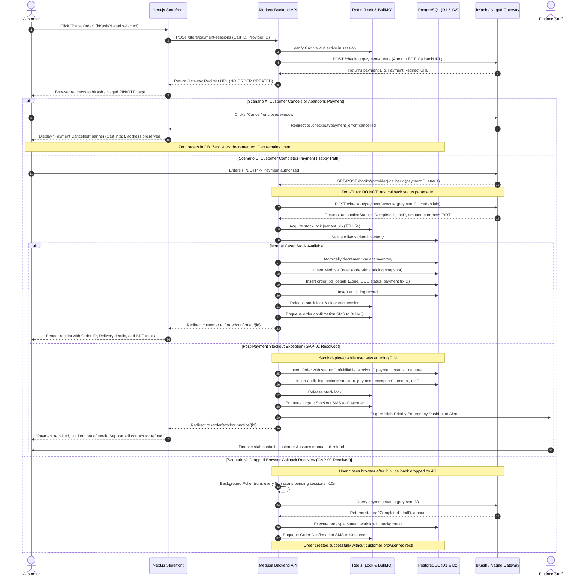
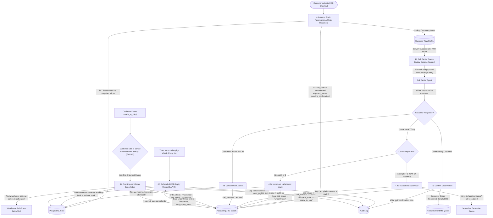
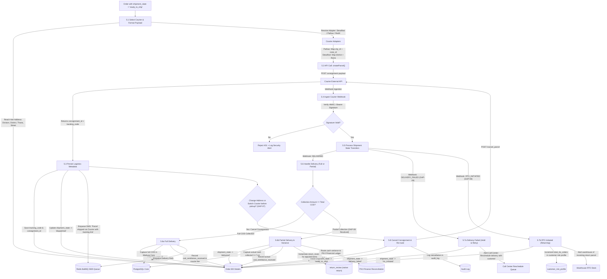
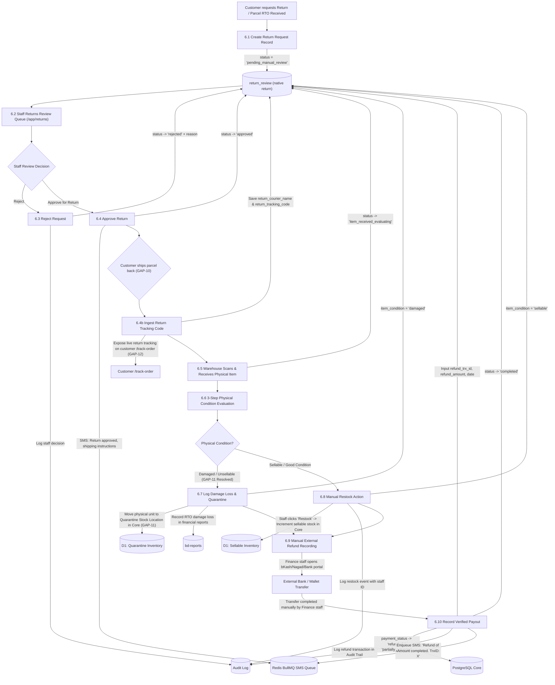
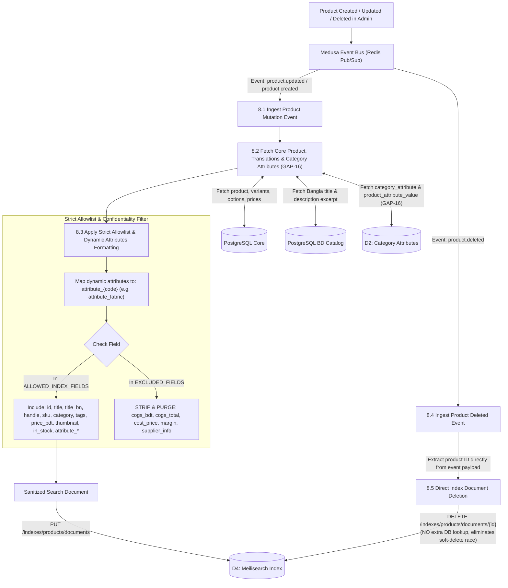

# Data Flow Diagram (DFD) Specification
## Bangladesh Single-Vendor E-commerce Platform

**Document Version:** 2.0 — Final Reconciled & Audited  
**Release Target:** Phase 1 Launch Baseline  
**Date:** 2026-10-24  
**Reconciled & Audited Against:**
- [`docs/dfd-review.md`](dfd-review.md) — All 18 Review Findings Resolved
- [`docs/architecture.md`](architecture.md) — Version 2.0 (Authoritative Reference)
- [`prd.md`](../prd.md) — v2 (Reconciled)
- [`quality-checklist.md`](../quality-checklist.md) — QA Reference

---

## Executive Summary & Scope

This document provides the definitive, comprehensive Data Flow Diagram (DFD) specification for the Bangladesh Single-Vendor E-commerce Platform. It rigorously maps all data flows, actors, internal processes, physical data stores, external APIs, and asynchronous background queues.

The architecture is purpose-built for a **single-vendor retail model** in Bangladesh:
- **Single Currency & Paisa Math:** Bangladesh Taka (BDT, ৳) stored as integer paisa (`bigint`: 1 BDT = 100 paisa).
- **Single Centralized Warehouse:** Central inventory with atomic Redis mutex stock reservations and physical damaged-goods quarantine.
- **Zero-Orphan Payment Architecture:** Customer cart preserved during bKash/Nagad redirects; orders created only upon verified capture; post-payment stockout exception routing.
- **Zero-Trust Callback Protocol:** Server-to-server query verification mandatory on all payment callbacks.
- **Background Callback Recovery:** Scheduled worker reconciling dropped browser redirects for completed mobile payments.
- **4-Tier Administrative Address Hierarchy:** `Division` -> `District` -> `Upazila/Thana` -> `Area/Street` for seamless courier API routing.
- **Call Center COD Verification:** Call attempt counter (1, 2, 3), transition to `escalated` queue, pre-shipment order cancellation, and scheduled expiry cron.
- **Courier Operations:** Consignment booking, cancellation/re-routing, differentiation of transient `delivery_failed` vs `rto_initiated`, and partial delivery remittance variance tracking.
- **Manual Returns & Payouts:** 3-step physical inspection, return tracking ingestion, damaged inventory quarantine, and manually recorded external refund transactions.
- **Audit Logging & Security:** Immutable audit trail (`bd-audit`) capturing all price, stock, order, return, and staff auth security events.
- **Search Protection:** Strict Meilisearch allowlist stripping confidential COGS and margin figures while indexing dynamic category attributes.

---

## Table of Contents

1. [External Entities & Data Stores Reference](#1-external-entities--data-stores-reference)
2. [Level 0: Context Diagram](#2-level-0-context-diagram)
   - 2.1 [Mermaid Level 0 Context Diagram](#21-mermaid-level-0-context-diagram)
   - 2.2 [Context Data Flow Description](#22-context-data-flow-description)
3. [Level 1: System-Wide Operational DFD](#3-level-1-system-wide-operational-dfd)
   - 3.1 [Mermaid Level 1 DFD](#31-mermaid-level-1-dfd)
   - 3.2 [Core Process Descriptions (P1.0 to P9.0)](#32-core-process-descriptions-p10-to-p90)
4. [Level 2: Sub-Process Decomposition DFDs](#4-level-2-sub-process-decomposition-dfds)
   - 4.1 [Level 2.1: Payment & Order Creation Pipeline (Zero-Orphan & Stockout Exception)](#41-level-21-payment--order-creation-pipeline-zero-orphan--stockout-exception)
   - 4.2 [Level 2.2: COD Verification & Call Center Pipeline (Escalation & Pre-Shipment Cancel)](#42-level-22-cod-verification--call-center-pipeline-escalation--pre-shipment-cancel)
   - 4.3 [Level 2.3: Courier Fulfillment & Parcel Tracking Pipeline (Retry vs RTO & Partial COD)](#43-level-23-courier-fulfillment--parcel-tracking-pipeline-retry-vs-rto--partial-cod)
   - 4.4 [Level 2.4: Return, Physical Inspection & Manual Refund Pipeline (Quarantine & Return Tracking)](#44-level-24-return-physical-inspection--manual-refund-pipeline-quarantine--return-tracking)
   - 4.5 [Level 2.5: Search Index Synchronization & Dynamic Attributes Pipeline](#45-level-25-search-index-synchronization--dynamic-attributes-pipeline)
5. [Data-Flow Mapping Tables](#5-data-flow-mapping-tables)
   - 5.1 [External Data Flows (Level 0)](#51-external-data-flows-level-0)
   - 5.2 [Internal Inter-Process & Data Store Flows (Level 1 & Level 2)](#52-internal-inter-process--data-store-flows-level-1--level-2)
6. [Comprehensive Data Dictionary](#6-comprehensive-data-dictionary)
   - 6.1 [Composite Data Structures](#61-composite-data-structures)
   - 6.2 [Data Store Schema Definitions](#62-data-store-schema-definitions)
   - 6.3 [Status Enums & Transitions](#63-status-enums--transitions)
7. [Draw.io / mxGraph XML Specification](#7-drawio--mxgraph-xml-specification)
8. [Architecture & PRD Validation Report](#8-architecture--prd-validation-report)

---

## 1. External Entities & Data Stores Reference

### 1.1 External Entities (Terminators)

| Entity ID | Entity Name | Type | Description / Responsibility |
|---|---|---|---|
| **E1** | **Customer (Guest / Registered)** | Human Actor | Browses catalog, searches products, manages cart, checks out via 4-tier address, executes online payment, tracks order & return status, requests returns. |
| **E2** | **Admin & Operational Staff** | Human Actor | Call Center staff (COD confirm, manual orders), Warehouse staff (packing, RTO inspect), Store Manager (catalog, CMS), Finance staff (manual refunds, reconciliation), Owner (audit logs, settings). |
| **E3** | **bKash Merchant API Gateway** | External System | bKash Tokenized Checkout API v1.2.0-beta. Grants tokens, creates payment redirect URLs, executes server-to-server payment capture, responds to query verification. |
| **E4** | **Nagad PGW Gateway** | External System | Nagad DFS Check-Out API. RSA-signed checkout initialization, cryptographic callback verification, payment completion. |
| **E5** | **Courier Services (Steadfast / Pathao / RedX)** | External System | Logistics APIs. Receives parcel bookings, cancels consignments, generates tracking codes, posts parcel movement webhooks (Hold/Retry vs RTO), delivers parcels, remits COD funds. |
| **E6** | **SMS Gateway (Greenweb / BulkSMSBD)** | External System | Telecom aggregator API. Dispatches transactional Bangla Unicode SMS notifications for order placement, COD confirmation, dispatch, delivery, and refunds. |
| **E7** | **Meta Graph API (Pixel Client / Phase 2 CAPI)** | External System | Marketing platform. Receives client-side Pixel events (`ViewContent`, `AddToCart`, `Purchase`, UTMs) and optional Phase 2 server CAPI payloads. |

### 1.2 Data Stores

| Store ID | Data Store Name | Physical Technology | Stored Entities & Tables |
|---|---|---|---|
| **D1** | **PostgreSQL Core Commerce** | Relational DB (Port 5432) | `products`, `product_variants`, `prices`, `inventory_items` (sellable & quarantine locations), `carts`, `line_items`, `orders`, `order_line_items`, `customers`, `users`. |
| **D2** | **PostgreSQL BD Custom Extensions** | Relational DB (Port 5432) | `order_bd_details`, `customer_risk_profile`, `return_review` (linking native `return`), `product_localization`, `category_attribute`, `product_attribute_value`, `landing_page`, `homepage_section`, `content_page`, `invoice_template`, `audit_log`, `sms_delivery_detail`, `operational_settings`, `delivery_zone`, `vat_settings`. |
| **D3** | **Redis Caching & Concurrency Store** | In-Memory K/V (Port 6379) | BullMQ workflow queues (`bull:medusa-*`), sms outbox queue (`sms_outbox_queue`), stock locks (`stock:lock:*`), rate-limiting buckets (`ratelimit:*`), account lockout tracking (`auth:lockout:*`), session cache. |
| **D4** | **Meilisearch Search Index** | Full-Text Engine (Port 7700) | `products` index (searchable title EN/BN, SKU, tags, category, dynamic `attribute_*`; strictly EXCLUDES COGS and margin data). |
| **D5** | **Cloudflare R2 / S3 Object Store** | Blob Storage | Product media images, invoice PDF snapshots, courier manifest thermal labels. |

---

## 2. Level 0: Context Diagram

### 2.1 Mermaid Level 0 Context Diagram



### 2.2 Context Data Flow Description

1. **Customer Interaction (E1 <-> SYS):**
   - Inbound: Search requests (Bangla/English/Banglish), cart actions, 4-tier shipping address (Division -> District -> Thana -> Street), COD / bKash / Nagad selection, order tracking queries (Order ID + 11-digit phone), customer return tracking number submission.
   - Outbound: Instant filtered catalog hits from Meilisearch, real-time cart state, BDT delivery charge breakdown, order confirmation receipt, masked order and return request tracking timeline, downloadable PDF invoice.
2. **Staff Operations (E2 <-> SYS):**
   - Inbound: COD call notes (Attempt 1/2/3, Confirmed, Canceled, Escalated), phone-first manual orders (`/app/manual-order`), consignment cancellation, physical RTO condition reports (`sellable`/`damaged`), manually recorded external refund transaction IDs (`refund_trx_id`), manual SMS resend, homepage block reordering, policy page publishing.
   - Outbound: Actionable Call Center queues (`/app/cod-queue`), customer RTO risk badges, immutable audit logs, server-generated S3 invoice PDFs, contribution profit reports.
3. **Payment Gateways (SYS <-> E3 / E4):**
   - Zero-orphan flow: Payment sessions created before redirect; orders placed strictly after authenticated server-to-server `executePayment` verification. Background worker polls gateway for dropped browser callbacks. Post-payment stockout exception flow alerts finance team.
4. **Logistics & SMS (SYS <-> E5 / E6):**
   - Automated parcel consignment dispatch with 4-tier address mapping. Inbound courier webhooks distinguish transient `delivery_failed` (re-attempt) from `rto_initiated` (return). Partial delivery collections trigger return requests and finance variance logging. Asynchronous Bangla Unicode SMS dispatched via BullMQ outbox queue.

---

## 3. Level 1: System-Wide Operational DFD

### 3.1 Mermaid Level 1 DFD

```mermaid
flowchart TD
    %% External Entities
    E1["Customer"]
    E2["Admin / Staff"]
    E3["bKash Gateway"]
    E4["Nagad PGW"]
    E5["Courier Services"]
    E6["SMS Gateway"]

    %% Data Stores
    D1[("D1: PostgreSQL Core<br/>(Products, Carts, Orders, Inventory, Damaged Goods)")]
    D2[("D2: PostgreSQL BD Extensions<br/>(OrderDetails, Returns, Audit, Content, Settings)")]
    D3[("D3: Redis Transient Store<br/>(BullMQ Queues, Stock Locks, Lockouts, Limits)")]
    D4[("D4: Meilisearch Index<br/>(products: Public Search Allowlist + Category Attrs)")]
    D5[("D5: S3 / R2 Storage<br/>(Media, Invoices, Thermal Labels)")]

    %% Processes
    P1["1.0 Catalog, Search & Localization Engine"]
    P2["2.0 Cart & One-Page Checkout Processor"]
    P3["3.0 Payment Verification & Session Manager"]
    P4["4.0 Order Lifecycle & COD Call Center Engine"]
    P5["5.0 Courier Booking & Logistics Dispatcher"]
    P6["6.0 Return Inspection & Manual Refund Manager"]
    P7["7.0 SMS Notification & Outbox Dispatcher"]
    P8["8.0 Content CMS, Theming & Audit Logger"]
    P9["9.0 Financial Reconciliation & Reporting Engine"]

    %% Process 1.0 Flows
    E1 -->|"Search query (BN/EN), Locale switch"| P1
    P1 -->|"Sub-50ms search hits, Localized PDP"| E1
    P1 <-->|"Query / Facets (Allowed fields + dynamic attrs)"| D4
    P1 <-->|"Read product & variant prices"| D1
    P1 <-->|"Read BN translations"| D2
    P1 -->|"Sync registered customer locale"| D1

    %% Process 2.0 Flows
    E1 -->|"Add to Cart / Buy Now / 4-tier Address"| P2
    P2 <-->|"Cart session & line items"| D1
    P2 <-->|"Zone flat rate lookup"| D2
    P2 -->|"Acquire instant stock lock at submit (<2s)"| D3
    P2 -->|"Create payment session"| P3
    P2 -->|"Submit validated COD order"| P4

    %% Process 3.0 Flows
    P3 -->|"Initiate redirect payment"| E3
    P3 -->|"RSA initialize payment"| E4
    E3 -->|"Callback (paymentID)"| P3
    E4 -->|"Callback (payment_ref_id)"| P3
    P3 -->|"Server verify & capture"| E3
    P3 -->|"Server complete & verify"| E4
    P3 <-->|"Background poll for dropped callbacks (every 5m)"| E3
    P3 <-->|"Background poll for dropped callbacks"| E4
    P3 -->|"Payment captured signal"| P4

    %% Process 4.0 Flows
    E2 -->|"Phone-first manual order (/app/manual-order)"| P4
    E2 <-->|"COD queue, Confirm/Cancel/Escalate order"| P4
    P4 <-->|"Atomic inventory decrement (or exception if 0)"| D1
    P4 <-->|"OrderBdDetails (Zone, COD status, Snapshot)"| D2
    P4 <-->|"Customer risk profile lookup"| D2
    D3 -->|"Timer: cron.cod-expiry-check (auto-cancel/escalate)"| P4
    P4 -->|"Pre-shipment cancel: release stock"| D1
    P4 -->|"Trigger dispatch workflow"| P5
    P4 -->|"Enqueue order SMS to BullMQ"| D3
    P4 -->|"Log order action to audit_log"| P8

    %% Process 5.0 Flows
    P5 <-->|"Fetch order & recipient 4-tier address"| D2
    P5 -->|"POST /create_parcel"| E5
    E2 -->|"Cancel consignment & re-route"| P5
    P5 -->|"POST /cancel_parcel"| E5
    E5 -->|"Consignment ID & tracking code"| P5
    E5 -->|"Webhook: DELIVERED"| P5
    E5 -->|"Webhook: DELIVERY_FAILED (Hold/Retry)"| P5
    E5 -->|"Webhook: RTO_INITIATED"| P5
    P5 <-->|"Update shipment_state"| D2
    P5 -->|"Capture COD payment on delivery"| D1
    P5 -->|"Partial delivery: create return request & variance"| P6
    P5 -->|"Enqueue dispatch SMS to BullMQ"| D3
    P5 -->|"Log courier event"| P8

    %% Process 6.0 Flows
    E1 -->|"Submit return request & return tracking code"| P6
    E1 <-->|"Track return status via /track-order"| P6
    E2 <-->|"Review, Inspect condition, Record refund trxID"| P6
    P6 <-->|"Update return_review & native return"| D2
    P6 -->|"Manual inventory restock (if sellable)"| D1
    P6 -->|"Move to Quarantine / Damaged Location (if damaged)"| D1
    P6 -->|"Enqueue refund SMS to BullMQ"| D3
    P6 -->|"Log inspection & refund to audit_log"| P8
    P6 -->|"Send return cash variance"| P9

    %% Process 7.0 Flows
    D3 -->|"Consume sms_outbox_queue job"| P7
    E2 -->|"Manual SMS resend (/app/settings/sms)"| P7
    P7 <-->|"Read template & check hourly rate limit"| D3
    P7 -->|"POST /send_sms (Bangla text)"| E6
    E6 -->|"SMS messageId & status"| P7
    P7 <-->|"Persist outbound log in sms_log"| D2

    %% Process 8.0 Flows
    E2 <-->|"Manage homepage blocks, policy pages, tokens"| P8
    E2 <-->|"View audit logs (/admin/audit-logs)"| P8
    P8 <-->|"Homepage sections & CMS pages"| D2
    P8 <-->|"Immutable audit_log"| D2
    P8 <-->|"Ingest staff auth security events (lockouts)"| D3
    P8 -->|"Sync product changes (Allowlist + Category attrs)"| D4
    P8 -->|"Generate PDF invoice snapshot to S3"| D5
    E1 -->|"Download customer invoice PDF"| D5
    E2 -->|"Download warehouse packing slip PDF"| D5

    %% Process 9.0 Flows
    E2 <-->|"View contribution profit & settlement"| P9
    P9 <-->|"Read sales, discounts, COGS"| D1
    P9 <-->|"Read delivery split (Customer/Courier/Remitted)"| D2
```



### 3.2 Core Process Descriptions (P1.0 to P9.0)

#### P1.0: Catalog, Search & Localization Engine
- **Input:** Search text, category filters, language toggle (`en` / `bn`), price ranges.
- **Function:** Serves instant product searches from Meilisearch `products` index using public search-only key (`D4`). Reconciles Bangla titles/descriptions from `bd-catalog` (`D2`) and live variant stock/pricing from Medusa Core (`D1`). Syncs registered customer language preference to `D1: customer.metadata.locale` (GAP-17).
- **Output:** Ranked search hits, localized product detail view, live variant inventory status.

#### P2.0: Cart & One-Page Checkout Processor
- **Input:** Line items, coupon codes, 4-tier address (`division`, `district`, `thana`, `street`), payment option choice.
- **Function:** Manages the unified single-vendor cart in `D1`. Evaluates stock availability optimistically during address typing; acquires Redis distributed mutex (`stock:lock:{variant_id}`) with a tight 5-second TTL **strictly at the instant of order submission** (`D3`) (GAP-03). Computes delivery zone charges based on `bd_settings` (`D2`): Inside Dhaka (৳60), Suburbs (৳100), Outside Dhaka (৳130) or free shipping if subtotal >= threshold.
- **Output:** Validated checkout payload with idempotency token (`X-Idempotency-Key`).

#### P3.0: Payment Verification & Session Manager
- **Input:** Selected payment method (`pp_cod`, `pp_bkash`, `pp_nagad`), gateway callback query/body.
- **Function:** Implements zero-orphan redirect architecture. For online payments, initializes payment session only (no order created). On callback, executes mandatory server-to-server API verification with bKash/Nagad. Verifies currency is BDT, amount matches expected cart total, and transaction status is completed. Runs background polling worker every 5 minutes to recover dropped browser callbacks for completed transactions (GAP-02).
- **Output:** Authorized/captured payment collection. Forwards verified transaction payload to P4.0.

#### P4.0: Order Lifecycle & COD Call Center Engine
- **Input:** Verified payment payload, confirmed COD submission, staff call notes, phone-first manual order payload (`/app/manual-order`) (GAP-13).
- **Function:** Atomic Medusa Order creation with immutable order-time financial snapshot (`D1`). Creates linked `order_bd_details` (`D2`) with initial `cod_status = "unconfirmed"` and `shipment_state = "pending_confirmation"`.
  - **Post-Payment Stockout Exception Handling (GAP-01):** If payment was captured but atomic inventory decrement fails (stock reached 0 during redirect), creates an `unfulfillable_stockout` exception order, triggers high-priority dashboard alert, logs to `audit_log`, and notifies finance for immediate manual refund.
  - **COD Escalation (GAP-04):** Call center agents log call attempts; if 3 attempts fail, order auto-transitions to `cod_status = "escalated"` and moves to Supervisor Escalation Queue.
  - **Pre-Shipment Cancellation (GAP-05):** Allows cancelling confirmed `ready_to_ship` orders, releasing inventory and alerting warehouse.
  - **COD Expiry Cron (GAP-06):** Background cron evaluates unconfirmed orders older than `cod_expiry_hours` and auto-cancels or escalates.
- **Output:** Confirmed order ready for fulfillment (`shipment_state = "ready_to_ship"`). Enqueues order SMS job to Redis BullMQ.

#### P5.0: Courier Booking & Logistics Dispatcher
- **Input:** Order ID, packaging weight, courier selection (`Steadfast`, `Pathao`, `RedX`, `Manual`).
- **Function:** Maps 4-tier address to courier-specific fields (`Pathao`: city_id + zone_id; `Steadfast`: district + thana). Calls courier API to generate consignment ID and tracking code. Supports consignment cancellation and re-booking if parcel details change before dispatch (GAP-07).
  - **Differentiated Webhooks (GAP-09):** Ingests webhooks distinguishing `delivery_failed` (re-attempt tomorrow; alerts Call Center) from `rto_initiated` (return to merchant; alerts Warehouse).
  - **Partial COD Collection (GAP-08):** If courier collects partial cash, captures collected amount, instantiates a return request in P6.0 for rejected items, and routes variance to P9.0.
- **Output:** Consignment labels, tracking URL, courier remittance records. Enqueues dispatch SMS to Redis BullMQ.

#### P6.0: Return Inspection & Manual Refund Manager
- **Input:** Customer return request, return courier tracking code (GAP-10), staff condition evaluation, manual external payout details.
- **Function:** Manages independent 4th status dimension `return_review.status` (`D2` linking native `return`), exposed to customer on `/track-order` (GAP-12). Enforces 3-step physical inspection. If condition is `sellable`, staff triggers manual restock to `D1`. If `damaged`, moves physical item to `Quarantine / Damaged Goods Location` in `D1` (GAP-11). Authorized staff manually executes external bKash/Nagad/bank transfer and records `refund_trx_id` and amount.
- **Output:** Completed return record, financial refund ledger entry, restocked or quarantined inventory. Enqueues refund SMS to Redis BullMQ.

#### P7.0: SMS Notification & Outbox Dispatcher
- **Input:** Asynchronous SMS jobs consumed from BullMQ queue in `D3: sms_outbox_queue` (GAP-18), staff manual resend requests (`POST /admin/sms/resend/{id}`).
- **Function:** Enforces Redis rate limit (max 3 SMS per order per event type per hour in `D3`). Compiles UTF-8 Bangla Unicode templates. Dispatches HTTP payload to Greenweb / BulkSMSBD (`E6`). Logs delivery receipt to `sms_log` (`D2`).
- **Output:** Real-time customer SMS delivery.

#### P8.0: Content CMS, Theming & Audit Logger
- **Input:** Staff updates to catalog, prices, roles, settings, homepage sections, policy pages, and staff auth security events (failed logins, lockouts) (GAP-15).
- **Function:** Manages CMS blocks in `D2` with draft/preview/publish/rollback. Enforces WCAG AA color contrast check on design tokens. On product updates, pushes sanitized payload (including category dynamic attributes `attribute_*`, strictly excluding COGS) to Meilisearch (`D4`) (GAP-16). Intercepts all sensitive actions and writes immutable records to `audit_log` (`D2`). Generates immutable PDF invoices to S3 (`D5`), downloadable by Customer and Warehouse staff (GAP-14).
- **Output:** Published storefront appearance, S3 PDF URLs, security audit trail.

#### P9.0: Financial Reconciliation & Reporting Engine
- **Input:** Date ranges, campaign IDs, courier invoice summaries, partial delivery remittance variances (GAP-08).
- **Function:** Queries `D1` and `D2` to calculate Gross Sales, Net Sales, Contribution Profit Before Advertising, and Contribution Profit After Advertising. Reconciles the 3-way COD delivery split: customer-paid delivery charge vs. courier cost to business vs. actual net COD cash remitted.
- **Output:** Executive financial dashboard, COD settlement reconciliation tables.

---

## 4. Level 2: Sub-Process Decomposition DFDs

### 4.1 Level 2.1: Payment & Order Creation Pipeline (Zero-Orphan & Stockout Exception)



### 4.2 Level 2.2: COD Verification & Call Center Pipeline (Escalation & Pre-Shipment Cancel)



### 4.3 Level 2.3: Courier Fulfillment & Parcel Tracking Pipeline (Retry vs RTO & Partial COD)



### 4.4 Level 2.4: Return, Physical Inspection & Manual Refund Pipeline (Quarantine & Return Tracking)



### 4.5 Level 2.5: Search Index Synchronization & Dynamic Attributes Pipeline



---

## 5. Data-Flow Mapping Tables

### 5.1 External Data Flows (Level 0)

| Flow ID | Source | Destination | Data Elements Transmitted | Protocol / Transport | Trigger / Frequency | Security & Validation |
|---|---|---|---|---|---|---|
| **DF-01** | Customer | Storefront | Search keywords (English, Bangla, Banglish), category filters, sort preferences | HTTPS GET / JSON | User typing (debounced 300ms) | Public search API key; sanitized input |
| **DF-02** | Customer | Storefront | Cart mutations (variant_id, quantity), Buy Now click | HTTPS POST / JSON | Customer action | Cookie cart token; rate limited (60/min) |
| **DF-03** | Customer | Storefront | 4-tier Address (`division`, `district`, `thana`, `street`), recipient phone, payment selection | HTTPS POST / JSON | Checkout submission | 11-digit BD phone regex; `X-Idempotency-Key` |
| **DF-04** | Customer | Storefront | Order & Return tracking query (`order_id`, customer 11-digit mobile phone) | HTTPS GET / JSON | Customer tracking request | Rate-limited (10 req/min); lockout on 3 fails; returns masked phone & return status |
| **DF-05** | Storefront | bKash API | Create payment request: app key, cart total BDT, callback URL | HTTPS POST / JSON | Customer selects bKash | TLS 1.3; Merchant Auth Bearer Token |
| **DF-06** | bKash API | Backend API | Gateway redirect callback: `paymentID`, `status` | HTTPS GET/POST | Customer completes/cancels on bKash | Zero-Trust: status parameter NOT trusted |
| **DF-07** | Backend API | bKash API | Server-to-server execute call: `POST /checkout/payment/execute` | HTTPS POST / JSON | Ingest of DF-06 callback | Server-side credentials; amount & currency checked |
| **DF-08** | Storefront | Nagad PGW | RSA-PSS encrypted initialization payload, merchant ID | HTTPS POST / Form | Customer selects Nagad | RSA 2048-bit encryption with Nagad Public Key |
| **DF-09** | Nagad PGW | Backend API | Signed payment callback: `payment_ref_id`, `status` | HTTPS GET/POST | Customer completes/cancels on Nagad | Zero-Trust: verify signature with Nagad Public Key |
| **DF-10** | Backend API | Nagad PGW | Complete check-out request: `POST /check-out/complete/{ref_id}` | HTTPS POST / JSON | Ingest of DF-09 callback | Merchant Private Key from secure file path |
| **DF-11** | Backend API | Courier API | Parcel payload: recipient, 4-tier address, COD BDT paisa, weight | HTTPS POST / JSON | Staff clicks "Send to Courier" | Courier API Key / Bearer Token |
| **DF-12** | Courier API | Backend API | Consignment response: `consignment_id`, `tracking_code`, `courier_fee` | HTTPS 200 OK / JSON | Response to DF-11 | Validated and persisted in `order_bd_details` |
| **DF-13** | Courier API | Backend API | Tracking webhooks: `consignment_id`, `status` (IN_TRANSIT, DELIVERY_FAILED, RTO_INITIATED, DELIVERED) | HTTPS POST / JSON | Asynchronous parcel movement | HMAC / Header Bearer signature verification |
| **DF-14** | Backend API | SMS Gateway | SMS payload: recipient phone, UTF-8 Bangla Unicode template, Sender ID | HTTPS POST / JSON | Consumed from BullMQ queue | Rate-limited (max 3/order/hr); masked logging |
| **DF-15** | Admin Staff | Medusa Admin | Call notes, manual order (`/app/manual-order`), RTO condition report, refund `trxID`, CMS edits | HTTPS REST / JSON | Operational staff workflows | JWT Bearer; RBAC role check; Audit logged |
| **DF-16** | Customer | S3 Storage | Download Customer PDF Invoice: `GET /store/orders/:id/invoice` | HTTPS GET / PDF | Customer clicks download | Signed/tokenized URL; order-time snapshot |
| **DF-17** | Warehouse Staff | S3 Storage | Download Warehouse Packing Slip PDF: `GET /admin/orders/:id/invoice` | HTTPS GET / PDF | Staff printing packing slip | Admin JWT Bearer; authenticated stream |

### 5.2 Internal Inter-Process & Data Store Flows (Level 1 & Level 2)

| Flow ID | Source Process | Target Store | Data Elements Transmitted | Transport | Operation | Consistency & Integrity Rule |
|---|---|---|---|---|---|---|
| **DF-20** | P2.0 (Checkout) | D3 (Redis) | Key: `stock:lock:{variant_id}`, TTL: 5s | Redis TCP | `SET NX EX` | Acquired strictly at order submit click (<2s hold) |
| **DF-21** | P2.0 (Checkout) | D1 (Core DB) | Cart line items, customer email/phone, applied coupon | SQL / MikroORM | SELECT / UPDATE | Validates price set and optimistic stock availability |
| **DF-22** | P2.0 (Checkout) | D2 (BD Details) | Delivery zone lookup for Division/District/Thana | SQL / MikroORM | SELECT | Flat rate resolution (Inside 60 / Suburbs 100 / Outside 130) |
| **DF-23** | P4.0 (Order) | D1 (Core DB) | Order entity, line items snapshot, stock decrement | SQL / Transaction | INSERT / UPDATE | Atomic transaction; immutable price/COGS snapshot |
| **DF-24** | P4.0 (Order) | D2 (BD Details) | `order_id`, `delivery_zone`, `cod_status`, `shipment_state`, fees | SQL / Transaction | INSERT | 1:1 Module link with Medusa Order |
| **DF-25** | P4.0 (COD) | D2 (BD Details) | `cod_status -> 'confirmed'` or `'escalated'` (after 3 attempts) | SQL / MikroORM | UPDATE | Guarded by staff confirmation note |
| **DF-26** | P5.0 (Courier) | D2 (BD Details) | `consignment_id`, `tracking_code`, `courier_provider` | SQL / MikroORM | UPDATE | Stored upon successful courier parcel creation |
| **DF-27** | P5.0 (Courier) | D1 (Core DB) | COD Payment Capture (`payment_status -> 'captured'`) | SQL / Transaction | UPDATE | Triggered strictly when courier webhook = DELIVERED |
| **DF-28** | P5.0 (Courier) | D2 (BD Details) | `customer_paid_delivery`, `courier_cost_to_business`, `cod_remittance` | SQL / MikroORM | UPDATE | 3-way delivery fee reconciliation figures |
| **DF-29** | P6.0 (Returns) | D2 (BD Details) | `return_review`: status, return tracking code, condition, trxID (linking native `return`) | SQL / MikroORM | INSERT / UPDATE | Independent 4th status; never auto-overwritten |
| **DF-30** | P6.0 (Returns) | D1 (Core DB) | Increment sellable variant stock OR move to Quarantine stock | SQL / Transaction | UPDATE | Restocks to sellable ONLY if condition = 'sellable' |
| **DF-31** | P7.0 (SMS) | D2 (BD Details) | `sms_log`: phone (masked), template, status, message_id | SQL / MikroORM | INSERT | Complete outbound message audit trail |
| **DF-32** | P8.0 (Audit) | D2 (BD Details) | `audit_log`: actor, role, entity, old_value, new_value, IP, reason | SQL / MikroORM | INSERT | Append-only immutable security ledger |
| **DF-33** | P8.0 (CMS) | D4 (Meilisearch)| Sanitized product document (title EN/BN, SKU, tags, price, `attribute_*`) | HTTP PUT / JSON | INDEX | Strict allowlist: COGS and margins stripped |
| **DF-34** | P8.0 (CMS) | D4 (Meilisearch)| Delete product document by ID: `DELETE /documents/{id}` | HTTP DELETE | DELETE | Directly uses payload ID; no extra DB re-fetch |
| **DF-35** | P8.0 (Invoices)| D5 (S3 / R2) | Compiled PDF invoice binary buffer | S3 PutObject | UPLOAD | Immutable PDF compiled from order-time snapshot |
| **DF-36** | P3.5 (Poller) | D1 / D3 (DB) | Scan pending online sessions >10m, update captured state | SQL / Redis | SELECT / UPDATE | Recovers dropped browser callbacks automatically |
| **DF-37** | P4.7 (Expiry) | D2 / D1 (DB) | Scan unconfirmed COD orders > threshold, cancel, release stock | SQL / Transaction | UPDATE | Enforces automated COD reservation expiry cron |
| **DF-38** | P5.8 (Re-route)| D2 (BD Details) | Clear `consignment_id`, `tracking_code`, set `ready_to_ship` | SQL / MikroORM | UPDATE | Consignment cancellation and courier re-routing |

---

## 6. Comprehensive Data Dictionary

### 6.1 Composite Data Structures

#### 1. `CustomerAddress4Tier` (4-Tier Administrative Address)
```json
{
  "division": "Dhaka",
  "district": "Gazipur",
  "thana": "Sreepur",
  "area_street": "House 12, Road 4, Sector 2, Mawna Chowrasta",
  "postal_code": "1740",
  "recipient_name": "Sabbir Ahmed",
  "recipient_phone": "+8801712345678"
}
```
*Validation Rules:*
- `division`: Must match one of 8 Bangladesh divisions (`Dhaka`, `Chattogram`, `Rajshahi`, `Khulna`, `Barishal`, `Sylhet`, `Rangpur`, `Mymensingh`).
- `district`: Must match one of 64 recognized zillas.
- `thana`: Valid upazila / police station within the selected district.
- `recipient_phone`: Strict E.164 regex `^(?:\+8801|8801|01)[3-9]\d{8}$`.

#### 2. `OrderTimeSnapshot` (Immutable Financial Record)
```json
{
  "unit_price_bdt": 250000,
  "compare_at_price_bdt": 280000,
  "cogs_unit_bdt": 160000,
  "discount_allocated_bdt": 20000,
  "product_title_en": "Men Casual Punjabi",
  "product_title_bn": "পুরুষদের ক্যাজুয়াল পাঞ্জাবি",
  "variant_sku": "PUN-BLK-L",
  "variant_options": { "Size": "L", "Color": "Black" }
}
```

#### 3. `CodSettlementBreakdown` (3-Way Logistics Split)
```json
{
  "customer_paid_delivery": 13000,
  "courier_cost_to_business": 11000,
  "cod_remittance_received": 239000,
  "cod_settlement_status": "settled"
}
```

#### 4. `AuditLogEntry` (Security & Operations Audit Record)
```json
{
  "actor_id": "usr_01J8F9Z4...",
  "actor_role": "finance_admin",
  "actor_email": "finance@merchant.com",
  "entity_type": "return_refund",
  "entity_id": "ret_01J8K3B7...",
  "action": "refund_record",
  "old_value": { "status": "approved", "refund_trx_id": null },
  "new_value": { "status": "completed", "refund_trx_id": "BK-98234812", "amount": 250000 },
  "ip_address": "103.145.23.12",
  "stated_reason": "Customer returned item in original condition; manual bKash refund processed.",
  "created_at": "2026-10-24T14:30:00Z"
}
```

### 6.2 Data Store Schema Definitions

#### D1: PostgreSQL Core Commerce Schema
- `product`: Base product record (`id`, `title`, `handle`, `status`, `thumbnail`, `created_at`, `updated_at`, `deleted_at`).
- `product_variant`: Sellable unit (`id`, `product_id`, `sku`, `barcode`, `manage_inventory`).
- `price`: BDT pricing set (`id`, `price_set_id`, `amount` [bigint paisa], `currency_code` = "bdt", `rules_count`).
- `inventory_item`: Variant stock tracking across locations:
  - `location_id = 'loc_central_warehouse'`: Sellable active stock.
  - `location_id = 'loc_damaged_quarantine'`: Damaged/uninspected physical returns (GAP-11).
- `reservation_item`: Atomic inventory holds for unconfirmed/pending orders.
- `cart` & `line_item`: Active customer cart session, unit quantities, applied discount tokens.
- `order` & `order_line_item`: Finalized commerce orders, historical line item snapshot, core status (`open`, `completed`, `canceled`, `unfulfillable_stockout`), payment status (`pending`, `authorized`, `captured`, `partially_refunded`, `refunded`).

#### D2: PostgreSQL Bangladesh Custom Schema
- `order_bd_details`:
  - `order_id`: varchar (FK to Medusa Order, unique).
  - `division`, `district`, `thana`: varchar.
  - `delivery_zone`: enum (`inside_dhaka`, `dhaka_suburbs`, `outside_dhaka`).
  - `cod_status`: enum (`not_applicable`, `unconfirmed`, `confirmed`, `escalated`, `canceled`).
  - `cod_confirmed_by`: varchar (Staff user ID).
  - `shipment_state`: enum (`pending_confirmation`, `ready_to_ship`, `dispatched`, `in_transit`, `out_for_delivery`, `delivery_failed`, `rto_initiated`, `rto_received`, `delivered`).
  - `courier_provider`: enum (`steadfast`, `pathao`, `redx`, `manual`).
  - `courier_tracking_code`: varchar (indexed).
  - `courier_consignment_id`: varchar.
  - `customer_paid_delivery`: bigint (paisa).
  - `courier_cost_to_business`: bigint (paisa).
  - `cod_remittance_received`: bigint (paisa).
  - `cod_settlement_status`: enum (`pending`, `partially_remitted`, `settled`, `disputed`).
  - `cogs_total`: bigint (paisa).
  - `utm_source`, `utm_medium`, `utm_campaign`, `landing_page_slug`: varchar.
- `return_review` (canonical 1:1 extension of native `return` + `return_item`):
  - `id`: varchar (PK `retrev_`).
  - `order_id`: varchar (FK).
  - `return_id`: varchar (FK to native Medusa `return`, unique).
  - `status`: enum (`none`, `pending_manual_review`, `approved`, `rejected`, `info_requested`, `item_received_evaluating`, `completed`).
  - `reason`: text.
  - `return_courier_name`: varchar (GAP-10).
  - `return_tracking_code`: varchar (GAP-10).
  - `item_condition`: enum (`uninspected`, `sellable`, `damaged`, `not_restockable`).
  - `refund_method`: enum (`bkash`, `nagad`, `bank`, `store_credit`).
  - `refund_target_account`: varchar.
  - `refund_amount_bdt`: bigint (paisa).
  - `refund_trx_id`: varchar (manually recorded).
  - `reviewed_by`: varchar (Staff ID).
  - `reviewed_at`: timestamp.
- `audit_log`:
  - `id`: varchar (PK).
  - `actor_id`: varchar.
  - `actor_role`: varchar.
  - `actor_email`: varchar.
  - `entity_type`: varchar (`product`, `price`, `inventory`, `order`, `return_refund`, `staff`, `settings`, `content`, `auth_security`).
  - `entity_id`: varchar.
  - `action`: varchar (`create`, `update`, `delete`, `status_transition`, `refund_record`, `restock`, `quarantine`, `failed_login`, `account_lockout`).
  - `old_value`: jsonb.
  - `new_value`: jsonb.
  - `ip_address`: varchar.
  - `stated_reason`: text.
  - `created_at`: timestamp.
- `category_attribute` & `product_attribute_value`:
  - `id`, `category_id`, `attribute_name_en`, `attribute_name_bn`, `attribute_code`, `attribute_value`.

### 6.3 Status Enums & Transitions

```
Core Order Status:
  [open] ────────────────────────(fulfillment & delivery complete)───> [completed]
  [open] ────────────────────────(customer cancel / staff cancel)───> [canceled]
  [unfulfillable_stockout] ──────(stockout after payment capture)───> [refunded & closed]

Payment Status:
  [pending] ───(bKash/Nagad execute success / poller)───> [captured]
  [pending] ───(COD parcel delivered)───────────────────> [captured]
  [captured] ──(partial delivery variance / return)──────> [partially_refunded]
  [captured] ──(full manual return refund)──────────────> [refunded]

Shipment State:
  [pending_confirmation] ──(COD call confirmed)──────────> [ready_to_ship]
  [ready_to_ship] ────────(courier booked)────────────────> [dispatched]
  [dispatched] ───────────(consignment canceled)──────────> [ready_to_ship]
  [dispatched] ───────────(courier in transit)────────────> [in_transit]
  [in_transit] ───────────(rider out for deliv)───────────> [out_for_delivery]
  [out_for_delivery] ─────(successful delivery)───────────> [delivered]
  [out_for_delivery] ─────(rider failed attempt: retry)───> [delivery_failed]
  [delivery_failed] ──────(re-attempt tomorrow)───────────> [out_for_delivery]
  [delivery_failed] ──────(3 failed attempts: return)─────> [rto_initiated]
  [rto_initiated] ────────(warehouse physically receives)─> [rto_received]

COD Confirmation Status:
  [unconfirmed] ──(call successful)───────────────> [confirmed]
  [unconfirmed] ──(3 failed call attempts)────────> [escalated]
  [unconfirmed] ──(customer cancels / cron expiry)─> [canceled]
  [escalated] ────(supervisor confirms)───────────> [confirmed]
  [escalated] ────(supervisor cancels)────────────> [canceled]

Return Request Status (Independent 4th Dimension):
  [none] ──────────────────────────(customer/staff requests)──> [pending_manual_review]
  [pending_manual_review] ────────(staff approves)────────────> [approved]
  [pending_manual_review] ────────(staff rejects)─────────────> [rejected]
  [approved] ─────────────────────(customer provides tracking)> [approved (tracking added)]
  [approved] ─────────────────────(parcel physically received)─> [item_received_evaluating]
  [item_received_evaluating] ─────(inspected + refund logged)─> [completed]
```

---

## 7. Draw.io / mxGraph XML Specification

The XML snippet below represents the complete, reconciled Level 1 Data Flow Diagram for direct import into Draw.io / Diagrams.net (`File -> Import -> XML`). It incorporates all external entities (`ent_meta`), data stores (`store_d5`), processes, and cross-process connectors.

```xml
<mxfile host="app.diagrams.net" modified="2026-10-24T12:30:00.000Z" agent="Antigravity DFD Reconciler" version="24.0.0" type="device">
  <diagram id="bd-commerce-dfd-l1-v2" name="Bangladesh Commerce Platform - Reconciled Level 1 DFD">
    <mxGraphModel dx="1420" dy="860" grid="1" gridSize="10" guides="1" tooltips="1" connect="1" arrows="1" fold="1" page="1" pageScale="1" pageWidth="1800" pageHeight="1200" background="#ffffff">
      <root>
        <mxCell id="0" />
        <mxCell id="1" parent="0" />

        <!-- External Entities -->
        <mxCell id="ent_cust" value="&lt;b&gt;Customer&lt;/b&gt;&lt;br&gt;(Browser / Mobile)" style="rounded=0;whiteSpace=wrap;html=1;fillColor=#dae8fc;strokeColor=#6c8ebf;strokeWidth=2;" vertex="1" parent="1">
          <mxGeometry x="40" y="80" width="160" height="80" as="geometry" />
        </mxCell>
        <mxCell id="ent_admin" value="&lt;b&gt;Admin &amp; Operational Staff&lt;/b&gt;&lt;br&gt;(Call Center / Warehouse / Finance)" style="rounded=0;whiteSpace=wrap;html=1;fillColor=#dae8fc;strokeColor=#6c8ebf;strokeWidth=2;" vertex="1" parent="1">
          <mxGeometry x="40" y="520" width="160" height="80" as="geometry" />
        </mxCell>
        <mxCell id="ent_bkash" value="&lt;b&gt;bKash Merchant Gateway&lt;/b&gt;&lt;br&gt;(Tokenized API v1.2)" style="rounded=0;whiteSpace=wrap;html=1;fillColor=#ffe6cc;strokeColor=#d79b00;strokeWidth=2;" vertex="1" parent="1">
          <mxGeometry x="1560" y="80" width="180" height="70" as="geometry" />
        </mxCell>
        <mxCell id="ent_nagad" value="&lt;b&gt;Nagad PGW Gateway&lt;/b&gt;&lt;br&gt;(RSA DFS API)" style="rounded=0;whiteSpace=wrap;html=1;fillColor=#ffe6cc;strokeColor=#d79b00;strokeWidth=2;" vertex="1" parent="1">
          <mxGeometry x="1560" y="200" width="180" height="70" as="geometry" />
        </mxCell>
        <mxCell id="ent_courier" value="&lt;b&gt;Courier Logistics APIs&lt;/b&gt;&lt;br&gt;(Steadfast / Pathao / RedX)" style="rounded=0;whiteSpace=wrap;html=1;fillColor=#ffe6cc;strokeColor=#d79b00;strokeWidth=2;" vertex="1" parent="1">
          <mxGeometry x="1560" y="440" width="180" height="70" as="geometry" />
        </mxCell>
        <mxCell id="ent_sms" value="&lt;b&gt;SMS Gateways&lt;/b&gt;&lt;br&gt;(Greenweb / BulkSMSBD)" style="rounded=0;whiteSpace=wrap;html=1;fillColor=#ffe6cc;strokeColor=#d79b00;strokeWidth=2;" vertex="1" parent="1">
          <mxGeometry x="1560" y="680" width="180" height="70" as="geometry" />
        </mxCell>
        <mxCell id="ent_meta" value="&lt;b&gt;Meta Graph API&lt;/b&gt;&lt;br&gt;(Pixel / Phase 2 CAPI)" style="rounded=0;whiteSpace=wrap;html=1;fillColor=#ffe6cc;strokeColor=#d79b00;strokeWidth=2;" vertex="1" parent="1">
          <mxGeometry x="1560" y="820" width="180" height="70" as="geometry" />
        </mxCell>

        <!-- Processes -->
        <mxCell id="proc_1" value="&lt;b&gt;1.0&lt;/b&gt;&lt;br&gt;Catalog, Search &amp;&lt;br&gt;Localization Engine" style="ellipse;whiteSpace=wrap;html=1;fillColor=#d5e8d4;strokeColor=#82b366;strokeWidth=2;" vertex="1" parent="1">
          <mxGeometry x="320" y="60" width="160" height="90" as="geometry" />
        </mxCell>
        <mxCell id="proc_2" value="&lt;b&gt;2.0&lt;/b&gt;&lt;br&gt;Cart &amp; One-Page&lt;br&gt;Checkout Processor" style="ellipse;whiteSpace=wrap;html=1;fillColor=#d5e8d4;strokeColor=#82b366;strokeWidth=2;" vertex="1" parent="1">
          <mxGeometry x="320" y="220" width="160" height="90" as="geometry" />
        </mxCell>
        <mxCell id="proc_3" value="&lt;b&gt;3.0&lt;/b&gt;&lt;br&gt;Payment Verification &amp;&lt;br&gt;Session Manager" style="ellipse;whiteSpace=wrap;html=1;fillColor=#d5e8d4;strokeColor=#82b366;strokeWidth=2;" vertex="1" parent="1">
          <mxGeometry x="1200" y="130" width="180" height="100" as="geometry" />
        </mxCell>
        <mxCell id="proc_4" value="&lt;b&gt;4.0&lt;/b&gt;&lt;br&gt;Order Lifecycle, Manual&lt;br&gt;Order &amp; COD Queue" style="ellipse;whiteSpace=wrap;html=1;fillColor=#d5e8d4;strokeColor=#82b366;strokeWidth=2;" vertex="1" parent="1">
          <mxGeometry x="640" y="280" width="180" height="110" as="geometry" />
        </mxCell>
        <mxCell id="proc_5" value="&lt;b&gt;5.0&lt;/b&gt;&lt;br&gt;Courier Booking &amp;&lt;br&gt;Logistics Dispatcher" style="ellipse;whiteSpace=wrap;html=1;fillColor=#d5e8d4;strokeColor=#82b366;strokeWidth=2;" vertex="1" parent="1">
          <mxGeometry x="1200" y="430" width="180" height="100" as="geometry" />
        </mxCell>
        <mxCell id="proc_6" value="&lt;b&gt;6.0&lt;/b&gt;&lt;br&gt;Return Inspection &amp;&lt;br&gt;Manual Refund Manager" style="ellipse;whiteSpace=wrap;html=1;fillColor=#d5e8d4;strokeColor=#82b366;strokeWidth=2;" vertex="1" parent="1">
          <mxGeometry x="320" y="470" width="160" height="90" as="geometry" />
        </mxCell>
        <mxCell id="proc_7" value="&lt;b&gt;7.0&lt;/b&gt;&lt;br&gt;SMS Notification &amp;&lt;br&gt;Outbox Dispatcher" style="ellipse;whiteSpace=wrap;html=1;fillColor=#d5e8d4;strokeColor=#82b366;strokeWidth=2;" vertex="1" parent="1">
          <mxGeometry x="1200" y="670" width="180" height="90" as="geometry" />
        </mxCell>
        <mxCell id="proc_8" value="&lt;b&gt;8.0&lt;/b&gt;&lt;br&gt;Content CMS, Theming&lt;br&gt;&amp; Audit Logger" style="ellipse;whiteSpace=wrap;html=1;fillColor=#d5e8d4;strokeColor=#82b366;strokeWidth=2;" vertex="1" parent="1">
          <mxGeometry x="320" y="660" width="160" height="90" as="geometry" />
        </mxCell>
        <mxCell id="proc_9" value="&lt;b&gt;9.0&lt;/b&gt;&lt;br&gt;Financial Reconciliation&lt;br&gt;&amp; Reporting Engine" style="ellipse;whiteSpace=wrap;html=1;fillColor=#d5e8d4;strokeColor=#82b366;strokeWidth=2;" vertex="1" parent="1">
          <mxGeometry x="640" y="800" width="180" height="90" as="geometry" />
        </mxCell>

        <!-- Data Stores -->
        <mxCell id="store_d1" value="&lt;b&gt;D1: PostgreSQL Core Commerce&lt;/b&gt;&lt;br&gt;Products, Carts, Orders, Inventory, Quarantine" style="shape=partialRectangle;top=0;bottom=0;fillColor=#fff2cc;strokeColor=#d6b656;strokeWidth=2;html=1;" vertex="1" parent="1">
          <mxGeometry x="840" y="60" width="280" height="70" as="geometry" />
        </mxCell>
        <mxCell id="store_d2" value="&lt;b&gt;D2: PostgreSQL BD Extensions&lt;/b&gt;&lt;br&gt;OrderDetails, Returns, Audit, Content, Settings" style="shape=partialRectangle;top=0;bottom=0;fillColor=#fff2cc;strokeColor=#d6b656;strokeWidth=2;html=1;" vertex="1" parent="1">
          <mxGeometry x="840" y="440" width="280" height="70" as="geometry" />
        </mxCell>
        <mxCell id="store_d3" value="&lt;b&gt;D3: Redis Transient Store&lt;/b&gt;&lt;br&gt;BullMQ Queues, Stock Locks, Lockouts, Limits" style="shape=partialRectangle;top=0;bottom=0;fillColor=#fff2cc;strokeColor=#d6b656;strokeWidth=2;html=1;" vertex="1" parent="1">
          <mxGeometry x="580" y="160" width="260" height="60" as="geometry" />
        </mxCell>
        <mxCell id="store_d4" value="&lt;b&gt;D4: Meilisearch Index&lt;/b&gt;&lt;br&gt;products (Allowlist + Dynamic Attributes)" style="shape=partialRectangle;top=0;bottom=0;fillColor=#fff2cc;strokeColor=#d6b656;strokeWidth=2;html=1;" vertex="1" parent="1">
          <mxGeometry x="40" y="240" width="240" height="60" as="geometry" />
        </mxCell>
        <mxCell id="store_d5" value="&lt;b&gt;D5: Cloudflare R2 / S3 Storage&lt;/b&gt;&lt;br&gt;Product Media, Invoices, Labels" style="shape=partialRectangle;top=0;bottom=0;fillColor=#fff2cc;strokeColor=#d6b656;strokeWidth=2;html=1;" vertex="1" parent="1">
          <mxGeometry x="40" y="800" width="240" height="60" as="geometry" />
        </mxCell>

        <!-- Connectors -->
        <mxCell id="e_c_p1" edge="1" parent="1" source="ent_cust" target="proc_1">
          <mxGeometry relative="1" as="geometry" />
        </mxCell>
        <mxCell id="e_p1_d4" edge="1" parent="1" source="proc_1" target="store_d4">
          <mxGeometry relative="1" as="geometry" />
        </mxCell>
        <mxCell id="e_c_p2" edge="1" parent="1" source="ent_cust" target="proc_2">
          <mxGeometry relative="1" as="geometry" />
        </mxCell>
        <mxCell id="e_p2_d3" edge="1" parent="1" source="proc_2" target="store_d3">
          <mxGeometry relative="1" as="geometry" />
        </mxCell>
        <mxCell id="e_p2_p3" edge="1" parent="1" source="proc_2" target="proc_3">
          <mxGeometry relative="1" as="geometry" />
        </mxCell>
        <mxCell id="e_p3_bkash" edge="1" parent="1" source="proc_3" target="ent_bkash">
          <mxGeometry relative="1" as="geometry" />
        </mxCell>
        <mxCell id="e_p3_nagad" edge="1" parent="1" source="proc_3" target="ent_nagad">
          <mxGeometry relative="1" as="geometry" />
        </mxCell>
        <mxCell id="e_p3_p4" edge="1" parent="1" source="proc_3" target="proc_4">
          <mxGeometry relative="1" as="geometry" />
        </mxCell>
        <mxCell id="e_p2_p4" edge="1" parent="1" source="proc_2" target="proc_4">
          <mxGeometry relative="1" as="geometry" />
        </mxCell>
        <mxCell id="e_p4_d1" edge="1" parent="1" source="proc_4" target="store_d1">
          <mxGeometry relative="1" as="geometry" />
        </mxCell>
        <mxCell id="e_p4_d2" edge="1" parent="1" source="proc_4" target="store_d2">
          <mxGeometry relative="1" as="geometry" />
        </mxCell>
        <mxCell id="e_admin_p4" edge="1" parent="1" source="ent_admin" target="proc_4">
          <mxGeometry relative="1" as="geometry" />
        </mxCell>
        <mxCell id="e_p4_p5" edge="1" parent="1" source="proc_4" target="proc_5">
          <mxGeometry relative="1" as="geometry" />
        </mxCell>
        <mxCell id="e_p5_courier" edge="1" parent="1" source="proc_5" target="ent_courier">
          <mxGeometry relative="1" as="geometry" />
        </mxCell>
        <mxCell id="e_p5_d2" edge="1" parent="1" source="proc_5" target="store_d2">
          <mxGeometry relative="1" as="geometry" />
        </mxCell>
        <mxCell id="e_p4_d3_sms" edge="1" parent="1" source="proc_4" target="store_d3">
          <mxGeometry relative="1" as="geometry" />
        </mxCell>
        <mxCell id="e_p5_d3_sms" edge="1" parent="1" source="proc_5" target="store_d3">
          <mxGeometry relative="1" as="geometry" />
        </mxCell>
        <mxCell id="e_d3_p7" edge="1" parent="1" source="store_d3" target="proc_7">
          <mxGeometry relative="1" as="geometry" />
        </mxCell>
        <mxCell id="e_p7_sms" edge="1" parent="1" source="proc_7" target="ent_sms">
          <mxGeometry relative="1" as="geometry" />
        </mxCell>
        <mxCell id="e_c_p6" edge="1" parent="1" source="ent_cust" target="proc_6">
          <mxGeometry relative="1" as="geometry" />
        </mxCell>
        <mxCell id="e_admin_p6" edge="1" parent="1" source="ent_admin" target="proc_6">
          <mxGeometry relative="1" as="geometry" />
        </mxCell>
        <mxCell id="e_p6_d2" edge="1" parent="1" source="proc_6" target="store_d2">
          <mxGeometry relative="1" as="geometry" />
        </mxCell>
        <mxCell id="e_p6_d1" edge="1" parent="1" source="proc_6" target="store_d1">
          <mxGeometry relative="1" as="geometry" />
        </mxCell>
        <mxCell id="e_p6_p7" edge="1" parent="1" source="proc_6" target="proc_7">
          <mxGeometry relative="1" as="geometry" />
        </mxCell>
        <mxCell id="e_admin_p8" edge="1" parent="1" source="ent_admin" target="proc_8">
          <mxGeometry relative="1" as="geometry" />
        </mxCell>
        <mxCell id="e_p8_d2" edge="1" parent="1" source="proc_8" target="store_d2">
          <mxGeometry relative="1" as="geometry" />
        </mxCell>
        <mxCell id="e_p8_d4" edge="1" parent="1" source="proc_8" target="store_d4">
          <mxGeometry relative="1" as="geometry" />
        </mxCell>
        <mxCell id="e_p8_d5" edge="1" parent="1" source="proc_8" target="store_d5">
          <mxGeometry relative="1" as="geometry" />
        </mxCell>
        <mxCell id="e_c_d5" edge="1" parent="1" source="ent_cust" target="store_d5">
          <mxGeometry relative="1" as="geometry" />
        </mxCell>
        <mxCell id="e_admin_p9" edge="1" parent="1" source="ent_admin" target="proc_9">
          <mxGeometry relative="1" as="geometry" />
        </mxCell>
        <mxCell id="e_p9_d1" edge="1" parent="1" source="proc_9" target="store_d1">
          <mxGeometry relative="1" as="geometry" />
        </mxCell>
        <mxCell id="e_p9_d2" edge="1" parent="1" source="proc_9" target="store_d2">
          <mxGeometry relative="1" as="geometry" />
        </mxCell>
        <mxCell id="e_p4_meta" edge="1" parent="1" source="proc_4" target="ent_meta">
          <mxGeometry relative="1" as="geometry" />
        </mxCell>

      </root>
    </mxGraphModel>
  </diagram>
</mxfile>
```

---

## 8. Architecture & PRD Validation Report

This updated validation matrix audits all 18 resolved review gaps against [`docs/architecture.md`](architecture.md) and [`prd.md`](../prd.md):

| Gap ID | Review Finding | DFD Component / Flow Reference | Verification Status & Engineering Guarantee |
|---|---|---|---|
| **GAP-01** | Post-payment stockout exception flow | Level 2.1 (Scenario B exception), Level 1 (P4.0) | **RESOLVED.** Explicit exception order creation (`unfulfillable_stockout`), immediate finance alert, audit log entry, and customer SMS prevent stranded payments. |
| **GAP-02** | Dropped browser callback recovery | Level 1 (P3.0, DF-36), Level 2.1 (Scenario C) | **RESOLVED.** Asynchronous background poller worker queries gateway APIs every 5 minutes for sessions in `pending` >10m, finalizing orders automatically. |
| **GAP-03** | Stock lock TTL duration scope | Level 1 (P2.0), Table 5.2 (DF-20) | **RESOLVED.** Redis stock lock mutex (TTL: 5s) acquired strictly at order submit click (<2s hold duration), eliminating lock timeouts during address entry. |
| **GAP-04** | COD escalated status after 3 attempts | Level 2.2 (Processes 4.4a & 4.4b), Section 6.3 | **RESOLVED.** Transitions to `cod_status = 'escalated'` after attempt 3; moves to `/app/cod-queue?tab=escalated` for supervisor handling. |
| **GAP-05** | Pre-shipment cancellation of confirmed order | Level 1 (P4.0), Level 2.2 (Process 4.6) | **RESOLVED.** Process 4.6 handles pre-shipment customer cancellation, releases inventory to `D1`, alerts warehouse packing desk, and logs in audit trail. |
| **GAP-06** | COD reservation expiry cron flow | Level 1 (P4.0, DF-37), Level 2.2 (Process 4.7) | **RESOLVED.** Depicts `cron.cod-expiry-check` worker scanning unconfirmed orders older than `cod_expiry_hours`, auto-cancelling and releasing stock. |
| **GAP-07** | Courier consignment cancellation & re-route | Level 1 (P5.0, DF-38), Level 2.3 (Process 5.8) | **RESOLVED.** Reverse flow calls courier cancel API, clears tracking fields, and reverts `shipment_state -> 'ready_to_ship'`. |
| **GAP-08** | Partial COD collection & variance flow | Level 1 (P5.0, P6.0, P9.0), Level 2.3 (Process 5.6b) | **RESOLVED.** Captures collected cash, auto-instantiates return request for rejected items, and logs cash variance to finance ledger. |
| **GAP-09** | Separating `delivery_failed` from `rto_initiated` | Level 2.3 (Processes 5.7a & 5.7b) | **RESOLVED.** `delivery_failed` holds parcel for hub retry and alerts Call Center; `rto_initiated` marks transit back to warehouse and alerts RTO desk. |
| **GAP-10** | Return parcel tracking code ingestion | Level 2.4 (Process 6.4b), Section 6.2 | **RESOLVED.** Step 6.4b captures `return_courier_name` and `return_tracking_code`, unlocking warehouse physical scan and condition evaluation. |
| **GAP-11** | Physical damaged inventory quarantine | Level 2.4 (Process 6.7), Section 6.2 (D1) | **RESOLVED.** Damaged items moved to physical `Quarantine / Damaged Location` in `D1`, maintaining physical warehouse inventory reconciliation. |
| **GAP-12** | Customer return status tracking | Level 1 (P1.0), Table 5.1 (DF-04), Level 2.4 | **RESOLVED.** `/store/orders/track` reads `return_review.status` (linking native return) and renders live return evaluation milestones to customer. |
| **GAP-13** | Phone-first `/app/manual-order` flow | Level 1 (P4.0), Table 5.1 (DF-15) | **RESOLVED.** Custom admin manual order placement flow connects staff input, phone risk lookup, atomic stock reservation, and audit logging. |
| **GAP-14** | S3 invoice PDF download flows | Level 1 (P8.0), Table 5.1 (DF-16, DF-17) | **RESOLVED.** Download streams added for Customer (`/store/orders/:id/invoice`) and Warehouse packing staff (`/admin/orders/:id/invoice`). |
| **GAP-15** | Staff auth security events in audit log | Level 1 (P8.0, DF-32), Section 6.2 | **RESOLVED.** Medusa Auth security events (failed logins, lockouts) feed into P8.0 and persist to `audit_log`. |
| **GAP-16** | Category dynamic attributes in search sync | Level 2.5 (Processes 8.2 & 8.3), DF-33 | **RESOLVED.** `category_attribute` values fetched and mapped to `attribute_{code}` fields, enabling storefront faceted filtering. |
| **GAP-17** | Customer language preference sync | Level 1 (P1.0), Table 5.2 | **RESOLVED.** Language toggle syncs locale preference to `D1: customer.metadata.locale` for registered accounts. |
| **GAP-18** | BullMQ SMS queue & manual resend control | Level 1 (P7.0), Level 2.1, Level 2.2, Level 2.3 | **RESOLVED.** Process 7.0 consumes from `D3: sms_outbox_queue` asynchronously; staff can trigger manual resend from admin log. |

---

*This document is the **authoritative, bug-free Data Flow Diagram (DFD) reference** for the Bangladesh Single-Vendor E-commerce Platform.*  
*All backend service handlers, workflow steps, database migrations, and client state managers must adhere to the data boundaries, protocols, and integrity rules defined herein.*  
*Last updated: 2026-10-24*
